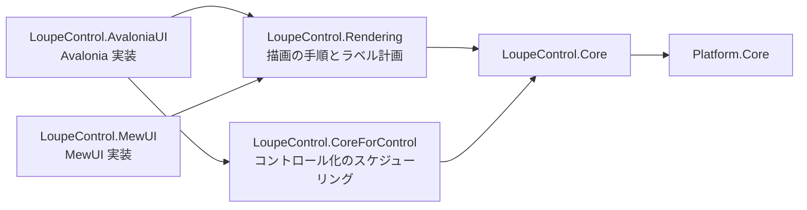
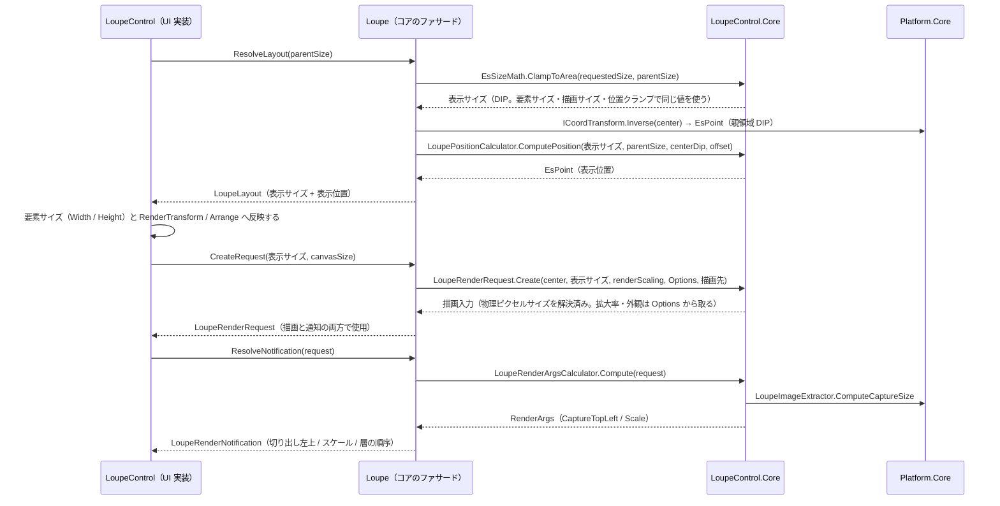

# LoupeControl.Core システム仕様書

## 概要

`LoupeControl.AvaloniaUI`（Avalonia UI 実装）と `LoupeControl.MewUI`（MewUI 実装）が共有する、UI フレームワーク非依存のルーペロジックを提供するライブラリです。SaveEvidence のマルチ UI 対応における「コントロールの Core / UI 分割」のパイロット実装（ティア E）です。

## 技術スタック

- .NET 10 / C# 14
- UI フレームワークは一切参照しない
- 外部パッケージへの直接依存なし（`Platform.Core` 経由で SkiaSharp を参照）

## アーキテクチャ

層の全体像（Core / Rendering / CoreForControl / UI）は [`src/README.md`](../README.md) を参照してください。

- `LoupeControl.Core` は UI フレームワークへ依存しません。依存は `Platform.Core` のみです。
- **描画の手順は UI 非依存の描画層（`LoupeControl.Rendering` の `LoupeRenderer`）が単一所有します**（描画先は `Platform.Core` の `IEsCanvas`。本プロジェクトは描画 API を持ちません）。
- **コントロール化にだけ必要な処理（再描画要求のバッチ化・世代番号管理）は `LoupeControl.CoreForControl` が所有します**（同層も UI フレームワークに依存せず、実行キューは UI がコールバックで注入します）。
- UI 実装は、コア型と自身の型（`Avalonia.Point` / `Size` / `IBrush`、`SKColor`）を相互変換します。変換は境界（サービス呼び出し・イベント引数の生成・描画）の 1 行に限定し、UI 側の状態・描画は UI の型のまま維持します。
- 設定（表示サイズ・拡大率・外観）は `LoupeOptions` が単一所有し、UI 層は本型を 1 プロパティとして公開するだけです（設定の既定値・補正も本型が持つ）。外観（装飾の値）は `LoupeAppearance` が単一所有し、UI 層は外観値を保持しません（描画時に読むだけ）。
- `LoupeOptions` / `LoupeAppearance` を含む**大部分の型を `public`** とします（外部が独自の UI アダプタを実装できるようにするため）。内部手順（配置計算・描画引数の計算）は `internal` とし、単体テストにのみ `InternalsVisibleTo`（`LoupeControl.Core.Tests`）で公開します。
- コントロール化に必要な型（`LoupeRenderCoordinator`）は `LoupeControl.CoreForControl` が `public` として提供します。

## コンポーネント構成

| ファイル | 内容 |
| --- | --- |
| `Loupe.cs` | **公開ファサード（操作の唯一の窓口）**。設定・環境値・中心・オフセットの保持、表示レイアウトの解決（`ResolveLayout`）、描画入力の生成（`CreateRequest`）、通知内容の解決（`ResolveNotification`）、描画実装の保持（`Renderer`。`ILoupeRenderer` 経由で委譲する）。`LoupeLayout` / `LoupeRenderNotification` の値型も本ファイルが所有する |
| `ILoupeRenderer.cs` | 描画の契約（描画内容 → 描画面の写像。**描画の差し替え点**。実装は描画層が提供する） |
| `LoupeOptions.cs` | ルーペの設定（表示サイズ・拡大率・外観）の単一所有（**public**）。既定値・生成時の補正（`init` アクセサ。設定経路によらず範囲内の値だけを保持する）・`Default` |
| `LoupeAppearance.cs` | ルーペの外観 12 項目（下地・市松模様・外枠・十字線・中心座標ラベル）の単一所有（**public**）。既定値・生成時の補正（`init` アクセサ。設定経路によらず範囲内の値だけを保持する）・`ShouldShowCoordLabel`・`Has*`（描画可否） |
| `LoupeValueCoercer.cs` | 数値パラメータの既定値・安全域（最小 / 最大）の単一所有と、範囲外の値のクランプ |
| `LoupeAppearanceScaler.cs` | 外観の寸法値（タイルサイズ・外枠の太さ）の物理ピクセル換算（補正は外観の生成時に済んでいるため再補正しない）。**中心座標ラベルは対象外**（DIP で配置するため） |
| `LoupeRenderRequest.cs` | 1 フレーム分の描画入力（コア⇔UI の契約）と、UI の DIP 値からの組み立て（`Create`） |
| `LoupeCoordLabel.cs` | 中心座標ラベルの描画契約（文言・**DIP** の寸法・色）と配置の計算（`ComputeFrame`。体裁は `EsLabelLayout`（Platform.Core）が単一所有する）。表示はコントロールがテキスト要素として行う |
| `LoupePositionCalculator.cs`（**internal**） | 表示位置（中心 + オフセット）の計算と親領域内へのクランプ、親サイズ未確定の判定。利用者はファサードの `ResolveLayout` を使う |
| `LoupeDecorationGeometry.cs` | 十字線（縦横 2 本）と外枠（4 辺）の描画矩形の計算 |
| `LoupeCheckerboard.cs` | 市松模様のタイルの明暗判定と、暗色タイルの**列挙子**（`ComputeDarkTiles`。リストを確保しない） |
| `LoupeRenderArgsCalculator.cs`（**internal**） | 描画完了イベント引数用の表示情報（切り出し左上・スケール）の計算と `RenderArgs` 値型。利用者はファサードの `ResolveNotification` を使う |
| `LoupeLogFormat.cs` | 設定値の変更ログが出力する値の文字列化 |
| `LoupeLogMessage.cs` | ログ定義（`LoggerMessage` ソース生成）の単一所有 |
| `Imaging/LoupeImageExtractor.cs` | 切り出し領域の一辺・左上（ドメイン座標）の計算、`EsBitmap` からの領域切り出し、拡大描画の矩形（`ComputeMagnifiedRects`。引数はビットマップの実寸） |

## データフロー

## 単一所有（Single Source of Truth）

| 計算 / 値 | 所有者 |
| --- | --- |
| ルーペの設定（表示サイズ・拡大率・外観）とその既定値 | `LoupeOptions` |
| 設定の数値項目の安全域への補正（生成時） | `LoupeOptions`（`init` アクセサ。規則は `LoupeValueCoercer` が単一所有する） |
| 設定の変更ログの差分検出（変化した項目だけを出力） | `LoupeLogMessage.LogOptionsChanged` |
| 装飾の外観（色・タイルサイズ・外枠の太さ・ラベル 4 項目）とその既定値 | `LoupeAppearance` |
| 下地（ベース）色とその既定値 | `LoupeAppearance.BackgroundColor`（描画層が最初に塗る） |
| 数値パラメータ（スカラー）の安全域とクランプ | `LoupeValueCoercer` |
| 外観の数値項目の安全域への補正（生成時） | `LoupeAppearance`（`init` アクセサ。規則は `LoupeValueCoercer` が単一所有する） |
| 描画の可否（アルファ 0 は描画しない） | `LoupeAppearance.Has*` |
| ラベル表示の可否（設定と中心の有無） | `LoupeAppearance.ShouldShowCoordLabel` |
| 切り出し領域の一辺（ドメインピクセル） | `Imaging.LoupeImageExtractor.ComputeCaptureSize`（internal。切り上げは `Platform.Core` の `IntMath.CeilDiv`） |
| 切り出し領域の左上（中心 → 左上の変換） | `Imaging.LoupeImageExtractor.ComputeCaptureTopLeft`（internal） |
| 拡大描画の矩形（切り出し元・描画先） | `Imaging.LoupeImageExtractor.ComputeMagnifiedRects`（ビットマップの実寸を受け取る） |
| 表示サイズの親領域へのクランプと表示サイズの決定 | `Loupe.ResolveLayout`（規則は `Platform.Core` の `EsSizeMath.ClampToArea`。状態を保持しないため、親領域のサイズを引数で受ける） |
| 表示位置（中心 + オフセットと親領域内へのクランプ） | `Loupe.ResolveLayout`（規則は internal の `LoupePositionCalculator.ComputePosition`。親サイズ未確定の判定は `EsSizeMath.HasArea`） |
| 描画入力（物理ピクセルサイズ）の組み立てと描画先へのクランプ | `Loupe.CreateRequest`（規則は internal の `LoupePositionCalculator.ResolvePixelSize`） |
| 描画完了通知の内容（切り出し左上・スケール・層の順序） | `Loupe.ResolveNotification`（規則は internal の `LoupeRenderArgsCalculator`。層の一覧は `Loupe` が静的共有する） |
| 中心座標ラベルの契約（文言・寸法・色）と表示可否 | `LoupeCoordLabel.Resolve`（文言は `CoordinateFormatter`、表示可否は `LoupeAppearance.ShouldShowCoordLabel`） |
| ラベルの既定の見た目（文字色 = 白、背景色 = 黒 60%、フォントサイズ = 12.0） | `EsLabelDefaults`（`Platform.Core`。マーキーと共有） |
| 十字線・外枠の矩形 | `LoupeDecorationGeometry` |
| ラベルの余白・背景矩形・文字原点 | `EsLabelLayout`（`Platform.Core`。内側余白の既定値は `EsLabelLayout.Padding`）。コアは使用する余白・オフセットだけを指定し、利用者は `LoupeCoordLabel.ComputeFrame` を使う |
| DIP → 物理ピクセルの変換（切り上げ・最低 1） | `Platform.Core` の `DpiScaler.ScaleToPixel` |
| 外観の寸法値の物理ピクセル換算（市松タイル・外枠の太さ・ラベル文字サイズ・角丸半径） | `LoupeAppearanceScaler` |
| ログの書式とレベル、変化判定（同値・同一インスタンスなら出力しない） | `LoupeLogMessage` / `LoupeLogFormat` |

`LoupeRenderArgsCalculator` / `LoupeImageExtractor.ExtractRegionAt`（internal）/ 描画層（`LoupeControl.Rendering`）の十字線・外枠描画はいずれも上記へ委譲し、同じ計算を二重に所有しません。

## 例外処理ポリシー

本プロジェクトは純粋計算と `EsBitmap` の操作で構成されます。例外を送出するのは `EsBitmap` の引数検証（`ArgumentOutOfRangeException`）と破棄後アクセス（`ObjectDisposedException`）のみです。`LoupeImageExtractor.ExtractRegionAt` は破棄済みソースに備え、例外の捕捉は呼び出し側（UI 実装）の責務とします。

## 可視性ポリシー

- 大部分の型・メンバーを `public` とします（UI 非依存の汎用ライブラリとして、外部の UI アダプタ実装を可能にするため）。内部手順は `internal` とし、単体テストにのみ `InternalsVisibleTo` で公開します。
- 可視性の変更（`public` → `internal`）は破壊的な設計変更として扱います。
- **UI 固有のログは各 UI プロジェクトが所有します**（中間ビットマップを生成する描画パイプライン固有のログは `LoupeControl.AvaloniaUI` の `LoupeRenderLog`）。

## テスト

- `src/LoupeControl.Core/tests`（`LoupeControl.Core.Tests`）が本プロジェクトのテストを持ちます。
- UI 初期化が不要なため、`[Fact]` / `[Theory]`（`AvaloniaFact` ではない）で並列実行されます。
- UI 依存の検証（コントロール生成・描画・`StyledProperty` の coerce 経由の反映・イベント発火）は `LoupeControl.AvaloniaUI.Tests`（Avalonia ヘッドレス・直列）が担います。

## 設計判断（UI 非依存の境界）

本プロジェクトの型は、UI フレームワークの型をシグネチャに持たないことを境界の条件としています。

| 判断 | 内容 |
| --- | --- |
| 座標・寸法の型 | コア（`EsUtil.Platform.Core.Geometry`）の `EsPoint` / `EsSize` / `EsRect` を使い、UI 型は境界で 1 行変換する |
| 画像の型 | 拡大元画像は UI ごとに型が異なるため契約（`LoupeRenderRequest`）に含めず、描画層が解決した `EsBitmap` を別引数で受け取る |
| 文字の描画 | コアは文言・外観・配置の基準だけを持ち、実寸 → 配置矩形の写像は描画層（`LoupeControl.Rendering` の `LoupeLabelPlan`）が、実寸測定と要素の配置は UI 層が行う（実寸は描画 API 依存のため） |
| 再描画のバッチ化 | UI のディスパッチャーに依存するため `LoupeControl.CoreForControl` が単一所有する（コアは同期計算のみ） |
| 色 | UI 非依存の `System.Drawing.Color` を使い、UI の色型への変換は境界で行う |
| 切り出し領域の左上 | `ExtractRegionAt` と描画完了通知の 2 経路で重複する計算を `LoupeImageExtractor.ComputeCaptureTopLeft`（internal）が単一所有する（切り出しと通知が同じ規則を使う） |
| ラベルの体裁 | 「背景 = 文字の実寸 + 内側余白 × 2」「文字原点 = 背景の左上 + 内側余白」「行送り」は特定のコントロールに依存しない規則のため、`Platform.Core` の `EsLabelLayout` が単一所有する（マーキーとルーペが同じ規則を共用する） |
| フォントサイズの安全域 | 6〜48 と「非数は既定値」は両コントロールで共通のため `EsLabelMetrics`（`Platform.Core`）が単一所有する |

## ライセンス

MIT License（全文は [`../../LICENSE`](../../LICENSE) を参照）。
