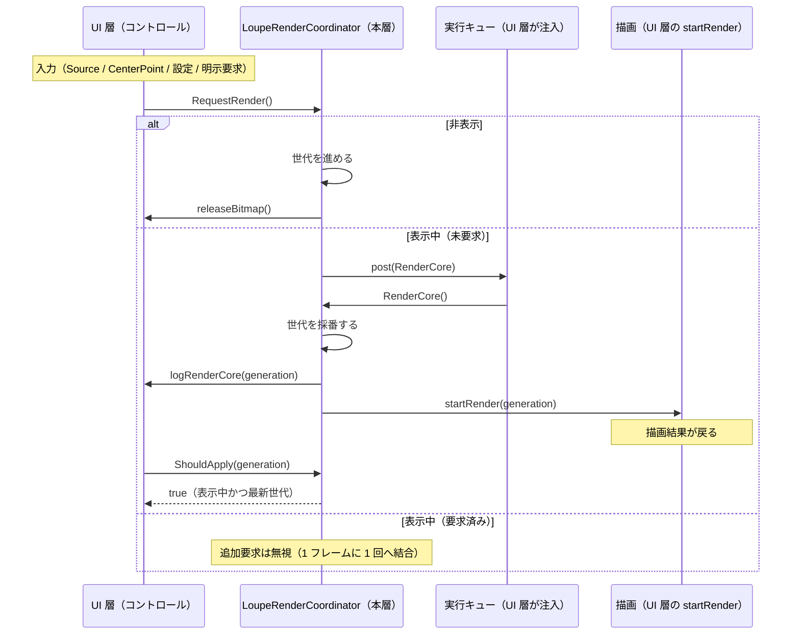

# LoupeControl.CoreForControl システム仕様書

## システム概要

`LoupeControl.CoreForControl` は、ルーペコントロール（`LoupeControl`）を**他の UI コントロールへ組み込むときにだけ必要な処理**を担う層です。具体的には「再描画要求のバッチ化と世代番号管理」だけを持ちます。

`Feature.LoupeCore`（表示レイアウト・描画入力・通知内容）と UI 層（フレームワーク固有の入力・描画・実行キュー）の間に位置し、両者が共有する**再描画のスケジューリング**を 1 箇所に集約します。UI フレームワークへ依存しないため、ヘッドレス実行なしで `[Fact]` 並列検証できます。

## 技術スタック

| 区分 | 採用技術 |
| --- | --- |
| 対象フレームワーク | .NET 10（`net10.0`） |
| 言語 | C# 14 |
| 依存 | **なし**（パッケージ・プロジェクト参照を持たない。実行キュー・ログ・描画はすべてコールバックで受け取る） |

## アーキテクチャ

### 依存方向（一方向を厳守）

層の全体像（Core / Rendering / CoreForControl / UI）は [`src/README.md`](../README.md) を参照してください。

```text
UI 層（LoupeControl.AvaloniaUI / LoupeControl.MewUI）
  入力の受付・効果の適用・通知の転送・描画先の用意・ラベル要素の配置
    ├──> LoupeControl.Rendering   どう描くか（描画 API の呼び出し手順。ILoupeRenderer を実装する）
    ├──> LoupeControl.CoreForControl ← 本プロジェクト   組み込み先がある場合にだけ必要な規則
    └──> Feature.LoupeCore   何を描くか + 判断（状態・値・純粋計算・コア⇔UI の契約）
           └──> Platform.Core（Es* 値型・ICoordTransform・IEsCanvas・EsLabelLayout）
※ Rendering と CoreForControl の間に依存はない（兄弟）。Core は Rendering / CoreForControl を参照しない。
※ 本層を使うのは LoupeControl.AvaloniaUI のみ（MewUI は中間ビットマップを持たず同期描画するため不要）。
```

MewUI 版は現状コーディネーターを使いません（中間ビットマップを持たずキャンバスへ直接描画するため、再描画のバッチ化が不要）。同じ必要が生じた時点で本層のコーディネーターを注入できます。

### 責務の分担

| 層 | 責務 |
| --- | --- |
| `Feature.LoupeCore` | 表示レイアウト・描画入力・通知内容の解決・ログ定義 |
| **本プロジェクト** | **再描画要求のバッチ化（1 フレーム 1 回）・世代番号管理・古い結果の破棄判定** |
| `LoupeControl.*UI` | フレームワークの入力・描画・実行キュー（`post`）の提供、ビットマップの生成と解放 |
| ホスト | 表示開始・拡大元画像の供給（中心座標ラベルはコントロールがテキスト要素として表示する） |

### 設計判断

| 判断 | 理由 |
| --- | --- |
| スケジューリングを Core ではなく本層に置く | 「いつ何回再描画するか」は UI へ組み込んで初めて問題になる。単体のルーペには再描画のスケジューリングという概念が無く、コアをそのまま独立できるよう本層へ分離する |
| `post` を必須引数にする | 実行キューと優先度（`DispatcherPriority.Render` 等）はフレームワーク固有である。既定値（Avalonia の Dispatcher）を持つと本層が UI へ依存してしまう |
| 表示状態・解放・描画開始をコールバックにする | コントロールの状態とリソースを本層が保持すると、UI コントロールに依存してしまう（テストも不可能になる） |
| 世代番号で古い結果を破棄する | 非同期の生成結果が到着した時点で表示が変わっている可能性があるため（順序保証は結果側で持つ） |

## コンポーネント構成

```text
src/LoupeControl.CoreForControl/
├── src/
│   └── LoupeRenderCoordinator.cs        再描画のスケジューリング（ファサード層）
└── tests/
    └── LoupeRenderCoordinator.Tests.cs  バッチ化・世代番号・適用判定・破棄と解放の検証
```

| コンポーネント | 責務 |
| --- | --- |
| `LoupeRenderCoordinator` | 要求のバッチ化、世代番号の採番、古い結果の破棄判定、要求の破棄と解放。ビットマップと表示状態は保持しない |

## データフロー（再描画）



## 単一所有（Single Source of Truth）

| 値 / 判断 | 所有者 |
| --- | --- |
| 再描画要求の結合（1 フレームに 1 回） | `LoupeRenderCoordinator.RequestRender` |
| 再描画の世代番号と、古い結果を破棄する判断 | `LoupeRenderCoordinator.RenderCore` / `ShouldApply` |
| 要求の破棄とビットマップ解放の手順 | `LoupeRenderCoordinator.CancelAndRelease` |
| 実行キューと優先度 | UI 層（`post` コールバックの実装） |
| 描画の内容（切り出し・拡大・市松・十字線・外枠） | `Feature.LoupeCore` と描画層（`LoupeControl.Rendering` の `LoupeRenderer`） |

## 例外処理ポリシー

| 条件 | 動作 |
| --- | --- |
| いずれかのコールバックが null | `ArgumentNullException` を送出する（配線の誤りを早期に検出する） |
| 要求が取り消された後に `RenderCore` が呼ばれる | 何もしない（防御分岐） |
| 非表示状態で `CancelAndRelease` を繰り返す | 解放をその都度呼ぶ（解放自体が冪等であることを前提にする） |
