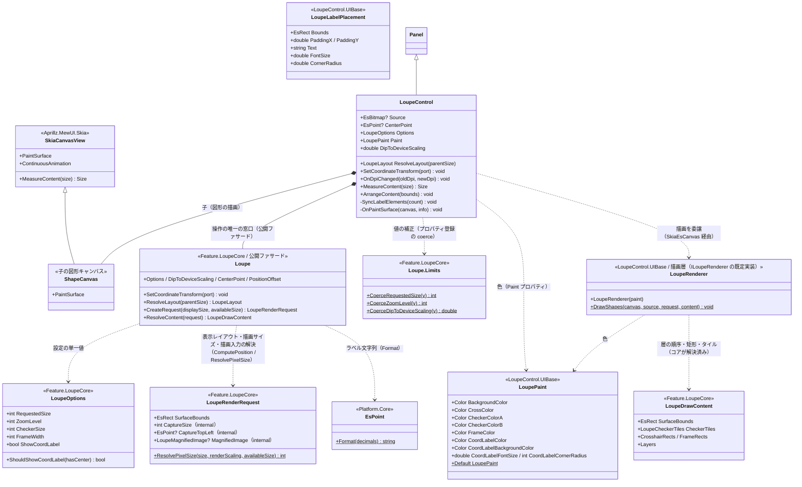
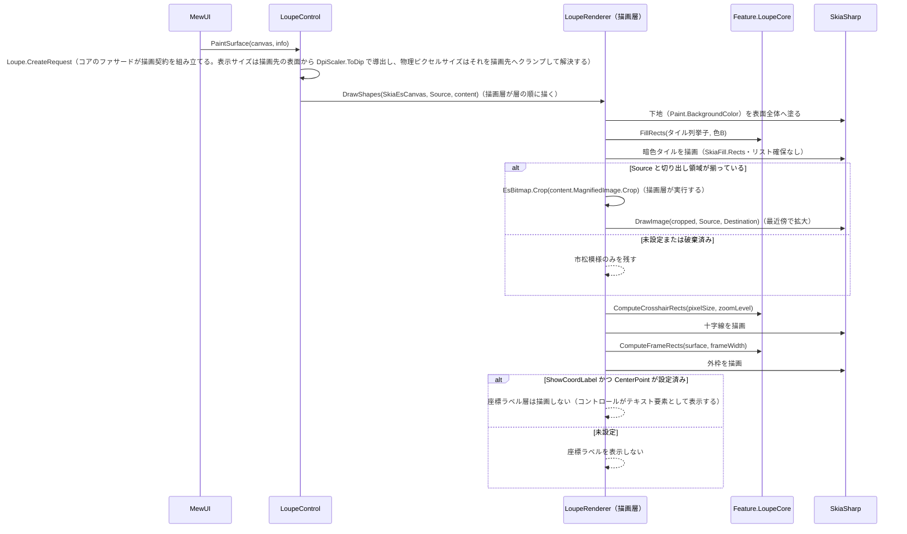

# LoupeControl.MewUI システム仕様書

`LoupeControl`（MewUI 版ルーペ）のシステム概要・アーキテクチャ・依存関係・設計判断を記載します。

## システム概要

`LoupeControl.MewUI` は、Avalonia 版 `LoupeControl` と**同一の UI 非依存コア（`Feature.LoupeCore`）と描画層（`LoupeControl.UIBase`）** を使い、
描画ポートの適合（`SkiaEsCanvas`）と入力の受付のみを MewUI（SkiaSharp）で実装したルーペコントロールです。

コアが担う範囲（数値の安全域補正・切り出し領域の計算・装飾矩形の計算）は両 UI で完全に共通であり、
本プロジェクトはその計算結果をキャンバスへ描画するだけです。
これにより **UI ごとの見た目の差を作らずに済み**、UI 追加時の再実装は描画 API の呼び出しのみになります。

## 技術スタック

| 区分 | 採用技術 |
| --- | --- |
| 対象フレームワーク | .NET 10（`net10.0`） |
| 言語 | C# 14 |
| UI フレームワーク | MewUI（`Aprillz.MewUI.Skia` **0.21.1 固定**） |
| 描画 | SkiaSharp（描画層 `LoupeControl.UIBase` が描画ポート `SkiaEsCanvas` 経由で描く） |
| 基底コントロール | `Aprillz.MewUI.Controls.Panel`（図形は子の `SkiaCanvasView` が描画する） |
| プロパティシステム | `MewProperty<T>`（`MewPropertyOptions.AffectsRender` / `AffectsLayout`） |

## アーキテクチャ

### 依存方向（一方向を厳守）

層の全体像（Core / UIBase / UI）は [`src/README.md`](../README.md) を参照してください。

```text
UI 層（LoupeControl.AvaloniaUI / LoupeControl.MewUI）
  入力の受付・効果の適用・通知の転送・描画先の用意・ラベル要素の配置
    ├──> LoupeControl.UIBase   どう描くか（UIBase の ILoupeRenderer を実装する）
    ├──> LoupeControl.UIBase   組み込み先がある場合にだけ必要な規則
    └──> Feature.LoupeCore   何を描くか + 判断（状態・値・純粋計算・コア⇔UI の契約）
           ├──> Common（IEsCanvas・IEsRectWalker）
           └──> Platform.Core（Es* 値型・ICoordTransform）
※ Core は UIBase を参照しない（本層の描画実装がコアの契約を実装する向きだけ）。
```

Avalonia 版と MewUI 版の間に依存はありません（互いを参照しません）。
両者に共通する計算は必ず `Feature.LoupeCore` を経由します。

### 責務の分担

| 層 | 責務 |
| --- | --- |
| `Feature.LoupeCore` | 数値の安全域補正、切り出し領域の計算、切り出し、十字線・外枠の矩形計算、市松模様の明暗判定、寸法・表示可否（`LoupeOptions`）と描画入力（`LoupeRenderRequest`）の単一所有 |
| `LoupeControl.UIBase` | 描画の手順（層の順序と描画ポートへの写し方）とラベル計画（実寸 → ラベル要素の配置）。UI 非依存であり、UI フレームワークを参照しない |
| `LoupeControl.MewUI` | コアの描画入力を描画層（`LoupeRenderer`）へ渡し、描画ポート `SkiaEsCanvas` を適合させる。`MewProperty` による入力の受付。DPI の自動追従 |
| ホスト（`app.MewUI` 等） | `Source` / `CenterPoint` の設定、表示位置の決定（コアのファサード `ResolveLayout` を利用） |

## コンポーネント構成

```text
src/LoupeControl.MewUI/
├── src/
│   ├── LoupeControl.cs         MewProperty の定義・DPI 追従・描画の起動（SkiaEsCanvas の適合）
│   └── LoupeRenderedEventArgs.cs  描画完了の通知引数（中心座標ラベルはコントロールが表示する）
└── tests/
    ├── TestHelper.cs                テスト用の描画先（SKBitmap + SKCanvas）・画像生成・setter を経由しない設定
    ├── RecordingLogger.cs           ログ収集
    ├── LoupeRenderedEventArgs.Tests.cs      イベント引数の保持
    └── LoupeControl.Tests.cs        プロパティ補正・レイアウト・全設定経路の補正・ログ・要求サイズ
```

| コンポーネント | 責務 |
| --- | --- |
| `LoupeControl` | 入力プロパティ（`MewProperty`）の定義（補正と変更ログもここへ登録する）、DPI 変更の追従、子（図形キャンバス・ラベル要素）の計測と配置、ラベル要素（`Border` + `TextBlock`）の追加・更新。描画は描画層（`LoupeRenderer`）を `SkiaEsCanvas` 経由で呼ぶ（描画の順序と内容は描画層が単一所有し、コアは描く層とその順序を指示する） |
| `LoupeRenderer`（描画層） | 下地 → 市松模様 → 拡大画像 → 十字線 → 外枠の順に描画ポートへ写す（コアの描画内容 `LoupeDrawContent`（層の順序・矩形・タイル・拡大画像の切り出しと描画の矩形）をそのまま使用）。**色は `LoupePaint` が単一所有する**（コントロールの `Paint` プロパティの値を受け取る）。**描く層とその順序はコアが単一所有する**（`LoupeDrawLayer` を先頭から処理し、中心座標ラベルは処理しない） |
| `LoupeRenderTarget`（テスト） | ウィンドウ不要の描画先。`SKBitmap` と `SKCanvas` を保持し、画素を読み取る |

## クラス図



## シーケンス図（描画）



## 設計判断

1. **中間ビットマップを持たない**。Avalonia 版は `RenderTargetBitmap` に描いて `EsBitmap` へコピーするが、
   MewUI 版は `SkiaCanvasView` のキャンバスへ直接描画する（コピーとメモリ確保を排除）。
2. **拡大は最近傍で行う**。ルーペは画素をそのまま拡大する用途であり、補間すると画素が判別できなくなる。
3. **装飾矩形と市松模様の明暗判定はコアが単一所有する**。両 UI で同じ見た目を保証するため、
   Avalonia 版と MewUI 版は同じコアの計算を使う（描画の手順そのものも UI 非依存の描画層 `LoupeControl.UIBase` が共有する）。
4. **設定（表示サイズ・拡大率・寸法）はコアの `LoupeOptions` が単一所有し、色は描画層の `LoupePaint` が単一所有する**。UI 層は `Options` と `Paint` を公開して描画時に読むだけであり、既定値・数値項目の補正もコアが持つ。
   描画の可否（アルファ 0）は `LoupePaint.Has*` が、ラベルの余白（寸法）はコアが判断・所有するため、両 UI の見た目が一致する
   （従来は Avalonia が既定で十字線を描き MewUI は描かないという既定値のドリフトがあった）。
5. **位置を持たない**。表示位置は「親領域サイズ」「中心座標」「オフセット」に依存するホスト側の関心事であり、
   計算はコアの公開ファサード（`Loupe.ResolveLayout`）が単一所有する。コントロールは入力と描画のみを担う。
6. **DPI を自動追従させる**。`OnDpiChanged` で `DipToDeviceScaling` を更新し、ホストが DPI を扱わずに済むようにした。
7. **`Options` はレイアウトにも影響する**。`MeasureContent` が要求サイズを返すため、
プロパティへ `MewPropertyOptions.AffectsLayout` を付与して再測定を促す（未付与では変更が反映されない）。
描画サイズは `Options.RequestedSize` × `DipToDeviceScaling` を物理ピクセルへ換算し、キャンバスより大きい場合はキャンバスに合わせる
   （「領域へクランプする」規則と DIP → 物理ピクセルの換算はコアのファサード（`Loupe.ResolveLayout` / `Loupe.CreateRequest`）が単一所有し、Avalonia 版の親パネルへのクランプと同じ規則を使う）。
8. **静的画像では連続再描画を無効化する**。`ContinuousAnimation` を `false` にし、プロパティ変更時のみ再描画する。
9. **座標ラベルはコントロールがテキスト要素として表示する**（両 UI 共通）。文言・表示可否・基準点はコア（`LoupeTextPlacement`）が、体裁（フォントサイズ・色・角丸）は描画の設定（`Paint`）が単一所有し、コントロールは `LoupeLabelPlan`（描画層 `LoupeControl.UIBase`）へ自 UI の実寸（`SkiaText.Measure`）を渡して要素を配置する（ラベル要素は子の末尾に置かれ、子は親より後に描かれるため常に最上位）。Avalonia 版も同じ契約を使い、測定 API（`FormattedText`）だけが異なる。
10. **値の補正と変更ログはプロパティの登録が所有する**。`MewProperty.Register` の `coerce` / `changed` へ渡すため、
   setter を経由しない設定（バインディング等）でも安全域が保たれ、変更が記録される
   （Avalonia 版の `coerce` コールバック + `Changed` クラスハンドラと同じ契約。規則と書式はコアが単一所有する）。
設定（`Options`・`Options`）の数値項目はコアの型が、描画の設定（`Paint`）の数値項目は描画層の型が生成時に補正するため、コントロールは `coerce` を登録しない（環境値の `DipToDeviceScaling` のみ登録する）。

## テスト方針

| 対象 | 方針 |
| --- | --- |
| `LoupeRenderer`（描画層） | `SKBitmap` + `SKCanvas`（`SkiaEsCanvas` 経由）へ実際に描画し、**画素を実測**して検証する（ウィンドウ不要で並列実行できる。検証は `LoupeControl.UIBase` のテストが担う） |
| `LoupeControl` | `MewProperty` の補正・既定値・要求サイズを検証する（MewUI の要素生成はホスト登録を要しない） |
| コアロジック | `Feature.LoupeCore.Tests` が担保する（本プロジェクトでは再検証しない） |
| アプリ組み込み | `app.MewUI/verify-ui.ps1` が実機の画素を実測して検証する |

## 未実装・今後の対応

| 項目 | 内容 |
| --- | --- |
| 座標変換ポート | 実装済み（`SetCoordinateTransform`。ホストが設定し、コントロールはファサードへ転送する。Avalonia 版と同じ API） |
| 再生成の要求メソッド | `Clear` / `RequestRender` 相当（現在はプロパティ変更で自動再描画） |
| 座標ラベル以外の文字描画 | 日本語のフォントフォールバック（ラベルは `MarqueeControl.MewUI`（選択矩形の外側の装飾）側で対応済み。本コントロールの座標ラベルは数値のみのため未適用） |

## ログ

設定変更を Debug、描画の例外を Error で記録します（Avalonia 版と同一の書式）。

| レベル | 出力元 |
| --- | --- |
| Debug | `Source` / `CenterPoint` / `RequestedSize` / `DipToDeviceScaling` / `ZoomLevel` の変更（補正後の値を渡す。変化判定（同一値・同一インスタンスなら出力しない）は出力する主体のログ定義（Source は `LoupeControl.UIBase` の `LoupeUiLogMessage`、他はコアの `LoupeLogMessage`）が単一所有し、UI 層は設定の前後を渡すだけ。設定の変更は変化した項目だけを出力する） |
| Error | 描画処理の例外（アプリを落とさずログへ記録して描画を中止する） |

Avalonia 版の Trace ログ（再描画パイプライン）は持ちません（MewUI 版は中間ビットマップを作らず同期描画するため）。  
出力先は `Log` プロパティへ注入します（既定は `NullLogger`）。
