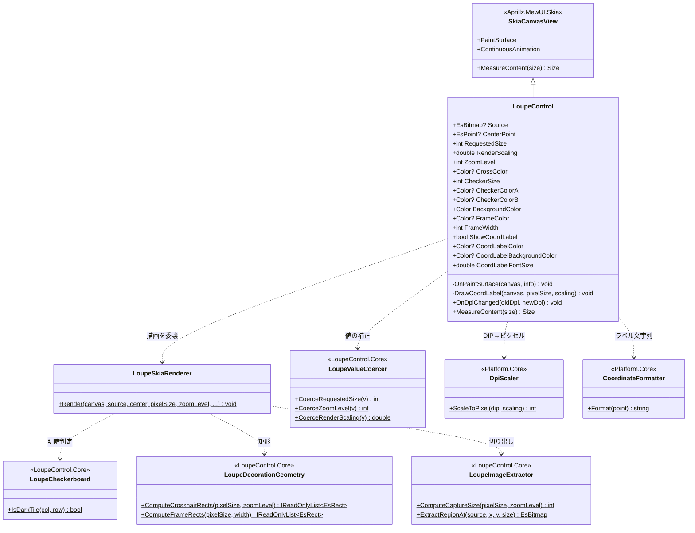
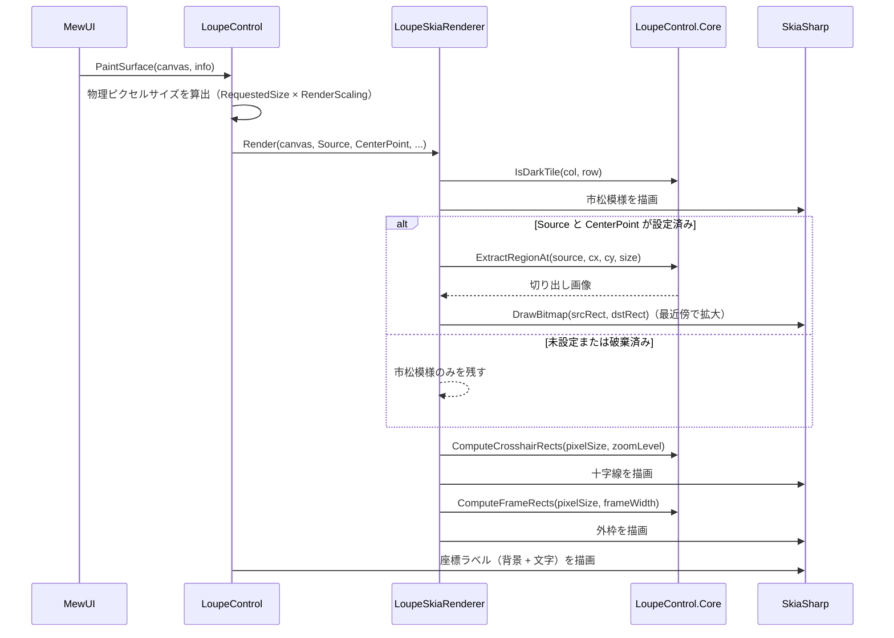

# LoupeControl.MewUI システム仕様書

`LoupeControl`（MewUI 版ルーペ）のシステム概要・アーキテクチャ・依存関係・設計判断を記載します。

## システム概要

`LoupeControl.MewUI` は、Avalonia 版 `LoupeControl` と**同一の UI 非依存コア（`LoupeControl.Core`）** を使い、
描画層のみを MewUI（SkiaSharp）で実装したルーペコントロールです。

コアが担う範囲（数値の安全域補正・切り出し領域の計算・装飾矩形の計算）は両 UI で完全に共通であり、
本プロジェクトはその計算結果をキャンバスへ描画するだけです。
これにより **UI ごとの見た目の差を作らずに済み**、UI 追加時の再実装は描画 API の呼び出しのみになります。

## 技術スタック

| 区分 | 採用技術 |
| --- | --- |
| 対象フレームワーク | .NET 10（`net10.0`） |
| 言語 | C# 14 |
| UI フレームワーク | MewUI（`Aprillz.MewUI.Skia` **0.21.1 固定**） |
| 描画 | SkiaSharp（`SKCanvas` へ直接描画する） |
| 基底コントロール | `Aprillz.MewUI.Skia.Controls.SkiaCanvasView` |
| プロパティシステム | `MewProperty<T>`（`MewPropertyOptions.AffectsRender` / `AffectsLayout`） |

## アーキテクチャ

### 依存方向（一方向を厳守）

```text
┌──────────────────────┐        ┌────────────────────────┐
│  LoupeControl.MewUI  │        │      LoupeControl      │
│ （MewUI の描画層）   │        │ （Avalonia の描画層）  │
└──────────┬───────────┘        └───────────┬────────────┘
           │                                │
           └────────────┬───────────────────┘
                        ▼
              ┌────────────────────┐
              │  LoupeControl.Core │  コアロジック（単一所有）
              └─────────┬──────────┘
                        ▼
              ┌────────────────────┐
              │   Platform.Core    │  コア幾何型・DPI 変換
              └────────────────────┘
```

Avalonia 版と MewUI 版の間に依存はありません（互いを参照しません）。
両者に共通する計算は必ず `LoupeControl.Core` を経由します。

### 責務の分担

| 層 | 責務 |
| --- | --- |
| `LoupeControl.Core` | 数値の安全域補正、切り出し領域の計算、切り出し、十字線・外枠の矩形計算、市松模様の明暗判定 |
| `LoupeControl.MewUI` | コアの計算結果を `SKCanvas` へ描画する。`MewProperty` による入力の受付。DPI の自動追従 |
| ホスト（`app.MewUI` 等） | `Source` / `CenterPoint` の設定、表示位置の決定（コアの `LoupePositionCalculator` を利用） |

## コンポーネント構成

```text
src/LoupeControl.MewUI/
├── src/
│   ├── LoupeControl.cs          MewProperty の定義・DPI 追従・描画の起点・座標ラベル
│   └── LoupeSkiaRenderer.cs     コアの計算結果を SKCanvas へ描画する（市松・画像・十字線・外枠）
└── tests/
    ├── TestHelper.cs                テスト用の描画先（SKBitmap + SKCanvas）と画像生成
    ├── LoupeSkiaRenderer.Tests.cs   描画結果の画素検証（11 件）
    └── LoupeControl.Tests.cs        プロパティ補正・レイアウト（14 件）
```

| コンポーネント | 責務 |
| --- | --- |
| `LoupeControl` | 入力プロパティ（`MewProperty`）の定義、DPI 変更の追従、`PaintSurface` から描画を開始、座標ラベルの描画 |
| `LoupeSkiaRenderer` | 下地 → 市松模様 → 拡大画像 → 十字線 → 外枠の順に描画する（コアの矩形計算をそのまま使用） |
| `LoupeRenderTarget`（テスト） | ウィンドウ不要の描画先。`SKBitmap` と `SKCanvas` を保持し、画素を読み取る |

## クラス図



## シーケンス図（描画）



## 設計判断

1. **中間ビットマップを持たない**。Avalonia 版は `RenderTargetBitmap` に描いて `EsBitmap` へコピーするが、
   MewUI 版は `SkiaCanvasView` のキャンバスへ直接描画する（コピーとメモリ確保を排除）。
2. **拡大は最近傍で行う**。ルーペは画素をそのまま拡大する用途であり、補間すると画素が判別できなくなる。
3. **装飾矩形と市松模様の明暗判定をコアへ移した**。両 UI で同じ見た目を保証するため、
   Avalonia 版の `LoupeDecorationRenderer` / `LoupeBackgroundRenderer` はコアへ委譲する形に変更した（二重所有の解消）。
4. **位置を持たない**。表示位置は「親領域サイズ」「中心座標」「オフセット」に依存するホスト側の関心事であり、
   計算はコアの `LoupePositionCalculator` が単一所有する。コントロールは入力と描画のみを担う。
5. **DPI を自動追従させる**。`OnDpiChanged` で `RenderScaling` を更新し、ホストが DPI を扱わずに済むようにした。
6. **`RequestedSize` はレイアウトにも影響する**。`MeasureContent` が要求サイズを返すため、
   プロパティへ `MewPropertyOptions.AffectsLayout` を付与して再測定を促す（未付与では変更が反映されない）。
7. **静的画像では連続再描画を無効化する**。`ContinuousAnimation` を `false` にし、プロパティ変更時のみ再描画する。

## テスト方針

| 対象 | 方針 |
| --- | --- |
| `LoupeSkiaRenderer` | `SKBitmap` + `SKCanvas` へ実際に描画し、**画素を実測**して検証する（ウィンドウ不要で並列実行できる） |
| `LoupeControl` | `MewProperty` の補正・既定値・要求サイズを検証する（MewUI の要素生成はホスト登録を要しない） |
| コアロジック | `LoupeControl.Core.Tests` が担保する（本プロジェクトでは再検証しない） |
| アプリ組み込み | `app.MewUI/verify-ui.ps1` が実機の画素を実測して検証する |

## 未実装・今後の対応

| 項目 | 内容 |
| --- | --- |
| 座標変換ポート | Avalonia 版の `SetCoordinateTransform` 相当（ホストが `LoupePositionCalculator` を使う形で代替中） |
| 再描画の要求メソッド | `Clear` / `ForceUpdate` 相当（現在はプロパティ変更で自動再描画） |
| 座標ラベル以外の文字描画 | 日本語のフォントフォールバック（ラベルは `FadeMaskControl.MewUI` 側で対応済み。本コントロールの座標ラベルは数値のみのため未適用） |

## ログ

設定変更を Debug、描画の例外を Error で記録します（Avalonia 版と同一の書式）。

| レベル | 出力元 |
| --- | --- |
| Debug | `Source` / `CenterPoint` / `RequestedSize` / `RenderScaling` / `ZoomLevel` の変更（補正後の値で記録。同一値なら出力しない） |
| Error | 描画処理の例外（アプリを落とさずログへ記録して描画を中止する） |

Avalonia 版の Trace ログ（再描画パイプライン）は持ちません（MewUI 版は中間ビットマップを作らず同期描画するため）。<br/>
出力先は `Log` プロパティへ注入します（既定は `NullLogger`）。
