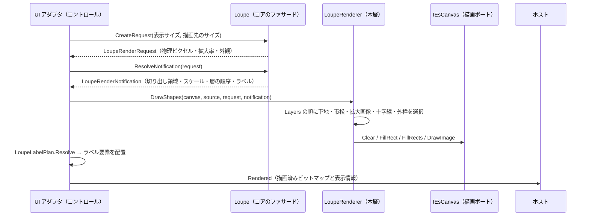
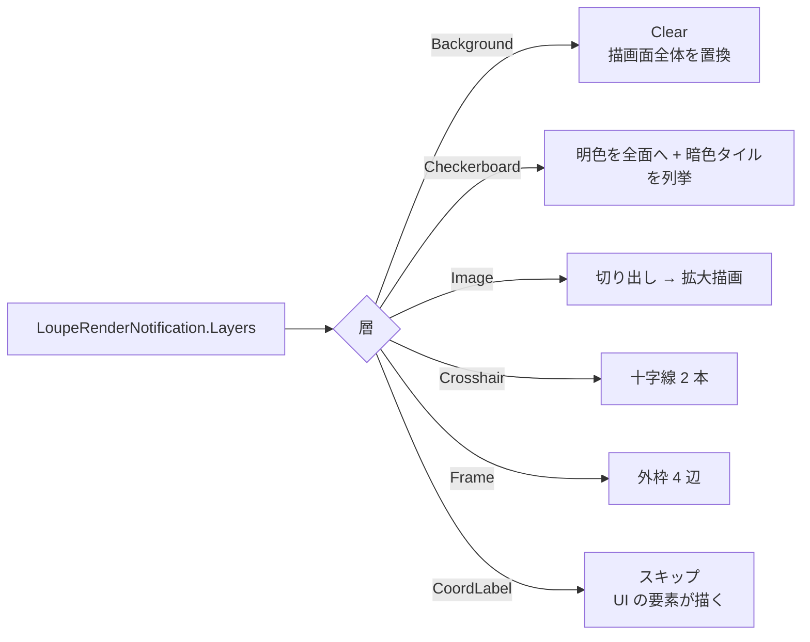

# LoupeControl.Rendering システム仕様書

`LoupeControl.Rendering`（`LoupeControl` の UI 非依存の描画層）の構造・依存・例外処理・コンポーネント構成を記載します。外部機能と公開 API は [SPEC_ExtFunc](SPEC_ExtFunc.md)、利用手順は [README](README.md) を参照してください。

## 1. システム概要

| 項目 | 内容 |
| --- | --- |
| 目的 | 描画 API の呼び出し手順（層の順序と写し方）を 1 箇所へ集約し、UI の追加・描画方式の変更を描画ポートの実装だけで済ませる |
| 提供形態 | クラスライブラリ（`LoupeControl.Rendering.dll`） |
| 想定利用者 | UI 実装（`LoupeControl.AvaloniaUI` / `LoupeControl.MewUI`）・独自コントロールの実装者 |
| 汎用性 | 特定のアプリ・UI に依存しない。色・寸法を持たない（コアの契約が単一所有する） |

## 2. 技術スタック

| 項目 | 内容 |
| --- | --- |
| ターゲット | `net10.0` |
| 言語 | C# 14（`Nullable` 有効・`ImplicitUsings` 有効） |
| ルート名前空間 | `EsUtil.SaveEvidence.Loupe.Rendering` |
| ドキュメント生成 | `GenerateDocumentationFile` 有効（XML は配布物へ出さず `cref` の検証のみに使う） |
| テスト | xUnit v3（UI 初期化不要。描画は Skia のビットマップ上で画素検証する） |

## 3. アーキテクチャ

### 3.1 依存方向（一方向）

層の全体像（Core / Rendering / CoreForControl / UI）は [`src/README.md`](../README.md) を参照してください。

```text
UI 層（LoupeControl.AvaloniaUI / LoupeControl.MewUI）
  入力の受付・効果の適用・通知の転送・描画先の用意・ラベル要素の配置
    ├──> LoupeControl.Rendering ← 本プロジェクト   どう描くか（描画 API の呼び出し手順。ILoupeRenderer を実装する）
    ├──> LoupeControl.CoreForControl   組み込み先がある場合にだけ必要な規則
    └──> Feature.LoupeCore   何を描くか + 判断（状態・値・純粋計算・コア⇔UI の契約）
           └──> Platform.Core（Es* 値型・ICoordTransform・IEsCanvas・EsLabelLayout）
※ Rendering と CoreForControl の間に依存はない（兄弟）。Core は Rendering / CoreForControl を参照しない。
```

- 上位層は下位層のみを参照します（逆参照なし）。
- 本層は UI フレームワークを参照しません（描画 API は `IEsCanvas` 経由）。
- コアは本層を参照しません（**コアは「何を描くか」、本層は「どう描くか」**）。

### 3.2 データフロー



### 3.3 層の処理



## 4. コンポーネント構成

| ファイル | 型 | 責務 |
| --- | --- | --- |
| `src/LoupeRenderer.cs` | `LoupeRenderer` | 描画入力と層の順序（通知）を描画ポートへ写す（`ILoupeRenderer` の既定実装。`Default` で共有する）。図形の層とラベルの層を分けて提供する |
| `src/LoupeLabelPlan.cs` | `LoupeLabelPlan` | 通知と実寸からラベル要素の配置指示を解決する |

## 5. 単一所有（同じ真実を 2 箇所に持たない）

| 対象 | 所有者 |
| --- | --- |
| 描画する層とその順序 | `Loupe.ResolveLayers`（コア。本層は順に写すだけ） |
| 描画可否（透明色は描かない・ソース未解決なら描かない） | コア（`LoupeAppearance.Has*`。判定は `DrawingColorExtensions.IsVisible` が単一所有する / `LoupeImageExtractor.TryExtractRegionAt`） |
| 切り出し領域と拡大の矩形 | コア（`LoupeImageExtractor`） |
| 市松模様のタイル位置とタイル数 | コア（`LoupeCheckerboard`。リストを確保しない列挙子で渡す） |
| 十字線・外枠の矩形 | コア（`LoupeDecorationGeometry`） |
| 外観の DIP → 物理ピクセル換算 | コア（`LoupeAppearanceScaler`） |
| 描画先のサイズ決定（クランプ） | コア（`LoupePositionCalculator.ResolvePixelSize`） |
| ラベルの文言・色・フォントサイズ | コア（`LoupeCoordLabel` / `LoupeAppearance`） |
| ラベルの体裁（背景・文字原点） | `Platform.Core`（`EsLabelLayout`） |
| 描画 API の呼び出し（背景 → 文字の順序） | `Platform.Core`（`SkiaLabel` / `IEsCanvas.DrawLabel`） |

## 6. 例外処理ポリシー

| 状況 | 扱い |
| --- | --- |
| `canvas` が null | `ArgumentNullException`（呼び出し側の実装誤り） |
| `layers` が null | `ArgumentNullException` |
| `source` が null / 中心未設定 | 拡大画像を描かない（例外ではない。市松模様のみになる） |
| `source` が破棄済み | コア（`LoupeImageExtractor`）が `ObjectDisposedException` を吸収して null を返す（例外を描画層へ伝播させない） |
| `measureText` が null | `ArgumentNullException` |
| 背景色が透明 | 描画面を透明で置き換える（前フレームの残像を残さない） |

## 7. 可視性ポリシー

- すべて `public` です（UI 実装・独自コントロールの作者が参照する API のみで構成されるため、internal にする対象がない）。
- `[EditorBrowsable]` による「見えにくくする」対処は行いません（公開面も契約も変わらないため）。

## 8. テスト方針

| 方針 | 内容 |
| --- | --- |
| UI 初期化不要 | 描画は `SkiaEsCanvas`（UI 非依存）で行い、ビットマップの画素を検証する |
| 検証点 | 描画手順の唯一の検証点である（UI 側はアダプタのみを持つため、UI ごとの描画テストは不要） |
| 合計 | 21 件 |

```powershell
dotnet test src/LoupeControl.Rendering/tests/LoupeControl.Rendering.Tests.csproj
```

## 9. ライセンス

MIT License（全文は [`../../LICENSE`](../../LICENSE) を参照）。
