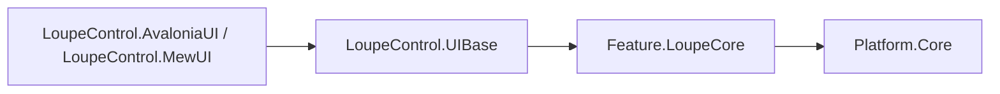
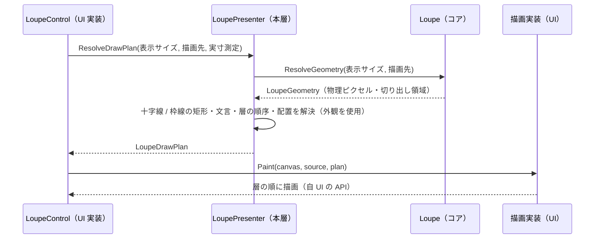

# LoupeControl.UIBase システム仕様書

`LoupeControl`（拡大鏡）をコントロールとして成り立たせる **UI 非依存の共有層**の構造・依存・例外処理・設計判断を記載します。外部機能と公開 API は [SPEC_ExtFunc](SPEC_ExtFunc.md)、利用手順は [README](README.md) を参照してください。

## 1. システム概要

| 項目 | 内容 |
| --- | --- |
| 目的 | 「どう見せるか」（描画計画と外観）を 1 箇所に集約し、UI ごとの実装差から切り離す |
| 提供形態 | クラスライブラリ（`LoupeControl.UIBase.dll`） |
| 想定利用者 | UI 実装（`LoupeControl.AvaloniaUI` / `LoupeControl.MewUI`） |
| 汎用性 | 特定のアプリに依存しない（描画 API の抽象も持たないため、UI フレームワーク非依存） |

## 2. 技術スタック

| 項目 | 内容 |
| --- | --- |
| ターゲット | `net10.0` |
| 言語 | C# 14（`Nullable` 有効・`ImplicitUsings` 有効） |
| ルート名前空間 | `EsUtil.SaveEvidence.Loupe.UIBase` |
| ドキュメント生成 | `GenerateDocumentationFile` 有効（`cref` の検証のみ） |
| テスト | xUnit v3（UI 初期化不要。`InternalsVisibleTo` で `internal` を検証する） |
| 依存 | `Feature.LoupeCore` と `Platform.Core` のみ（UI フレームワーク・SkiaSharp を参照しない） |

## 3. アーキテクチャ

### 3.1 依存方向



- 本層は UI フレームワークを参照しません（**描画 API の抽象も持ちません**）。
- コアは本層を参照しません（本層がコアの幾何を使う向きだけ）。

### 3.2 データフロー（描画計画 → 描画）



## 4. コンポーネント構成

| ファイル | 型 | 可視性 | 責務 |
| --- | --- | --- | --- |
| `src/LoupePresenter.cs` | `LoupePresenter` | public | 提示のファサード。コアのラップ、外観の保持、描画計画（`ResolveDrawPlan`）と表示レイアウト（`ResolveLayout`）の解決、層の組合せ表の単一所有 |
| `src/LoupeAppearance.cs` | `LoupeAppearance` | public | 外観（色・フォント・角丸・枠線の太さ・表示可否）の単一所有と補正 |
| `src/LoupeDrawPlan.cs` | `LoupeDrawPlan` | public | 描画計画の値（UI が見る唯一の描画値） |
| `src/LoupeDrawLayer.cs` | `LoupeDrawLayer` | public | 描画層と順序の単一所有 |
| `src/LoupeTextPlacement.cs` | `LoupeTextPlacement` | public | 文言・基準点・アライン・描画領域 |
| `src/LoupeLabelPlacement.cs` | `LoupeLabelPlacement` | public | ラベル要素の配置指示 |
| `src/LoupeLabelPlan.cs` | `LoupeLabelPlan` | public | 実寸 → 配置指示の写像（アラインの適用とクランプの単一所有） |
| `src/LoupeLabelTexts.cs` | `LoupeLabelTexts` | internal | 文言（`EsPoint.Format`）と基準点（上端中央）の生成 |
| `src/LoupeDecorationGeometry.cs` | `LoupeDecorationGeometry` | internal | 十字線（縦横 2 本）と枠線（4 辺）の矩形の計算 |
| `src/LoupeMetricsScaler.cs` | `LoupeMetricsScaler` | internal | 枠線の太さの物理ピクセル換算 |
| `src/LoupeUiLogMessage.cs` | `LoupeUiLogMessage` | public | UI が出力するログ定義（ソース生成） |
| `src/LoupeLogFormat.cs` | `LoupeLogFormat` | public | UI が出すログの書式 |

## 5. 単一所有（同じ真実を 2 箇所に持たない）

| 計算 / 値 | 所有者 |
| --- | --- |
| 外観（色・フォント・角丸・枠線の太さ・表示可否）とその既定値 | `LoupeAppearance` |
| 枠線の太さの安全域への補正 | `LoupeAppearance`（`init` アクセサ。規則は `Loupe.Limits`） |
| 描画層とその順序 | `LoupeDrawPlan.Layers`（組合せ表は `LoupePresenter` が事前生成する） |
| 描く層の選択（描く値がある層だけを含める） | `LoupePresenter.ResolveLayers` |
| 十字線・枠線の矩形 | `LoupeDecorationGeometry` |
| 枠線の太さの物理ピクセル換算 | `LoupeMetricsScaler` |
| 中心座標ラベルの文言と基準点 | `LoupeLabelTexts` |
| ラベルの背景矩形・文字原点（実寸 + 余白、アライン、クランプ） | `LoupeLabelPlan` |
| 描画完了通知の組み立てに使う値の選択 | `LoupeDrawPlan`（コアの幾何から写す） |
| UI が出力するログの書式・レベル | `LoupeUiLogMessage` / `LoupeLogFormat` |

## 6. 例外処理ポリシー

`LoupePresenter.ResolveDrawPlan` / `LoupeLabelPlan.Resolve` は引数（`measureText` / `appearance`）が null なら `ArgumentNullException` を送出します。描画中にソースが破棄された場合（`ObjectDisposedException`）の吸収は描画実装（各 UI の painter）の責務です。

## 7. 可視性ポリシー

- UI が参照する型（`LoupePresenter` / `LoupeAppearance` / `LoupeDrawPlan` / `LoupeDrawLayer` / `LoupeTextPlacement` / `LoupeLabelPlacement` / `LoupeLabelPlan` / `LoupeUiLogMessage` / `LoupeLogFormat`）は `public` とします。
- 本層とテストだけが使う内部ヘルパー（`LoupeDecorationGeometry` / `LoupeMetricsScaler` / `LoupeLabelTexts`）は `internal` とし、単体テストにのみ `InternalsVisibleTo`（`LoupeControl.UIBase.Tests`）で公開します。

## 8. テスト方針

| 方針 | 内容 |
| --- | --- |
| UI 初期化不要 | 描画計画の値は UI 型を持たないため `[Fact]` / `[Theory]` で並列実行する |
| 単位 | 描画計画の値・外観・装飾矩形・寸法換算・ラベル写像・ログ定義 |
| 画素の検証 | `LoupeControl.MewUI.Tests`（Skia）が担う（本層は描画 API を持たないため） |
| 合計 | 49 件（`[Theory]` は展開後のケース数） |

```powershell
dotnet test src/LoupeControl.UIBase/tests/LoupeControl.UIBase.Tests.csproj
```

## 9. 設計判断（UI 非依存の境界と描画 API の抽象を持たない理由）

| 判断 | 内容 |
| --- | --- |
| 描画計画を本層に置く（コアに置かない） | コアは「何を描くか（幾何・判断）」だけを決める。装飾矩形・文言・表示可否・描画順は描画の都合であり、コアに置くと色・フォントをコアへ持ち込むことになる |
| **描画 API の抽象を持たない** | UI フレームワークごとの描画モデルは異なり、抽象に集約すると対象 UI（WinUI3 / WinForms 等）が増えるたびに抽象が肥大して差異を吸収しきれなくなる。本層は描画計画というデータを返し、描画は各 UI が自前で行う |
| 色の型 | UI 非依存の `System.Drawing.Color` とし、UI の色型への変換は描画の境界で行う |
| ラベルの体裁 | 「背景 = 文字の実寸 + 内側余白 × 2」「アラインの適用」「クランプ」は描画にだけ必要な規則のため、本層の `LoupeLabelPlan` が単一所有する |
| 中間ビットマップの非同期生成 | UI のディスパッチャーに依存し、中間ビットマップを持つ UI にだけ必要なため、`LoupeRenderCoordinator` は `LoupeControl.AvaloniaUI` が所有する |
| 継承による差し替え | `LoupePresenter` は `sealed` にしない（外観の差し替え・`ResolveDrawPlan` の上書きで独自の見た目を提供することを役割とする） |

## 10. ライセンス

MIT License（全文は [`../../LICENSE`](../../LICENSE) を参照）。
