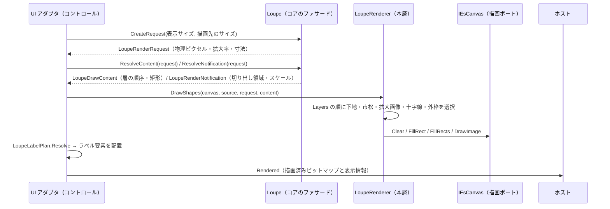
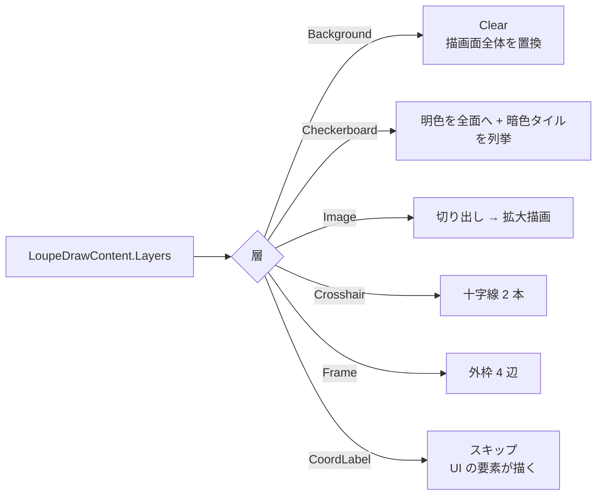
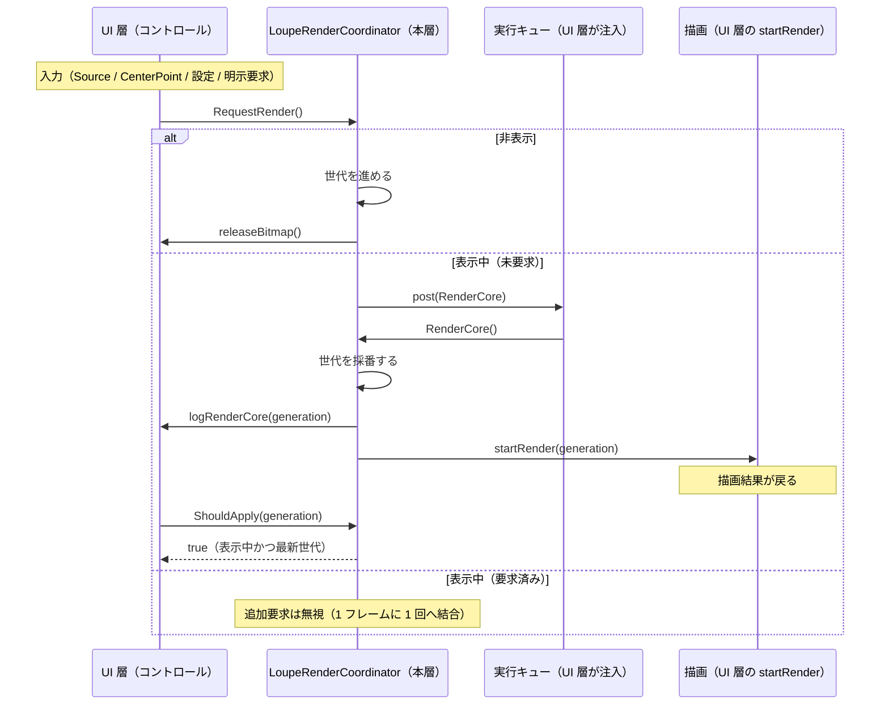

# LoupeControl.UIBase システム仕様書

`LoupeControl.UIBase`（`LoupeControl` をコントロールとして成り立たせる UI 非依存層）の構造・依存・例外処理・コンポーネント構成を記載します。外部機能と公開 API は [SPEC_ExtFunc](SPEC_ExtFunc.md)、利用手順は [README](README.md) を参照してください。

## 1. システム概要

| 項目 | 内容 |
| --- | --- |
| 目的 | 「どう描くか（描画 API の呼び出し手順）」と「他のコントロールへ組み込むときにだけ必要な規則（再描画のスケジューリング）」を 1 箇所へ集約し、UI の追加・描画方式の変更を描画ポートの実装だけで済ませる |
| 提供形態 | クラスライブラリ（`LoupeControl.UIBase.dll`） |
| 想定利用者 | UI 実装（`LoupeControl.AvaloniaUI` / `LoupeControl.MewUI`）・独自コントロールの実装者 |
| 汎用性 | 特定のアプリ・UI に依存しない。寸法はコア（`LoupeMetrics`）が、色は本層（`LoupePaint`）が単一所有する |

本層は 2 つの関心事を持ちます。どちらも「単体で使う `Loupe` だけでは決まらない」ため、コア（`Feature.LoupeCore`）には置きません。

| 関心事 | 内容 | 代表型 |
| --- | --- | --- |
| **描画手順** | 層の順序に従って描画ポート（`IEsCanvas`）を呼ぶ手順と色（`LoupePaint`）、実寸 → ラベル要素の写像 | `LoupeRenderer` / `LoupePaint` / `LoupeLabelPlan`（写し方の基底は本層の `LoupeRendererBase`） |
| **組み込み規則** | 再描画要求のバッチ化（1 フレーム 1 回）と世代番号管理 | `LoupeRenderCoordinator` |

## 2. 技術スタック

| 項目 | 内容 |
| --- | --- |
| ターゲット | `net10.0` |
| 言語 | C# 14（`Nullable` 有効・`ImplicitUsings` 有効） |
| ルート名前空間 | `EsUtil.SaveEvidence.Loupe.UIBase` |
| ドキュメント生成 | `GenerateDocumentationFile` 有効（XML は配布物へ出さず `cref` の検証のみに使う） |
| テスト | xUnit v3（UI 初期化不要。描画は Skia のビットマップ上で画素検証する） |

## 3. アーキテクチャ

### 3.1 依存方向（一方向）

層の全体像（Core / UIBase / UI）は [`src/README.md`](../README.md) を参照してください。

```text
UI 層（LoupeControl.AvaloniaUI / LoupeControl.MewUI）
  入力の受付・効果の適用・通知の転送・描画先の用意・ラベル要素の配置
    ├──> LoupeControl.UIBase ← 本プロジェクト   どう描くか（描画手順）＋ 組み込み先があるときだけ必要な規則
    └──> Feature.LoupeCore   何を描くか + 判断（状態・値・純粋計算・コア⇔UI の契約）
           ├──> Common（IEsCanvas・IEsRectWalker）
           └──> Platform.Core（Es* 値型・ICoordTransform）
※ コアは本層を参照しない（本層がコアの描画内容（`LoupeDrawContent`）を使う向きだけ）。
※ 本層を使うのは LoupeControl.AvaloniaUI のみ（MewUI は中間ビットマップを持たず同期描画するため不要）。
```

- 上位層は下位層のみを参照します（逆参照なし）。
- 本層は UI フレームワークを参照しません（描画 API は `IEsCanvas` 経由。実行キューは `post` コールバックで受け取る）。
- コアは本層を参照しません（**コアは「何を描くか」、本層は「どう描くか」**）。

### 3.2 描画のデータフロー



### 3.3 層の処理



### 3.4 再描画のデータフロー



## 4. コンポーネント構成

```text
src/LoupeControl.UIBase/
├── src/
│   ├── LoupeRenderer.cs              既定の描画実装（色を保持し、手順は基底が所有する）
│   ├── LoupePaint.cs                 描画に使う色と「描くかどうか」の述語の単一所有
│   ├── LoupeLabelPlan.cs             実寸 → ラベル要素の配置指示の写像
│   └── LoupeRenderCoordinator.cs     再描画のスケジューリング（バッチ化・世代番号）
└── tests/
    ├── TestHelper.cs                 テスト用の描画先（Skia）
    ├── LoupeRenderer.Tests.cs        層ごとの描画の検証
    ├── LoupePaint.Tests.cs           色の既定値・部分変更・描画可否の述語の検証
    ├── LoupeLabelPlan.Tests.cs       実寸 → ラベル要素の写像の検証
    └── LoupeRenderCoordinator.Tests.cs バッチ化・世代番号・適用判定・破棄と解放の検証
```

### 描画手順

| コンポーネント | 責務 |
| --- | --- |
| `LoupeRenderer` | 既定の描画実装（`sealed`。色（`LoupePaint`）を保持し、手順は基底が所有する）。図形の層を描き、テキストのフック（`DrawLabel`）は引き継ぐ（既定は何もしない） |
| `LoupePaint` | 描画に使う 7 色と描画可否の述語（`Has*`）を単一所有する。`Default` を基点に部分変更する |
| `LoupeLabelPlan` | 通知・色・実寸からラベル要素の配置指示を解決する |

### 組み込み規則

| コンポーネント | 責務 |
| --- | --- |
| `LoupeRenderCoordinator` | 要求のバッチ化、世代番号の採番、古い結果の破棄判定、要求の破棄と解放。ビットマップと表示状態は保持しない |

## 5. 責務の分担と設計判断

| 層 | 責務 |
| --- | --- |
| `Feature.LoupeCore` | 表示レイアウト・描画入力・通知内容の解決・寸法（`LoupeMetrics`）・ログ定義 |
| **本プロジェクト** | **描画 API の呼び出し手順と色（`LoupePaint`）**・実寸 → ラベル要素の写像・**再描画要求のバッチ化（1 フレーム 1 回）・世代番号管理・古い結果の破棄判定** |
| `LoupeControl.*UI` | フレームワークの入力・描画・実行キュー（`post`）の提供、ビットマップの生成と解放、ラベル要素の配置 |
| ホスト | 表示開始・拡大元画像の供給（中心座標ラベルはコントロールがテキスト要素として表示する） |

| 判断 | 理由 |
| --- | --- |
| 描画手順を本層に置く（コアに置かない） | コアは「何を描くか（判断・データ）」だけを決める。描画 API の呼び出しは UI フレームワーク差を `IEsCanvas` へ閉じ込めた本層の責務である。色も同じ理由で本層（`LoupePaint`）が単一所有する（色はコアの計算・判定に入らない） |
| スケジューリングを Core ではなく本層に置く | 「いつ何回再描画するか」は UI へ組み込んで初めて問題になる。単体のルーペには再描画のスケジューリングという概念が無く、コアをそのまま独立できるよう本層へ分離する |
| `post` を必須引数にする | 実行キューと優先度（`DispatcherPriority.Render` 等）はフレームワーク固有である。既定値（Avalonia の Dispatcher）を持つと本層が UI へ依存してしまう |
| 表示状態・解放・描画開始をコールバックにする | コントロールの状態とリソースを本層が保持すると、UI コントロールに依存してしまう（テストも不可能になる） |
| 世代番号で古い結果を破棄する | 非同期の生成結果が到着した時点で表示が変わっている可能性があるため（順序保証は結果側で持つ） |

## 6. 単一所有（同じ真実を 2 箇所に持たない）

| 対象 | 所有者 |
| --- | --- |
| 描画する層とその順序 | `Loupe.ResolveLayers`（コア。本層は順に写すだけ） |
| 描画の色（下地・市松模様・外枠・十字線・中心座標ラベルの 7 色）とその既定値 | 本層（`LoupePaint`） |
| 描画可否（透明色は描かない・切り出し領域が無い場合は描かない） | 本層（`LoupePaint.Has*` / `LoupeRendererBase.DrawMagnifiedImage`。判定の規則は `DrawingColorExtensions.IsVisible` が単一所有する） |
| 切り出し領域と拡大の矩形 | コア（`LoupeRenderRequest` の internal メンバーが算出し、描画内容 `LoupeDrawContent.MagnifiedImage` が持つ） |
| 市松模様のタイル位置とタイル数 | コア（描画内容 `LoupeDrawContent.CheckerTiles`。リストを確保しない列挙子で渡す） |
| 十字線・円枠の矩形 | コア（描画内容 `LoupeDrawContent`） |
| 寸法の DIP → 物理ピクセル換算 | コア（描画入力 `LoupeRenderRequest` の換算済み寸法） |
| 描画先のサイズ決定（クランプ） | コア（`LoupeRenderRequest.ResolvePixelSize`） |
| ラベルの文言と基準点 | コア（`LoupeTextPlacement`） |
| ラベルのフォントサイズ・角丸・色・内側余白 | 本層（`LoupePaint` / `LoupeLabelPlan`） |
| 描画 API の呼び出し（背景 → 文字の順序） | `Platform.Core`（`SkiaLabel` / `IEsCanvas.DrawLabel`） |
| 再描画要求の結合（1 フレームに 1 回） | `LoupeRenderCoordinator.RequestRender` |
| 再描画の世代番号と、古い結果を破棄する判断 | `LoupeRenderCoordinator.RenderCore` / `ShouldApply` |
| 要求の破棄とビットマップ解放の手順 | `LoupeRenderCoordinator.CancelAndRelease` |
| 実行キューと優先度 | UI 層（`post` コールバックの実装） |

## 7. 例外処理ポリシー

| 状況 | 扱い |
| --- | --- |
| `canvas` が null | `ArgumentNullException`（呼び出し側の実装誤り） |
| `layers` が null | `ArgumentNullException` |
| `source` が null / 切り出し領域が無い | 拡大画像を描かない（例外ではない。市松模様のみになる） |
| `source` が破棄済み | 本層（`LoupeRendererBase.DrawMagnifiedImage`）が `ObjectDisposedException` を吸収して何も描かない（市松模様のみが残る） |
| `measureText` が null | `ArgumentNullException` |
| `paint`（`LoupePaint`）が null | `ArgumentNullException`（`LoupeRenderer` の生成時・`LoupeLabelPlan.Resolve` の呼び出し時） |
| 背景色が透明 | 描画面を透明で置き換える（前フレームの残像を残さない） |
| `LoupeRenderCoordinator` のいずれかのコールバックが null | `ArgumentNullException` を送出する（配線の誤りを早期に検出する） |
| 要求が取り消された後に `RenderCore` が呼ばれる | 何もしない（防御分岐） |
| 非表示状態で `CancelAndRelease` を繰り返す | 解放をその都度呼ぶ（解放自体が冪等であることを前提にする） |

## 8. 可視性ポリシー

- すべて `public` です（UI 実装・独自コントロールの作者が参照する API のみで構成されるため、internal にする対象がない）。
- `[EditorBrowsable]` による「見えにくくする」対処は行いません（公開面も契約も変わらないため）。

## 9. テスト方針

| 方針 | 内容 |
| --- | --- |
| UI 初期化不要 | 描画は `SkiaEsCanvas`（UI 非依存）で行い、ビットマップの画素を検証する。再描画のスケジューリングは UI 型を持たないため `[Fact]` で検証する |
| 検証点 | 描画手順の唯一の検証点である（UI 側はアダプタのみを持つため、UI ごとの描画テストは不要） |
| 合計 | 44 件（描画 17 / 色 8 / ラベル 7 / 組み込み規則 12） |

```powershell
dotnet test src/LoupeControl.UIBase/tests/LoupeControl.UIBase.Tests.csproj
```

## 10. ライセンス

MIT License（全文は [`../../LICENSE`](../../LICENSE) を参照）。
