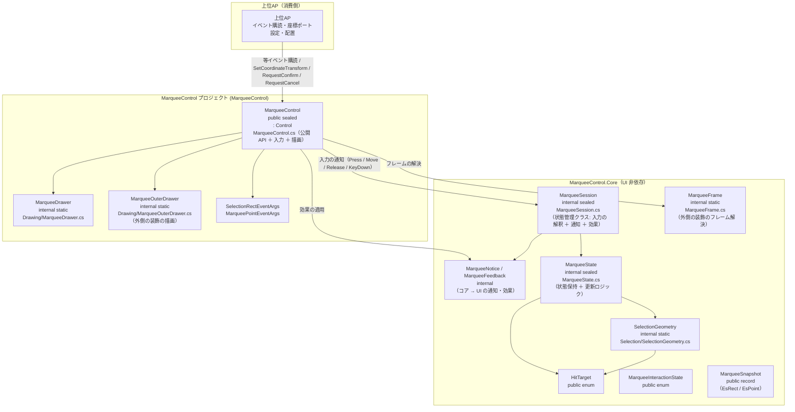
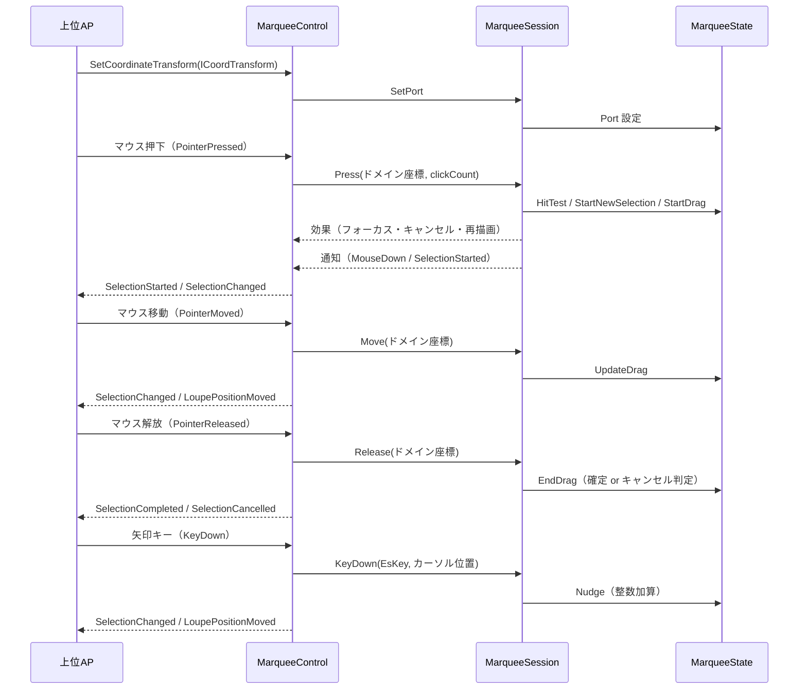

# MarqueeControl システム仕様書（SPEC_System）

## 目次

- [MarqueeControl システム仕様書（SPEC\_System）](#marqueecontrol-システム仕様書spec_system)
  - [目次](#目次)
  - [1. システム概要](#1-システム概要)
  - [2. 技術スタック](#2-技術スタック)
  - [3. アーキテクチャ](#3-アーキテクチャ)
    - [3.1 レイヤー構造](#31-レイヤー構造)
    - [3.2 依存の方向](#32-依存の方向)
  - [4. 例外処理ポリシー](#4-例外処理ポリシー)
    - [4.1 基本方針](#41-基本方針)
    - [4.2 本プロジェクト固有の例外処理](#42-本プロジェクト固有の例外処理)
  - [5. コンポーネント図](#5-コンポーネント図)
  - [6. コンポーネント一覧](#6-コンポーネント一覧)
    - [6.1 MarqueeControl](#61-marqueecontrol)
    - [6.2 MarqueeSession（状態管理クラス）](#62-marqueesession状態管理クラス)
    - [6.3 MarqueeState](#63-marqueestate)
    - [6.4 SelectionGeometry](#64-selectiongeometry)
    - [6.5 MarqueeDrawer](#65-marqueedrawer)
    - [6.6 MarqueeOuterDrawer](#66-marqueeouterdrawer)
    - [6.7 MarqueeFrame（コア）](#67-marqueeframeコア)
    - [6.8 HitTarget](#68-hittarget)
    - [6.9 公開イベント引数](#69-公開イベント引数)
  - [7. 依存ルール](#7-依存ルール)
  - [8. ライフサイクル](#8-ライフサイクル)
    - [8.1 状態の初期化と破棄（所有権）](#81-状態の初期化と破棄所有権)
  - [9. ログ](#9-ログ)
    - [9.1 ログ定義一覧](#91-ログ定義一覧)
      - [コア（`Estable.Marquee.MarqueeLogMessage`）](#コアestablemarqueemarqueelogmessage)

---

## 1. システム概要

SaveEvidence は、Windows デスクトップ上の画面をキャプチャし、プレビュー・編集・保存するための Avalonia UI アプリケーションです（.NET 10.0 / C# 14 / MVVM）。

本プロジェクト（MarqueeControl）は、このシステムのうち**領域選択ドラッグ矩形**の UI・操作・描画を自己完結する再利用可能なコントロールです。上位 AP（CaptureSessionControl.AvaloniaUI / app）に依存せず、マウス操作・キーボード操作（nudge）・描画をコントロール内で完結します。

## 2. 技術スタック

| 項目 | 内容 |
| --- | --- |
| **プロジェクト** | `MarqueeControl` |
| **ルート名前空間** | `Estable.AvaloniaUI.Marquee` |
| **言語** | C# 14（.NET 10.0） |
| **UI フレームワーク** | Avalonia UI 12.1（Control / StyledProperty / DrawingContext） |
| **ターゲットフレームワーク** | net10.0 |
| **ビルドツール** | MSBuild / .NET SDK 10.0 |
| **ログ** | Microsoft.Extensions.Logging.Abstractions（LoggerMessage ソース生成） |
| **テスト** | xUnit v3 / Avalonia.Headless.XUnit |
| **依存プロジェクト** | Platform.AvaloniaUI（ScreenConverter）/ Platform.Native（ICursorService）/ Platform.Core（ICoordTransform / CoordTransform） |

## 3. アーキテクチャ

### 3.1 レイヤー構造

```text
公開コントロール（MarqueeControl）… 入力の受付 / 効果の適用 / 通知の転送 / 描画
  → 状態管理クラス（MarqueeSession）… 入力の解釈と状態遷移の判断
    → 状態（MarqueeState）… 状態保持と更新ロジック
      → 共有型（SelectionGeometry / MarqueeDrawer）+ Platform.AvaloniaUI
  → 外側の装飾のフレーム解決（MarqueeFrame）… 選択の状態 + 外側の装飾の設定 → 装飾コアのフレーム
      → 装飾コア（MarqueeControl.Core の `Estable.Marquee.Decoration`）… 暗転・穴あけ枠・ラベルの判断
```

### 3.2 依存の方向

- 依存は**一方向の階層構造**（MarqueeControl → MarqueeSession → MarqueeState → SelectionGeometry / Platform.AvaloniaUI / Platform.Native / Platform.Core）。
- MarqueeControl は上位 AP に依存しない（再利用可能）。
- **判断はコア（`MarqueeSession`）・反映は UI**: nudge セッション・ダブルクリックの確定/キャンセル・ハンドルのスナップ・クリック検出・最小サイズによるキャンセルはコアが決め、コントロールは効果（`MarqueeFeedback`）を適用するだけにする。
- 描画は MarqueeDrawer（選択矩形）と MarqueeOuterDrawer（外側の装飾）へ委譲し、状態（選択矩形・nudge）は MarqueeState に集約する。外側の装飾の**判断**は持たず、`MarqueeFrame.Resolve` が返すフレームを描画 API へ写すだけとする。
- 座標変換は `ICoordTransform`（`Platform.Core` 提供）が担い、コントロールは変換関数を生成しない。
- 上位 AP へはイベントのみで通知し、上位 AP はポインター・キーイベントを直接処理しない。

## 4. 例外処理ポリシー

### 4.1 基本方針

- ライブラリは例外を原則伝播し、上位 AP（app）で処理する。
- UI レイヤー（app）ではユーザー操作起因の例外を各ハンドラで catch し、UI の応答性を維持する。
- ログは LoggerMessage ソース生成で出力する。操作イベントは Debug、Down 直前 / Up 直後の位置・ホイールは Trace で記録する。ログ定義はすべてコア（名前空間 `Estable.Marquee` の `MarqueeLogMessage`）が単一所有し、本プロジェクトは固有のログ定義を持たない。

### 4.2 本プロジェクト固有の例外処理

- イベントハンドラ内の例外は握りつぶさず、上位 AP へ伝播する（コントロールの内部状態を不正にしない）。
- 状態は MarqueeState に集約し、クリップ（`MarqueeOptions.ClampToDomainBounds` + `Port.Bounds`）により不正な選択矩形を防止する。

## 5. コンポーネント図



## 6. コンポーネント一覧

### 6.1 MarqueeControl

- **分類**: 公開コントロール（`public sealed class : Control`）
- **責務**:
  - ポインターイベント（Pressed / Moved / Released）をコア型へ変換してセッションへ通知する
  - キーイベント（矢印キー・Escape / Enter）を `EsKey` へ変換してセッションへ通知する。購読は **TopLevel の 1 経路のみ**（フォーカス非依存）
  - セッションが返す効果（カーソル操作・フォーカス・カーソル形状・再描画）を適用する（効果の選択と適用順はコアが単一所有）
  - セッションからの通知を公開イベントへ転送する（判断はしない）
  - 描画（`Render`）を起動し、セッションの状態を MarqueeDrawer へ、`MarqueeFrame.Resolve` が返した外側の装飾のフレームを MarqueeOuterDrawer へ渡す
  - ホイール操作（Ctrl+ホイールの `ZoomRequested`・通常ホイールの `ScrollRequested` / 連携 ScrollViewer のスクロール）
  - 祖先 ScrollViewer の ScrollChanged 購読（`ViewportChanged` 発行はセッションへ委譲）
  - 設定（外観・対話パラメータ）の保持と、対話パラメータ（`MinSelectionSize` / `ClampToDomainBounds` / `HandleHitRadius`）のセッションへの伝搬
- **公開API**:
  - イベント 15 種: `SelectionStarted` / `SelectionChanged` / `SelectionCompleted` / `SelectionCancelled` / `MouseDown` / `MouseUp` / `MouseClicked` / `MouseDoubleClicked` / `MouseMoved` / `LoupePositionMoved` / `ViewportChanged` / `ZoomRequested` / `ScrollRequested` / `ConfirmRequested` / `CancelRequested`
  - StyledProperty 3 種: `Options`（不変の設定値 `MarqueeOptions`。外側の装飾 6 項目 + 外観 9 項目 + 対話パラメータ 3 項目を内包） / `Scaling` / `DisplayScaleScaling`
  - プロパティ: `Log`（保持・`NullLogger` へのフォールバック・セッションへの伝搬はコアが単一所有） / `SizeLabelOverrideProvider`（外側の装飾のラベル文言。デリゲートのため設定値に含めない） / `HasSelection` / `SelectionRect`
  - メソッド: `SetCoordinateTransform(ICoordTransform?)` / `SetSelection` / `ResetSelection` / `RequestCancel` / `RequestConfirm` / `AttachScrollViewer`
- **構成（薄い層）**: 公開 API・入力の受付・効果の適用・通知の転送・描画のみを集約し、判断（状態遷移・確定/キャンセル・スナップ・クリック検出・外側の装飾の描画内容）はコアへ委譲する
- **依存**: MarqueeSession / MarqueeOptions / MarqueeFeedback / MarqueeNotice / MarqueeDrawer / MarqueeOuterDrawer / MarqueeFrame（MarqueeControl.Core）/ ICoordTransform（Platform.Core）/ ICursorService（Platform.Native）/ ScreenConverter（Platform.AvaloniaUI）

### 6.2 MarqueeSession（状態管理クラス）

- **分類**: 内部状態管理クラス（`internal sealed class`・コア提供）
- **責務**:
  - 入力の通知（`Press` / `Move` / `Release` / `KeyDown` / `NudgeByKey`）を受けて状態を更新する
  - 判断: nudge セッションの開始/終了（カーソル非表示・基点同期）・ダブルクリックの確定/キャンセル・ハンドルのスナップ・クリック検出・最小サイズによるキャンセル・エコー移動の抑制・カーソル種別の決定
  - 効果（`MarqueeFeedback`: 再描画・フォーカス・マウスキャプチャ・カーソル操作/形状）を返す
  - 通知（`MarqueeNotice`: 種別・通知座標・スナップショット）を発火する（UI 層は公開イベントへ転送するだけ。ビューポートの変化も `NotifyViewportChanged` で本クラスが通知を組み立てる）
  - 設定（`MarqueeOptions`）の保持と適用（対話パラメータを内部で参照する）
- **可視性**: internal（外部から見えない）
- **依存**: MarqueeState / MarqueeOptions / MarqueeNotice / MarqueeFeedback / MarqueeLogMessage / SelectionGeometry / EsKey（Platform.Core）/ ICoordTransform / ICursorService
- **備考**: **Enter と Return は同一の確定キー**として扱う（Avalonia の `Key` は両者が同値のエイリアスで、名前ベースの相互変換では `Return` が得られるため）

### 6.3 MarqueeState

- **分類**: 内部状態クラス（`internal sealed class`・コンポジション）
- **責務**:
  - 選択矩形・ドラッグ状態・アクティブハンドル・nudge 状態（基点＋累積オフセット）の保持
  - 純粋ロジック: `HitTest` / `StartNewSelection` / `StartDrag` / `UpdateDrag` / `EndDrag` / `Nudge` / `GetOppositeCorner` / `GetInteractionState` / `CreateSnapshot`
  - クリップ（`MarqueeOptions.ClampToDomainBounds` + `Port.Bounds` による境界内制限。境界 Rect 生成は `GetBoundsRect` に一元化）
  - カーソル操作（`ICursorService`）
  - nudge 終了の共通化（`EndNudge`。`Reset` / `SetSelection` / `MarqueeSession` から共用し、カーソル再表示を委譲）
- **可視性**: internal（外部から見えない）
- **依存**: SelectionGeometry / HitTarget / ICoordTransform（Platform.Core）/ ICursorService（Platform.Native）

### 6.4 SelectionGeometry

- **分類**: 内部静的クラス（`internal static class`）
- **責務**: 選択矩形の純粋な幾何計算（正規化・ハンドル位置・ヒットテスト・対角計算）
- **可視性**: internal（外部から見えない）
- **依存**: UI 非依存（`MarqueeControl.Core` の `EsPoint` / `EsRect`）

### 6.5 MarqueeDrawer

- **分類**: 内部静的クラス（`internal static class`）
- **責務**: ドラッグハンドル・始点マーカー・座標ラベルの描画
- **可視性**: internal（外部から見えない）
- **特徴**: 色・太さで決まる `SolidColorBrush` / `Pen` を容量制限付きで共有し、描画で再利用する。容量管理は `AddWithCapacityLimit` に一元化（単一所有）。外観値（ハンドル枠の太さ・ラベルの余白）と描画対象のハンドル一覧はコア（`MarqueeAppearance` / `SelectionGeometry.DirectionalHandles`）を参照する。**選択枠線は描かない**（外側の装飾の穴あけ枠が同じ矩形を描くため。2 本目を描くと線幅が二重になる）
- **依存**: Avalonia（DrawingContext / SolidColorBrush / Pen）/ SelectionGeometry

### 6.6 MarqueeOuterDrawer

- **分類**: 内部静的クラス（`internal static class`）
- **責務**: 選択矩形の外側に描く装飾（暗転マスク・穴あけ枠・ラベル）の描画
- **可視性**: internal（外部から見えない）
- **特徴**: 装飾コアの `OuterDecoFrame` の各項目を Avalonia の描画 API へ写すだけで、外観値・判断を持たない（どの矩形を暗転するか・枠線を描くか・ラベルをどう組むかは装飾コアが単一所有する）。色 → ブラシは `BrushCache` を共有し、テキストの実寸測定のみ UI 固有（`FormattedText`）
- **依存**: Avalonia（DrawingContext / FormattedText）/ MarqueeControl.Core（`Estable.Marquee.Decoration` の `OuterDecoFrame` / `OuterDecoLabelLayout`）/ Platform.AvaloniaUI（BrushCache・色変換）

### 6.7 MarqueeFrame（コア）

- **分類**: 内部静的クラス（`internal static class`・コア提供）
- **責務**: 選択矩形の外側に描く装飾の描画内容を解決する（セッションの状態 + 外側の装飾の設定 → 装飾コアのフレーム）
- **可視性**: internal（両 UI 実装とテストのみが `InternalsVisibleTo` で参照する）
- **特徴**: 選択矩形と選択の有無は**セッションが単一のソース**であり、設定値には選択の状態を持たせない。暗転・穴あけ枠・ラベルの判断は装飾コアへ委譲する

### 6.8 HitTarget

- **分類**: 公開 enum
- **責務**: ドラッグハンドルの種別（ヒットテスト・矩形変形・nudge・描画で共通利用）
- **可視性**: public（上位 AP がカーソル形状のマッピングに使用するため）

### 6.9 公開イベント引数

- `MarqueeInteractionState` enum（public）: NoSelection / StartPointNudging / Dragging / DraggingNudging / Selected / SelectedNudging
- `MarqueeSnapshot` record（public）: State / SelectionRect / ActiveTarget / MousePosition / IsMouseDown / IsDragging / NudgeActive / HasSelection。座標は UI 非依存の `EsRect` / `EsPoint`（各 UI の境界で自前の型へ変換する）
- `SelectionRectEventArgs`（public）: Rect（Avalonia）+ Snapshot
- `MarqueePointEventArgs`（public）: Point（Avalonia）+ Snapshot

## 7. 依存ルール

- 依存方向は**一方向の階層構造**（MarqueeControl → MarqueeSession → MarqueeState → SelectionGeometry / Platform.AvaloniaUI / Platform.Core）。
- MarqueeControl は上位 AP に**依存しない**（再利用可能）。
- 判断（状態遷移・確定/キャンセル・スナップ・クリック検出）はコアの `MarqueeSession` に集約し、UI 層は効果を適用するだけにする。
- 描画は MarqueeDrawer（選択矩形）と MarqueeOuterDrawer（外側の装飾）へ委譲し、状態（選択矩形・nudge）は MarqueeState に集約する。外側の装飾の**判断**は持たず、`MarqueeFrame.Resolve` が返すフレームを描画 API へ写すだけとする。
- 座標変換は `ICoordTransform`（`Platform.Core` 提供）が担い、コントロールは変換関数を生成しない。
- 上位 AP へはイベントのみで通知し、上位 AP はポインター・キーイベントを直接処理しない。
- **キーイベントは 1 経路で受ける**（TopLevel のトンネル購読）。コントロール自身のキーハンドラを持たないため、同一キーの二重処理を防ぐ仕組み（フラグ等）が不要になる。トンネルはルートから下降するため、祖先のバブリングハンドラより先に処理済みにできる。

## 8. ライフサイクル



### 8.1 状態の初期化と破棄（所有権）

- コントロール自身が保持する状態（選択矩形・nudge 状態）は `ResetSelection()` で初期化します（上位 AP は状態をポーリングせず、イベントで把握）。
- 上位 AP はコントロールを Visual Tree から除去するだけで破棄できます（所有権は上位 AP にあり、明示的な解放 API は不要）。
- ビジュアルツリー切断時（`OnDetachedFromVisualTree`）は TopLevel キー購読・ScrollViewer 購読を解除し、セッションへ対話の終了を通知します（nudge 中ならポインターを再表示して選択状態を初期化）。

## 9. ログ

ログ定義はコア（`Estable.Marquee.MarqueeLogMessage`、`MarqueeControl.Core/src/MarqueeLogMessage.cs`）が単一所有する
（入力の判断に伴うログは UI から出せず、後から出すと行の順序が変わるため）。UI 層に固有のログ定義は持たない
（通常ホイールのスクロールログは、スクロールの実行を連携 `ScrollViewer` または `ScrollRequested` 通知へ委ねる形になり、
本コントロール内に記録すべき判断が無くなったため削除した）。
各メソッドは `this ILogger` 第一引数で定義し、呼び出し側では logger 引数を省略する。未設定（null）の場合は `NullLogger` で無出力。
出力先・レベル制御はホストアプリケーションが所有する（定義のみ）。マウス移動の高頻度ログは行わない（Down 直前・Up 直後の位置のみ `Trace` で記録）。

### 9.1 ログ定義一覧

#### コア（`Estable.Marquee.MarqueeLogMessage`）

| レベル | メソッド | 出力内容 |
| --- | --- | --- |
| `Debug` | `MarqueeLogMessage.LogMouseDown` | ポインター押下（位置 / クリック数 / 選択有無） |
| `Debug` | `MarqueeLogMessage.LogMouseUp` | ポインター解放（位置 / ドラッグ有無 / 選択有無） |
| `Debug` | `MarqueeLogMessage.LogClick` | クリック（位置） |
| `Debug` | `MarqueeLogMessage.LogDoubleClick` | ダブルクリック（位置 / 選択内側か） |
| `Debug` | `MarqueeLogMessage.LogDragStart` | ドラッグ開始（ハンドル / 位置）。新規選択も `handle=None` として記録する |
| `Debug` | `MarqueeLogMessage.LogKeyDown` | キー入力（キー名 / 処理有無） |
| `Debug` | `MarqueeLogMessage.LogConfirmRequested` | 確定要求（矩形） |
| `Debug` | `MarqueeLogMessage.LogCancelRequested` | キャンセル要求 |
| `Trace` | `MarqueeLogMessage.LogPositionBeforeDown` | Down 直前のマウス位置 |
| `Trace` | `MarqueeLogMessage.LogPositionAfterUp` | Up 直後のマウス位置 |
| `Debug` | `MarqueeLogMessage.LogZoomRequested` | Ctrl+ホイールによるズーム要求（拡大/縮小） |
| `Debug` | `MarqueeLogMessage.LogSettingChanged` | 設定値変更（変更前後） |
