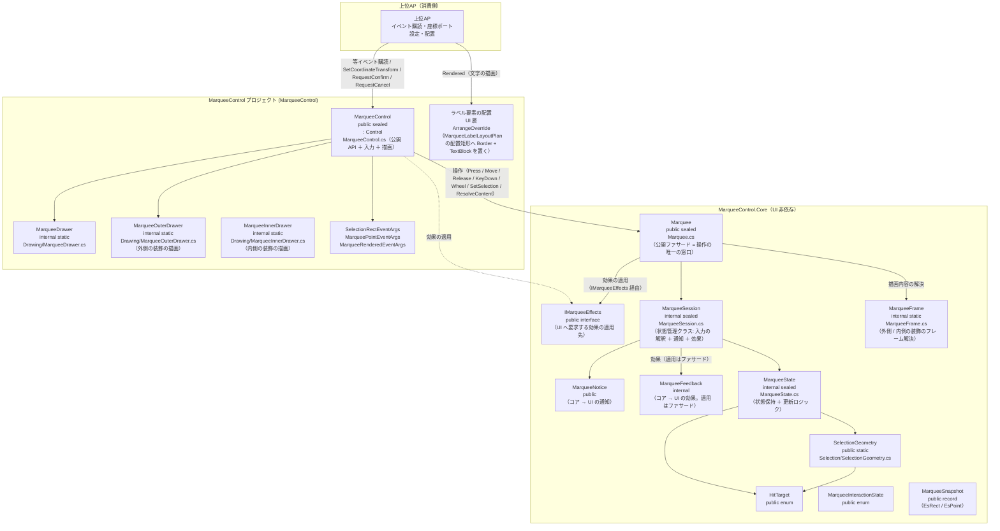
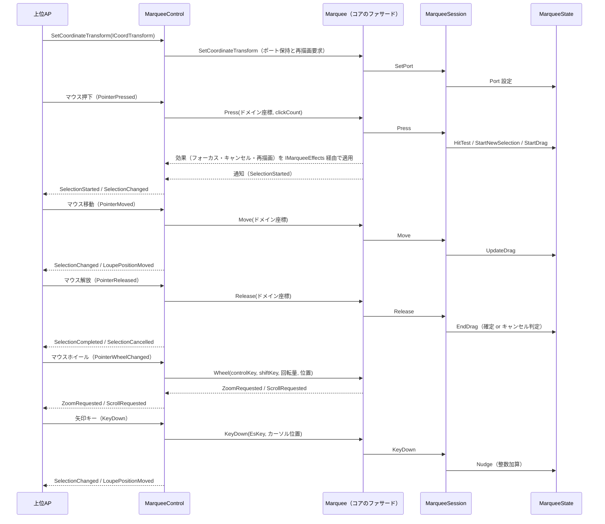

# MarqueeControl システム仕様書（SPEC_System）

## 目次

- [MarqueeControl システム仕様書（SPEC\_System）](#marqueecontrol-システム仕様書spec_system)
  - [目次](#目次)
  - [1. システム概要](#1-システム概要)
  - [2. 技術スタック](#2-技術スタック)
  - [3. アーキテクチャ](#3-アーキテクチャ)
    - [3.1 レイヤー構造](#31-レイヤー構造)
    - [3.2 依存の方向](#32-依存の方向)
  - [4. 例外処理ポリシー](#4-例外処理ポリシー)
    - [4.1 基本方針](#41-基本方針)
    - [4.2 本プロジェクト固有の例外処理](#42-本プロジェクト固有の例外処理)
  - [5. コンポーネント図](#5-コンポーネント図)
  - [6. コンポーネント一覧](#6-コンポーネント一覧)
    - [6.1 MarqueeControl](#61-marqueecontrol)
    - [6.2 Marquee（公開ファサード・コア）](#62-marquee公開ファサードコア)
    - [6.3 MarqueeState](#63-marqueestate)
    - [6.4 SelectionGeometry](#64-selectiongeometry)
    - [6.5 MarqueeDrawer](#65-marqueedrawer)
    - [6.6 MarqueeOuterDrawer](#66-marqueeouterdrawer)
    - [6.6.1 ラベルの要素配置（文字の表示）](#661-ラベルの要素配置文字の表示)
    - [6.7 MarqueeInnerDrawer](#67-marqueeinnerdrawer)
    - [6.8 MarqueeFrame（コア）](#68-marqueeframeコア)
    - [6.9 HitTarget](#69-hittarget)
    - [6.10 公開イベント引数](#610-公開イベント引数)
  - [7. 依存ルール](#7-依存ルール)
  - [8. ライフサイクル](#8-ライフサイクル)
    - [8.1 状態の初期化と破棄（所有権）](#81-状態の初期化と破棄所有権)
  - [9. ログ](#9-ログ)
    - [9.1 ログ定義一覧](#91-ログ定義一覧)
      - [コア（`Estable.Marquee.MarqueeLogMessage`）](#コアestablemarqueemarqueelogmessage)
      - [組み込みの層（`Estable.Marquee.CoreForControl.MarqueeWheelLogMessage`）](#組み込みの層establemarqueecoreforcontrolmarqueewheellogmessage)

---

## 1. システム概要

SaveEvidence は、Windows デスクトップ上の画面をキャプチャし、プレビュー・編集・保存するための Avalonia UI アプリケーションです（.NET 10.0 / C# 14 / MVVM）。

本プロジェクト（MarqueeControl）は、このシステムのうち**領域選択ドラッグ矩形**の UI・操作・描画を自己完結する再利用可能なコントロールです。上位 AP（CaptureSessionControl.AvaloniaUI / app）に依存せず、マウス操作・キーボード操作（nudge）・描画をコントロール内で完結します。

## 2. 技術スタック

| 項目 | 内容 |
| --- | --- |
| **プロジェクト** | `MarqueeControl` |
| **ルート名前空間** | `Estable.AvaloniaUI.Marquee` |
| **言語** | C# 14（.NET 10.0） |
| **UI フレームワーク** | Avalonia UI 12.1（Control / StyledProperty / DrawingContext） |
| **ターゲットフレームワーク** | net10.0 |
| **ビルドツール** | MSBuild / .NET SDK 10.0 |
| **ログ** | Microsoft.Extensions.Logging.Abstractions（LoggerMessage ソース生成） |
| **テスト** | xUnit v3 / Avalonia.Headless.XUnit |
| **依存プロジェクト** | Platform.AvaloniaUI（ScreenConverter）/ Platform.Native（ICursorService）/ Platform.Core（ICoordTransform / CoordTransform） |

## 3. アーキテクチャ

### 3.1 レイヤー構造

```text
公開コントロール（MarqueeControl）… 入力の受付 / 効果の適用 / 通知の転送 / 描画内容の写像
  → 状態管理クラス（MarqueeSession）… 入力の解釈と状態遷移の判断
    → 状態（MarqueeState）… 状態保持と更新ロジック
      → 共有型（SelectionGeometry / MarqueeDrawer）+ Platform.AvaloniaUI
  → 描画内容の解決（MarqueeFrame）… 選択の状態 + 設定 → 描画内容 1 値（MarqueeDrawContent）
  → 装飾の解決（別プロジェクトの装飾層 `Estable.Marquee.Decoration`）… 暗転・穴あけ枠・ラベル・ハイライトの判断
  → 文字の描画（ホスト）… 描画完了イベント（Rendered）で受け取った契約を自 UI のテキスト API で描く
```

### 3.2 依存の方向

- 依存は**一方向の階層構造**（MarqueeControl → MarqueeSession → MarqueeState → SelectionGeometry / Platform.AvaloniaUI / Platform.Native / Platform.Core）。
- MarqueeControl は上位 AP に依存しない（再利用可能）。
- **判断はコア（`Marquee`）・反映は UI**: nudge セッション・ダブルクリックの確定/キャンセル・ハンドルのスナップ・クリック検出・最小サイズによるキャンセルはコアが決め、コントロールは `IMarqueeEffects` を実装して要求された効果を適用するだけにする。
- 描画は MarqueeDrawer（選択矩形）と MarqueeOuterDrawer（外側の装飾）と MarqueeInnerDrawer（内側の装飾）へ委譲し、状態（選択矩形・nudge）はコア（`MarqueeState`）に集約する。装飾の**判断**は持たず、`Marquee.ResolveContent` が返す描画内容を描画 API へ写すだけとする。
- **装飾（暗転・穴あけ枠・ラベル・ハイライト）は `MarqueeControl.Core` の概念ではない**ため、別プロジェクトの装飾（`MarqueeControl.Core` の `Decoration` 名前空間）が単一所有する。本コントロールは `DecoOptions` で設定し、描画内容を装飾層から受け取る（コアと装飾層は独立して参照する）。
- **文字（ラベル・座標ラベル）はコントロールが描かない**。描画するラベルの一覧と描画順は組み込みの層（`MarqueeControl.CoreForControl` の `MarqueeLabelLayoutPlan`）が単一所有し、実寸測定と描画はホストが `Rendered` のハンドラで行う（UI 層のラベル要素 が共通実装）。
- 座標変換は `ICoordTransform`（`Platform.Core` 提供）が担い、コントロールは変換関数を生成しない。
- 上位 AP へはイベントのみで通知し、上位 AP はポインター・キーイベントを直接処理しない。

## 4. 例外処理ポリシー

### 4.1 基本方針

- ライブラリは例外を原則伝播し、上位 AP（app）で処理する。
- UI レイヤー（app）ではユーザー操作起因の例外を各ハンドラで catch し、UI の応答性を維持する。
- ログは LoggerMessage ソース生成で出力する。操作イベントは Debug、Down 直前 / Up 直後の位置・ホイールは Trace で記録する。選択の判断に伴うログ定義はコア（名前空間 `Estable.Marquee` の `MarqueeLogMessage`）が、ズーム要求のログ定義は組み込みの層（`MarqueeControl.CoreForControl` の `MarqueeWheelLogMessage`）が単一所有し、本プロジェクトはログ定義を持たない

### 4.2 本プロジェクト固有の例外処理

- イベントハンドラ内の例外は握りつぶさず、上位 AP へ伝播する（コントロールの内部状態を不正にしない）。
- 状態は MarqueeState に集約し、クリップ（`MarqueeOptions.ClampToDomainBounds` + `Port.Bounds`）により不正な選択矩形を防止する。

## 5. コンポーネント図



## 6. コンポーネント一覧

### 6.1 MarqueeControl

- **分類**: 公開コントロール（`public sealed class : Control`）
- **責務**:
  - ポインターイベント（Pressed / Moved / Released）をコア型へ変換してコア（ファサード）へ通知する
  - キーイベント（矢印キー・Escape / Enter）を `EsKey` へ変換してコアへ通知する。購読は **TopLevel の 1 経路のみ**（フォーカス非依存）
  - コアが要求する効果（カーソル操作・フォーカス・カーソル形状・再描画）を `IMarqueeEffects` 実装で受けて適用する（効果の選択と適用順はコアが単一所有）
  - コアからの通知を公開イベントへ転送する（判断はしない）
  - 描画（`Render`）を起動し、`Marquee.ResolveContent` が返した描画内容（`MarqueeDrawContent`）のうち**図形の項目**（外側/内側の装飾・ハンドル・マーカー）を各描画層へ渡す。**文字は描かず**、描画のたびに `Rendered`（描画内容全体）を発火してホストへ委ねる
  - ホイール操作を組み込みの層（`MarqueeControl.CoreForControl` の `MarqueeWheelInterpreter`）へ通知し、要求（ズーム / スクロール）を受け取る（Ctrl の判定・連携先への適用・ログは同層が単一所有する）
  - 祖先 ScrollViewer の ScrollChanged 購読（`ViewportChanged` の発行はコントロール化の層の `MarqueeViewportNotifier` へ委譲）
  - 設定（外観・対話パラメータ）・環境値（倍率）・文言プロバイダの保持とファサードへの伝搬
- **公開API**:
- イベント 11 種: `SelectionStarted` / `SelectionChanged` / `SelectionCompleted` / `SelectionCancelled` / `LoupePositionMoved` / `ViewportChanged` / `ZoomRequested` / `ScrollRequested` / `ConfirmRequested` / `CancelRequested` / `Rendered`（描画完了。文字はホストが描く）。**生のポインター入力（Mouse 系）は公開しない**（ホストは自 UI の入力イベントを使う。押下状態は `CurrentSnapshot.IsMouseDown`）
  - StyledProperty 2 種: `Options`（不変の設定値 `MarqueeOptions`。外側の装飾 6 項目 + 外観 9 項目 + 対話パラメータ 3 項目を内包） / `Scaling`。`DisplayScaleScaling` は通常のプロパティ（環境値。XAML のバインディング・スタイル対象外。再描画の要求はコアの設定変更が行う）としてファサードへ委譲する（MewUI 版と同じ形）
  - プロパティ: `Log`（保持・`NullLogger` へのフォールバックはコアが単一所有） / `SizeLabelOverrideProvider`（外側の装飾のラベル文言。デリゲートのため設定値に含めない） / `HasSelection` / `SelectionRect`
  - メソッド: `SetCoordinateTransform(ICoordTransform?)` / `SetSelection` / `ResetSelection` / `RequestCancel` / `RequestConfirm` / `AttachScrollViewer`
- **構成（薄い層）**: 公開 API・入力の受付・効果の適用・通知の転送・描画のみを集約し、判断（状態遷移・確定/キャンセル・スナップ・クリック検出・装飾の描画内容）はコアへ委譲する
- **依存**: Marquee（公開ファサード）/ IMarqueeEffects / MarqueeSession（間接） / MarqueeOptions / MarqueeNotice / MarqueeDrawContent / MarqueeDrawer / MarqueeOuterDrawer / MarqueeInnerDrawer （MarqueeControl.Core）/ ICoordTransform（Platform.Core）/ ICursorService（Platform.Native）/ ScreenConverter（Platform.AvaloniaUI）

### 6.2 Marquee（公開ファサード・コア）

- **分類**: ファサードクラス（`public sealed class`・コア提供。適用パターン: Facade）
- **責務**: Marquee の**操作の唯一の窓口**。UI 層とホストは本型だけを参照する
  - 操作の提供: `Press` / `Move` / `Release` / `KeyDown` / `EndNudge` / `SetSelection` / `ResetSelection` / `RequestConfirm` / `RequestCancel` / `ResolveContent`
  - 設定・環境値の保持: `Options` / `Scaling` / `DisplayScaleScaling` / `SizeLabelOverrideProvider` / `OperationTextProvider` / `InfoTextProvider` / `Log` / `SetCoordinateTransform`
  - 効果の適用: `IMarqueeEffects`（UI が実装）へフォーカス・再描画・カーソル形状・ポインターキャプチャ・座標変換を要求する（適用順の単一所有）
  - ホイールの解釈（`MarqueeWheelInterpreter.Handle`）: Ctrl = ズーム要求 / それ以外 = スクロール（連携先があれば適用、無ければ `ScrollRequested`）とログを組み込みの層へ委ね、要求を公開イベントへ転送する
  - 通知: `Notified`（状態機械の通知をそのまま転送する）
- **内部実装**: 状態機械 `MarqueeSession`（`internal`）とフレーム解決 `MarqueeFrame`（`internal`）を保持・利用する
- **可視性**: public（ファサードのみ。内部の状態機械とフレーム解決は `internal` で隠す）
- **備考**: 設定・効果の適用・通知の転送・描画内容の解決を 1 型に集約したため、UI 層は自 UI の公開プロパティ・公開イベント・描画 API へつなぐだけになる（ホイールの解釈は組み込みの層（`MarqueeControl.CoreForControl`）が単一所有する）

### 6.3 MarqueeState

- **分類**: 内部状態クラス（`internal sealed class`・コンポジション。コア提供）
- **責務**:
  - 選択矩形・ドラッグ状態・アクティブハンドル・nudge 状態（基点＋累積オフセット）の保持
  - 純粋ロジック: `HitTest` / `StartNewSelection` / `StartDrag` / `UpdateDrag` / `EndDrag` / `Nudge` / `GetOppositeCorner` / `GetInteractionState` / `CreateSnapshot`
  - クリップ（`MarqueeOptions.ClampToDomainBounds` + `Port.Bounds` による境界内制限。境界 Rect 生成は `GetBoundsRect` に一元化）
  - カーソル操作（`ICursorService`）
  - nudge 終了の共通化（`EndNudge`。`Reset` / `SetSelection` / `MarqueeSession` から共用し、カーソル再表示を委譲）
- **可視性**: internal（本コントロールはコアの公開 API（`MarqueeSession` / `MarqueeSnapshot` / `MarqueeFrame`）のみを使う。`MarqueeState` は可変プロパティを多数持つため外部に公開しない）
- **依存**: SelectionGeometry / HitTarget / ICoordTransform（Platform.Core）/ ICursorService（Platform.Native）

### 6.4 SelectionGeometry

- **分類**: 静的クラス（`public static class`・コア提供）
- **責務**: 選択矩形の純粋な幾何計算（正規化・ハンドル位置・ヒットテスト・対角計算）
- **可視性**: public（コア提供）
- **依存**: UI 非依存（`MarqueeControl.Core` の `EsPoint` / `EsRect`）

### 6.5 MarqueeDrawer

- **分類**: 内部静的クラス（`internal static class`）
- **責務**: ドラッグハンドル・始点マーカーの描画
- **可視性**: internal（外部から見えない）
- **特徴**: 色・太さで決まる `SolidColorBrush` / `Pen` を容量制限付きで共有し、描画で再利用する。容量管理（しきい値・超過時の全クリア）は `CapacityLimitedCache<TKey, TValue>`（Platform.AvaloniaUI）に一元化（単一所有）。外観値（ハンドル枠の太さ）と描画対象のハンドル一覧はコア（`MarqueeAppearance` / `SelectionGeometry.DirectionalHandles`）を参照する。**ハンドルの塗り色はコアが解決済み**（未指定は白へ解決されるため、本層にフォールバックを置かない）。**選択枠線は描かない**（外側の装飾の穴あけ枠が同じ矩形を描くため。2 本目を描くと線幅が二重になる）。**座標ラベルも描かない**（ホストが描く）
- **依存**: Avalonia（DrawingContext / SolidColorBrush / Pen）/ SelectionGeometry

### 6.6 MarqueeOuterDrawer

- **分類**: 内部静的クラス（`internal static class`）
- **責務**: 選択矩形の外側に描く装飾のうち**非文字の項目**（暗転マスク・穴あけ枠）の描画
- **可視性**: internal（外部から見えない）
- **特徴**: 装飾（`MarqueeControl.Core` の `Decoration` 名前空間）の `OuterDecoFrame` の各項目を Avalonia の描画 API へ写すだけで、外観値・判断を持たない（どの矩形を暗転するか・枠線を描くかは装飾層が単一所有する）。色 → ブラシは `CapacityLimitedCache<TKey, TValue>` を共有する。**文字（ラベル）は描かない**（ホストが `Rendered` で描く）
- **依存**: Avalonia（DrawingContext）/ MarqueeControl.Core（`Estable.Marquee.Decoration` の `OuterDecoFrame`）/ Platform.AvaloniaUI（CapacityLimitedCache・色変換）

### 6.6.1 ラベルの要素配置（文字の表示）

- **分類**: 公開静的クラス（`public static class`）
- **責務**: 描画完了イベントで受け取った描画内容のうち**文字**（ラベル・座標ラベル）を描画する（ホスト向けの共通実装）
- **可視性**: public（ホストが `Rendered` のハンドラから呼ぶ）
- **特徴**: 文言・行の選定・配置（背景矩形・文字原点）は装飾（`MarqueeControl.Core` の `Decoration` 名前空間）が単一所有し、本クラスは実寸測定（`FormattedText`）と描画 API の呼び出しのみを持つ（座標ラベルは `MarqueeControl.Core` の `MarqueeCoordLabel.ComputeFrame` が配置を返す）。ブラシは容量制限付きキャッシュ（`MarqueeBrushCache`）を共用する
- **依存**: Avalonia（DrawingContext / FormattedText）/ MarqueeControl.CoreForControl（`MarqueeLabelLayoutPlan`）/ MarqueeControl.Core（装飾の描画契約）/ MarqueeControl.Core（座標ラベルの契約）/ Platform.AvaloniaUI（色変換）

### 6.7 MarqueeInnerDrawer

- **分類**: 内部静的クラス（`internal static class`）
- **責務**: 穴あけ矩形（選択矩形 / ハイライト矩形）の内側に描く装飾（塗り・内枠）の描画
- **可視性**: internal（外部から見えない）
- **特徴**: 装飾（`MarqueeControl.Core` の `Decoration` 名前空間）の `InnerDecoFrame` の各項目を Avalonia の描画 API へ写すだけで、外観値・判断を持たない（塗るか・枠線を描くかは装飾層が単一所有する）。色 → ブラシは外側の装飾と同じキャッシュ（`MarqueeBrushCache`）を共有する
- **依存**: Avalonia（DrawingContext）/ MarqueeControl.Core（`Estable.Marquee.Decoration` の `InnerDecoFrame`）/ Platform.AvaloniaUI（ブラシキャッシュ・色変換）

### 6.8 MarqueeFrame（コア）

- **分類**: 静的クラス（`public static class`・コア提供）
- **責務**: 1 フレーム分の描画内容（外側の装飾・内側の装飾・ハンドル・始点マーカー・ラベル・座標ラベル）を解決する（セッションの状態 + 設定 + 文言プロバイダ → `MarqueeDrawContent`）
- **可視性**: internal（ファサード `Marquee.ResolveContent` からのみ使う。外部には公開しない）
- **特徴**: 選択矩形と選択の有無は**セッションが単一のソース**であり、設定値には選択の状態を持たせない。暗転・穴あけ枠・ラベル・ハンドル・マーカー・座標ラベルの可否は本型の判断（`ResolveContent`）が単一所有し、UI 層は値を持つ項目を描くだけとする

### 6.9 HitTarget

- **分類**: 公開 enum
- **責務**: ドラッグハンドルの種別（ヒットテスト・矩形変形・nudge・描画で共通利用）
- **可視性**: public（上位 AP がカーソル形状のマッピングに使用するため）

### 6.10 公開イベント引数

- `MarqueeInteractionState` enum（public）: NoSelection / StartPointNudging / Dragging / DraggingNudging / Selected / SelectedNudging
- `MarqueeSnapshot` record（public）: State / SelectionRect / ActiveTarget / MousePosition / IsMouseDown / IsDragging / NudgeActive / HasSelection。座標は UI 非依存の `EsRect` / `EsPoint`（各 UI の境界で自前の型へ変換する）
- `SelectionRectEventArgs`（public）: Rect（Avalonia）+ Snapshot
- `MarqueePointEventArgs`（public）: Point（Avalonia）+ Snapshot
- `MarqueeRenderedEventArgs`（public）: Context（`DrawingContext`。描画中のみ有効）+ Content（`MarqueeDrawContent`。図形と文字の描画契約）

## 7. 依存ルール

- 依存方向は**一方向の階層構造**（MarqueeControl → Marquee（ファサード） → MarqueeSession → MarqueeState → SelectionGeometry / Platform.AvaloniaUI / Platform.Core）。
- MarqueeControl は上位 AP に**依存しない**（再利用可能）。
- 判断（状態遷移・確定/キャンセル・スナップ・クリック検出）はコアの `Marquee`（内部の `MarqueeSession`）に集約し、UI 層は効果（`IMarqueeEffects`）を適用するだけにする。
- 描画は MarqueeDrawer（選択矩形）と MarqueeOuterDrawer（外側の装飾）と MarqueeInnerDrawer（内側の装飾）へ委譲し、状態（選択矩形・nudge）は MarqueeState に集約する。装飾の**判断**は持たず、`Marquee.ResolveContent` が返す描画内容を描画 API へ写すだけとする。
- **文字（ラベル・座標ラベル）はコントロールが描かない（ホストが `Rendered` のハンドラで描く）**。文言・行の選定・配置はコアが単一所有する。`Rendered` の契約は描画内容全体であるため、ホストは文字以外の上書きもできる。
- 座標変換は `ICoordTransform`（`Platform.Core` 提供）が担い、コントロールは変換関数を生成しない。
- 上位 AP へはイベントのみで通知し、上位 AP はポインター・キーイベントを直接処理しない。
- **キーイベントは 1 経路で受ける**（TopLevel のトンネル購読）。コントロール自身のキーハンドラを持たないため、同一キーの二重処理を防ぐ仕組み（フラグ等）が不要になる。トンネルはルートから下降するため、祖先のバブリングハンドラより先に処理済みにできる。

## 8. ライフサイクル



### 8.1 状態の初期化と破棄（所有権）

- コントロール自身が保持する状態（選択矩形・nudge 状態）は `ResetSelection()` で初期化します（上位 AP は状態をポーリングせず、イベントで把握）。
- 上位 AP はコントロールを Visual Tree から除去するだけで破棄できます（所有権は上位 AP にあり、明示的な解放 API は不要）。
- ビジュアルツリー切断時（`OnDetachedFromVisualTree`）は TopLevel キー購読・ScrollViewer 購読を解除し、コア（`Marquee.ResetSelection`）へ対話状態の初期化を要求します（nudge 中ならポインターを再表示して選択状態を初期化。「切断」自体は UI のライフサイクルであるため、コアに専用 API は持ちません）。

## 9. ログ

ログ定義はコア（`Estable.Marquee.MarqueeLogMessage`、`MarqueeControl.Core/src/MarqueeLogMessage.cs`）と、組み込みの層（`Estable.Marquee.CoreForControl.MarqueeWheelLogMessage`）が単一所有する
（入力の判断に伴うログは UI から出せず、後から出すと行の順序が変わるため）。UI 層に固有のログ定義は持たない
（通常ホイールのスクロールログは、スクロールの実行を連携 `ScrollViewer` または `ScrollRequested` 通知へ委ねる形になり、
本コントロール内に記録すべき判断が無くなったため削除した）。
各メソッドは `this ILogger` 第一引数で定義し、呼び出し側では logger 引数を省略する。未設定（null）の場合は `NullLogger` で無出力。
出力先・レベル制御はホストアプリケーションが所有する（定義のみ）。マウス移動の高頻度ログは行わない（Down 直前・Up 直後の位置のみ `Trace` で記録）。

### 9.1 ログ定義一覧

#### コア（`Estable.Marquee.MarqueeLogMessage`）

| レベル | メソッド | 出力内容 |
| --- | --- | --- |
| `Debug` | `MarqueeLogMessage.LogMouseDown` | ポインター押下（位置 / クリック数 / 選択有無） |
| `Debug` | `MarqueeLogMessage.LogMouseUp` | ポインター解放（位置 / ドラッグ有無 / 選択有無） |
| `Debug` | `MarqueeLogMessage.LogDoubleClick` | ダブルクリック（位置 / 選択内側か） |
| `Debug` | `MarqueeLogMessage.LogDragStart` | ドラッグ開始（ハンドル / 位置）。新規選択も `handle=None` として記録する |
| `Debug` | `MarqueeLogMessage.LogKeyDown` | キー入力（キー名 / 処理有無） |
| `Debug` | `MarqueeLogMessage.LogConfirmRequested` | 確定要求（矩形） |
| `Debug` | `MarqueeLogMessage.LogCancelRequested` | キャンセル要求 |
| `Trace` | `MarqueeLogMessage.LogPositionBeforeDown` | Down 直前のマウス位置 |
| `Trace` | `MarqueeLogMessage.LogPositionAfterUp` | Up 直後のマウス位置 |
| `Debug` | `MarqueeLogMessage.LogSettingChanged` | 設定値変更（変更前後） |

#### 組み込みの層（`Estable.Marquee.CoreForControl.MarqueeWheelLogMessage`）

| レベル | メソッド | 出力内容 |
| --- | --- | --- |
| `Debug` | `MarqueeWheelLogMessage.LogZoomRequested` | Ctrl+ホイールによるズーム要求（拡大/縮小） |
