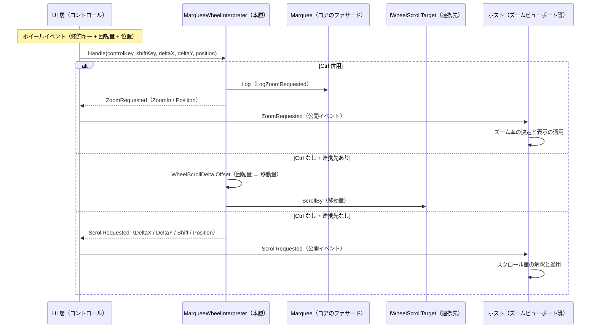

# MarqueeControl.CoreForControl システム仕様書

## システム概要

`MarqueeControl.CoreForControl` は、選択コントロール（`MarqueeControl`）を**他の UI コントロールへ組み込むときにだけ必要な処理**を担う層です。具体的には「ホイール入力を解釈して、ズーム要求の通知・連携先へのスクロール適用・スクロール要求の通知を行う」処理と、「ビューポート（パン・ズーム）の変化を上位へ再通知する」処理を持ちます。

`Feature.MarqueeCore`（選択の判断・状態・描画内容）と UI 層（フレームワーク固有の入力・描画）の間に位置し、両者が共有する**組み込みの転送規則**を 1 箇所に集約します。UI フレームワークへ依存しないため、ヘッドレス実行なしで `[Fact]` 並列検証できます。

## 技術スタック

| 区分 | 採用技術 |
| --- | --- |
| 対象フレームワーク | .NET 10（`net10.0`） |
| 言語 | C# 14 |
| ログ | `Microsoft.Extensions.Logging.Abstractions`（LoggerMessage ソース生成・`ILogger` 拡張メソッド） |
| 依存元 | `Feature.MarqueeCore`（公開ファサード `Marquee`） / `Platform.Core`（`EsPoint` / `EsVector`） |

## アーキテクチャ

### 依存方向（一方向を厳守）

層の全体像（Core / Rendering / CoreForControl / UI）は [`src/README.md`](../README.md) を参照してください。

```text
UI 層（MarqueeControl.AvaloniaUI / MarqueeControl.MewUI）
  入力の受付・効果の適用・通知の転送・描画先の用意・ラベル要素の配置
    ├──> MarqueeControl.Rendering   どう描くか（描画 API の呼び出し手順。IMarqueeRenderer を実装する）
    ├──> MarqueeControl.CoreForControl ← 本プロジェクト   組み込み先がある場合にだけ必要な規則
    └──> Feature.MarqueeCore   何を描くか + 判断（状態・値・純粋計算・コア⇔UI の契約）
           └──> Platform.Core（Es* 値型・ICoordTransform・ICursorService・IEsCanvas・EsLabelLayout）
※ Rendering と CoreForControl の間に依存はない（兄弟）。Core は Rendering / CoreForControl を参照しない。
```

### 責務の分担

| 層 | 責務 |
| --- | --- |
| `Feature.MarqueeCore` | 選択の判断（ドラッグ・nudge・確定/キャンセル・スナップ・最小サイズ）・状態・描画内容の解決・ログ定義（選択の判断に伴うもの） |
| **本プロジェクト** | **ホイール入力の解釈（Ctrl = ズーム / それ以外 = スクロール）**・要求の通知・**連携先へのスクロール適用（回転量 → 移動量の換算を含む）**・ズーム要求のログ定義・**ビューポート変化の再通知（スナップショット + 再描画）** |
| `MarqueeControl.*UI` | フレームワークの入力イベントから修飾キーと回転量を取り出して `Handle` を呼ぶ、要求を公開イベントへ転送する、**自 UI のスクロール機構を `IWheelScrollTarget` へ適合させて注入する** |
| ホスト | 要求の実処理（ズーム率の決定・表示の適用・スクロール先の決定） |

### 設計判断

| 判断 | 理由 |
| --- | --- |
| ホイール要求を Core ではなく本層に置く | 「Ctrl+ホイール = ズーム」は選択の判断ではなく、選択コントロールをビューポートへ組み込むときの規則である。単体で使う Marquee にはズームもスクロールも存在しないため、コアをそのまま独立できるよう本層へ分離する |
| 要求イベントを本層が持ち、UI 層は転送のみ行う | UI 層に「どちらの要求を出すか」の分岐を残さない（両 UI で解釈が同じになり、片方だけ修正される事故を防ぐ） |
| ログ定義を本層が持つ | ズーム要求のログは両 UI で同一の書式・レベルにする必要がある。ロガーはコアのファサード（`Marquee.Log`）を共用し、ホストのログ基盤へ出力する |
| 要求の値型を本層が持つ | 要求の型は解釈の結果そのものであり、コア（選択）から見ると存在しない概念である（コアの公開面に残さない） |
| 連携スクロールの適用を本層が持つ（適用先は抽象） | 「1 ノッチ = 48 DIP」「Shift で横」は UI をまたいで同じ規則であり、*回転量から移動量への換算と適用の順序* を UI ごとに書かせない。UI 固有の型は `IWheelScrollTarget` へ適合させて吸収する |
| 連携先が無い場合は要求として通知する | スクロール先（ズームビューポートのパン等）が UI 側に無い場合、勝手に捨てずホストへ委ねる（振る舞いを後方互換に保つ） |
| ビューポート変化の通知を Core ではなく本層に置く | ビューポートは組み込み先に存在する概念であり、単体で使う Marquee には存在しない。コアに置くと、コアが「他のコントロール（ビューポート）の語彙」を持つことになる |

## コンポーネント構成

```text
src/MarqueeControl.CoreForControl/
├── src/
│   ├── MarqueeWheelInterpreter.cs   ホイール入力の解釈・通知・連携先への適用（唯一のロジック）
│   │                                （同ファイル内: `IWheelScrollTarget` / `WheelScrollDelta`（internal））
│   ├── MarqueeViewportNotifier.cs   ビューポート変化の再通知（スナップショット + 再描画）
│   ├── WheelRequest.cs              要求の値型（WheelZoomRequest / WheelScrollRequest）
│   └── MarqueeWheelLogMessage.cs    ズーム要求のログ定義（LoggerMessage ソース生成。internal）
└── tests/
    ├── RecordingLogger.cs           ログ出力を収集するテスト用 ILogger
    ├── MarqueeWheelInterpreter.Tests.cs 解釈・通知・連携先への適用・ログの検証
    ├── WheelRequest.Tests.cs        要求の値の検証
    └── MarqueeViewportNotifier.Tests.cs ビューポート変化の通知の検証
```

| コンポーネント | 責務 |
| --- | --- |
| `MarqueeWheelInterpreter` | 解釈（Ctrl の判定・方向の決定）・通知（`ZoomRequested` / `ScrollRequested`）・適用（連携先への `ScrollBy`）・ログ。ビューの状態を保持しない |
| `IWheelScrollTarget` | スクロールの適用先（UI 層が適合させる抽象） |
| `WheelScrollDelta` | 回転量 → 移動量の換算（1 ノッチ = 48 DIP・Shift で横） |
| `WheelZoomRequest` / `WheelScrollRequest` | 要求の値（方向・回転量・修飾キー・発生位置）。`WheelScrollRequest.Delta` がコア型同士の変換を単一所有する |
| `MarqueeWheelLogMessage` | ズーム要求のログ定義（書式・レベル） |
| `MarqueeViewportNotifier` | ビューポート変化の再通知（現在の状態スナップショット）と再描画の要求。選択の状態は変更しない |

## データフロー（ホイール操作）



## 単一所有（Single Source of Truth）

| 値 / 判断 | 所有者 |
| --- | --- |
| ホイール入力の解釈（Ctrl = ズーム、方向 = 回転量の符号） | `MarqueeWheelInterpreter.Handle` |
| 連携先への適用（ズーム以外はスクロールとして適用し、通知を抑止する） | `MarqueeWheelInterpreter.Handle` |
| 回転量 → 移動量の換算（1 ノッチ・Shift の横変換） | `WheelScrollDelta.Offset` |
| 要求の値（方向・回転量・修飾キー・発生位置） | `WheelZoomRequest` / `WheelScrollRequest` |
| 回転量のベクター変換（`EsVector`） | `WheelScrollRequest.Delta` |
| ズーム要求のログ書式・レベル | `MarqueeWheelLogMessage.LogZoomRequested` |
| ロガーの保持と null の吸収 | コアのファサード（`Marquee.Log`） |
| 1 ノッチあたりの移動量（48 DIP） | `Platform.Core` の `ScrollMath.WheelScrollUnit` |
| ズーム率の決定と表示の適用 | 受け手（ホスト。ズームビューポート） |
| ラベルの一覧・順序・要素の配置矩形の写像 | 描画層の `MarqueeLabelPlan.Resolve`（`MarqueeControl.Rendering`。本層は関知しない） |
| テキストの実寸測定と描画 API の呼び出し | UI 層（ホスト） |

## 例外処理ポリシー

| 条件 | 動作 |
| --- | --- |
| `MarqueeWheelInterpreter` の生成でコアのファサードが null | `ArgumentNullException` を送出する（配線の誤りを早期に検出する） |
| ロガーが未設定（`Marquee.Log` に null） | コアのファサードが `NullLogger` へ吸収する（本層は判断しない） |
| 要求の購読者がおらず連携先も無い | 何もしない（通知は null 条件付きで発火する） |
| 連携先が null（未連携・解除後） | スクロールを要求として通知する（黙って捨てない） |
