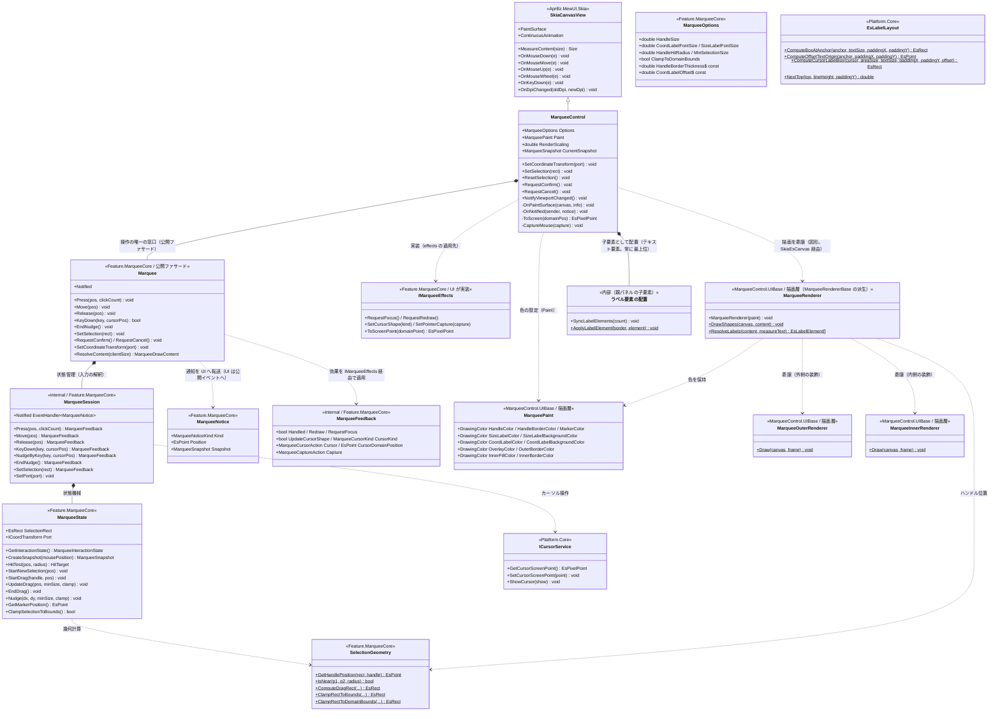
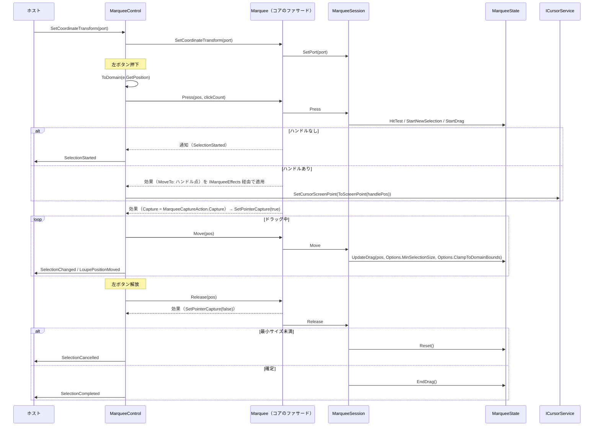
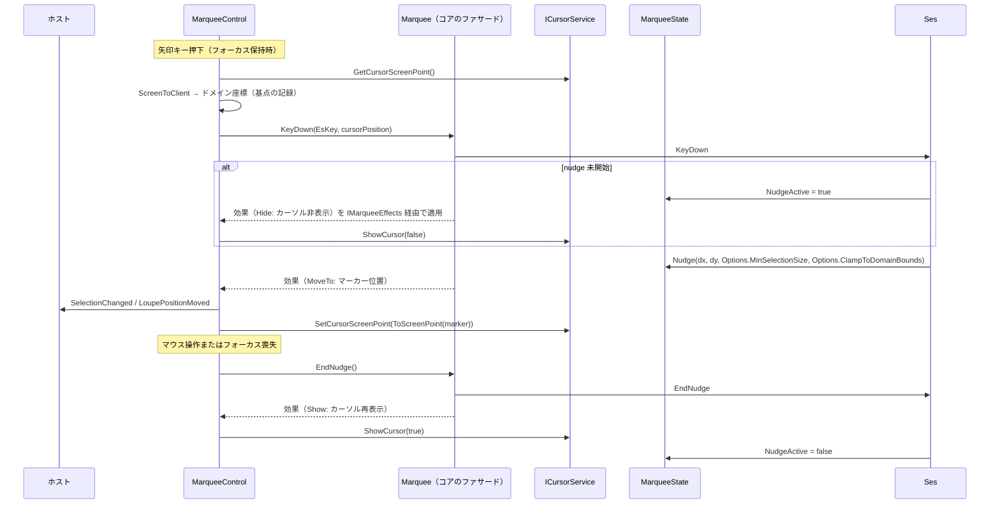
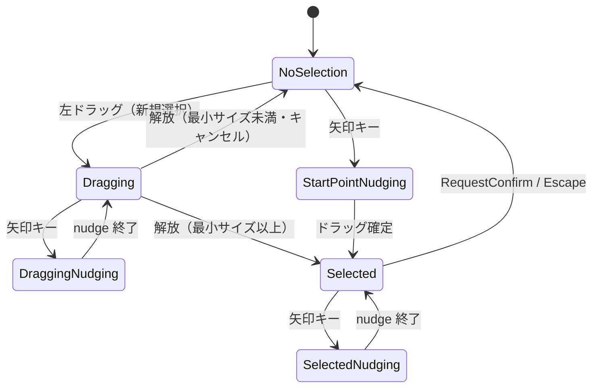

# MarqueeControl.MewUI システム仕様書

MarqueeControl（MewUI 版）のシステム概要・アーキテクチャ・依存関係・設計判断を記載します。

## システム概要

`MarqueeControl.MewUI` は、Avalonia 版 `MarqueeControl` と**同一の UI 非依存コア（`Feature.MarqueeCore`）と描画層（`MarqueeControl.UIBase`）**を使い、
入力の受付・効果の適用・通知の転送・描画ポートの適合のみを MewUI（SkiaSharp）で実装したドラッグ矩形コントロールです。

コアが担う範囲（選択矩形の正規化・ハンドル位置・ヒットテスト・ドラッグ変形・nudge・境界クリップ・対話状態の合成に加えて、
nudge セッション・ダブルクリックの確定/キャンセル・ハンドルのスナップ・クリック検出・最小サイズによるキャンセルの判断）は
両 UI で完全に共通であり、本プロジェクトは入力をコア（公開ファサード `Marquee`）へ通知し、返された効果を適用し、描画内容を描画層（`MarqueeRenderer`）へ渡してキャンバス（`SkiaEsCanvas`）へ描かせます。

## 技術スタック

| 区分 | 採用技術 |
| --- | --- |
| 対象フレームワーク | .NET 10（`net10.0`） |
| 言語 | C# 14 |
| UI フレームワーク | MewUI（`Aprillz.MewUI.Skia` **0.21.1 固定**） |
| 描画 | SkiaSharp（描画層 `MarqueeControl.UIBase` が描画ポート `SkiaEsCanvas` 経由で描く） |
| 基底コントロール | `Aprillz.MewUI.Skia.Controls.SkiaCanvasView` |
| プロパティシステム | `MewProperty<T>`（`MewPropertyOptions.AffectsRender`） |
| カーソル操作 | `ICursorService`（`Platform.Native` の Win32 実装） |

## アーキテクチャ

### 依存方向（一方向を厳守）

層の全体像（Core / UIBase / UI）は [`src/README.md`](../README.md) を参照してください。

```text
UI 層（MarqueeControl.AvaloniaUI / MarqueeControl.MewUI）
  入力の受付・効果の適用・通知の転送・描画先の用意・ラベル要素の配置
    ├──> MarqueeControl.UIBase   どう描くか（描画 API の呼び出し手順。IMarqueeRenderer を実装する）
    ├──> MarqueeControl.UIBase   組み込み先がある場合にだけ必要な規則
    └──> Feature.MarqueeCore   何を描くか + 判断（状態・値・純粋計算・コア⇔UI の契約）
           └──> Platform.Core（Es* 値型・ICoordTransform・ICursorService・IEsCanvas・EsLabelLayout）
※ Core は UIBase を参照しない（本層の描画実装がコアの契約を実装する向きだけ）。
※ 本コントロール（UI 層）は Platform.Native（Win32 実装）と Platform.MewUI も参照する。
```

### 責務の分担

| 層 | 責務 |
| --- | --- |
| `Feature.MarqueeCore` | 選択矩形の幾何計算、ヒットテスト、ドラッグ変形、nudge、境界クリップ、対話状態の合成、スナップショット生成、**入力の解釈（nudge セッション・確定/キャンセル・スナップ・クリック検出・最小サイズ判定）と通知・効果の生成（効果の適用順、ビューポート変化の通知、ホイールの解釈、ログの保持を含む）**。公開ファサード `Marquee` を唯一の窓口とし、状態機械とフレーム解決は内部契約（`internal`）とする |
| `MarqueeControl.UIBase` | 色（`MarqueePaint`）と描画の手順（層の順序と描画ポートへの写し方）とラベル計画（実寸 → ラベル要素の配置）。UI 非依存であり、UI フレームワークを参照しない |
| `MarqueeControl.MewUI` | 入力（マウス・キー・ホイール）をコア型へ変換してファサードへ通知する、`IMarqueeEffects` を実装して要求された効果（再描画・フォーカス・マウスキャプチャ・カーソル形状/操作）を適用する、通知を公開イベントへ転送する、描画内容を描画層（`MarqueeRenderer`）へ渡す（描画先は `SkiaEsCanvas`）、DPI の追従 |
| ホスト | 座標変換ポートの設定、選択の復元・確定・キャンセル、重ね順の管理、ビューポート変化の通知 |

### 設計判断

| 判断 | 理由 |
| --- | --- |
| 状態機械（`MarqueeState`）と入力の判断（`MarqueeSession`）をコアに置き、UI 側は入力の変換と効果の適用のみを行う | 本コントロールの本体は「状態遷移 + 幾何 + 入力の解釈」であり、UI に残すと MewUI 版で丸ごと書き直しになる |
| コアの操作を公開ファサード `Marquee` に一本化し、状態機械とフレーム解決を `internal` にする | 操作の入口が 1 つになり、UI 層がコアの内部契約へ踏み込む余地がなくなる（両 UI で同じ窓口を使う） |
| イベント引数をコア型（`EsPoint` / `EsRect`）で公開する | コアの状態機械と同一の型になり境界変換が不要になる。MewUI の `Rect` は負のサイズを 0 にクランプするため、`EsRect` のほうが安全 |
| カーソルサービスの既定実装の解決を UI 層で行う | コアは `Platform.Native` を参照できない（循環参照）。コアは抽象と `null` のみを扱う |
| `SkiaCanvasView`（`Control` 系）を基底にする | 画像の上へ重ねるオーバーレイであり、子要素を持たない。背景を塗らないため下の画像が透ける |
| `ScrollViewer` を自動購読しない | MewUI 版の画面構成（`Grid` 重ね合わせ）では祖先探索の前提が異なる。ビューポート変化はホストが `NotifyViewportChanged()` で通知する |
| マウスダウン・アップのイベントを公開しない | `UIElement` が同名メンバー（＝同じ情報を提供するイベント）を持つため、本コントロールでは公開しない（重複を避ける） |
| ログの出力先を持つ | 入力を持つコントロールは操作ログが必要（上位 AP はドラッグ・nudge 用のキー・マウスイベントを直接検出しないため）。既定は `NullLogger` で、ホストが `Log` プロパティで注入する（保持・フォールバック・ファサードへの伝搬はコアが単一所有する） |

## コンポーネント構成

```text
src/MarqueeControl.MewUI/
├── src/
│   ├── MarqueeControl.cs                 公開 API・入力の受付と効果の適用・カーソル制御・描画の起動（SkiaEsCanvas の適合。ラベル要素の配置も含む）
│   ├── ラベルの要素配置（ArrangeContent）        内部: ラベル要素（Border + TextBlock）の追加・更新と配置
│   ├── MarqueeRenderedEventArgs.cs        描画完了通知のイベント引数（サイズ・座標ラベルはコントロールが表示する）
│   ├── MarqueePointEventArgs.cs          座標通知のイベント引数
│   └── SelectionRectEventArgs.cs          選択矩形通知のイベント引数
└── tests/
    ├── RecordingLogger.cs                ログ出力を収集するテスト用 ILogger
    └── MarqueeControl.Tests.cs          公開 API・プロパティ・イベントの検証
```

| コンポーネント | 責務 |
| --- | --- |
| `MarqueeControl` | `MewProperty` の定義、入力のドメイン変換とファサードへの通知、`IMarqueeEffects` の実装（効果の適用）、マウスキャプチャの取得/解放、DPI 変更の追従、描画内容の描画層（`MarqueeRenderer`）への委譲、子要素（図形キャンバス・ラベル要素）の計測と配置、付加情報の描画機会の通知（`Rendered`） |
| `MarqueeRenderer`（描画層） | 描画内容を層の順に描画ポートへ写す。色は `MarqueePaint`（生成時に注入）から引く。`DrawShapes`（図形）は本コントロールが呼ぶ。**選択枠線は描かない**（外側の装飾の穴あけ枠が同じ矩形を描くため）。**サイズ・座標ラベルも描かない**（コントロールがテキスト要素として表示する） |
| `MarqueeOuterRenderer`（描画層） | 装飾（`Feature.MarqueeCore` の `Decoration` 名前空間）の `OuterDecoFrame` を描画ポートへ写す（暗転マスク・枠線。色は引数の `MarqueePaint` から引く）。**ラベル（サイズ・座標）は描かない**（コントロールがテキスト要素として表示する） |
| `MarqueeInnerRenderer`（描画層） | 装飾（`Feature.MarqueeCore` の `Decoration` 名前空間）の `InnerDecoFrame` を描画ポートへ写す（穴あけ矩形の塗り・内枠。色は引数の `MarqueePaint` から引く） |
| UI 層のラベル要素 | 親パネルの子要素（`Border` + `TextBlock`）として中心座標・サイズラベルを配置する。文言・寸法と順序（`MarqueeDrawContent.Layers`）は Core が、色は `MarqueePaint`（描画層）が単一所有し、実寸から配置矩形を求める写像は `MarqueeLabelPlan`（描画層）が単一所有する |
| `MarqueePointEventArgs` / `SelectionRectEventArgs` / `MarqueeRenderedEventArgs` | 通知時点の座標（矩形）とスナップショットの組・描画完了（描画先と描画内容の契約） |

## クラス図



## シーケンス図（新規選択のドラッグ）



## シーケンス図（矢印キー nudge）



## 状態遷移

コアの `MarqueeState.GetInteractionState()` が合成する対話状態です（nudge が最優先）。



## 描画フロー

```text
OnPaintSurface(canvas, info)
  ├─ canvas.Scale(RenderScaling)                     … DPI の適用（境界 1 箇所）
  ├─ canvas.Clear(透明)                              … 前フレームの描画を残さない
  ├─ Marquee.ResolveContent(clientSize)              … 描画内容 1 値（判断はコア。内部で MarqueeFrame が解決。サイズのみを渡し原点は常に 0）
  └─ Renderer.DrawShapes(new SkiaEsCanvas(canvas), content)   … 描画の手順はファサードが保持する描画実装（既定は描画層）が単一所有
       ├─ MarqueeOuterRenderer.Draw                 … 外側の装飾（暗転マスク・枠線）
       ├─ MarqueeInnerRenderer.Draw                 … 穴あけ矩形の塗り・内枠
       ├─ content.Handles があれば                  … 8 方向の中心は SelectionGeometry（コア）が単一所有
       └─ content.Marker があれば                   … nudge 中の十字マーカー
  └─ content.HasText なら
       └─ Rendered（ホスト）                         … UI 層が配置したテキスト要素がラベルを表示する
```

背景は塗りません（透明のままにして下の画像を透かします）。**選択枠線は外側の装飾の穴あけ枠が描きます**（別々に描くと線幅が二重になるため）。**サイズ・座標ラベルはコントロールがテキスト要素として表示します**（実寸測定は描画 API 依存のためコントロールが行い、配置矩形は `MarqueeLabelPlan`（描画層）が単一所有する。コントロールは描画完了を `Rendered` で通知するだけ。契約は描画内容全体であるため、ホストは付加情報以外の上書きもできます）。

## エラー処理ポリシー

| 条件 | 動作 |
| --- | --- |
| カーソルサービスが null | `PlatformFactory.CreateCursorService()` の既定実装を使用する |
| ウィンドウを特定できない（未レイアウト・未表示） | マウスキャプチャとカーソル移動を行わない（例外にしない） |
| `Options.CoordLabelFontSize` に NaN / ∞ | 既定値（12）へ補正する |
| 破棄済みの画像を描画しようとした | 本コントロールは画像を扱わない（対象外） |

## 実装上の注意（実測・設計から得た知見）

1. **生のポインター入力（Mouse 系）は公開イベント化しない**。押下・解放・クリック・移動は入力そのものであり、ホストは自 UI の入力イベントで観測できる（押下状態は `CurrentSnapshot.IsMouseDown`）。
   参考として、MewUI の基底 `UIElement` は `MouseDown` / `MouseUp` を CLR イベントとして持つため、派生コントロールが同名の公開イベントを宣言すると `CS0108`（メンバーの隠蔽）になる（`new` を付けても同名の別物が並ぶ）。
   なお **基底のイベントは `Handled` を立てても止まらない**（`UIElement.OnMouseDown` は `Handled` を見ずに発火する。実測で確認）。
2. **MewUI の `Rect` / `Size` は負のサイズを 0 にクランプする**。コアは `EsRect` を使うため影響を受けないが、
   MewUI 型へ変換する場合は値が変わりうる（本コントロールはイベント引数も `EsRect` で公開して回避する）。
3. **`MouseEventArgs.ScreenPosition` は画面座標（デバイスピクセル）**、**`Window.Position` / `ClientToScreen` の入力は DIP** である。
   カーソル移動（nudge）の座標変換はこの非対称性を踏まえて実装する。
4. **スナップショットはドラッグ状態の解除前に生成する**。`EndDrag` の後ではマーカー位置が固定コーナーを返すため、
   nudge 位置は解放処理の冒頭で計算する。
5. **枠線は 4 辺の塗り（FILL）で描かれる**。コアの `DecoGeometry.GetBorderRects`（辺の計算は `EsRectMath.ComputeInnerEdges` が単一所有）が穴あけ矩形の内側に太さ分の帯を 4 本返し、それを塗る（ストロークではないため、太さが半分外側へはみ出さない）。
   描画テストの期待値はこの前提で書く。

## 未実装（今後の判断）

| 項目 | 状況 |
| --- | --- |
| `ScrollViewer` の自動連携 | ホストが `NotifyViewportChanged()` を呼ぶ方式で代替 |
| フォーカス非依存の矢印キー nudge | フォーカス依存で実装（`TopLevel` のキー購読は行わない） |
| 通常ホイールのスクロールログ | スクロールの実処理はホストが担うため出力しない（操作ログの定義はコア（`EsUtil.Feature.MarqueeCore.MarqueeLogMessage`）が所有し、ズーム要求のログは組み込みの層（`EsUtil.SaveEvidence.Marquee.UIBase.MarqueeWheelLogMessage`）が所有する。書式・レベルとも Avalonia 版と同一） |
| 実ウィンドウへの組み込み | `FadeMaskDragRectControl.MewUI` を経由して配線済み（撮影・切り出しの両方） |
