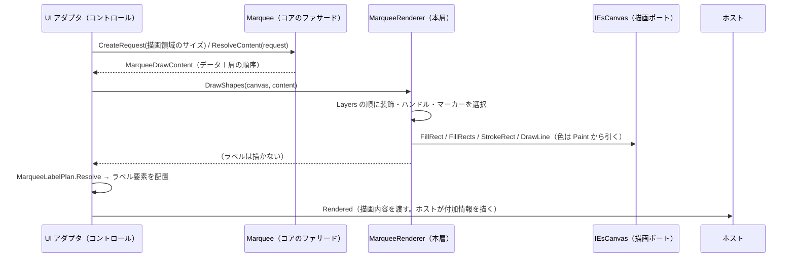
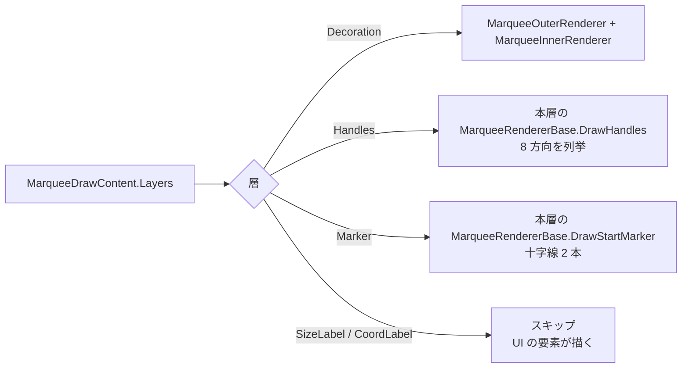
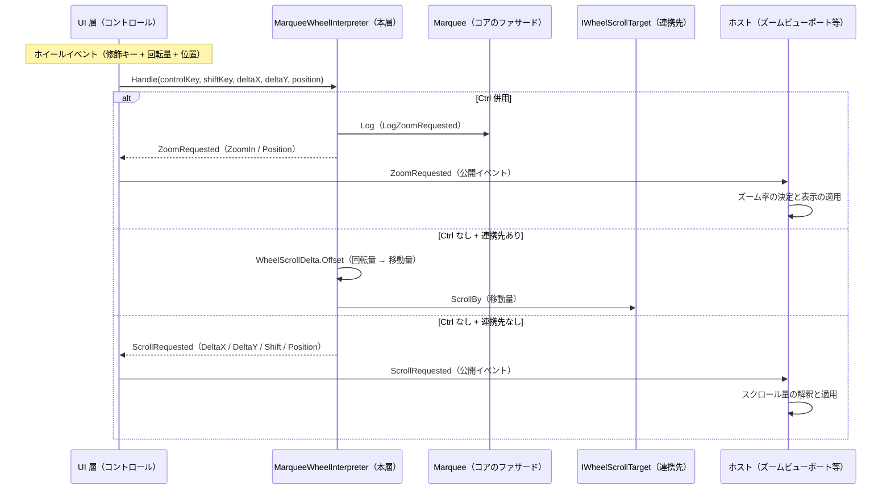
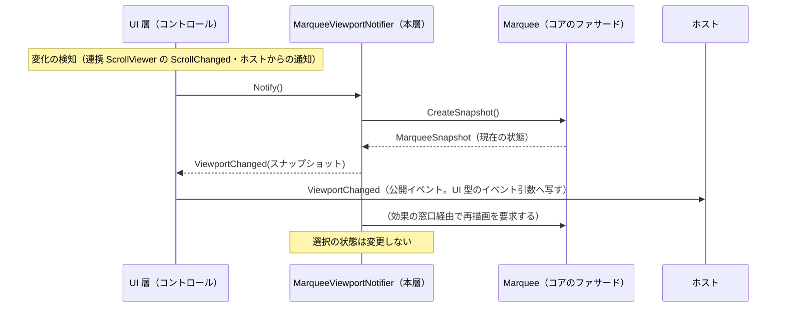

# MarqueeControl.UIBase システム仕様書

`MarqueeControl.UIBase`（`MarqueeControl` をコントロールとして成り立たせる UI 非依存層）の構造・依存・例外処理・コンポーネント構成を記載します。外部機能と公開 API は [SPEC_ExtFunc](SPEC_ExtFunc.md)、利用手順は [README](README.md) を参照してください。

## 1. システム概要

| 項目 | 内容 |
| --- | --- |
| 目的 | 「どう描くか（描画 API の呼び出し手順）」と「他のコントロールへ組み込むときにだけ必要な規則」を 1 箇所へ集約し、UI の追加・描画方式の変更を描画ポートの実装だけで済ませる |
| 提供形態 | クラスライブラリ（`MarqueeControl.UIBase.dll`） |
| 想定利用者 | UI 実装（`MarqueeControl.AvaloniaUI` / `MarqueeControl.MewUI`）・独自コントロールの実装者 |
| 汎用性 | 特定のアプリ・UI に依存しない。寸法・表示可否・文言はコアの契約が、色は本層の `MarqueePaint` が単一所有する |

本層は 2 つの関心事を持ちます。どちらも「単体で使う `Marquee` だけでは決まらない」ため、コア（`Feature.MarqueeCore`）には置きません。

| 関心事 | 内容 | 代表型 |
| --- | --- | --- |
| **描画手順** | 色（描画にだけ必要な設定）と、層の順序に従って描画ポート（`IEsCanvas`）を呼ぶ手順、実寸 → ラベル要素の写像 | `MarqueePaint` / `MarqueeRenderer` / `MarqueeOuterRenderer` / `MarqueeInnerRenderer` / `MarqueeLabelPlan` / `MarqueeHostLabelRenderer`（写し方の基底は本層の `MarqueeRendererBase`） |
| **組み込み規則** | ホイール入力の解釈・連携先へのスクロール適用・ビューポート変化の再通知 | `MarqueeWheelInterpreter` / `MarqueeViewportNotifier` / `WheelZoomRequest` / `WheelScrollRequest` / `IWheelScrollTarget` |

## 2. 技術スタック

| 項目 | 内容 |
| --- | --- |
| ターゲット | `net10.0` |
| 言語 | C# 14（`Nullable` 有効・`ImplicitUsings` 有効） |
| ルート名前空間 | `EsUtil.SaveEvidence.Marquee.UIBase` |
| ログ | `Microsoft.Extensions.Logging.Abstractions`（LoggerMessage ソース生成・`ILogger` 拡張メソッド） |
| ドキュメント生成 | `GenerateDocumentationFile` 有効（XML は配布物へ出さず `cref` の検証のみに使う） |
| テスト | xUnit v3（UI 初期化不要。描画は Skia のビットマップ上で画素検証する） |

## 3. アーキテクチャ

### 3.1 依存方向

層の全体像（Core / UIBase / UI）は [`src/README.md`](../README.md) を参照してください。

```text
UI 層（MarqueeControl.AvaloniaUI / MarqueeControl.MewUI）
  入力の受付・効果の適用・通知の転送・描画先の用意・ラベル要素の配置
    ├──> MarqueeControl.UIBase ← 本プロジェクト   どう描くか（色・描画手順）＋ 組み込み先がある場合にだけ必要な規則
    └──> Feature.MarqueeCore   何を描くか + 判断（状態・値・純粋計算・コア⇔UI の契約）
           ├──> Common（IEsCanvas）
           └──> Platform.Core（Es* 値型・ICoordTransform・ICursorService・ScrollMath）
※ コアは本層を参照しない（本層がコアの描画内容（`MarqueeDrawContent`）を使う向きだけ）。
```

- 上位層は下位層のみを参照します（逆参照なし）。
- 本層は UI フレームワークを参照しません（描画 API は `IEsCanvas` 経由。ホイールは修飾キーの真偽と回転量だけを受け取る）。
- コアは本層を参照しません（**コアは「何を描くか」、本層は「どう描くか」**）。

### 3.2 描画のデータフロー（どこから描画されるか）



### 3.3 描画の分岐



### 3.4 ホイール入力のデータフロー



### 3.5 ビューポート変化のデータフロー



## 4. コンポーネント構成

```text
src/MarqueeControl.UIBase/
├── src/
│   ├── MarqueePaint.cs              色の単一所有（ハンドル・十字マーカー・ラベル・装飾）
│   ├── MarqueeRenderer.cs           描画内容を層の順に写す（IMarqueeRenderer の既定実装。色を保持）
│   ├── MarqueeOuterRenderer.cs      外側の装飾（暗転マスク・穴あけ枠）の描画
│   ├── MarqueeInnerRenderer.cs      内側の装飾（塗り・内枠）の描画
│   ├── MarqueeLabelPlan.cs          実寸 → ラベル要素の配置指示の写像
│   ├── MarqueeHostLabelRenderer.cs  ホスト付加情報ラベルの体裁適用
│   ├── MarqueeWheelInterpreter.cs   ホイールの解釈・通知・連携先への適用
│   │                                （同ファイル内: `IWheelScrollTarget` / `WheelScrollDelta`（internal））
│   ├── MarqueeViewportNotifier.cs   ビューポート変化の再通知（スナップショット + 再描画）
│   ├── WheelRequest.cs              要求の値型（WheelZoomRequest / WheelScrollRequest）
│   └── MarqueeWheelLogMessage.cs    ズーム要求のログ定義（LoggerMessage ソース生成。internal）
└── tests/
    ├── TestHelper.cs                テスト用の描画先（Skia）
    ├── RecordingLogger.cs           ログ出力を収集するテスト用 ILogger
    ├── StubMarqueeRenderer.cs       描画しない描画実装（コアのファサード生成用）
    ├── MarqueePaint.Tests.cs       色の既定値・未指定のハンドル塗り色の解決の検証
    ├── MarqueeRenderer.Tests.cs     図形の描画の検証
    ├── MarqueeLabelPlan.Tests.cs    実寸 → ラベル要素の写像の検証
    ├── MarqueeHostLabelRenderer.Tests.cs 付加情報ラベルの体裁の検証
    ├── MarqueeWheelInterpreter.Tests.cs  解釈・通知・適用・ログの検証
    ├── WheelRequest.Tests.cs        要求の値の検証
    └── MarqueeViewportNotifier.Tests.cs  ビューポート変化の通知の検証
```

### 描画手順

| コンポーネント | 責務 |
| --- | --- |
| `MarqueePaint` | 色の単一所有者（ハンドル・十字マーカー・ラベル・装飾） |
| `MarqueeRenderer` | 本層の `MarqueeRendererBase` の既定実装（sealed）。色を必須引数で受け取り、描画内容の解決結果を層の順に描画ポートへ写す。図形の層を描き、テキストのフック（`DrawLabel`）は基底の既定（何もしない）を引き継ぐ |
| `MarqueeOuterRenderer` | `MarqueeOuterDecoFrame`（暗転領域・枠線）を `paint.OverlayColor` / `paint.OuterBorderColor` で描く |
| `MarqueeInnerRenderer` | `MarqueeInnerDecoFrame`（塗り・内枠）を `paint.InnerFillColor` / `paint.InnerBorderColor` で描く |
| `MarqueeLabelPlan` | 描画内容と実寸からラベル要素の配置指示を解決する |
| `MarqueeHostLabelRenderer` | ホスト付加情報ラベルへコアの体裁を適用して描く |

### 組み込み規則

| コンポーネント | 責務 |
| --- | --- |
| `MarqueeWheelInterpreter` | 解釈（Ctrl の判定・方向の決定）・通知（`ZoomRequested` / `ScrollRequested`）・適用（連携先への `ScrollBy`）・ログ。ビューの状態を保持しない |
| `IWheelScrollTarget` | スクロールの適用先（UI 層が適合させる抽象） |
| `WheelScrollDelta` | 回転量 → 移動量の換算（1 ノッチ = 48 DIP・Shift で横） |
| `WheelZoomRequest` / `WheelScrollRequest` | 要求の値（方向・回転量・修飾キー・発生位置）。`WheelScrollRequest.Delta` がコア型同士の変換を単一所有する |
| `MarqueeWheelLogMessage` | ズーム要求のログ定義（書式・レベル） |
| `MarqueeViewportNotifier` | ビューポート変化の再通知（現在の状態スナップショット）と再描画の要求。選択の状態は変更しない |

## 5. 責務の分担と設計判断

| 層 | 責務 |
| --- | --- |
| `Feature.MarqueeCore` | 選択の判断（ドラッグ・nudge・確定/キャンセル・スナップ・最小サイズ）・状態・描画内容の解決（層と順序）・ログ定義（選択の判断に伴うもの） |
| **本プロジェクト** | **色の単一所有（`MarqueePaint`）**・**描画 API の呼び出し手順**・実寸 → ラベル要素の写像・**ホイール入力の解釈（Ctrl = ズーム / それ以外 = スクロール）**・要求の通知・**連携先へのスクロール適用（回転量 → 移動量の換算を含む）**・ズーム要求のログ定義・**ビューポート変化の再通知（スナップショット + 再描画）** |
| `MarqueeControl.*UI` | フレームワークの入力イベントから修飾キーと回転量を取り出して `Handle` を呼ぶ、要求を公開イベントへ転送する、**自 UI のスクロール機構を `IWheelScrollTarget` へ適合させて注入する**、描画先（`IEsCanvas`）の用意、ラベル要素の配置 |
| ホスト | 要求の実処理（ズーム率の決定・表示の適用・スクロール先の決定）・付加情報ラベルの文言 |

| 判断 | 理由 |
| --- | --- |
| 描画手順を本層に置く（コアに置かない） | コアは「何を描くか（判断・データ）」だけを決める。描画 API の呼び出しは UI フレームワーク差を `IEsCanvas` へ閉じ込めた本層の責務である |
| 色を本層に置く（コアに置かない） | 色は描画にだけ必要な設定であり、コアの計算・判断には使わない（描くかどうかは `MarqueeDecoOptions` の明示フラグが決める）。コアの描画契約へ色を戻すと、色の設定経路がコア → 本層の逆参照になる |
| ホイール要求を Core ではなく本層に置く | 「Ctrl+ホイール = ズーム」は選択の判断ではなく、選択コントロールをビューポートへ組み込むときの規則である。単体で使う Marquee にはズームもスクロールも存在しないため、コアをそのまま独立できるよう本層へ分離する |
| 要求イベントを本層が持ち、UI 層は転送のみ行う | UI 層に「どちらの要求を出すか」の分岐を残さない（両 UI で解釈が同じになり、片方だけ修正される事故を防ぐ） |
| ログ定義を本層が持つ | ズーム要求のログは両 UI で同一の書式・レベルにする必要がある。ロガーはコアのファサード（`Marquee.Log`）を共用し、ホストのログ基盤へ出力する |
| 要求の値型を本層が持つ | 要求の型は解釈の結果そのものであり、コア（選択）から見ると存在しない概念である（コアの公開面に残さない） |
| 連携スクロールの適用を本層が持つ（適用先は抽象） | 「1 ノッチ = 48 DIP」「Shift で横」は UI をまたいで同じ規則であり、*回転量から移動量への換算と適用の順序* を UI ごとに書かせない。UI 固有の型は `IWheelScrollTarget` へ適合させて吸収する |
| 連携先が無い場合は要求として通知する | スクロール先（ズームビューポートのパン等）が UI 側に無い場合、勝手に捨てずホストへ委ねる（振る舞いを後方互換に保つ） |
| ビューポート変化の通知を Core ではなく本層に置く | ビューポートは組み込み先に存在する概念であり、単体で使う Marquee には存在しない。コアに置くと、コアが「他のコントロール（ビューポート）の語彙」を持つことになる |

## 6. 単一所有（同じ真実を 2 箇所に持たない）

| 対象 | 所有者 |
| --- | --- |
| 描画する層とその順序 | `Marquee.ResolveLayers`（コア。本層は順に写すだけ） |
| 描くかどうかの判断（非表示・選択なし・nudge・表示可否フラグ・穴あけ矩形な し） | コア（`Marquee.ResolveContent`。本層は判断を持たない） |
| ハンドルの矩形（8 方向の位置と大きさ） | コア（`Marquee.ResolveContent` が解決済み。本層は矩形を渡すだけ） |
| ラベルの文言と基準点 | コア（`MarqueeTextPlacement`） |
| ラベルの体裁（フォントサイズ・内側余白・色） | 本層（`MarqueePaint`） |
| 描画に使う色（ハンドル・十字マーカー・ラベル・装飾） | 本層（`MarqueePaint`） |
| ラベル要素の写像（順序・実寸の反映・アライン・領域クランプ） | 本層（`MarqueeLabelPlan`） |
| 描画 API の呼び出し（背景 → 文字の順序） | `Platform.Core`（`SkiaLabel` / `IEsCanvas.DrawLabel`） |
| ブラシ・ペンの共有 | 描画ポートの実装（`AvaloniaCanvas` / `SkiaEsCanvas`） |
| ホイール入力の解釈（Ctrl = ズーム、方向 = 回転量の符号） | `MarqueeWheelInterpreter.Handle` |
| 連携先への適用（ズーム以外はスクロールとして適用し、通知を抑止する） | `MarqueeWheelInterpreter.Handle` |
| 回転量 → 移動量の換算（1 ノッチ・Shift の横変換） | `WheelScrollDelta.Offset` |
| 要求の値（方向・回転量・修飾キー・発生位置） | `WheelZoomRequest` / `WheelScrollRequest` |
| 回転量のベクター変換（`EsVector`） | `WheelScrollRequest.Delta` |
| ズーム要求のログ書式・レベル | `MarqueeWheelLogMessage.LogZoomRequested` |
| ロガーの保持と null の吸収 | コアのファサード（`Marquee.Log`） |
| 1 ノッチあたりの移動量（48 DIP） | `Platform.Core` の `ScrollMath.WheelScrollUnit` |
| ズーム率の決定と表示の適用 | 受け手（ホスト。ズームビューポート） |
| テキストの実寸測定 | UI 層（ホスト。Avalonia は `FormattedText`、MewUI は `SkiaText.Measure`） |

## 7. 例外処理ポリシー

| 状況 | 扱い |
| --- | --- |
| `canvas` が null | `ArgumentNullException`（呼び出し側の実装誤り） |
| `layers` / `frame` が空・null 項目 | 何もしない（描くものが無い状態は例外ではない） |
| `measureText` が null | `ArgumentNullException` |
| 描画の設定（`paint`）が null | `ArgumentNullException` |
| `MarqueeHostLabelRenderer.Draw` の `text` が null | `ArgumentNullException` |
| 基準点が描画面の外 | 例外にせず描画先のクリップに任せる |
| `MarqueeWheelInterpreter` の生成でコアのファサードが null | `ArgumentNullException` を送出する（配線の誤りを早期に検出する） |
| ロガーが未設定（`Marquee.Log` に null） | コアのファサードが `NullLogger` へ吸収する（本層は判断しない） |
| 要求の購読者がおらず連携先も無い | 何もしない（通知は null 条件付きで発火する） |
| 連携先が null（未連携・解除後） | スクロールを要求として通知する（黙って捨てない） |

## 8. 可視性ポリシー

- 描画手順はすべて `public` です（UI 実装・独自コントロールの作者が参照する API のみで構成されるため、internal にする対象がない）。
- 組み込み規則は、UI 層が使う型のみ `public`、本層の内部手順（`WheelScrollDelta` / `MarqueeWheelLogMessage`）は `internal` とし、単体テストにのみ `InternalsVisibleTo` で公開します。
- `[EditorBrowsable]` による「見えにくくする」対処は行いません（公開面も契約も変わらないため）。

## 9. テスト方針

| 方針 | 内容 |
| --- | --- |
| UI 初期化不要 | 描画は `SkiaEsCanvas`（UI 非依存）で行い、ビットマップの画素を検証する。ホイールの解釈は UI 型を持たないため `[Fact]` で検証する |
| 検証点 | 描画手順の唯一の検証点である（UI 側はアダプタのみを持つため、UI ごとの描画テストは不要） |
| 合計 | 59 件（描画 36 / 組み込み規則 23） |

```powershell
dotnet test src/MarqueeControl.UIBase/tests/MarqueeControl.UIBase.Tests.csproj
```

## 10. ライセンス

MIT License（全文は [`../../LICENSE`](../../LICENSE) を参照）。
