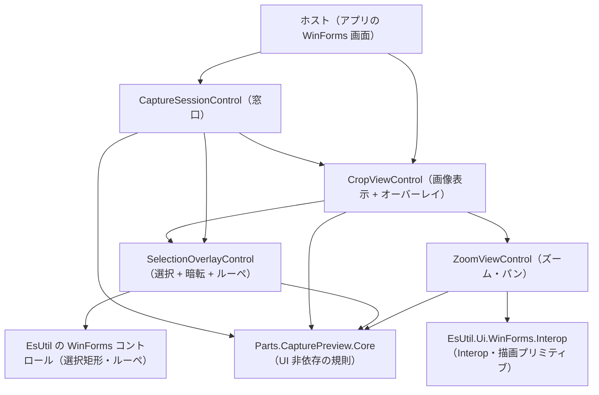
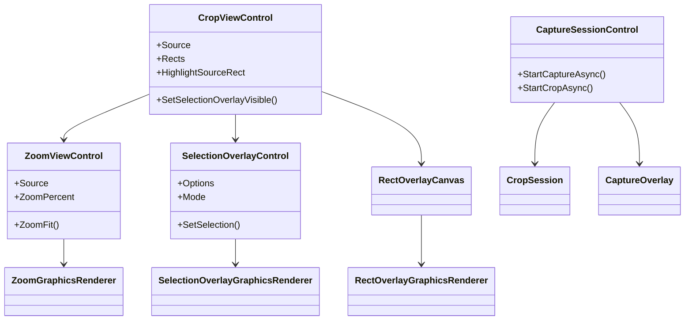
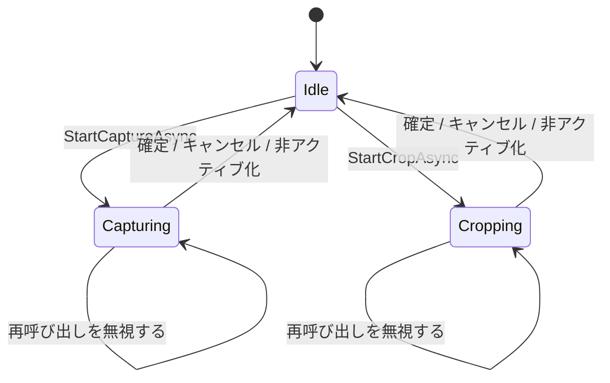
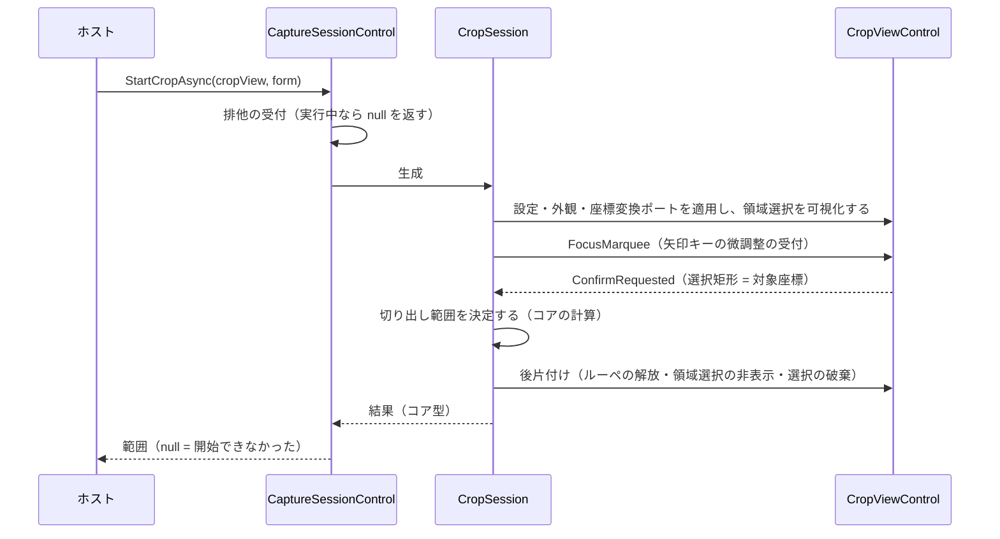

# Parts.CapturePreview.ControlWinForms システム仕様書

## 目次 <!-- omit from toc -->

- [1. 概要](#1-概要)
- [2. 技術スタック](#2-技術スタック)
- [3. アーキテクチャ](#3-アーキテクチャ)
- [4. コンポーネント構成](#4-コンポーネント構成)
  - [4.1 コンポーネント一覧](#41-コンポーネント一覧)
  - [4.2 クラス図](#42-クラス図)
  - [4.3 状態遷移（撮影と切り出しの排他）](#43-状態遷移撮影と切り出しの排他)
  - [4.4 切り出しの流れ](#44-切り出しの流れ)
- [5. 依存関係](#5-依存関係)
- [6. 例外処理ポリシー](#6-例外処理ポリシー)
- [7. ビルドと検証](#7-ビルドと検証)

## 1. 概要

本プロジェクトは、撮影スタック（`Parts.CapturePreview.Core`）を WinForms で使うためのコントロール層です。 `Parts.CapturePreview.ControlMewUI` の WinForms 版であり、**機能は既存の UI 版と同等**です。

| 目的 | 内容 |
| --- | --- |
| UI 非依存コアの共有 | 判断・値・計算はコアが持ち、本プロジェクトは入力の受付・効果の適用・通知の転送・描画・ホスト結線だけを行う |
| WinForms への適合 | 重ね合わせ・入力の透過・DPI 追従・画像の描画を WinForms の機構で表す。 子コントロールは親の描画を自分の背景として塗るため、重ねた兄弟は**下の兄弟の描画を覆い隠す**（描画のクリップで `WM_PAINT` すら届かなくなる）。 表示する必要のあるオーバーレイだけを表示し、重なり順を切り替えて表す |
| ホスト結線の集約 | セッションの生成・破棄・排他の受付を窓口（`CaptureSessionControl`）へ集約し、ホストは「いつ開始するか」「結果をどう反映するか」だけを担う |

## 2. 技術スタック

| 項目 | 値 | 理由 |
| --- | --- | --- |
| 対象フレームワーク | `net10.0-windows10.0.17763.0` | `System.Windows.Forms` を使う層の割り当て（`ビルド設定規約.md` §4） |
| UI フレームワーク | WinForms（`UseWindowsForms`） | 本層が提供する対象 |
| 描画 API | GDI+（`System.Drawing`） | Skia は `net10.0-windows10.0.17763.0` で解決できないため（`EsUtil.Ui.WinForms.Interop` が同じ理由を持つ） |
| 依存パッケージ | `Microsoft.Extensions.Logging.Abstractions` | ログの抽象（`ILogger`） |
| 参照するプロジェクト | `Parts.CapturePreview.Core` / `EsUtil.Ui.WinForms.Interop` / `EsUtil.Platform.Core` / `EsUtil.Ui.WinForms.Marquee` / `EsUtil.Ui.WinForms.Loupe` | コアの規則・描画のプリミティブ・内包するコントロール |
| テスト | xUnit v3 | 他プロジェクトと同じ（`テスト規約.md`） |

## 3. アーキテクチャ



**層の分担**:

| 層 | 責務 |
| --- | --- |
| コア（`Parts.CapturePreview.Core`） | ズームの状態遷移・表示矩形の計算・切り出し範囲の決定・選択の可否・モードごとの表示可否・ラベルの配置指示・ログの書式 |
| EsUtil のコントロール | 選択矩形のドラッグ・ハンドル・nudge・暗転マスク・サイズラベル、ルーペの切り出しと拡大 |
| 本プロジェクト（UI 層） | 入力のブリッジ・描画・重ね合わせ・DPI 追従・セッションのライフサイクル |
| `EsUtil.Ui.WinForms.Interop` | コア型 ⇔ GDI+ 型の変換、画像の複製と描画、テキストと矩形の描画プリミティブ |

## 4. コンポーネント構成

### 4.1 コンポーネント一覧

| 型 | 責務 | 状態を持つか |
| --- | --- | --- |
| `ZoomViewControl` | ズーム・パン・Fit の入力ブリッジと描画（下地 → 画像 → スクロールバー） | セッション・表示する画像の複製を保持する |
| `CropViewControl` | 画像表示と 3 つのオーバーレイの重ね合わせ・写像の更新 | 外部提供矩形・強調矩形を保持する |
| `SelectionOverlayControl` | 選択矩形と ルーペの生成・配置・配線・状態同期・付加情報の描画 | 設定・モードを保持する |
| `CaptureSessionControl` | 撮影と切り出しの窓口（排他の受付・設定の共有・生成と破棄） | スロット・設定・サービスを保持する |
| `CaptureOverlay` | 撮影 1 セッション（退避 → 取得 → 表示 → 確定待ち → 復帰） | 画像・倍率・ハイライトの状態を保持する |
| `CropSession` | 切り出し 1 セッション（配線・確定・キャンセル・後片付け） | 設定・状態機械・完了通知を保持する |
| `ZoomGraphicsRenderer` | セッションの値を GDI+ へ写す描画層 | 持たない |
| `RectOverlayCanvas` / `RectOverlayGraphicsRenderer` | 外部提供矩形のオーバーレイの描画 | 描画する矩形を保持する |
| `SelectionOverlayGraphicsRenderer` | ルーペ画像上の選択矩形の破線の描画 | 持たない |
| `OverlayHitTest` | 入力の透過の規則（無効状態 = ヒットテストを透かす） | 持たない |

### 4.2 クラス図



### 4.3 状態遷移（撮影と切り出しの排他）



排他（同時に 1 つだけ）と再入の拒否はコアが単一所有し、本プロジェクトはその唯一の適用者です。

### 4.4 切り出しの流れ



## 5. 依存関係

| 参照先 | 用途 |
| --- | --- |
| `Parts.CapturePreview.Core` | 撮影・切り出し・選択の共通規則と提示の写像（UI 非依存） |
| `EsUtil.Ui.WinForms.Interop` | コア型 ⇔ GDI+ 型の変換・DIP 換算・画像の複製と描画・テキストと矩形の描画 |
| `EsUtil.Platform.Core` | コア型・画像・DPI 換算・Win32 サービス（キャプチャ・要素検出・ウィンドウ操作） |
| `EsUtil.Ui.WinForms.Marquee` | 選択矩形コントロール（暗転マスク・ハンドル・nudge・サイズラベル） |
| `EsUtil.Ui.WinForms.Loupe` | ルーペ コントロール（拡大鏡） |

**参照しない**: `App.*`（`依存関係.md` §4 の `DEP0004` が拒否します）。 許可された参照の一覧は `依存関係.md` §3 が所有します。

## 6. 例外処理ポリシー

共通方針は [`例外処理規約.md`](../../../.github/例外処理規約.md) §2・§3 に従います。 本プロジェクト固有の事項は次のとおりです。

| 状況 | 扱い | 理由 |
| --- | --- | --- |
| 引数が null | `ArgumentNullException`（`ArgumentNullException.ThrowIfNull`） | 呼び出し側の誤りであり、回復できない |
| 破棄済みの窓口の操作 | `ObjectDisposedException` | セッションの後片付けが済んでおり、操作できない |
| 退化した選択（切り出せない矩形） | **0x0 の空矩形**を返す（例外にしない） | キャンセルと同じ表現にし、ホストの分岐を 1 つにする（`null` は「開始できなかった」に限定する） |
| 開始できない要求（実行中・画像なし） | `null` を返す（例外にしない） | 排他の受付結果であり、ホストは「何も起きなかった」として扱える |
| 撮影の取得失敗 | コアのサービスが投げる例外をそのまま伝搬する（`Win32Exception` 等） | 取得できない状態では撮影が成立せず、呼び出し側に代替手段が無い |
| 表示の完了後の例外 | 境界で記録して続行する（`BoundaryCatch` + `LogOperationError`） | 撮影の終了を例外で中断するとセッションが終了できなくなる |

**境界での捕捉は 1 箇所**: 公開ファサード（`ZoomViewControl` / `CropViewControl` / `SelectionOverlayControl` / `CaptureSessionControl`）だけが `catch (Exception ex) when (BoundaryCatch.IsRecoverable(ex))` で例外を記録して再送出します（`git grep BoundaryCatch` で一覧できます）。

## 7. ビルドと検証

```powershell
dotnet build src/Parts.CapturePreview.ControlWinForms/src/Parts.CapturePreview.ControlWinForms.csproj
dotnet test src/Parts.CapturePreview.ControlWinForms/tests/Parts.CapturePreview.ControlWinForms.Tests.csproj
```

合否基準と手順は [`検証手順.md`](../../../.github/検証手順.md) が所有します（ビルドの警告 0・エラー 0、テストの全件合格）。 テストはハンドル（ウィンドウ）を生成する操作を対象外とし、描画はオフスクリーンのビットマップ上で画素を実測します。
