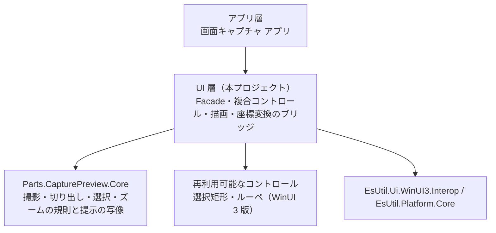
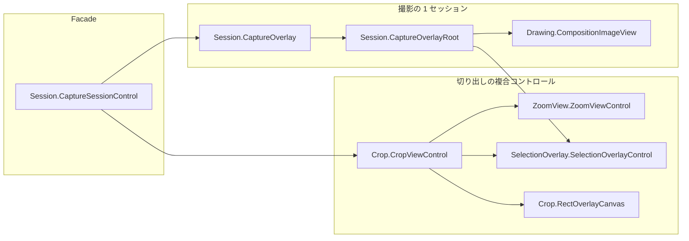
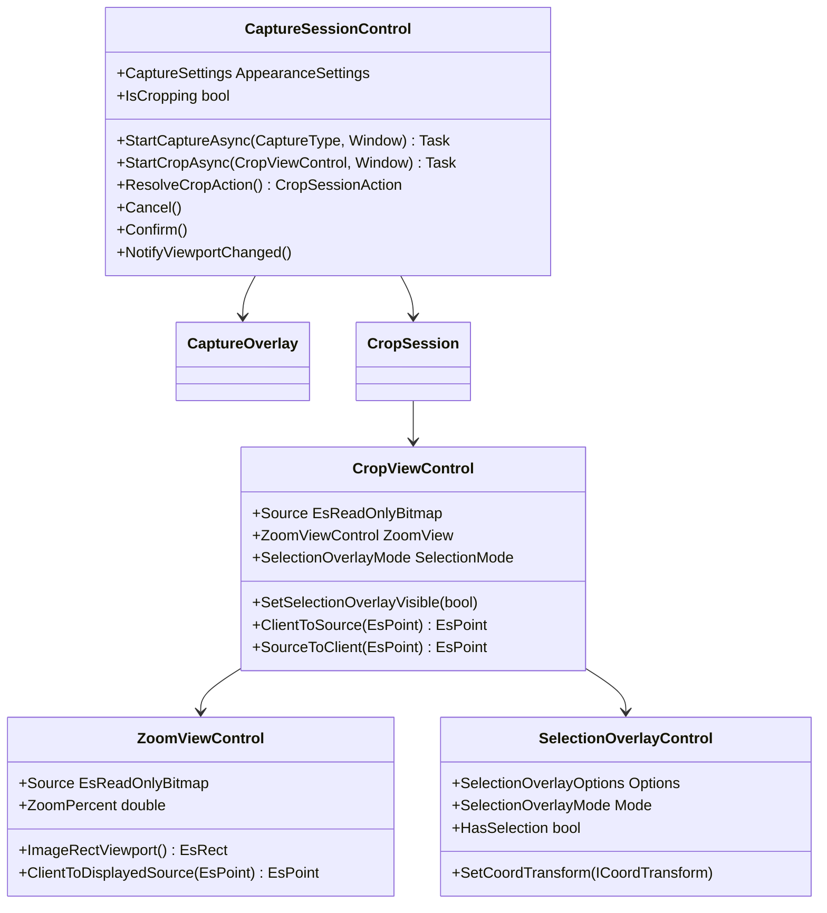
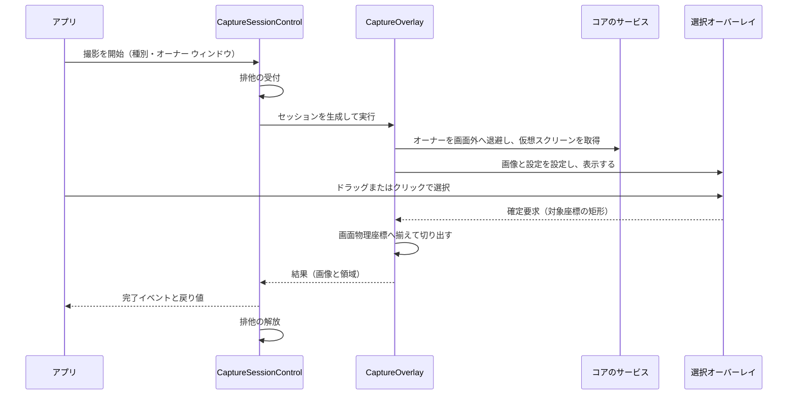
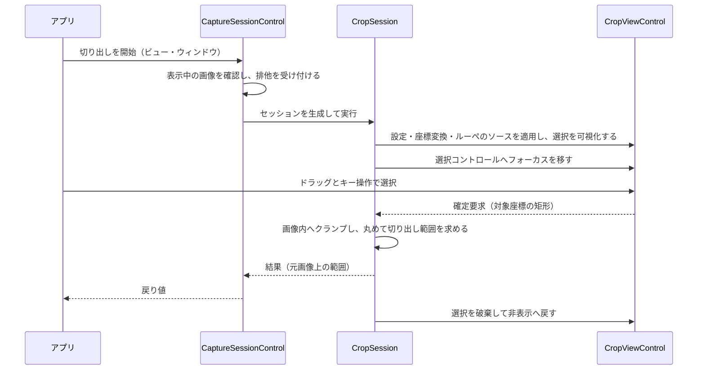
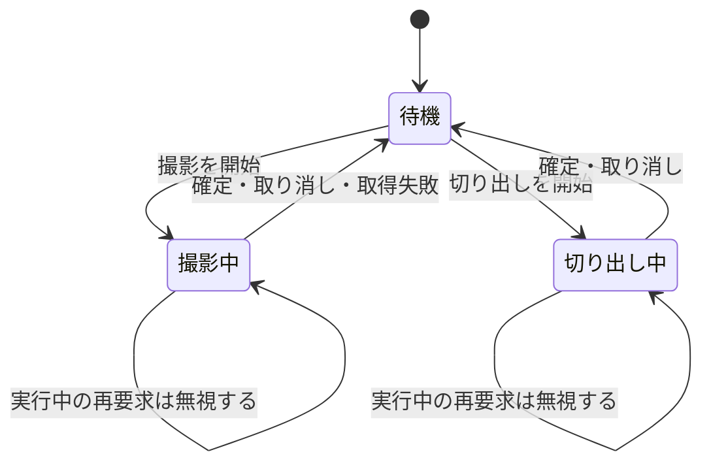
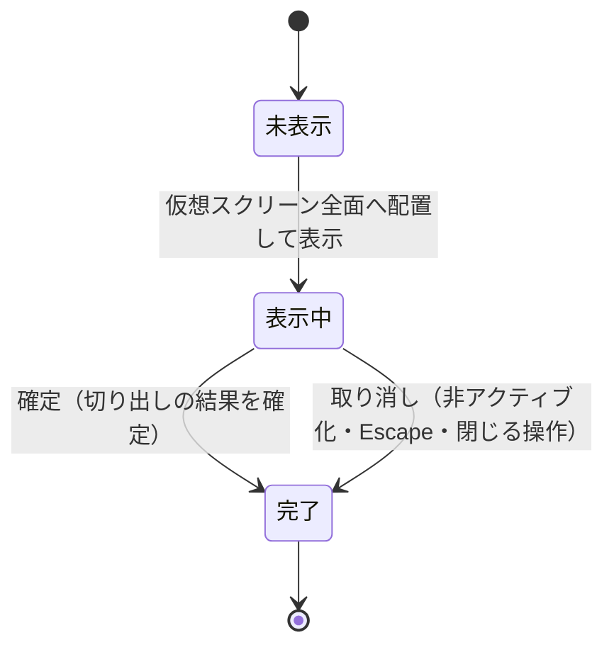

# Parts.CapturePreview.ControlWinUI3 システム仕様書

## 目次 <!-- omit from toc -->

- [1. システム概要](#1-システム概要)
- [2. 技術スタック](#2-技術スタック)
- [3. アーキテクチャ](#3-アーキテクチャ)
- [4. コンポーネント構成](#4-コンポーネント構成)
- [5. 依存関係](#5-依存関係)
- [6. 例外処理ポリシー](#6-例外処理ポリシー)
- [7. クラス図](#7-クラス図)
- [8. シーケンス図](#8-シーケンス図)
- [9. 状態遷移](#9-状態遷移)
- [10. テスト方針](#10-テスト方針)
- [11. 検証できない範囲](#11-検証できない範囲)
- [12. 制約](#12-制約)

## 1. システム概要

`Parts.CapturePreview.ControlWinUI3` は、画面キャプチャの撮影スタックを WinUI 3 のコントロールとして提供する層です。

- **撮影（画面全体の選択）と切り出し（プレビュー内の範囲指定）の 2 つのセッション**を持ちます。
- 状態・判断・計算は UI 非依存のコア（`Parts.CapturePreview.Core`）が持ち、本層は**入力の受付・効果の適用・描画・配線**だけを行います。
- 表示は **Composition と XAML の要素**で行います。 撮影画像は撮影時に 1 度だけ Composition のサーフェスへ写し、以降は加工しません。

## 2. 技術スタック

| 項目 | 値 |
| --- | --- |
| 対象フレームワーク | `net10.0-windows10.0.22621.0` |
| UI フレームワーク | WinUI 3（`Microsoft.WindowsAppSDK` 1.x。 `UseWinUI` を有効にする） |
| 最低対応 OS | `10.0.19041.0` |
| 表示 | Composition（`SpriteVisual` + `LoadedImageSurface`）と XAML の要素（`Rectangle`） |
| 画像とログ | `EsUtil.Platform.Core`（画像型・Win32 サービス）、`Microsoft.Extensions.Logging.Abstractions` |
| テスト | xUnit v3（`OutputType` は `Exe` を明示する） |

## 3. アーキテクチャ

層の依存は常に一方向です。 本層は**コントロール層（UI）**に属し、コアの規則と描画プリミティブを参照します。

設計の原則:

1. **規則・判断・計算はコアが持ち、本層は写像だけを行う**（本層に「どちらの操作をすべきか」の判断を書かない）。
2. **入力はコントロールが受け取り、ウィンドウは撮影の間だけの器とする**（撮影のオーバーレイは入力の受け口を 1 か所に集める）。
3. **描画の内容はコアが確定した値に従う**（描画層は式・クランプ・既定値を持たない）。

## 4. コンポーネント構成

| コンポーネント | 役割 |
| --- | --- |
| `Session.CaptureSessionControl` | 撮影と切り出しの Facade。 サービスの生成と破棄、排他の受付、設定の保持 |
| `Session.CaptureOverlay` | 撮影の 1 セッション（オーナーの退避・仮想スクリーンの取得・オーバーレイの表示・確定） |
| `Session.CaptureOverlayRoot` | オーバーレイのルート要素（下地色と十字カーソルを持つ） |
| `Session.CropSession` | 切り出しのライフサイクル（確定・キャンセル・ホストの非アクティブ化） |
| `Crop.CropViewControl` | 画像ビューポート・矩形オーバーレイ・領域選択・強調を重ねた複合コントロール |
| `Crop.RectOverlayCanvas` | 外部提供矩形の重ね描き（入力は下のレイヤへ通す） |
| `ZoomView.ZoomViewControl` | ズーム・パン・Fit の画像ビューポート（スクロールバーを自前で描く） |
| `SelectionOverlay.SelectionOverlayControl` | 選択矩形・暗転マスク・ルーペの組み立てと配線 |

## 5. 依存関係

| 参照先 | 用途 |
| --- | --- |
| `Parts.CapturePreview.Core` | 撮影・切り出し・選択・ズームの規則、設定型、ログ定義、提示の写像 |
| `EsUtil.Ui.WinUI3.Interop` | コア型 ⇔ WinUI 3 の型の変換、DIP の換算、画像の表示ビュー、実効倍率の解決 |
| `EsUtil.Platform.Core` | コアの値型、画像型、Win32 のサービス（画面キャプチャ・要素検出・ウィンドウ操作） |
| `EsUtil.Ui.WinUI3.Interop` | 描画リストの要素への反映、Composition の画像表示、テキストの実寸測定 |
| 再利用可能なコントロール（WinUI 3 版） | 選択矩形（`Marquee`）とルーペ（`Loupe`）のコントロール |

- **本層からアプリへの参照はない**（`DEP0004` が機械的に拒否する）。
- **本層から許可されていないプロジェクトへの参照はない**（`DEP0005` が機械的に拒否する）。
- 名前空間はフォルダに追従します（`IDE0130` がビルドで検査する）。

## 6. 例外処理ポリシー

[`例外処理規約.md`](../../../.github/例外処理規約.md) §4 に従います。 本層固有の判断は次のとおりです。

| 状況 | 扱い |
| --- | --- |
| 公開ファサード（`CaptureSessionControl` と各コントロール） | 下位の例外を集約して記録し、呼び出し側へ伝搬する（`BoundaryCatch` で判定し、`throw;` でスタックを保つ） |
| 撮影の取得失敗（画像が得られない） | **null を返す**（例外にしない。 取り消しと同じ表現にする） |
| 切り出しの取り消し・退化した選択 | **0x0 の空矩形を返す**（null は「開始できなかった」の意味に限る） |
| 実行中の再要求 | **何もせずに返す**（既存のセッションを中断しない） |
| 描画の失敗 | 記録して継続する（描画のたびに再試行され、アプリを落とさない） |

## 7. クラス図

## 8. シーケンス図

撮影の流れ:

切り出しの流れ:

## 9. 状態遷移

撮影と切り出しの排他（コアのスロットが判断する）:

撮影オーバーレイのウィンドウ:

## 10. テスト方針

- **検証はビルドの警告 0 と `dotnet test` の全件合格で判定する**（[`検証手順.md`](../../../.github/検証手順.md)）。
- 対象は描画リストの内容（矩形・色・順序）と Facade の状態（設定の部分更新・破棄・操作なしの呼び出し）です。
- **描画層のテストは画素で固定する**（破線のダッシュ長・半透明のアルファ・退化した入力で描かないこと）。
- **Facade のテストはウィンドウを生成しない**（コンストラクタとサービスの生成は P/Invoke を実行しない）。

## 11. 検証できない範囲

| 対象 | 理由 | 確認の方法 |
| --- | --- | --- |
| コントロールのインスタンス（入力・配置・重なり順） | XAML の型は、XAML のランタイムを初期化していないプロセスで生成できない（実測: `COMException` 0x80040154 `REGDB_E_CLASSNOTREG`） | アプリでの動作確認 |
| 撮影セッションの実行（ウィンドウの表示・画面の取得・確定） | ウィンドウと画面が必要 | アプリでの動作確認 |
| モニターごとの DPI の照会 | モニター構成に依存する | アプリでの動作確認（照会できない場合は基準値 96 を使う） |

## 12. 制約

- **UI スレッド**: セッションの開始・確定・描画は UI スレッドで行います。
- **透明の表現**: WinUI 3 のウィンドウは透明を表現できないため、撮影オーバーレイは「撮影画像の平均色へ暗転色を重ねた色」を下地にします（画像が合成されるまでの 1 フレームの見え方を暗転後の見た目に近づける。 平均色のままにすると、その 1 フレームが明るい画面に見えます）。 ウィンドウは最初から**仮想スクリーンと同じ大きさ**で画面外に置いて内容を描かせ、最初の描画フレームを待ち（上限 400 ms）、さらに合成の完了を 200 ms 待ってから、大きさを変えずに画面内へ移します（大きさを変えると再レイアウトが走り、白い下地が 1〜2 フレーム見えます。 移動を早めると同じく白いフレームが出ます。 いずれも実測 2026-10-17）。 **撮影画像の読み込み完了も待ちます**（`LoadedImageSurface` は段階的に復号するため、完了前に移すと縮小された画面が 1〜2 フレーム見えます。 実測 2026-10-25: `CompositionImageView.WaitForSourceReadyAsync` を使う）。 さらに**画像を含む描画フレームをもう 1 回待ち**、`Activate` の直後にもう一度だけ画面外へ置き直します（`Activate` でウィンドウが初めて表示されるときに既定の位置・大きさが適用され、小さい画面が 1 フレーム見えるため。 実測 2026-10-25）。 画面内へ移した後は `MoveInZOrderAtTop` で Z 順も最前面にします（オーナーを退避しない場合、オーナーの背後に隠れるため）。
- **オーナーの退避**: キャプチャ除外（`WDA_EXCLUDEFROMCAPTURE`）が効いている環境ではオーナーを退避しません（オーバーレイが画面全体を覆うため見た目は変わらず、退避の再合成で一瞬明るい画面が見えます）。 除外が効かない場合だけ退避します。
- **ウィンドウの配置**: 撮影オーバーレイは物理ピクセルで仮想スクリーン全面へ配置します（DIP で与えると OS が作業領域内へ補正するため）。 WinUI 3 のウィンドウは DWM の枠を内側に持つため、**クライアント領域が画面と一致するように枠の分だけ外側へ広げます**（`OverlayWindowPlacer` が実測して補正します。 補正しないと撮影画像が数ピクセル縮小され、画面の座標とずれます）。
- **要素の可視性**: WinUI 3 の要素は可視性を列挙型で表すため、コアが返す真偽を境界で写します。
