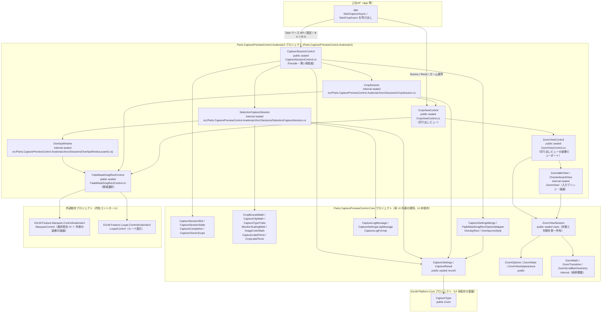
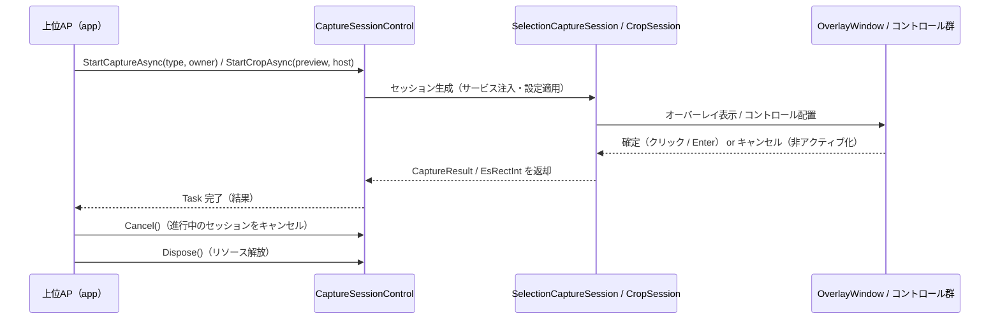

# Parts.CapturePreviewControl.AvaloniaUI システム仕様書

## 目次

- [Parts.CapturePreviewControl.AvaloniaUI システム仕様書（SPEC\_System）](#partscapturepreviewcontrolavaloniaui-システム仕様書)
  - [目次](#目次)
  - [1. システム概要](#1-システム概要)
  - [2. 技術スタック](#2-技術スタック)
  - [3. アーキテクチャ](#3-アーキテクチャ)
    - [3.1 レイヤー構造](#31-レイヤー構造)
    - [3.2 依存方向](#32-依存方向)
  - [4. 例外処理ポリシー](#4-例外処理ポリシー)
    - [4.1 基本方針](#41-基本方針)
    - [4.2 本プロジェクト固有の例外処理](#42-本プロジェクト固有の例外処理)
  - [5. コンポーネント図](#5-コンポーネント図)
  - [6. コンポーネント一覧](#6-コンポーネント一覧)
    - [6.1 CaptureSessionControl](#61-capturesessioncontrol)
    - [6.2 SelectionCaptureSession](#62-selectioncapturesession)
    - [6.3 CropSession](#63-cropsession)
    - [6.4 OverlayWindow](#64-overlaywindow)
    - [6.5 公開データ型](#65-公開データ型)
    - [6.6 CropViewControl](#66-cropviewcontrol)
    - [6.7 FadeMaskDragRectControl](#67-fademaskdragrectcontrol)
    - [6.8 ZoomViewControl（切り出しビューの画像ビューポート）](#68-zoomviewcontrol切り出しビューの画像ビューポート)
    - [6.9 ZoomableView](#69-zoomableview)
    - [6.10 CheckerboardView](#610-checkerboardview)
    - [6.11 Parts.CapturePreviewControl.Core の画像ビューポートの型（UI 非依存）](#611-partscapturepreviewcontrolcore-の画像ビューポートの型ui-非依存)
  - [7. 依存ルール](#7-依存ルール)
  - [8. ライフサイクル](#8-ライフサイクル)
  - [9. ログ](#9-ログ)
    - [9.1 LogLevel 設定ポリシー](#91-loglevel-設定ポリシー)
    - [9.2 ログ定義一覧](#92-ログ定義一覧)

---

## 1. システム概要

SaveEvidence は、Windows デスクトップ上の画面をキャプチャし、プレビュー・編集・保存するための Avalonia UI アプリケーションです（.NET 10.0 / C# 14 / MVVM）。

本プロジェクト（Parts.CapturePreviewControl.AvaloniaUI）は、このシステムのうち**画面キャプチャ（ScreenSelect / WindowSelect / AreaSelect）と切出し（Crop）のセッション統括**を担います。 上位 AP（app）へは Task ベースの公開 Facade（`CaptureSessionControl`）を提供し、内部でオーバーレイ（`OverlayWindow`）と複合コントロール（`FadeMaskDragRectControl`）を組み立てて実行します。

本アセンブリは、セッションの Facade に加えて 2 つの公開複合コントロール（画像表示 + 領域選択の `CropViewControl` と、領域選択の `FadeMaskDragRectControl`）を同一アセンブリ内に収録します。 `CropViewControl` は画像ビューポート（`ZoomViewControl` / `ZoomableView` / `CheckerboardView`）を内包し、その状態と判断は UI 非依存の `Parts.CapturePreviewControl.Core`（`ZoomViewSession`）が単一所有します。

## 2. 技術スタック

| 項目 | 内容 |
| --- | --- |
| **プロジェクト** | `Parts.CapturePreviewControl.AvaloniaUI` |
| **ルート名前空間** | `EsUtil.SaveEvidence.Parts.CapturePreview.AvaloniaUI` |
| **言語** | C# 14（.NET 10.0） |
| **UI フレームワーク** | Avalonia UI 12.1 |
| **ターゲットフレームワーク** | net10.0-windows10.0.17763.0 |
| **ビルドツール** | MSBuild / .NET SDK 10.0 |
| **ログ** | Microsoft.Extensions.Logging.Abstractions（LoggerMessage ソース生成） |
| **テスト** | xUnit v3 / Avalonia.Headless.XUnit |
| **依存プロジェクト** | Parts.CapturePreviewControl.Core（撮影セッション・切り出しビュー・領域選択・画像ビューポートの状態と判断）/ Parts.CaptureSessionControl.UIBase（設定 → 外観の写像）/ EsUtil.Feature.Marquee.ControlAvaloniaUI / EsUtil.Feature.Loupe.ControlAvaloniaUI（内包コントロール）/ Platform.AvaloniaUI（ScreenConverter）/ EsUtil.Platform.Core（抽象・値型／Win32 実装は `Native` 配下） |

撮影セッション（`CaptureSessionControl` / `SelectionCaptureSession` / `OverlayWindow`）は内包コントロール（MarqueeControl / LoupeControl）を直接参照しません（窓口は `FadeMaskDragRectControl` のみ。 公開型のカプセル化）。 内包コントロールを参照するのは同一アセンブリ内の複合コントロールだけです。

## 3. アーキテクチャ

### 3.1 レイヤー構造

```text
公開 Facade（CaptureSessionControl）
  → セッション（SelectionCaptureSession / CropSession）
    → オーバーレイ / 複合コントロール（OverlayWindow / FadeMaskDragRectControl）
      → 各コントロール（Marquee / Loupe）+ Platform.AvaloniaUI

並置: 公開複合コントロール（CropViewControl / FadeMaskDragRectControl）
  → 各コントロール（Marquee / Loupe / ZoomView）+ Platform.AvaloniaUI

横断: Parts.CapturePreviewControl.Core（設定のマージ・実行の排他・切り出し範囲・モニタ倍率・複合コントロールのモードと設定・ログ定義）
```

### 3.2 依存方向

- 依存は**一方向の階層構造**（CaptureSessionControl → Sessions → 複合コントロール → 各コントロール / Platform.AvaloniaUI）。
- 配線・状態同期は複合コントロールに集約し、セッションは薄い統括者（SRP / DRY）。
- プラットフォームサービス（ICaptureService / IWindowService / IElementFinder）は注入され、内部で生成しない（DIP）。
- 両 UI 共通の規則（状態・判断・契約・ログ定義）は `Parts.CapturePreviewControl.Core` が単一所有し、本プロジェクトは委譲する（同じ規則を両 UI に書かない）。

## 4. 例外処理ポリシー

### 4.1 基本方針

- ライブラリは例外を原則伝播し、上位 AP（app）で処理する。
- UI レイヤー（app）ではユーザー操作起因の例外を各ハンドラで catch し、UI の応答性を維持する。
- ログは LoggerMessage ソース生成で出力する。 定義はすべて `Parts.CapturePreviewControl.Core`（`CaptureLogMessage` / `CaptureLogFormat` / `CaptureSettingsLogMessage`）が単一所有し、本 UI は定義を持たない（`_log.LogXxx` を呼ぶだけ）。 現在の定義は Debug / Trace のみで、Error / Warning は定義していない（例外は上位 AP が処理する）。

### 4.2 本プロジェクト固有の例外処理

- キャプチャ中の例外はオーバーレイを閉じて通常状態に復帰する。
- 仮想スクリーン全体のキャプチャはバックグラウンド + 5 秒タイムアウト（DWM 応答不能時の安全策）。

## 5. コンポーネント図



## 6. コンポーネント一覧

### 6.1 CaptureSessionControl

- **分類**: 公開統括者（`public sealed class : IDisposable`・Facade パターン）
- **責務**:
  - キャプチャ / Crop の開始・キャンセル・確定の公開 API を提供（単一の窓口）
  - セッションの生成とライフサイクル管理（再入禁止・Dispose ガード）
  - 設定（`CaptureSettings`）の保持・部分更新・検証
  - プラットフォームサービスの注入（`EsUtil.Platform.Core` の `Native.Win` 経由）
- **公開メンバー**:
  - コンストラクタ: `CaptureSessionControl(CaptureSettings? initialSettings = null, ILogger? logger = null)`
  - プロパティ: `AppearanceSettings`（`CaptureSettings`。 getter は全メンバー non-null / setter は部分更新 + 検証）/ `IsCropping`（切り出し中かどうか）
  - メソッド: `StartCaptureAsync(CaptureType, Window)` / `StartCropAsync(CropViewControl, Window)` / `ResolveCropAction()` / `Cancel()` / `Confirm()` / `NotifyCropViewportChanged()` / `Dispose()`
  - イベント: `CaptureCompleted`（`Action<CaptureResult?>?`。 同期実行・UI スレッド）
- **可視性**: public
- **依存**: SelectionCaptureSession / CropSession / CaptureSettings / CaptureResult / CaptureType / CaptureSessionSlot / CaptureSettingsMerge / Platform.AvaloniaUI

### 6.2 SelectionCaptureSession

- **分類**: 内部セッションクラス（`internal sealed class`・Primary Constructor）
- **責務**:
  - 背景キャプチャ（全モード共通の仮想スクリーン全体。 バックグラウンド + 5 秒タイムアウト）
  - オーナーウィンドウのキャプチャ除外設定と画面外退避（`CaptureOwnerScope` に委譲）
  - `OverlayWindow` の生成・表示と、コアの完了通知（`CaptureCompletion`）での結果待機
  - 結果の返却（キャンセル時は画像 null / 矩形 0x0）
- **可視性**: internal
- **依存**: OverlayWindow / IWindowService / ICaptureService / IElementFinder（注入）/ CaptureType / CaptureSettings / CaptureOwnerScope / CaptureCompletion / CaptureLogMessage / CaptureLogFormat

### 6.3 CropSession

- **分類**: 内部セッションクラス（`internal sealed class`・Primary Constructor）
- **責務**:
  - 選択矩形のオーバーレイ（`FadeMaskDragRectControl` = Marquee（外側の装飾を含む）+ Loupe の配線を内包）を `CropViewControl.Rects` へ配置し、ライフサイクルを管理
  - 設定の適用: `CaptureSettings` → `FadeMaskDragRectOptions`（コアのマッパーで一元化）→ `Options`（同一値スキップ）
  - 座標変換: `CoordTransform`（`CropViewControl` の `ClientToSource` / `SourceToClient` に委譲）で論理（元画像 px）↔ ビューポート DIP を 1 段変換し、複合コントロールへ注入
  - カーソル上書き抑止（Crop 中の十字カーソル維持）
  - 確定 → 論理 Rect（`CropBoundsMath.ComputeCropBounds` で区間の流儀に従い終点のピクセルを加算） / キャンセル → 0x0 の空矩形を返却（いずれもコア型 `EsRectInt`）
  - サイズラベルの文言生成（`CropLabelTexts` に委譲）
- **可視性**: internal
- **依存**: CropViewControl / FadeMaskDragRectControl（同一アセンブリ。 `FadeMaskDragRectControl` / `FadeMaskDragRectOptions`）/ EsUtil.Platform.Core（`Native.ICursorOverrideGuard` / ICoordTransform / CoordTransform）/ CropBoundsMath / CropLabelTexts

### 6.4 OverlayWindow

- **分類**: 内部ウィンドウ（`internal sealed partial class : Window`）
- **責務**:
  - 全画面透明・Topmost・Alt+Tab 非表示の選択オーバーレイ
  - 選択 UI の配置: `VirtualScreenImage`（背景）/ `SelectionOverlay`（FadeMaskDragRectControl 複合コントロール）
  - モード別の選択処理（AreaSelect: ドラッグ選択 + ルーペ / Screen・WindowSelect: 要素検出 + ハイライト）
  - **選択スタイル（ハイライト型 / ドラッグ型）の判定はコアの `CaptureTypeTraits.IsHighlighted` が単一所有する**（本クラスは結果を 1 度読んで、十字カーソル・ルーペ・確定操作の配線を導く。 種別を直接比較しない）
  - **完了は 1 回だけ**の規則はコアの `CaptureSessionState` が単一所有する（確定とキャンセルの競合で二重完了にしない）
  - **確定矩形の計算はコアの `CaptureClipMath.ResolveCaptureRect` が単一所有する**（種別が決める区間の流儀に従った終点の加算と画像内へのクランプを組み合わせた唯一の入口。 退化した結果は確定せずキャンセルする）。 サイズラベルの表示倍率はコア（`MonitorScalingMath.ResolveForSourceRect`）へ委譲する
  - **事前切り出しキャッシュ（同一判定・所有権の受け渡し・旧値の破棄）はコアの `CaptureClipCache` が単一所有する**（本クラスは切り出しをバックグラウンドで実行して `Store` するだけ）。 適用範囲はハイライト型のホバー時のみ（範囲選択はドラッグ中の連続更新でキャッシュが無駄になるため）
  - **対象⇔画面物理の変換はコアの `CaptureClipMath` が単一所有する**（本クラスはコアの矩形を Avalonia の型へ写すだけ）
  - **確定対象の選択（ハイライト矩形 / 選択矩形）はコアの `CaptureTypeTraits.ResolveRect` が単一所有する**（サイズラベルの文言生成もこの結果を使う）
  - **検出関数の呼び分けはコアの `CaptureTypeTraits.FindUnderCursor` が単一所有する**（ホバー・押下で同じ分岐を書かない）
  - **ハイライトの状態（矩形の対象座標・表示名・表示名の変化）はコアの `CaptureHighlightSession` が単一所有する**（本クラスは検出結果を渡して戻り値を選択コントロールへ設定するだけ。 診断ログもコアが出し、確定対象・キーの確定可否はコアの状態を参照する）
  - **画像の共有値（サイズ・占有範囲・サイズの検証）はコアの `CaptureClipMath` が単一所有する**（`ImageSize` / `ImageBounds` / `ValidateImage`。 UI はコアの型同士の変換を書かない）
- **撮影対象の範囲（全モニタの包含矩形）と「モニタが無ければ撮影しない」前提条件はコアの `CaptureVirtualScreen.ResolveBounds` が単一所有する**（本クラスは列挙した矩形を渡して、返った範囲をウィンドウへ配置するだけ。 物理ピクセル → DIP の換算は `EsUtil.Platform.Core` の `DpiScaler.ToDip` に委譲する）
  - **撮影画像の保持（差し替え時の旧値の破棄・クローズ後の破棄・未取得時のフォールバック範囲）はコアの `CaptureImageHolder` が単一所有する**（本クラスは受け取った画像を渡して可否を見るだけ。 クローズ後の破棄漏れを防ぐ）
  - **背景取得のタイムアウトと未使用結果の破棄はコアの `CaptureVirtualScreen` が単一所有する**（本クラスは取得と UI スレッドへの反映のみを担う）
  - **確定・事前切り出しの切り出し矩形はコアの `CaptureClipMath.ResolveCaptureRect` が単一所有する**（ドラッグは浮動小数版・クリック確定は整数版。 UI は選択矩形の型を広げない）
  - **選択矩形と占有範囲は同じ座標空間（画面物理座標）で渡す**（本 UI のドラッグ選択の対象はウィンドウローカル物理ピクセルのため、確定時に `CaptureClipMath.ToScreenRect` で画面物理座標へ戻してから画面物理座標の占有範囲と組み合わせる。 切り出し矩形の求解は画面物理座標の 1 つの入口に統一されている）
  - **サイズラベルの文言はコアの `CaptureLabelTexts.ResolveSizeLabel` が解決する**（確定対象が無ければ設定の明示指定を使う規則を含む）
  - **オーナーの画面スケーリングの代表値はコアの `MonitorScalingMath.ResolveScaling` が解決する**（画面が取得できない場合は基準値・0 以下は正規化）
  - **キー操作（Enter = 確定 / Escape = キャンセル）の解釈はコアの `CaptureKeyActions` が単一所有する**（確定対象が無い場合の Enter は何もしない）。
    キーは **Tunnel + handledEventsToo** で受ける: 内包する選択オーバーレイ（Marquee）も TopLevel のキーを購読して
    Enter / Escape を処理済みにするため（ハイライト型は選択を持たず、その購読が常にキーを飲み込む）
  - **クリック確定（押下で固定・解放で確定）の状態と判断はコアの `CaptureClickSelection` が単一所有する**（退化した検出は固定せず、固定が無い解放では確定しない）
  - **モニタ一覧の構築（倍率未確定の除外）はコアの `MonitorScalingMath.Collect` が単一所有する**（`Screens.All` の取得のみ UI 固有）
  - **座標の整数化はコアの `CropBoundsMath.RoundToPixel` が単一所有する**（切り捨てで書くと UI ごとに 1 ピクセルずれる）
  - **タイムアウト・画面外退避座標はコアの `CaptureTiming` が単一所有する**（両 UI で同じ値を使う）
  - **ラベル文言の正規化（未検出・null は空文字）はコアの `CaptureLogFormat` が単一所有する**
  - ログ定義はコア（`CaptureLogMessage` / `CaptureLogFormat`）が単一所有する（本クラスは `_log.LogXxx` を呼ぶだけ）
  - クリック確定 → キャプチャ実行 → 結果コールバック
  - 非アクティブ化 / Close → キャンセル
- **可視性**: internal（クラス。 コンストラクタ等のシグネチャは public）
- **依存**: FadeMaskDragRectControl（同一アセンブリ。 `FadeMaskDragRectControl` / `FadeMaskDragRectMode`）/ Platform.AvaloniaUI（ScreenConverter）/ EsUtil.Platform.Core（`Native.ICaptureService` / `Native.IWindowService` / `Native.IElementFinder`）/ CaptureTypeTraits / CaptureClipMath / CaptureImageHolder / CaptureVirtualScreen / MonitorScalingMath / CaptureClipCache / CaptureHighlightSession / CaptureClickSelection / CaptureKeyActions / CaptureLabelTexts / CaptureTiming / CaptureSessionState / CaptureLogMessage / CaptureResult

### 6.5 公開データ型

| コンポーネント | 説明 |
| --- | --- |
| `CaptureType` enum | `ScreenSelect`（全画面）/ `WindowSelect`（ウィンドウ選択）/ `AreaSelect`（範囲選択）。 UI 非依存の共通基盤 `EsUtil.Platform.Core`（`EsUtil.Platform.Core`）提供 |
| `CaptureSettings` record | キャプチャの外観・動作設定（全メンバー nullable・部分更新可・`Validate()` / `ToNonNull()`）。 共通基盤 `Parts.CapturePreviewControl.Core` 提供 |
| `CaptureResult` record | キャプチャ結果（`Image` / `SourceBounds`。 キャンセル時は画像 null・矩形 0x0）。 共通基盤 `Parts.CapturePreviewControl.Core` 提供 |
| `FadeMaskDragRectSelectionEventArgs` record | 確定要求のイベント引数（`SelectionSourceRect`）。 本プロジェクト提供 |
| `FadeMaskDragRectPointEventArgs` record | ルーペ位置のイベント引数（`Position`）。 本プロジェクト提供 |

### 6.6 CropViewControl

- **分類**: 公開複合コントロール（`public sealed partial class : Panel`・Facade / Composite パターン）
- **責務**:
  - 画像表示（画像ビューポート `ZoomViewControl`）・領域選択オーバーレイ（`FadeMaskDragRectControl`）・外部提供矩形（`Rects`）を 1 コントロールに統合する
  - 子要素の生成・重ね順・入力の転送（領域選択オーバーレイ上のホイールを画像ビューポートへ転送する）
  - `SourceToClient` / `ClientToSource`（対象 ↔ ビューポート。 画像表示矩形の原点基準）とコア確定値の描画先への写像
- **公開メンバー**: `Source` / `Rects` / `SelectionMode` / `SelectionOverlayOptions` / `SelectionOverlayMarqueeAppearance` / `SelectionOverlayLoupeAppearance` / `Appearance` / `CenterAlign` / `ZoomPercent` / `CanZoomIn` / `CanZoomOut` / `HasSelection` / `SelectionSourceRect` / ラベルプロバイダ / `Log` / DPI スケーリング、メソッド `ZoomIn` / `ZoomOut` / `ZoomFit` / `SetSelection` / `ClearSelection` / `SetSelectionOverlayVisible` / `SetCoordTransform` / `RequestConfirm` / `RequestCancel` / `FocusMarquee` / `SetLoupeSource` / `ClearLoupe` / `NotifyViewportChanged` / `ImageRectViewport` / `SourceToClient` / `ClientToSource`、イベント `ConfirmRequested` / `CancelRequested` / `ZoomChanged` / `ViewportChanged`
- **可視性**: public
- **依存**: ZoomViewControl / FadeMaskDragRectControl（同一アセンブリ）/ Parts.CapturePreviewControl.Core（`OverlayRect` / `OverlayRectLayout` / `OverlayRectFrame` / `OverlayRectRasterizer`）/ Platform.AvaloniaUI（色の相互変換）/ EsUtil.Platform.Core（`EsBitmap` / `ICoordTransform`）
- **備考**: 画像表示・領域選択の状態と判断は内包コントロールとそのコアが単一所有し、本コントロールは配置・転送・写像のみを担う（自身は判断を持たない）

### 6.7 FadeMaskDragRectControl

- **分類**: 公開複合コントロール（`public sealed class : Panel`・Facade / Composite パターン）
- **責務**:
  - 選択矩形（`MarqueeControl`。 選択矩形の外側に描く装飾も同コントロールが描画する）・拡大鏡（`LoupeControl`）の生成・配置・配線・状態同期を 1 箇所に集約する
  - `Mode` による可視性・全面暗転の一括切替（解釈はコアの `FadeMaskDragRectModes`）
  - `Options`（コアの設定値）と `MarqueeAppearance` / `LoupeAppearance`（提示層の外観）の一括適用
  - 設定とモードから子コントロールへ適用する値の解決は `Parts.CaptureSessionControl.UIBase` の `FadeMaskDragRectChildValues` が単一所有し、本コントロールは代入するだけ
  - 座標変換ポートの一括分配（`SetCoordTransform`）
  - 付加情報（操作・情報ラベル）の描画（`Parts.CaptureSessionControl.UIBase` の `FadeMaskHostLabelRenderer`。 文言はホストが与える）
  - ルーペ画像上の選択矩形破線の描画（`LoupeRendered` イベントで描画先を受け取り、コアの破線幾何を描く）
- **公開メンバー**: `Mode` / `Options` / `MarqueeAppearance` / `LoupeAppearance` / `HasSelection` / `SelectionSourceRect` / `HighlightSourceRect` / `ShowFullOverlay` / `LoupeCenterPoint` / ラベルプロバイダ / `Log` / DPI スケーリング、メソッド `SetCoordTransform` / `SetSelection` / `ClearSelection` / `SetLoupeSource` / `SetLoupePosition` / `ClearLoupe` / `RequestConfirm` / `RequestCancel` / `FocusMarquee` / `RefreshOverlay` / `InvalidateOverlay`、イベント `ConfirmRequested` / `CancelRequested` / `LoupePositionMoved` / `LoupeRendered`
- **可視性**: public（内包コントロールへの直接アクセスは internal）
- **依存**: MarqueeControl / LoupeControl / Parts.CaptureSessionControl.UIBase / Parts.CapturePreviewControl.Core（`FadeMaskDragRectMode` / `FadeMaskDragRectModes` / `FadeMaskDragRectOptions` / `FadeMaskDragRectState` / `FadeMaskDragRectOverlay`）/ 提示層の外観（`MarqueeAppearance` / `LoupeAppearance`）/ EsUtil.Platform.Core
- **備考**: ホイール操作と表示の変化の追従は本コントロールの配線ではなく、ホストが担う（コントロール化を前提とした処理）

### 6.8 ZoomViewControl（切り出しビューの画像ビューポート）

- **分類**: 公開コントロール（`public sealed class : Panel`。 自己完結型複合コントロール）
- **責務**: 内部ビューポート（`ZoomableView`）を生成し、公開 API をコアの `ZoomViewSession` へ委譲する。 セッションの通知（`ZoomChanged` / `ViewportChanged`）を自 UI の公開イベントへ転送する。 **`CropViewControl` が内包する画像ビューポート**であり、独立した汎用コントロールとしての利用を前提としない
- **非公開メンバー**: `Session`（内部ビューポートが所有するセッションへの参照）/ `ZoomableView`（内包するビューポート）/ `CheckerboardView`（画像の透明部分の背景を描く子要素）/ `OnSessionNotified`（通知の転送）
- **公開 API の詳細**: 外部機能仕様書（`SPEC_ExtFunc.md`）の 5.7 を参照
- **可視性**: public（`CropViewControl` からは内部部品として扱う）
- **依存**: `Parts.CapturePreviewControl.Core`（`ZoomViewSession` / `ZoomOptions` / `ZoomNotice` / `ZoomState`）/ Platform.AvaloniaUI（コア型の相互変換）
- **状態と判断の所有者**: `ZoomViewSession`（コア）。 本コントロールは値の委譲と通知の転送のみを行う

### 6.9 ZoomableView

- **分類**: 内部コントロール（`internal sealed class : Panel`。 `ZoomViewControl` の内部実装）
- **責務**: ScrollViewer 不使用のパン・ズームビューポート。 入力（ポインター・ホイール）をコア型へ変換してセッションへ渡し、返された効果（再描画・ポインタキャプチャ）を適用する。 セッションの値（表示サイズ・原点・オフセット・スクロール可否）を `Image` のレイアウト・`RenderTransform`・標準 `ScrollBar` へ写す。 ビューポートのサイズ（`Bounds`）の所有者であり、変更時にセッションへ通知する
- **内部実装の詳細**: ScrollViewer を使用せず、RenderTransform ベースで配置する（レイアウトによるオフセット上書きが原理的に発生しない）。 描画位置 = 実効スケール × (コンテンツ座標 − オフセット) であり、値（スケール・オフセット・中央寄せ補正）はコアが確定する。 見た目のスクロールバー太さは標準 `ScrollBar` 固有であり、コアの外観（`ZoomViewAppearance`）は参照しない
- **可視性**: internal
- **依存**: `Parts.CapturePreviewControl.Core`（`ZoomViewSession` / `ZoomFeedback` / `ZoomNotice`）/ Platform.AvaloniaUI（相互変換）

### 6.10 CheckerboardView

- **分類**: 内部コントロール（`internal sealed class : Control`。 `ZoomViewControl` の内部実装）
- **責務**: 画像の透明部分の背景（市松模様）を描く。 子の順序で画像より先に描かれるようにし、描く範囲（画像の表示矩形の内側）とタイルの位置はコア（`ZoomViewAppearance.ComputeCheckerArea` / `ComputeLightTileRects`）に問い合わせるだけである
- **内部実装の詳細**: Panel は `Render` をシールしているため、子要素として画像の下にだけ描く層を作る。 画像の外（ペーストボード）は透明のままにし、親の背景をそのまま見せる。 入力は受けず（`IsHitTestVisible` を false）、表示矩形の変化と外観の変更で `InvalidateVisual` する
- **可視性**: internal
- **依存**: `Parts.CapturePreviewControl.Core`（`ZoomViewSession` / `ZoomViewAppearance`）/ Platform.AvaloniaUI（ブラシのキャッシュ）

### 6.11 Parts.CapturePreviewControl.Core の画像ビューポートの型（UI 非依存）

すべて UI 非依存プロジェクト（名前空間 ${S}Core）が提供する。

| コンポーネント | 分類 | 責務 |
| --- | --- | --- |
| `ZoomViewSession` | 公開 sealed class | **状態と判断を単一所有**する状態管理クラス（内部ズーム率・オフセット・設定・表示条件の保持、実効ズーム率の導出、可否、Fit 実効倍率のキャッシュと無効化、遷移の適用、パン、スクロールバーのドラッグ） |
| `ZoomOptions` | 公開 sealed class | ズーム遷移の設定（`MinZoom` / `MaxZoom` / `WheelFactor` / `ButtonZoomLevels`。 検証付き不変値・`With` で部分更新） |
| `ZoomState` | 公開 readonly record struct | 通知する 4 値（実効ズーム率・Fit 状態・可否） |
| `ZoomFeedback` | 公開 readonly record struct | UI が適用する効果（再描画・ポインタキャプチャ）。 適用順を単一所有する |
| `ZoomNotice` / `ZoomNoticeKind` | 公開 enum / sealed record | セッションから UI への通知（種別と通知時点の値） |
| `ZoomViewAppearance` | 公開 sealed record | 外観（下地・市松模様・スクロールバー）の単一値。 描画可否と市松模様を描く範囲（画像の表示矩形の内側）・タイル矩形も持つ |
| `ZoomScrollBar` / `ZoomScrollBarMetrics` | 公開 record struct | スクロールバーの矩形、および標準スクロールバー部品へ写す同期値 |
| `ZoomLogMessage` / `ZoomLogFormat` | 公開静的クラス | ログ定義（両 UI 共通の書式）と値の文字列化・丸め |
| `ZoomMath` / `ZoomTransition` / `ZoomAvailability` / `ZoomScrollBarGeometry` | internal（純粋関数） | ズーム中心維持・Fit 実効倍率・座標変換・オフセットクランプ・段階遷移・可否判定・スクロールバーの幾何 |

計算（`ZoomMath` / `ZoomTransition` / `ZoomAvailability` / `ZoomScrollBarGeometry`）は `InternalsVisibleTo` で UI 実装とテストへ公開し、UI 層はセッション経由で間接利用する。 UI 非依存のため、ヘッドレス不要の `[Fact]` で並列テスト可能である（ズームの状態と判断は UI 非依存コアのテストで検証する）。

## 7. 依存ルール

- 依存方向は**一方向の階層構造**（CaptureSessionControl → Sessions → 複合コントロール FadeMaskDragRectControl → 各コントロール / Platform.AvaloniaUI）。
- CaptureSessionControl / セッションは状態を保持せず、状態は複合コントロールと各コントロール / Platform.AvaloniaUI が保持する（薄い統括者・SRP）。
- Marquee / Loupe の配線は複合コントロールに集約され、セッションは配線コードを持たない（DRY）。
- セッションへのプラットフォームサービス（ICaptureService / IWindowService / IElementFinder）は注入され、内部で生成しない（DIP）。
- 上位 AP への通知は Task 返却と `CaptureCompleted` イベント（同期型）の併用（Task が完了結果、イベントが画像変更の順序保証）。
- 選択状態の同期は各コントロールの公開イベントのみ（ポーリングなし）。
- 収録する複合コントロール（`CropViewControl` / `FadeMaskDragRectControl`）も同じ向きの依存に従う（複合コントロール → 内包コントロール / コア / 提示層）。 セッションから見た窓口は `FadeMaskDragRectControl` と `CropViewControl` であり、セッションが内包コントロール（Marquee / Loupe）を直接参照することはない。
- 画像ビューポート（`ZoomViewControl`）は `CropViewControl` が内包し、`ZoomViewControl` → `ZoomableView` / `Parts.CapturePreviewControl.Core` の一方向に従う。 セッション（`CropSession`）はビューポートを直接参照せず、`CropViewControl` の公開メソッド（`ClientToSource` / `SourceToClient`）に委譲する。

## 8. ライフサイクル



## 9. ログ

ログ定義は `Parts.CapturePreviewControl.Core`（`CaptureLogMessage` / `CaptureSettingsLogMessage`）が単一所有する（LoggerMessage ソース生成）。 本 UI はログ定義を持たない。
各メソッドは `this ILogger` 第一引数で定義し、呼び出し側では logger 引数を省略する（例: `_log.LogCaptureStart(type)`）。
`CaptureSessionControl` コンストラクタの `logger` 引数で注入し、null の場合は出力しない（app では NLog へ転送）。
出力先・レベル制御はホストアプリケーションが所有する（本クラスは定義のみ）。

### 9.1 LogLevel 設定ポリシー

トレースログは LogLevel.Trace に限定せず、「重要度 × 発生頻度」でレベルを使い分ける。

| LogLevel | 対象 | 本番での意図 |
| --- | --- | --- |
| `Error` | 例外・失敗（処理継続不可） | 常時出力し、障害を確実に残す |
| `Warning` | 異常だがフォールバックで継続 | 常時出力し、異常発生の痕跡を残す |
| `Information` | ユーザー操作の主要イベント（低頻度） | 常時出力し、操作手順の再現を可能にする |
| `Debug` | 操作イベントの詳細（セッション開始 / 確定 / キャンセル / 設定変更） | 障害時のみ有効化して解析 |
| `Trace` | 高頻度・極詳細 | 特別な性能・座標解析時のみ有効化 |

判断基準:

1. 例外・警告は常時残す（`Error` / `Warning`）
2. 操作の起点イベント（低頻度）は `Information`
3. マウス・キー等の操作イベント（中頻度）は `Debug`
4. 高頻度・極詳細は `Trace`
5. 設定変更（変更前後）は `Debug`

### 9.2 ログ定義一覧

全ログ（`CaptureLogMessage` / `CaptureSettingsLogMessage`。 `Parts.CapturePreviewControl.Core`）:

| レベル | メソッド | 出力内容 |
| --- | --- | --- |
| `Debug` | `CaptureLogMessage.LogCaptureStart` | キャプチャセッション開始（種別） |
| `Debug` | `CaptureLogMessage.LogCaptureFinished` | キャプチャセッションの終了（確定は `CaptureCompleted`（矩形）→ `Result`（画像サイズ / 矩形）の 2 件、キャンセルは `CaptureCancelled` の 1 件。 出力の組はコアが単一所有する） |
| `Debug` | `CaptureLogMessage.LogConfirmRequested` | 選択の確定要求（Enter / ダブルクリック等） |
| `Debug` | `CaptureLogMessage.LogCancelRequested` | 選択のキャンセル要求（Esc / 非アクティブ化等） |
| `Debug` | `CaptureLogMessage.LogVirtualScreen` | 仮想スクリーン設定（原点 / サイズ。 画像未取得はサイズ 0） |
| `Trace` | `CaptureLogMessage.LogHighlight` | ハイライト検出結果（検出矩形 / タイトル / クラス名。 マルチモニタ・最大化ウィンドウの矩形検証とデスクトップウィンドウの特定用。 `CaptureHighlightSession` が出す） |
| `Debug` | `CaptureLogMessage.LogCropStart` | Crop セッション開始（元画像サイズ） |
| `Debug` | `CaptureLogMessage.LogCropFinished` | Crop セッションの終了（切り出せた場合は `CropCompleted`（矩形）、退化した選択は `CropCancelled`。 出力の組はコアが単一所有する） |
| `Debug` | `CaptureLogMessage.LogCropCancelled` | Crop キャンセル（Esc・非アクティブ化・ウィンドウクローズ等） |
| `Debug` | `CaptureSettingsLogMessage.LogSettingApplied` | 設定の適用（変化時の 1 回のみ） |

切り出しビューの画像ビューポート（`ZoomViewControl`）の操作ログは UI 非依存コア `Parts.CapturePreviewControl.Core`（`ZoomLogMessage`）が単一所有する（書式を両 UI で揃え、本 UI は定義を持たない）。 `ZoomViewControl.Log` へ注入された `ILogger` へ出力する（未設定時は `NullLogger`）。

| レベル | メソッド | 出力内容 |
| --- | --- | --- |
| `Information` | `ZoomLogMessage.LogZoomIn` / `LogZoomOut` | ⊖⊕ のズームイン / アウトの変更前後 %（実効ズーム率。 Fit 中は実効倍率） |
| `Information` | `ZoomLogMessage.LogZoomInWheel` / `LogZoomOutWheel` | Ctrl+ホイールのズームイン / アウトの変更前後 % |
