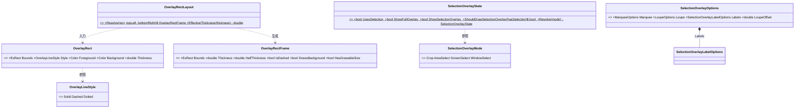
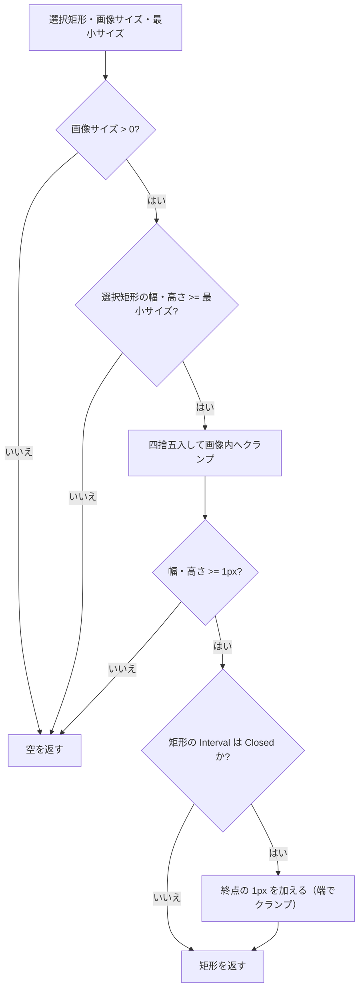
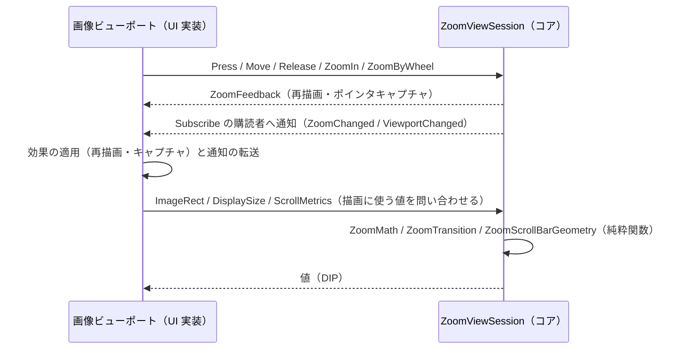

# Parts.CapturePreviewControl.Core システム仕様書

## 目次

- [1. 概要](#1-概要)
- [2. 技術スタック](#2-技術スタック)
- [3. アーキテクチャ](#3-アーキテクチャ)
  - [3.1 レイヤー構造](#31-レイヤー構造)
  - [3.2 層の責務の境界](#32-層の責務の境界)
  - [3.3 コンポーネントの構成](#33-コンポーネントの構成)
  - [3.4 クラス図](#34-クラス図)
  - [3.5 統合したコア（矩形オーバーレイ / 領域選択 / 画像ビューポート）](#35-統合したコア矩形オーバーレイ--領域選択--画像ビューポート)
- [4. 依存関係](#4-依存関係)
- [5. 処理フロー](#5-処理フロー)
  - [5.1 切り出し範囲の計算](#51-切り出し範囲の計算)
  - [5.2 切り出しビューの画像ビューポートのデータフロー](#52-切り出しビューの画像ビューポートのデータフロー)
- [6. 例外処理ポリシー](#6-例外処理ポリシー)
- [7. 設計判断](#7-設計判断)
- [8. 検証](#8-検証)

## 1. 概要

撮影（スクリーン / ウィンドウ / 範囲選択）・切り出し（Crop）・切り出しビューの画像ビューポート（ズーム・パン・Fit）の**共通規則**と、製品の設定型（`CaptureSettings`）と提示層の外観型（`MarqueeAppearance` / `LoupeAppearance`）を橋渡しする**提示の写像**を単一所有する UI 非依存ライブラリです。

## 2. 技術スタック

| 項目 | 内容 |
| --- | --- |
| 言語 / フレームワーク | C# 14 / .NET 10（`net10.0`） |
| 依存パッケージ | `Microsoft.Extensions.Logging.Abstractions`（ログ定義のソース生成。 `System.Drawing.Primitives` は共有フレームワーク） |
| テスト | xUnit v3（`Parts.CapturePreviewControl.Core.Tests`） |

## 3. アーキテクチャ

### 3.1 レイヤー構造

```text
Parts.CapturePreviewControl.AvaloniaUI / Parts.CapturePreviewControl.MewUI（UI 実装）
        │ 参照
        ▼
Parts.CapturePreviewControl.Core（本プロジェクト。撮影・切り出しの共通規則と、切り出しビューの画像ビューポートの状態と判断、提示の写像）
        │ 参照
        ├─> EsUtil.Feature.Marquee.Core / .Presenter、EsUtil.Feature.Loupe.Core / .Presenter
        ▼
EsUtil.Platform.Core（Es* 幾何型 / EsBitmap / ICaptureService / IWindowService）
```

依存は一方向です。 Core は UI フレームワーク（Avalonia / MewUI）を参照せず、提示層（`EsUtil.Feature.*.Presenter`）へは外観型（色・枠線の太さ・表示可否）の写像のためにのみ参照します（機能コアの「Core → Presenter 禁止」は同じ機能のコアが自身の提示層へ依存することを禁じる規則であり、本プロジェクトは製品の設定型と提示層の外観型を橋渡しする別の層です）。

### 3.2 層の責務の境界

| 区分 | 所有者 | 内容 |
| --- | --- | --- |
| 状態 | Core | セッションの実行中・完了（`CaptureSessionState`）、受付スロット（`CaptureSessionSlot`）、結果の確定（`CaptureCompletion`）、ハイライトとクリック確定（`CaptureHighlightSession` / `CaptureClickSelection`）、撮影画像（`CaptureImageHolder`）、切り出しビューの画像ビューポート（`ZoomViewSession`） |
| 判断 | Core | 切り出し範囲・ハイライトの反映・キー操作・クリック確定・種別の性質・モニタ倍率・設定のマージ・退避と除外の順序・画像配置・平均色・取得の打ち切り（`CaptureVirtualScreen`）・画像ビューポートの状態と判断（Fit の表現・実効ズーム率・可否・遷移の適用・パン・スクロールバー） |
| 契約 | Core | `ICaptureTarget` / `ICaptureOwnerWindow` / `CaptureSessionSlot` / `CaptureCompletion` / `ZoomFeedback` / `ZoomNotice` |
| ログ定義 | Core | `CapturePreviewLogMessage`（撮影・切り出し・設定・ズーム・例外） |
| ログ以外の正規化 | Core | `CaptureText`（未取得の文字列を空文字へ。 ログ定義とは別の型） |
| 提示の写像 | Core | 設定 → 外観の写像（`CapturePaintMapper`）、子コントロールへ適用する値の解決（`SelectionOverlayChildValues`）、付加情報ラベルの配置指示（`SelectionOverlayLabelRenderer` / `MarqueeHostLabelRenderer`）。 製品の設定型と提示層の外観型を橋渡しする |
| 入力ブリッジ | UI | ポインタ・キー・ホイールの購読とコア型への変換、返された効果の適用 |
| 描画 | UI | 外観値を持たず、設定とコア共有値を読んで描く |
| ホスト結線 | UI | Window の生成と表示、`Screens` / DPI の取得、`Dispatcher`、カーソル、レイアウト、Bitmap のライフサイクル |

### 3.3 コンポーネントの構成

```text
┌──────────────────────────────────────────────────────┐
│ 撮影画像の保持と取得の待ち方（クラス）                  │
│  CaptureImageHolder: Set（差し替え・破棄後の破棄）           │
│                      Image / Origin / Bounds / Dispose │
│  CaptureVirtualScreen: AwaitAsync（タイムアウト・未使用結果の破棄）│
└──────────────────────────────────────────────────────┘
┌──────────────────────────────────────────────────────┐
│ CropBoundsMath（静的クラス）                           │
│  ComputeCropBounds(selection, imageSize, min)  │
│    ├─ 最小サイズ判定                                  │
│    ├─ ToPixelRect      （クランプ + 四捨五入）         │
│    └─ ToClosedInterval （終点の 1 ピクセル + 端のクランプ）│
└──────────────────────────────────────────────────────┘
┌──────────────────────────────────────────────────────┐
│ CaptureSettings（record・全メンバー nullable）         │
│  Validate / ToNonNull                                 │
│ CaptureSettingsMerge（静的クラス）                     │
│  Merge（部分更新のマージ） / Apply（検証 + マージ + 同値スキップ）│
└──────────────────────────────────────────────────────┘
┌──────────────────────────────────────────────────────┐
│ CaptureLabelTexts（静的クラス）                        │
│  ToSelectionMode(CaptureType) SelectionOverlayMode    │
│  GetOperationText(mode) string                        │
│  GetInfoText(mode, windowTitle) string?               │
│ CropLabelTexts（静的クラス）                           │
│  FormatCropSizeLabel(rect, zoomPercent) string        │
└──────────────────────────────────────────────────────┘
┌──────────────────────────────────────────────────────┐
│ 種別・モニタの判断（静的クラス）                        │
│  CaptureTypeTraits: IsHighlighted / ResolveInterval│
│                     GetElementTarget                  │
│  MonitorScalingMath: ResolveForRect / ResolveForSourceRect（中心で判定）      │
│                     Collect（倍率未確定の除外） / ResolveScaling（代表値）      │
│  ImageColorMath: AverageColor（標本間引き）                            │
│  CropClipMath: ResolveCaptureRect（切り出し矩形の唯一の求解。整数/浮動小数。座標空間は画面物理）            │
│                   画面物理⇔画像ローカル矩形の相互変換 / 画像の共有値 / 切り出し         │
└──────────────────────────────────────────────────────┘
┌──────────────────────────────────────────────────────┐
│ ハイライトの状態と判断（クラス）                          │
│  CaptureHighlightSession: Update（検出→状態の導出） / Title / SourceRect │
│  CaptureHighlight: SourceRect / TitleChanged                            │
│  CaptureClickSelection: Fix（押下で固定） / Take（解放で取り出し）    │
└──────────────────────────────────────────────────────┘
┌──────────────────────────────────────────────────────┐
│ セッションの状態と排他（クラス）                        │
│  CaptureSessionState: IsRunning / IsCompleted         │
│                       TryBegin / TryComplete / End     │
│  CaptureSessionSlot{TCapture, TCrop}:                  │
│    HasCapture / HasCrop / IsBusy / Crop                │
│    TryBeginCapture / EndCapture / TryBeginCrop / EndCrop│
│    HasCropSelection / CancelAll                        │
│  CaptureCompletion{TResult}: Task / TrySetResult       │
└──────────────────────────────────────────────────────┘
┌──────────────────────────────────────────────────────┐
│ ホスト連携のポートと手順                               │
│  ICaptureTarget: 切り出し結果の適用先                  │
│  ICaptureOwnerWindow: 撮影時の退避対象                 │
│  CaptureOwnerScope: Enter（除外→退避） / Dispose（復帰）│
└──────────────────────────────────────────────────────┘
┌──────────────────────────────────────────────────────┐
│ ログ定義（静的クラス）                                 │
│  CapturePreviewLogMessage                              │
│  Rect / RectOrEmpty / Percent（内部）                  │
└──────────────────────────────────────────────────────┘
┌──────────────────────────────────────────────────────┐
│ オーバーレイのキー操作（静的クラス）                    │
│  CaptureKeyActions: Resolve(key, hasConfirmTarget)     │
│  CaptureKeyAction: None / Confirm / Cancel              │
└──────────────────────────────────────────────────────┘
┌──────────────────────────────────────────────────────┐
│ CaptureResult（record）                               │
│  Image: EsBitmap? / SourceBounds: EsRectInt?        │
└──────────────────────────────────────────────────────┘
┌──────────────────────────────────────────────────────┐
│ 切り出しビューの画像ビューポート（クラス・静的クラス）    │
│  ZoomViewSession（状態と判断を単一所有）                 │
│    SetSource / SetViewport / SetCenterAlign / SetAppearance │
│    ApplyConfig / SetZoom / SetFixedZoom / SetOffset     │
│    PanBy / PanByWheel / Press / Move / Release          │
│    ZoomIn / ZoomOut / ZoomFit / ZoomByWheel             │
│    TryBeginScrollBarDrag / UpdateScrollBarDrag / ReleaseScrollBarDrag │
│  ZoomTransition / ZoomMath / ZoomScrollBarGeometry（純粋関数） │
│  ZoomAvailability / ZoomViewAppearance                  │
│  ZoomOptions / ZoomState / ZoomFeedback / ZoomNotice      │
│  ZoomScrollBar / ZoomScrollBarMetrics                  │
│  CapturePreviewLogMessage（ズーム操作のログ）          │
└──────────────────────────────────────────────────────┘
┌──────────────────────────────────────────────────────┐
│ 提示の写像（静的クラス・record struct）                 │
│  CapturePaintMapper: ToMarqueeAppearance / ToLoupeAppearance │
│  SelectionOverlayChildValues: Resolve（設定とモード）  │
│  SelectionOverlayLabelRenderer: Resolve（縦積みの配置指示） │
│  MarqueeHostLabelRenderer: Resolve（1 行の体裁）       │
│  HighlightAppearanceDefaults: Default（強調の既定の外観）│
└──────────────────────────────────────────────────────┘
```

### 3.4 クラス図

```mermaid
classDiagram
    class CropBoundsMath {
        +ComputeCropBounds(EsRect, EsSize, double) EsRectInt
        +ToPixelRect(EsRect, EsSize) EsRectInt
        +ToClosedInterval(EsRectInt) EsRectInt
        +ToClosedInterval(EsRectInt, EsSize) EsRectInt
        +RoundToPixel(double) int
    }
    class CaptureTypeTraits {
        +IsHighlighted(CaptureType) bool
        +ResolveInterval(CaptureType) EsRectInterval
        +GetElementTarget(CaptureType) CaptureElementTarget
        +FindUnderCursor(IElementFinder, CaptureType, EsPointInt) ElementFinderResults
        +ResolveRect(CaptureType, EsRect, EsRect) EsRect?
    }
    class CropClipMath {
        +ResolveCaptureRect(CaptureType, EsRect, EsRectInt) EsRectInt
        +ResolveCaptureRect(CaptureType, EsRectInt, EsRectInt) EsRectInt
        +ImageSize(EsBitmap) EsSize
        +ImageBounds(EsBitmap, EsPointInt) EsRectInt
        +ValidateImage(EsBitmap, string)
        +ToLocalRect(EsRectInt, EsPointInt) EsRectInt
        +ToScreenRect(EsRect, EsPointInt) EsRect
        +ToScreenRect(EsRectInt, EsPointInt) EsRectInt
        +Extract(EsBitmap, EsPointInt, EsRectInt) EsBitmap?
    }
    class CaptureHighlightSession {
        +EsRect? SourceRect
        +string Title
        +Update(CaptureType, ElementFinderResults, EsPointInt) CaptureHighlight
    }
    class CaptureKeyActions {
        +Resolve(EsKey, bool) CaptureKeyAction
    }
    class CaptureClickSelection {
        +Fix(EsRectInt) bool
        +Take() EsRectInt?
    }
    class CaptureResult {
        +EsBitmap? Image
        +EsRectInt? SourceBounds
        +From(EsBitmap, EsRectInt) CaptureResult
    }
    class CaptureHighlight {
        +EsRect? SourceRect
        +bool TitleChanged
    }
    class MonitorScalingMath {
        +ResolveForRect(EsRectInt, IReadOnlyList, double) double
        +ResolveForSourceRect(EsRect, EsPointInt, IReadOnlyList, double) double
        +Collect(IEnumerable) IReadOnlyList
        +ResolveScaling(IEnumerable) double
    }
    class CaptureClipCache {
        +HasCached(EsRectInt) bool
        +Take(EsRectInt) EsBitmap?
        +Store(EsRectInt, EsBitmap)
        +Dispose()
    }
    class CaptureImageHolder {
        +EsBitmap? Image
        +EsPointInt Origin
        +EsRectInt Bounds
        +Set(EsBitmap, EsPointInt) bool
        +Dispose()
    }
    class CaptureVirtualScreen {
        +AwaitAsync(Task, TimeSpan) Task
    }
    class CropSessionActions {
        +Resolve(bool, bool) CropSessionAction
    }
    class CaptureTiming {
        +TimeSpan ScreenCaptureTimeout
        +int OwnerOffScreenCoord
    }
    class CaptureSettings {
        +bool? HideOwnerWindow
        +int? MinSelectionSize
        +Color? BorderColor
        +Validate()
        +ToNonNull() CaptureSettings
    }
    class CaptureSettingsMerge {
        +Merge(CaptureSettings, CaptureSettings) CaptureSettings
        +Apply(CaptureSettings, ref CaptureSettings, ILogger) bool
    }
    class CaptureSessionState {
        +bool IsRunning
        +bool IsCompleted
        +TryBegin() bool
        +TryComplete() bool
        +End()
    }
    class CaptureSessionSlot~TCapture, TCrop~ {
        +bool IsBusy
        +TryBeginCapture(TCapture) bool
        +TryBeginCrop(TCrop) bool
        +CancelAll(Action, Action)
    }
    class CaptureOwnerScope {
        +Enter(IWindowService, EsPlatformHandle, ICaptureOwnerWindow, bool) CaptureOwnerScope
        +Dispose()
    }
    CaptureHighlightSession ..> CaptureHighlight : 導出
    CaptureKeyActions ..> CaptureKeyAction : 返す
    CropClipMath ..> CropBoundsMath : 規則の合成
    CaptureSettingsMerge ..> CaptureSettings : マージ
    CaptureSessionState ..> CaptureSessionSlot : 状態を担う
    CaptureOwnerScope ..> ICaptureOwnerWindow : 退避と復帰
    CropBoundsMath ..> EsRectInt : 生成
    CaptureResult ..> EsRectInt : 保持
```



### 3.5 統合したコア（矩形オーバーレイ / 領域選択 / 画像ビューポート）

切り出しビューの矩形オーバーレイ・領域選択の複合コントロールのコア・切り出しビューの画像ビューポートを本プロジェクトが所有します（撮影スタックの 2 つの UI 非依存コアを統合しました）。

```text
┌──────────────────────────────────────────────────────┐
│ 矩形オーバーレイ（契約と判断）                          │
│  OverlayRect（record struct）: Bounds / Style / 前景色 / 背景色 / Thickness │
│  OverlayLineStyle: Solid / Dashed / Dotted            │
│  OverlayRectLayout: Resolve（クランプ・太さの下限・破線の判定） / EffectiveThickness │
│  OverlayRectFrame（record struct）: 描画入力（配置・太さ・半幅・破線・色・可否） │
│  OverlayLineDash: Get / IsDashed（ダッシュ長の単一所有） │
│  OverlayRectRasterizer: Draw（4 辺を EsBitmap へラスタライズ） │
└──────────────────────────────────────────────────────┘
┌──────────────────────────────────────────────────────┐
│ 領域選択の複合コントロールのコア                        │
│  SelectionOverlayMode: Crop / AreaSelect / ScreenSelect / WindowSelect │
│  SelectionOverlayOptions（record）: Marquee / Labels / Loupe / 破線色 2 / LoupeOffset │
│  SelectionOverlayLabelOptions（record）: 操作・情報ラベルの外観 │
│  SelectionOverlayState: Resolve（モード → 状態）        │
│  SelectionOverlayState: UsesSelection / ShowFullOverlay / ShowSelectionOverlay │
│  SelectionOverlayState: ShouldDrawSelectionOverlay（モードと選択の合成判断） │
│  SelectionUsability: IsUsable（選択の可否）       │
│  SelectionOutlineRasterizer: DrawSelectionRect（2 色の破線。 選択が覆う画素の外側へ引く） │
└──────────────────────────────────────────────────────┘
┌──────────────────────────────────────────────────────┐
│ 切り出しビューの画像ビューポート                        │
│  ZoomViewSession: 状態（内部ズーム率・オフセット・設定・表示条件）の保持 │
│    実効ズーム率・可否・遷移の適用・パン・スクロールバー  │
│  ZoomViewAppearance / ZoomOptions / ZoomState / ZoomFeedback │
│  ZoomNotice / ZoomScrollBar / ZoomScrollBarMetrics      │
│  ZoomTransition / ZoomMath / ZoomAvailability          │
│  ZoomScrollBarGeometry / CapturePreviewLogMessage       │
└──────────────────────────────────────────────────────┘
```

**矩形オーバーレイは「どう描くか」の判断（負サイズのクランプ・太さの 1 ピクセル下限・破線かどうか・背景色を使うか）を本プロジェクトが単一所有**し、UI 層は対象座標 → ビューポート座標の変換と、確定した描画入力の写像だけを行います（MewUI の値型は負のサイズを 0 へクランプしますが Avalonia は保持するため、本層を通して両 UI の挙動を揃えます）。

**領域選択のコアは動作モードの型・設定の単一値・モードから導出する表示可否・選択矩形の可否判定・ルーペ画像への破線描画を単一所有**します（両 UI が同じ型と判断を使うため、UI ごとに `switch` や「幅 > 0」の判定を書く余地がありません）。

**ルーペ画像上の選択矩形の破線は「選択が覆う画素の外側」へ引きます**（左・上は先頭の画素の 1 画素手前、右・下は最後の画素の 1 画素先）。 覆う画素数は矩形の区間（`EsRect.Interval`）が決めます（閉区間は終点を含むため 1 画素多い）。 外側へ引くのは、**破線を十字線へ被らせないためです**。 十字線はドラッグ中の点（選択の角）の画素を示すため、内側へ引くと終点が左上のときに限って破線が十字線の帯に重なって見えます（終点が右下のときは十字線が破線の外側になるため重なりません）。 外側へ揃えると、ドラッグの向きで破線の見え方が変わりません。

```mermaid
classDiagram
    class ZoomViewSession { <<sealed class>> +bool IsFit  +double ZoomPercent  +EsVector Offset  +ZoomState CurrentState  +ZoomFeedback SetSource(hasSource, sourceSize)  +ZoomFeedback ZoomIn()  +ZoomFeedback ZoomByWheel(zoomIn, pointer)  +ZoomFeedback PanBy(delta) }
    class ZoomOptions { <<sealed class>> +double MinZoom  +double MaxZoom  +double WheelFactor  +IReadOnlyList~double~ ButtonZoomLevels  +With(...) ZoomOptions }
    class ZoomState { <<readonly record struct>> +double ZoomPercent  +bool IsFit  +bool CanZoomIn  +bool CanZoomOut }
    class ZoomFeedback { <<readonly record struct>> +bool ShouldRedraw  +bool ShouldCapturePointer  +bool ShouldReleasePointer  +ApplyVisual(redraw)$  +ApplyPointer(capture, release)$ }
    class ZoomNotice { <<sealed record>> +ZoomNoticeKind Kind  +ZoomState State  +EsRect ImageRect }
    class ZoomViewAppearance { <<sealed record>> +Color BackgroundColor  +ComputeCheckerArea(...)$  +ComputeLightTileRects(...)$ }
    class ZoomScrollBarGeometry { <<static>> +Compute(...)$  +MovableThumbRange(...)$  +SourceOffsetFromThumb(...)$ }
    class ZoomTransition { <<static>> +NextLevel(...)$  +PrevLevel(...)$  +WheelZoomIn(...)$  +WheelZoomOut(...)$  +BuildAvailability(...)$ }
    class ZoomMath { <<static>> +FitScale(...)$  +ComputeOffsetAfterScaleChange(...)$  +ClampOffset(...)$  +ClientToSource(...)$ }

    ZoomViewSession ..> ZoomOptions : 保持
    ZoomViewSession ..> ZoomViewAppearance : 保持
    ZoomViewSession ..> ZoomTransition : 委譲
    ZoomViewSession ..> ZoomMath : 委譲
    ZoomViewSession ..> ZoomScrollBarGeometry : 委譲
    ZoomViewSession ..> ZoomState : 生成
    ZoomViewSession ..> ZoomFeedback : 返す
    ZoomViewSession ..> ZoomNotice : 通知
```





## 4. 依存関係

| 種別 | 依存先 |
| --- | --- |
| プロジェクト | `EsUtil.Platform.Core` / `EsUtil.Feature.Marquee.Core` / `EsUtil.Feature.Loupe.Core` / `EsUtil.Feature.Marquee.Presenter` / `EsUtil.Feature.Loupe.Presenter` |
| パッケージ | `Microsoft.Extensions.Logging.Abstractions`（ログ定義のソース生成） |

- **依存は一方向**です（UI 非依存の本コア → 各機能コア → `EsUtil.Platform.Core`）。 **UI フレームワーク（Avalonia / MewUI）を参照しません**。
- 参照の許可範囲は [依存関係.md](../../../.github/依存関係.md) が所有し、ビルドの `DEP0001`〜`DEP0006` が強制します。

## 5. 処理フロー

### 5.1 切り出し範囲の計算



### 5.2 切り出しビューの画像ビューポートのデータフロー



## 6. 例外処理ポリシー

| 状況 | 挙動 |
| --- | --- |
| 設定値が範囲外（`CaptureSettings.Validate`） | `ArgumentOutOfRangeException`（null メンバーは対象外） |
| 切り出しできない入力（`CropBoundsMath`） | 例外を投げず、`IsEmpty` が true の矩形を返す（呼び出し側がキャンセル扱いにする） |
| 画像の外側へはみ出すピクセル書き込み（`OverlayRectRasterizer` / `SelectionOutlineRasterizer`） | `EsBitmap.TrySetPixel` が false を返すだけで、例外にしない（画像端に接する矩形は正常な入力のため） |
| ズーム設定の不変条件違反（`ZoomOptions`） | `ArgumentNullException` / `ArgumentException` / `ArgumentOutOfRangeException` |
| ズームの計算入力が範囲外（`ZoomMath` / `ZoomTransition`） | 例外を投げず、内部でクランプする（スケールが 0 以下の場合は 1 として扱う） |

## 7. 設計判断

- **切り出し規則を 1 箇所に置く**: 終点のピクセルを含めるか（矩形の `EsRectInterval`）と端のクランプという切り出しの規則は `CropBoundsMath` が単一所有し、撮影の確定（`CropClipMath`）と切り出し（`CropSession`）が委譲する。 規則が複数箇所にあると、同じドラッグでも 1 px 異なる矩形になる。
- **色は `System.Drawing.Color`**: UI 非依存のプリミティブ（`System.Drawing.Primitives`）で、MewUI のコントロールがそのまま受け取れる。 設定から複合コントロールの設定値（`SelectionOverlayOptions`）への変換は本プロジェクトの `SelectionOverlayOptionsMapper` が単一所有する（両 UI で同じ変換を使う）。 ただし**色・枠線の太さ・表示可否は写像しない**（描画にだけ必要な設定のため、UI 層のホストが提示層の `MarqueeAppearance` / `LoupeAppearance` を組み立てる）。
- **判定を「クランプ前の値」で行う**: 画像外へ出た選択矩形を「大きい」と誤判定しないため、最小サイズの判定は画像内へクランプする前の値で行う。
- **丸めは 0.5 を切り上げ**: `Math.Round` の既定（銀行丸め）はピクセル座標の直感に反するため `MidpointRounding.AwayFromZero` を使う。
- **矩形の描画判断を 1 箇所に置く**: 負サイズのクランプ・太さの 1 ピクセル下限・破線かどうか・背景色を使うかは `OverlayRectLayout` が単一所有する。 経路（ベクターの図形要素 / ラスタライズ）ごとに判断すると見た目がずれる。
- **モードの解釈を 1 箇所に置く**: モードと表示可否（選択矩形・破線・全面暗転・ルーペ）の対応は `SelectionOverlayState` が単一所有する。 UI が `switch` を書くと片方の UI だけ挙動がずれる。
- **画像ビューポートの状態と判断を 1 箇所に置く**: 実効ズーム率の導出・可否・遷移の適用・パン・スクロールバーは `ZoomViewSession` が単一所有し、純粋計算（`ZoomTransition` / `ZoomMath` / `ZoomScrollBarGeometry`）へ委譲する。 UI が判断を持つと、ズーム挙動と設定が両 UI でずれる。
- **市松模様は画像の表示矩形の内側に限る**: 透明部分の背景は画像の内側だけに描き、画像の外（ペーストボード）は下地色の単色にする。 タイルの格子をビューポート原点基準に固定することで、パンしても模様が這わない。
- **設定 → 選択オーバーレイの写像は写像先のカテゴリ（`SelectionOverlay/`）が持つ**: `SelectionOverlayOptionsMapper` は写像元が `Setting/` の `CaptureSettings` だが、組み立てるのは選択オーバーレイの設定値であり、「どの設定が自分の設定値になるか」は**写像先が所有する規則**である（写像元へ置くと、写像先を増やすたびに設定側のカテゴリが膨らむ）。 `Setting/` が持つのは「設定値そのもののマージ・検証」（`CaptureSettingsMerge`）に限る。
- **一方の UI だけが使うコア型もコアに置く**: `ImageColorMath`（撮影の下地色の決定。 現在は MewUI が使用）と `OverlayRectRasterizer`（ルーペ画像への矩形ラスタライズ。 現在は Avalonia が使用）は、**UI フレームワークに依存しない規則**であり、コアに置く（UI 側へ移すと、もう一方の UI が同じ必要を持った時点で再びコピーになる。 「どちらの UI が使うか」は配置の基準にしない）。
- **ズームの表示規則（中央寄せ・スクロールバー値の範囲）はコアが単一所有する**: 中央寄せ補正は `ZoomMath.MaxCentered`（Fit 中は `ComputeImageOrigin`）、スクロールバー値の [0, 最大オフセット] へのクランプは `ZoomScrollBarMetrics.ClampOffset` が持ち、UI は自前の式を書かない（UI ごとに条件を書くと、画像がビューポートに収まる軸の扱いがずれる）。
- **ログ定義は本アセンブリで 1 つ**: 撮影・切り出し・ズーム・設定のログは `CapturePreviewLogMessage` が同居する（[`.github/ログ規約.md`](../../../.github/ログ規約.md) の「定義クラスはアセンブリごとに 1 つ」に従う）。 カテゴリ別に分割しない。
- **依存の宣言は推移参照で省略する**: 本プロジェクトは機能コア（`EsUtil.Feature.*.Core`）を**宣言せず**、提示層（`EsUtil.Feature.*.Presenter`）の推移参照で解決する（[`.github/依存関係.md`](../../../.github/依存関係.md) §1）。 提示層の公開面にコアの型（`MarqueeOptions` / `LoupeOptions`）が現れるため、宣言を分ける意味がない（宣言を消してもアセンブリ依存は残る）。

## 8. 検証

| 対象 | 内容 |
| --- | --- |
| `CropBoundsMath` | 純粋関数のためヘッドレスで検証する。 四捨五入（0.5 の切り上げ）・画像外のクランプ・画像と重ならない場合の空・1 ピクセル未満の空・最小サイズ・区間の流儀に応じた終点の加算と端のクランプ・画像サイズ 0 以下・丸め規則の公開。 Avalonia 版 / MewUI 版から移した境界値テストを 1 箇所へ集約した |
| `CaptureSettings` / `CaptureSettingsMerge` | 既定値の解決（`ToNonNull`）・部分更新のマージ・同値スキップ・範囲外の検証 |
| `CaptureTypeTraits` | 3 種別すべての性質（ハイライト・区間の流儀・検出対象）と未定義値のフォールバック・検出関数の呼び分け・確定対象の選択 |
| `MonitorScalingMath` | 中心を含むモニタの選択・単一モニタ・どのモニタにも含まれない場合のフォールバック・負座標・対象座標からの原点加算 |
| `CropLabelTexts` / `ImageColorMath` | ラベル書式（区間の流儀に応じた `WH`・倍率の丸め）・平均色（単色・標本間引き・null 検証） |
| `CropClipMath` / `CaptureClipCache` | 画面物理⇔画像ローカル座標の双方向変換（往復一致）・座標空間の混在で切り出せなくなる機序・切り出しの未取得時 null・同一判定・所有権の移動・旧値の破棄 |
| `CaptureTiming` / `CropSessionActions` | 方針値（タイムアウト・画面外座標）と、1 操作で実行する内容の決定（4 通りの入力） |
| `CaptureVirtualScreen` | 撮影対象の範囲（単一・複数モニタ・負の原点・モニタが無い場合）と、タイムアウト待ち・未使用結果の破棄 |
| `CaptureSessionState` / `CaptureSessionSlot` | 再入の禁止・単一完了・撮影と切り出しの相互排他・選択有無の委譲・一括キャンセル |
| `CapturePreviewLogMessage` | 全定義の本文書式とイベント ID（記録ロガーで検証） |
| `OverlayRectLayout` / `OverlayLineDash` | 負サイズのクランプ・太さの下限・破線の判定とダッシュ長の引き継ぎ（ベクター経路とラスタ経路が同じ数値を使う） |
| `OverlayRectRasterizer` | ルーペ画像へのラスタライズ（画素検証） |
| `SelectionOverlayState` | 4 モードの解決・未定義値のフォールバック・ルーペの表示可否・破線描画の合成判断（モードと選択の有無） |
| `SelectionOverlayOptions` / `LabelOptions` | 既定値・部分変更・ |
| `SelectionUsability` | 選択として成立するサイズの判定 |
| `SelectionOutlineRasterizer` | 破線の列挙と描画の画素検証 |
| `ZoomViewSession` | 実効ズーム率の導出・Fit の表現・可否・遷移の適用（ズーム中心の維持）・パン・Fit 復帰・スクロールバーのドラッグ |
| `ZoomOptions` / `ZoomTransition` / `ZoomMath` | 不変条件の検証と `With` による部分更新・ 23 段階／ホイール遷移・可否判定・Fit 実効倍率・クランプ・座標変換 |
| `ZoomViewAppearance` / `ZoomScrollBarGeometry` / `CapturePreviewLogMessage` | 描画可否・市松模様の範囲とタイル矩形・トラック／サムの矩形と逆算・ログ書式 |
