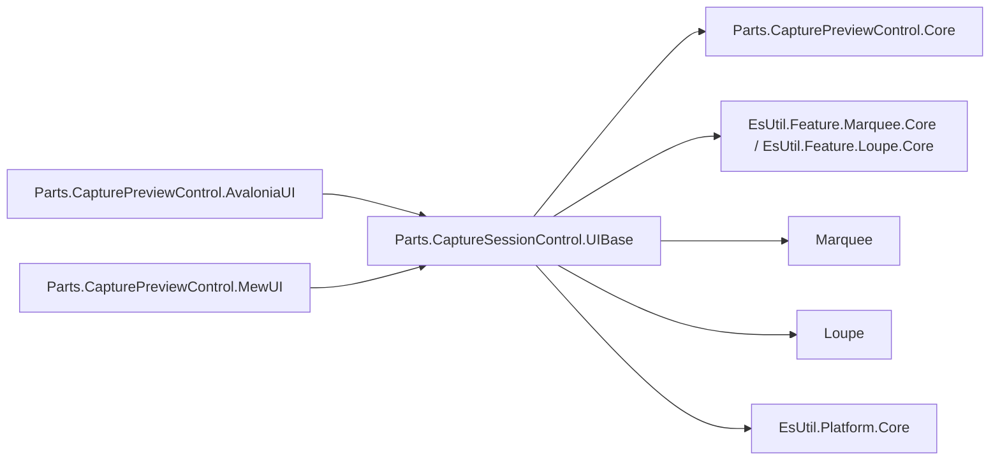
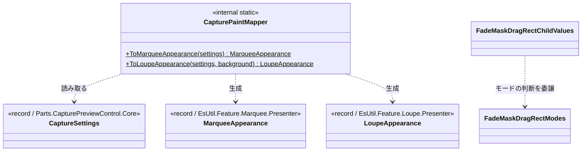
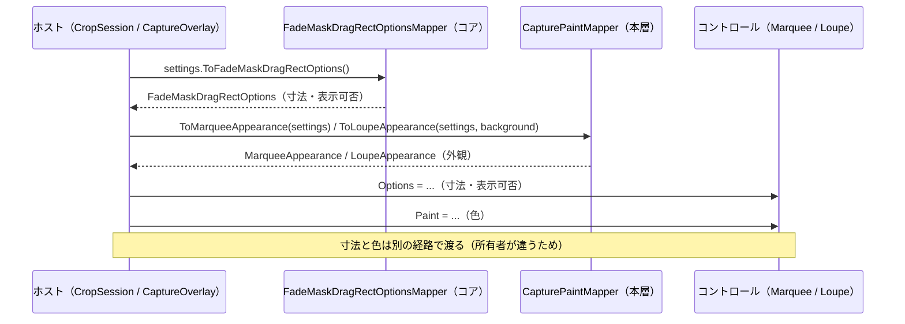

# Parts.CaptureSessionControl.UIBase システム仕様書

## 目次

- [1. 概要](#1-概要)
- [2. 技術スタック](#2-技術スタック)
- [3. アーキテクチャ](#3-アーキテクチャ)
  - [3.1 本層を置く理由](#31-本層を置く理由)
- [4. コンポーネント構成](#4-コンポーネント構成)
- [5. クラス図](#5-クラス図)
- [6. データフロー](#6-データフロー)
- [7. 例外処理ポリシー](#7-例外処理ポリシー)
- [8. 可視性ポリシー](#8-可視性ポリシー)
- [9. テスト](#9-テスト)

## 1. 概要

`Parts.CaptureSessionControl.UIBase` は、拠影・切り出しのセッションを実装する両 UI が共有する**設定写像と複合コントロールの共有処理**を提供します。 対象は次の 3 つです。

- **キャプチャ設定（`CaptureSettings`）→ 外観（`MarqueeAppearance` / `LoupeAppearance`）の写像**
- **設定とモードから内包コントロールへ適用する値の解決**（`FadeMaskDragRectChildValues`）
- **付加情報ラベル（操作・情報）の配置指示の解決**（`FadeMaskHostLabelRenderer` / `MarqueeHostLabelRenderer`）

寸法・表示可否はコアの設定マッパー（`FadeMaskDragRectOptionsMapper`）が単一所有するため、本層は色だけを扱います。

外部機能と公開 API は [SPEC_API](SPEC_API.md)、利用手順は [README](../README.md) を参照してください。

## 2. 技術スタック

| 項目 | 内容 |
| --- | --- |
| 目的 | 設定から色への写像と、複合コントロールの共有処理を 1 箇所へ集約し、両 UI で同じ見た目・振る舞いになるようにする |
| 提供形態 | クラスライブラリ（`Parts.CaptureSessionControl.UIBase.dll`）。 写像は `internal`、複合コントロールの共有処理は `public` |
| 想定利用者 | 両 UI のホスト（`Parts.CapturePreviewControl.AvaloniaUI` / `Parts.CapturePreviewControl.MewUI` の撮影オーバーレイ・切り出しセッション） |
| ターゲット | `net10.0` |
| 言語 | C# 14（`Nullable` 有効・`ImplicitUsings` 有効） |
| ルート名前空間 | `EsUtil.SaveEvidence.Parts.CaptureSession.UIBase` |
| 汎用性 | 特定の UI に依存しない。 UI フレームワークを参照しない |

## 3. アーキテクチャ



依存の向きは **UI → UIBase（本層）→ Core / 各提示層の設定**の一方向です。 逆向きの参照はありません。

### 3.1 本層を置く理由

| 置き場所の候補 | 可否 | 理由 |
| --- | --- | --- |
| `Parts.CapturePreviewControl.Core` | 不可 | 写像先が提示層の型（`MarqueeAppearance` / `LoupeAppearance`）のため、Core → UIBase の逆流になる |
| 再利用ライブラリ | 不可 | 写像元が製品の設定型（`CaptureSettings`）のため、再利用ライブラリが製品設定へ依存する |
| `Parts.CaptureSessionControl.UIBase`（本層） | 採用 | セッションの設定と両 UI の中間にあり、両 UI のホストが同じ写像・同じ組み立てを共有できる |

## 4. コンポーネント構成

| ファイル | 可視性 | 内容 |
| --- | --- | --- |
| `CapturePaintMapper.cs` | `internal static class` | `CaptureSettings` → `MarqueeAppearance` / `LoupeAppearance` の**色**の写像（**唯一の所有者**。 写像が 1 箇所に閉じるため、両 UI のホストが同じ写像を使うことが構造的に保証される） |
| `FadeMaskDragRectChildValues.cs` | `public readonly record struct` | 設定とモードから内包コントロールへ適用する**寸法・表示可否**の解決（**唯一の所有者**。 モードの判断はコアが持つ） |
| `FadeMaskHostLabelRenderer.cs` | `public static class` | 付加情報ラベル（操作・情報）の縦積みの配置指示の解決（**唯一の所有者**。 積み上げ位置と表示可否を含む） |
| `MarqueeHostLabelRenderer.cs` | `public static class` | ラベル 1 行の体裁（背景の寸法）の配置指示の解決（**唯一の所有者**） |

## 5. クラス図



## 6. データフロー



## 7. 例外処理ポリシー

| 状況 | 挙動 |
| --- | --- |
| `settings` が null | `ArgumentNullException`（呼び出し側の実装誤りであり、回復して続行すべき状況ではない） |
| 設定メンバーの null | 想定外（`ToNonNull` 済みを渡す契約）。 `!` で参照する |

本層は外部 I/O・非同期処理・リソース解放を持ちません。

## 8. 可視性ポリシー

- **写像（`CapturePaintMapper`）は `internal`**。 両 UI のホストが使う内部処理のためです。
- **複合コントロールの共有処理（`FadeMaskDragRectChildValues` / `FadeMaskHostLabelRenderer` / `MarqueeHostLabelRenderer`）は `public`**。 UIBase を参照する側（複合コントロールの UI 実装）が直接使うためです。
- `internal` は `InternalsVisibleTo`（`Parts.CapturePreviewControl.AvaloniaUI` / `Parts.CapturePreviewControl.MewUI` /
  `Parts.CaptureSessionControl.UIBase.Tests`）で公開します。
- **`internal` → `public` の変更は破壊的な設計変更として扱います**。

## 9. テスト

```text
tests/
├── CapturePaintMapper.Tests.cs          # 写像の網羅
├── FadeMaskDragRectChildValues.Tests.cs # モードから導出する値の上書き
├── FadeMaskHostLabelRenderer.Tests.cs   # 付加情報ラベルの縦積みと表示可否
└── MarqueeHostLabelRenderer.Tests.cs    # ラベル 1 行の体裁（背景の寸法の検証）
```

| 検証内容 | 件数 |
| --- | --- |
| 選択矩形の 9 項目の写像 | 1 |
| 外枠とハンドル枠が同じ枠線色になること | 1 |
| 写像しない色が既定値を保つこと | 1 |
| ルーペの 7 項目の写像 | 1 |
| ルーペの画像外の色が設定から与えられること | 1 |
| `settings` が null の場合の例外 | 1 |
| モードから導出する項目の上書き（ハンドル・全面暗転・入力の可否） | 9 |
| 付加情報ラベルの積み上げ・表示可否と、体裁（背景の寸法） | 12 / 6 |

UI 初期化が不要なため、すべて `[Fact]` で並列実行されます。

```powershell
dotnet test src/Parts.CaptureSessionControl.UIBase/tests/Parts.CaptureSessionControl.UIBase.Tests.csproj
```

UI 依存の検証（設定が実際にコントロールへ届くか、描画結果が期待どおりか）は各 UI のテストプロジェクトが担います。
