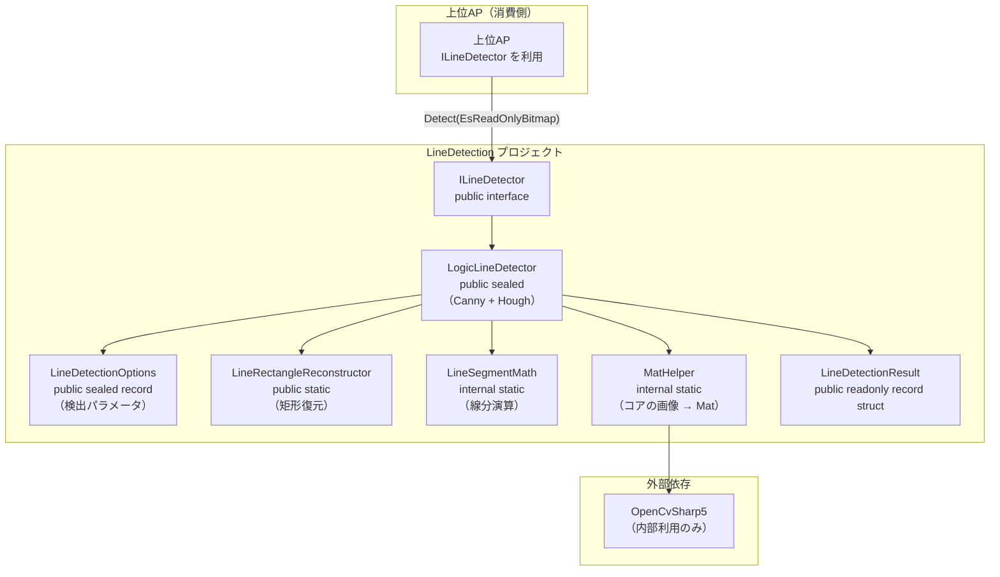

# Parts.LineDetection システム仕様書

本仕様書は、`EsUtil.SaveEvidence.Parts.LineDetection`（LineDetection ライブラリ）の**システム概要・アーキテクチャ・内部設計**を定義します。

## 目次 <!-- omit from toc -->

- [1. システム概要](#1-システム概要)
- [2. 技術スタック](#2-技術スタック)
- [3. アーキテクチャ](#3-アーキテクチャ)
- [4. コンポーネント構成](#4-コンポーネント構成)
- [5. 依存関係](#5-依存関係)
  - [5.1 ネイティブの構成（slim プロファイル）](#51-ネイティブの構成slim-プロファイル)
  - [5.2 名前空間](#52-名前空間)
- [6. 検出アルゴリズム](#6-検出アルゴリズム)
  - [6.1 ロジック方式（LogicLineDetector）](#61-ロジック方式logiclinedetector)
    - [6.1.1 主な内部処理](#611-主な内部処理)
- [7. 例外処理ポリシー](#7-例外処理ポリシー)

---

## 1. システム概要

LineDetection は、キャプチャ画像から Windows のウィンドウ枠となる水平・垂直の辺（線分）を検出するライブラリです。

- 検出方式は `ILineDetector` で抽象化され、ロジック方式（Canny + Hough）を同一の API で利用できます。
- 入力は `EsReadOnlyBitmap`（BGRA8888。 借用であり破棄しない）、出力は `LineDetectionResult` のリストです。
- OpenCvSharp は内部利用に閉じ、公開 API には露出しません。

## 2. 技術スタック

| 項目 | 内容 |
| --- | --- |
| 言語 | C#（.NET 10） |
| UI フレームワーク | なし（UI 非依存。 依存は `EsUtil.Platform.Core` と OpenCvSharp5 のみ） |
| 画像処理 | OpenCvSharp5（OpenCV・内部利用。 ネイティブは `OpenCvSharp5.runtime.win.slim`） |

## 3. アーキテクチャ



- 呼び出し元は `ILineDetector` にのみ依存します（依存性逆転）。
- 検出方式の追加は `ILineDetector` の実装を追加するだけで可能です（開放閉鎖原則）。

## 4. コンポーネント構成

| ファイル | 責務 |
| --- | --- |
| `ILineDetector.cs` | `ILineDetector`（インターフェース）を定義。 検出方式の抽象化。 |
| `LineDetectionResult.cs` | `LineOrientation`（向き）enum・`LineDetectionResult`（結果レコード）を定義。 |
| `LineDetectionOptions.cs` | ロジック方式の検出パラメータ（不変値・検証付き）と既定値（`Default`）を定義。 |
| `LineRectangleReconstructor.cs` | 線分の集合から矩形（ウィンドウの 4 辺）を構成する静的ヘルパー（`EsRectInt` を返す）。 4 辺が矩形を構成する組み合わせのみを対象とし、候補数と処理量に上限を設けて UI のブロックを防ぐ。 |
| `LineSegmentMath.cs` | 線分の演算（接続判定・平行判定・長さ等）の内部ヘルパー。 |
| `LogicLineDetector.cs` | ロジック方式の検出器。 Canny + HoughLinesP + 幾何学的一貫性による矩形検出。 |
| `MatHelper.cs` | コアの画像（`EsReadOnlyBitmap`）↔ `Mat` 変換のヘルパー（OpenCvSharp 依存を内部に閉じ込める）。 **中間のマネージド配列を作らず、`Mat` の領域へ直接コピーする**（フレーム全体のコピーが 2 回から 1 回になり、大きな画像でも配列を確保しない）。 |

## 5. 依存関係

- `ILineDetector.cs` → `LineDetectionResult`（`EsPoint`）/ `EsReadOnlyBitmap`（EsUtil.Platform.Core）
- `LogicLineDetector.cs` → `ILineDetector` / `LineOrientation` / `LineDetectionOptions` / `LineRectangleReconstructor` / `LineSegmentMath` / `MatHelper`
- `LineRectangleReconstructor.cs` → `LineDetectionResult` / `EsRectInt`（EsUtil.Platform.Core）
- `MatHelper.cs` → OpenCvSharp（内部のみ）・`EsReadOnlyBitmap`（EsUtil.Platform.Core）

本プロジェクトは **UI フレームワーク非依存**です（依存は `EsUtil.Platform.Core` と OpenCvSharp のみ。 Avalonia への依存なし）。 座標はコア型（`EsPoint` / `EsRectInt`）で公開し、UI 側は境界で各 UI の型へ変換します。

### 5.1 ネイティブの構成（slim プロファイル）

使用する OpenCV API は `imgproc`（`CvtColor` / `Canny` / `HoughLinesP`）と `imgcodecs`（テストの `ImRead`）だけで、動画入出力（`videoio` の `VideoCapture` / `VideoWriter`）を使いません。 そのためネイティブは `OpenCvSharp5.runtime.win.slim` を参照します。

| 参照 | `OpenCvSharpExtern.dll` | `opencv_videoio_ffmpeg500_64.dll` |
| --- | --- | --- |
| `OpenCvSharp5.runtime.win` | 含む | **含む** |
| `OpenCvSharp5.runtime.win.slim`（採用） | 含む（`videoio` 等を除いた分だけ小さい） | **含まない** |

slim が無効化するモジュール（`videoio` / `video` / `dnn` / `ml` / `highgui` / `contrib` / `stitching` / `barcode`）は本プロジェクトでは使用しません。

### 5.2 名前空間

UI 非依存のアセンブリは `EsUtil.*`（`EsUtil.Platform.Core.*` 等）に置く方針のため、名前空間は `EsUtil.SaveEvidence.Parts.LineDetection` とし、プロジェクトとアセンブリは `Parts.LineDetection` とする（アセンブリ名はフォルダ名と一致させる規則による）。

いずれも他の検出器へ依存しません（疎結合）。 `MatHelper` / `LineSegmentMath` は内部実装のため公開 API ではありません。 OpenCvSharp は `MatHelper` に閉じ、公開 API（`ILineDetector.Detect(EsReadOnlyBitmap)`）には露出しません。

## 6. 検出アルゴリズム

### 6.1 ロジック方式（LogicLineDetector）

```text
EsReadOnlyBitmap (BGRA8888)
  → MatHelper.ToMat (OpenCV の Mat へ変換)
  → グレースケール化
  → Canny エッジ検出
  → HoughLinesP で線分抽出（水平 / 垂直に分類）
  → 同一直線上の断片をクラスタリングしてマージ
  → 近接する平行線（外縁・内縁・透過枠の分裂）を統合
  → 各辺を元画像の輝度プロファイルの枠の外側の境界へ補正
  → 線分に沿ったエッジ支持率で文字列の断片を除外
  → 矩形（ウィンドウの 4 辺）を構成できる場合、対辺同長・コーナー近接を満たすものを優先出力
  → 矩形を構成できない場合は、フィルタ済みの線分リストを出力
```

#### 6.1.1 主な内部処理

- **クラスタリング**（`MergeCollinearAll`）: 同一垂直座標の断片を広いギャップ（`RectMergeGap=200`）で連結します。
- **枠の外側の境界への補正**（`SnapToEdgeByGradient`）: 元画像の輝度プロファイルから枠線コアを求め、外側の境界（排他座標）を返します。
- **近接平行線の統合**（`MergeParallelLines`）: 透過枠で分裂した枠線を 1 本に統合します。 代表座標はエッジ支持率が最も高い線分、同点ならスパンが最長の線分を採用します。
- **エッジ支持率フィルタ**（`EdgeSupportRatio`）: 文字列（断続エッジ）を除外します。
- **矩形探索**（`BuildRectangles`）: 対辺同長（比率 `OppositeSpanRatio`）・コーナー近接（辺の長さ × `CornerToleranceRatio`）を満たし、画像端からの距離合計が最小の矩形を選択します。

## 7. 例外処理ポリシー

- `LogicLineDetector`: 例外を投げません。 画像の幾何学的特徴のみで検出するため、実行時エラーは発生しません。
