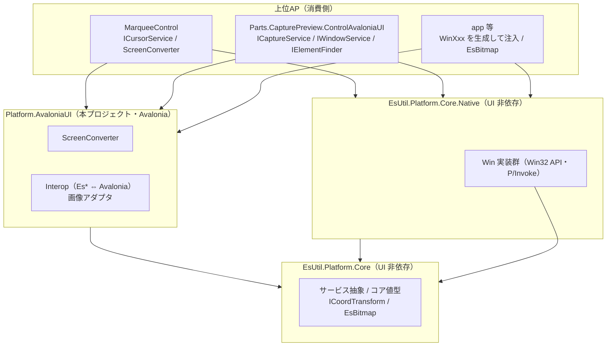

# Platform.AvaloniaUI システム仕様書

## 目次 <!-- omit from toc -->

- [1. システム概要](#1-システム概要)
- [2. 技術スタック](#2-技術スタック)
- [3. アーキテクチャ](#3-アーキテクチャ)
  - [3.1 プロジェクト分割](#31-プロジェクト分割)
  - [3.2 依存方向](#32-依存方向)
- [4. 例外処理ポリシー](#4-例外処理ポリシー)
- [5. コンポーネント図](#5-コンポーネント図)
- [6. コンポーネント一覧](#6-コンポーネント一覧)
  - [6.1 ScreenConverter](#61-screenconverter)
  - [6.2 相互変換（Interop）](#62-相互変換interop)
  - [6.3 画像アダプタ](#63-画像アダプタ)
- [7. 依存ルール](#7-依存ルール)
- [8. ライフサイクル](#8-ライフサイクル)
- [9. ログ](#9-ログ)

---

## 1. システム概要

SaveEvidence は、Windows デスクトップ上の画面をキャプチャし、プレビュー・編集・保存するための
Avalonia UI アプリケーションです（.NET 10.0 / C# 14 / MVVM）。

本プロジェクト（`Platform.AvaloniaUI`）は、そのうち **Avalonia UI 固有のアダプタ**を担います。
UI フレームワーク非依存の抽象・値型・純粋ロジックと、ネイティブ（OS）の Win32 実装は `EsUtil.Platform.Core`（後者は `Native/` 配下） が提供します。

## 2. 技術スタック

| 項目 | 内容 |
| --- | --- |
| **プロジェクト** | `src/Platform.AvaloniaUI/src/Platform.AvaloniaUI.csproj` |
| **ルート名前空間** | `EsUtil.SaveEvidence.Platform.AvaloniaUI`（画像アダプタは `.Imaging`、相互変換は `.Interop`、座標変換は `.Coord`） |
| **言語** | C# 14（.NET 10.0） |
| **UI フレームワーク** | Avalonia UI 12.1（Bitmap / PixelPoint / PixelRect / TopLevel 等の標準型） |
| **ターゲットフレームワーク** | net10.0 |
| **参照パッケージ** | Avalonia / Avalonia.Skia |
| **テスト** | xUnit v3 / Avalonia.Headless.XUnit |
| **依存プロジェクト** | `EsUtil.Platform.Core`（`Native/` の Win32 実装を含む） |

## 3. アーキテクチャ

### 3.1 プロジェクト分割

| プロジェクト | 責務 | UI 依存 |
| --- | --- | --- |
| `EsUtil.Platform.Core` | 抽象（サービス 6 種）・コア値型・座標変換ポート・`EsBitmap` | なし |
| `EsUtil.Platform.Core`（`Native/`） | サービス抽象と Win32 実装（`Native.Win`）・System.Drawing 変換（`Native.Imaging`） | なし |
| `Platform.AvaloniaUI`（本プロジェクト） | `ScreenConverter`・相互変換・画像アダプタ | Avalonia |

### 3.2 依存方向

- 依存は**一方向の階層構造**（本プロジェクト → `EsUtil.Platform.Core`（`Native/` を含む））。
- 上位 AP（`MarqueeControl` / `Parts.CapturePreview.ControlAvaloniaUI` / `App.AvaloniaUI`）は本プロジェクトを参照すれば、
  サービス抽象・コア値型・Win32 実装・Avalonia アダプタをすべて利用できる。
- 本プロジェクトは「Avalonia の型に依存するもの」だけを置く。 UI 非依存の型は `EsUtil.Platform.Core` 側に置く。

## 4. 例外処理ポリシー

- ライブラリは例外を原則伝播し、上位 AP（app）で処理する。
- 相互変換は値型の変換のみであり例外を送出しない。
- `ScreenConverter` はビジュアルツリー未接続時に等価変換へフォールバックし、例外を送出しない。

## 5. コンポーネント図

## 6. コンポーネント一覧

### 6.1 ScreenConverter

- **分類**: 公開静的クラス
- **責務**: コントロールローカル DIP ↔ 画面物理 Pixel の変換（`TopLevel` の解決を集約する唯一の場所）
- **公開メソッド**: `LocalDipToScreen(Visual, Point)` / `ScreenToLocalDip(Visual, PixelPoint)`
- **依存**: Avalonia（`TopLevel` / `Visual` / `PixelPoint`）
- **備考**: `TopLevel` に依存するため他 UI では再利用できない（Avalonia 版専用）。 座標変換ポートは提供しない（ポートの軸は「ローカル DIP ↔ 対象座標」であり、画面物理はその軸に含まれない）。

### 6.2 相互変換（Interop）

| コンポーネント | 説明 |
| --- | --- |
| `EsKeyAvaloniaInterop` | `EsKey` ⇔ `Avalonia.Input.Key`（名前ベース変換。 Avalonia の `Key` は `PageUp` / `Prior` 等の別名で同値を持つため数値変換しない。 **29 組の別名があるため変換の契約は「キーの値が保たれる」**（代表名は宣言順では決まらず、.NET はどれを返すか保証しない）。 未定義値は `None`。 双方向の名前集合一致は `EsKeyAvaloniaInterop.Tests` が強制する） |
| `EsWindowStateAvaloniaInterop` | `EsWindowState` ⇔ `Avalonia.Controls.WindowState`（名前ベース変換。 メンバー数が 4 と少ないため `Enum.IsDefined` で未定義値を検出し `Normal` へフォールバックする） |
| `EsGeometryAvaloniaInterop` | `EsPoint` / `EsSize` / `EsVector` / `EsRect` / `EsPointInt` / `EsRectInt` ⇔ Avalonia の対応型 |
| `EsPlatformHandleAvaloniaInterop` | `Avalonia.Platform.IPlatformHandle` ⇔ `EsPlatformHandle` |
| `ColorAvaloniaInterop` | `Avalonia.Media.Color` ⇔ `System.Drawing.Color`（コアの色型。 `System.Drawing.Primitives` は共有フレームワーク同梱のため Windows 専用ではない） |
| `CursorOverrideGuardAvaloniaExtensions` | `ICursorOverrideGuard.Attach(this ICursorOverrideGuard, TopLevel)`（`TopLevel` からハンドルを取得して Core の `Attach` へ委譲） |

- **可視性**: public

### 6.3 画像アダプタ

| コンポーネント | 説明 |
| --- | --- |
| `EsBitmapAvaloniaExtensions` | `EsBitmap`（Core）の Avalonia 向け生成・変換・ピクセル操作拡張 |
| `EsBitmapAvaloniaImage` | `EsBitmap` を内包して `IImage` として公開するアダプタ（**所有権を保持**。 射影 `Bitmap` は初回の `Draw` で生成し、以降は再利用する） |
| `EsImageSourceAdapter` | Avalonia の `Bitmap` またはコアの `EsBitmap` を包み、`IImage` と `IEsImageSource` の両面で公開するアダプタ（**真実は所有しない**。 反対側の射影だけを初回に生成して `Dispose` で解放する） |
| `CapacityLimitedCache<TKey, TValue>` | 生成にコストがかかる値をキー単位で共有する容量制限付きキャッシュ（スレッド安全。 容量超過時は全体をクリア） |
| `SolidColorBrushCache` | `System.Drawing.Color` の色 → `SolidColorBrush` の変換と容量管理を単一所有するキャッシュ（描画アダプタとラベル要素の配置が共用する） |
| `AvaloniaTextMeasure` | テキストの実寸測定を単一所有する（ラベルの配置矩形は実寸から決まるため、UI ごとの測定の食い違いを防ぐ） |
| `ColorExtensions` | C# 14 静的拡張メンバー `FromAColor`（基準色＋不透明度から色を生成） |

- **可視性**: public

## 7. 依存ルール

- 依存方向は**一方向の階層構造**（本プロジェクト → `EsUtil.Platform.Core`（`Native/` を含む））。
- 上位 AP は本プロジェクトのみを参照すればよい（推移的に `Native` / コアを利用できる）。
- 本プロジェクトに UI 非依存の型を置かない（置き場所は `EsUtil.Platform.Core`）。

## 8. ライフサイクル

- 本プロジェクトの型は静的クラスと拡張メソッドが中心であり、状態を持ちません。
- 生成・破棄が必要なリソース（`EsBitmap` 等）の所有権は以下に従います。
  - `ToAvaloniaImage` / `CreateAvaloniaImage` は内包 `EsBitmap` の所有権を `EsBitmapAvaloniaImage` へ移す。
  - `ToAvaloniaWriteableBitmap` / `ToAvaloniaBitmap` は複製を返し、呼び出し側が所有・破棄する。

## 9. ログ

本プロジェクトはログを出力しません。
ログ定義（`NativeLogMessage`）は `EsUtil.Platform.Core`（`Native/`）が所有し、Win 実装が使用します。
