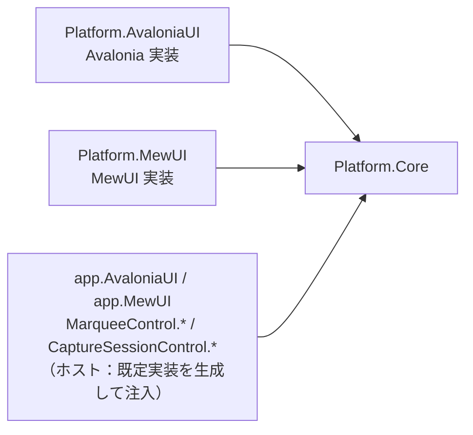

# Platform.Core システム仕様書

## 概要

`Platform.AvaloniaUI`（Avalonia UI 実装）と将来の MewUI 実装が共有する、UI フレームワーク非依存の型を提供するライブラリです。
SaveEvidence のマルチ UI 対応（Avalonia UI / MewUI）における、共有基盤（Core）分割の第一段階として作成されました。

## 技術スタック

- .NET 10 / C# 14
- Microsoft.Extensions.Logging.Abstractions（`LoggerFallback` のロガー抽象のみ。Microsoft 公式パッケージ）
- System.Drawing.Common（`Native/Imaging` の `System.Drawing.Bitmap` 変換のみ。Microsoft 公式パッケージ。Windows 専用）
- UI フレームワークは一切参照しない

## アーキテクチャ

- `Platform.Core` は他プロジェクトへ依存しない末端の共有ライブラリです。
- 各 UI 実装は、コア型と自身の型（例: `Avalonia.Input.Key` / `Avalonia.Point` / `IPlatformHandle`）を相互変換する Interop 層を個別に用意します（例: `Platform.AvaloniaUI` プロジェクトの `EsKeyAvaloniaInterop` / `EsGeometryAvaloniaInterop` / `EsPlatformHandleAvaloniaInterop`）。
- サービス抽象（`ICaptureService` 等）とその Windows 実装（Win32）は、本プロジェクトの `Native/` 配下が提供します。**実行時のプラットフォーム分岐（ファクトリ）を持たず、ホストが `Native/Win` の具象を生成して抽象型として注入します**。テストは抽象を実装したモックを注入するため、Win32 実行環境を必要としません。

## コンポーネント構成

| ファイル | 内容 |
| --- | --- |
| `EsKey.cs` | UI フレームワーク非依存のキー識別子（列挙型）。`Avalonia.Input.Key` と同名のメンバーを持つ |
| `EsWindowState.cs` | UI フレームワーク非依存のウィンドウ表示状態（列挙型）。`Avalonia.Controls.WindowState` と同名のメンバーを持つ |
| `HotKeyModifiers.cs` | ホットキー修飾キーのフラグ列挙型 |
| `HotKeySetting.cs` | ホットキー設定の値オブジェクト（record） |
| `Native/ICaptureService.cs` | 画面領域キャプチャの抽象 |
| `Native/ICursorService.cs` | OS カーソル操作の抽象 |
| `Native/IWindowService.cs` | ネイティブウィンドウ操作の抽象 |
| `Native/IElementFinder.cs` | 要素（ウィンドウ・スクリーン）検出の抽象 |
| `Native/ICursorOverrideGuard.cs` | カーソル上書き抑止の抽象 |
| `Native/IGlobalHotKeyService.cs` | グローバルホットキー管理の抽象 |
| `Native/ElementFinderResults.cs` | 要素検出の結果（`readonly record struct`） |
| `Native/PlatformLog.cs` | Win 実装が出力するログ定義（internal） |
| `Native/Win/WinNative.cs` | Win32 P/Invoke の宣言集約（internal） |
| `Native/Win/WinCaptureService.cs` | `ICaptureService` の Windows 実装 |
| `Native/Win/WinCursorService.cs` | `ICursorService` の Windows 実装 |
| `Native/Win/WinWindowService.cs` | `IWindowService` の Windows 実装 |
| `Native/Win/WinElementFinder.cs` | `IElementFinder` の Windows 実装 |
| `Native/Win/WinCursorOverrideGuard.cs` | `ICursorOverrideGuard` の Windows 実装 |
| `Native/Win/WinGlobalHotKeyService.cs` | `IGlobalHotKeyService<T>` の Windows 実装 |
| `Native/Imaging/EsBitmapDrawingExtensions.cs` | `System.Drawing.Bitmap` ⇔ `EsBitmap` の相互変換（Windows 専用） |
| `LoggerFallback.cs` | ロガーの null を `NullLogger.Instance` へ吸収する共通ヘルパー（拡張メソッド `OrNullLogger`） |
| `Coord/ScrollMath.cs` | スクロール範囲・ビューポートサイズの純粋計算とホイール 1 段のスクロール量（`WheelScrollUnit`） |
| `Coord/DpiScaler.cs` | DIP 値を物理ピクセルへ変換する純粋計算（DPI 基準値と DPI → スケーリング換算を含む） |
| `Coord/CoordTransformExtensions.cs` | 座標変換ポート未設定（null）を等価変換として解決する |
| `Coord/ICoordTransform.cs` | 座標系間の変換ポート（`Forward` / `Inverse` / `Bounds`） |
| `Coord/CoordTransform.cs` | 変換ポートの具象実装（`Func` 委譲・`Identity` / `Compose` / `ScrollOffset` / `Scale` / `DomainScale` / `ImageLayout`）。**画像レイアウト（レターボックス・スケール）と平行移動・スケーリングの純粋計算も単一所有する**（`CalculateUniformLayout` / `ComputeImageRenderInfo` / `OffsetPoint` 等は internal。各ファクトリが使う） |
| `Geometry/EsPoint.cs` | UI フレームワーク非依存の 2 次元座標（`readonly record struct`）。座標ラベルの文言（`Format`）と、フレームワーク対照の操作（`WithX` / `Offset` / `DistanceTo` / `NearlyEquals` / 演算子）を提供する |
| `Geometry/EsSize.cs` | UI フレームワーク非依存の 2 次元サイズ（`readonly record struct`。領域の確定判定 `HasArea` とクランプ `ClampToArea` / `ClampOffset`。`Constrain` / `Inflate` / `Deflate` / 四則演算） |
| `Geometry/EsVector.cs` | UI フレームワーク非依存の 2 次元ベクター（`readonly record struct`。`Length` / `LengthSquared` / `Normalize` / `Dot` / `Cross` / `Min` / `Max` / `Abs` / 四則演算） |
| `Geometry/EsRect.cs` | UI フレームワーク非依存の矩形（`readonly record struct`。枠線の内側 4 辺 `ResolveInnerEdges`（配列版 `ComputeInnerEdges`）・領域内クランプ `ClampToArea`・重なり部分 `Intersect` / `Intersects`・`Union` / `CenterRect` / `Normalize`） |
| `Geometry/EsPointInt.cs` | UI フレームワーク非依存の整数座標（`EsPoint` の整数版。丸めは `FromEsPoint` が単一所有する） |
| `Geometry/EsSizeInt.cs` | UI フレームワーク非依存の整数サイズ（`EsSize` の整数版。`IsEmpty`（0 以下）と `FromEsSize`） |
| `Geometry/EsRectInt.cs` | UI フレームワーク非依存の整数矩形（`EsRect` の整数版。`Contains` / `Intersects` / `Intersect` / `Union` / `Center` / `FromEsRect`） |
| `Geometry/EsAxis.cs` | レイアウト計算で扱う軸（`X` / `Y`）。軸を `bool` で指定しないための列挙型 |
| `Geometry/EsRounding.cs` | 小数を整数へ丸める方法（`Truncate` / `Round` / `Ceiling`）。丸め規則を整数型の変換へ集約するための列挙型 |
| `Geometry/EsThickness.cs` | 4 辺の厚さ（`readonly record struct`。`EsSize` / `EsRect` の `Inflate` / `Deflate` の引数） |
| `Geometry/EsRectEdges.cs` | 矩形の 4 辺の矩形を保持する固定長コンテナ（`readonly struct`。`EsRect.ResolveInnerEdges` の戻り値） |
| `Geometry/EsMath.cs` | 幾何値の近似比較（`AreClose`）と整数への丸め（`RoundToInt`）の単一所有者（internal） |
| `EsPlatformHandle.cs` | UI フレームワーク非依存のネイティブウィンドウ識別子（座標・寸法ではないため `Geometry` に置かない） |
| `Imaging/EsBitmap.cs` | 自前のピクセルバッファを所有するピクセルコンテナ（BGRA8888・Premul。外部パッケージに依存しない） |
| `Imaging/ImageDrawMode.cs` | 画像を描画先の領域へ配置する方法（`Uniform` / `Fill`） |
| `Imaging/ImageDrawMath.cs` | 画像を描画先の領域へ配置する矩形の計算（純粋関数。`EsRect` を返す） |
| `Imaging/DrawingColorExtensions.cs` | 描画色の可視判定（アルファが 0 より大きいか）の単一所有 |

### ラベル体裁を本プロジェクトが所有する理由

「背景 = 文字の実寸 + 内側余白 × 2」「文字の原点 = 背景の左上 + 内側余白」「縦積みの行送り」は、**特定のコントロールに依存しない体裁の規則**です。
各コントロールのコアが個別に書くと、同じ見た目を作る式が複数箇所へ散り（余白の適用漏れ・非対称な余白）、UI ごとに見た目がずれます。
またフォントサイズの安全域（6〜48）は、ラベルを持つコントロールで共通の規則です。

これらは UI フレームワークにも特定のコントロールにも依存しないため、各コントロールから最も近い共有層である本プロジェクト（`Imaging`）が単一所有します。

## 例外処理ポリシー

本プロジェクトは値型・列挙型と純粋計算で構成されます。例外は `EsBitmap` の引数検証（`ArgumentOutOfRangeException`）と破棄後アクセス（`ObjectDisposedException`）のみです。

## 設計判断（UI 非依存の境界）

本プロジェクトの型は、UI フレームワークの型を保持しないことを境界の条件としています。

| 判断 | 内容 |
| --- | --- |
| キーとウィンドウ状態 | `Avalonia.Input.Key` / `Avalonia.Controls.WindowState` と**メンバー名を一致**させ、名前ベースの変換で相互変換する（既存の設定ファイルをそのまま読み込める） |
| 座標・寸法 | `Avalonia.Point` / `Size` / `Vector` → `EsPoint` / `EsSize` / `EsVector` へ統一し、UI 境界で 1 行変換する |
| 色 | `System.Drawing.Color`（共有フレームワーク同梱でクロスプラットフォーム。`System.Drawing.Common` ではない）を使い、UI の色型への変換は境界で行う |
| Skia の描画プリミティブ | SkiaSharp は外部パッケージであるため、Skia に依存する型（描画ポートの適合・ビットマップの相互変換・テキスト測定）は `Platform.Skia` が単一所有する（本プロジェクトは SkiaSharp を参照しない） |
| 描画の契約 | 各コントロールの提示層（`Feature.*.Presenter`）が単一所有する（本プロジェクトは参照される側であり、それらを参照しない） |
| ロガー未設定 | `LoggerFallback.OrNullLogger()` が単一所有し、各所の `?? NullLogger.Instance` を排除する |

### コア型の命名

コア型には **`Es`（`EsUtil` の略）接頭辞**を付けます（`EsKey` / `EsPoint` / `EsSize` / `EsVector` / `EsRect` /
`EsPointInt` / `EsSizeInt` / `EsRectInt` / `EsAxis` / `EsPlatformHandle` / `EsWindowState` / `EsBitmap`）。

**整数版の型は `Es` + 型名 + `Int`** とします（`EsPoint` / `EsSize` / `EsRect` の整数版が `EsPointInt` / `EsSizeInt` /
`EsRectInt`）。整数であることは「画面物理ピクセル」を意味しない（画像ピクセルも整数である）ため、単位が読む側に
必要な箇所はドキュメントに明記します。

## ライセンス

MIT License（全文は [`../../LICENSE`](../../LICENSE) を参照）
