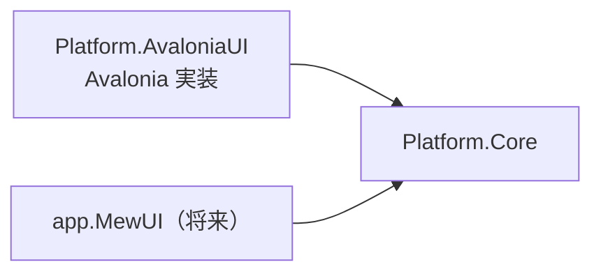

# Platform.Core システム仕様書

## 概要

`Platform.AvaloniaUI`（Avalonia UI 実装）と将来の MewUI 実装が共有する、UI フレームワーク非依存の型を提供するライブラリです。
SaveEvidence のマルチ UI 対応（Avalonia UI / MewUI）における、共有基盤（Core）分割の第一段階として作成されました。

## 技術スタック

- .NET 10 / C# 14
- SkiaSharp（`EsBitmap` のピクセル操作のみ）
- Microsoft.Extensions.Logging.Abstractions（`LoggerFallback` のロガー抽象のみ）
- UI フレームワークは一切参照しない

## アーキテクチャ

- `Platform.Core` は他プロジェクトへ依存しない末端の共有ライブラリです。
- 各 UI 実装は、コア型と自身の型（例: `Avalonia.Input.Key` / `Avalonia.Point` / `IPlatformHandle`）を相互変換する Interop 層を個別に用意します（例: `Platform.AvaloniaUI` プロジェクトの `EsKeyAvaloniaInterop` / `EsGeometryAvaloniaInterop` / `EsPlatformHandleAvaloniaInterop`）。
- サービス抽象（`ICaptureService` 等）の具象実装（Win32 / NoOp）と `PlatformFactory.CreateXxx()` のファクトリは、UI 非依存の `Platform.Native` が提供します。

## コンポーネント構成

| ファイル | 内容 |
| --- | --- |
| `EsKey.cs` | UI フレームワーク非依存のキー識別子（列挙型）。`Avalonia.Input.Key` と同名のメンバーを持つ |
| `EsWindowState.cs` | UI フレームワーク非依存のウィンドウ表示状態（列挙型）。`Avalonia.Controls.WindowState` と同名のメンバーを持つ |
| `HotKeyModifiers.cs` | ホットキー修飾キーのフラグ列挙型 |
| `HotKeySetting.cs` | ホットキー設定の値オブジェクト（record） |
| `ICaptureService.cs` | 画面領域キャプチャの抽象 |
| `ICursorService.cs` | OS カーソル操作の抽象 |
| `IWindowService.cs` | ネイティブウィンドウ操作の抽象 |
| `IElementFinder.cs` | 要素（ウィンドウ・スクリーン）検出の抽象 |
| `ICursorOverrideGuard.cs` | カーソル上書き抑止の抽象 |
| `IGlobalHotKeyService.cs` | グローバルホットキー管理の抽象 |
| `ElementFinderResults.cs` | 要素検出の結果（`readonly record struct`） |
| `LoggerFallback.cs` | ロガーの null を `NullLogger.Instance` へ吸収する共通ヘルパー（拡張メソッド `OrNullLogger`） |
| `Coordinate/ScrollMath.cs` | スクロール範囲・ビューポートサイズの純粋計算とホイール 1 段のスクロール量（`WheelScrollUnit`） |
| `Coordinate/DpiScaler.cs` | DIP 値を物理ピクセルへ変換する純粋計算（DPI 基準値と DPI → スケーリング換算を含む） |
| `Coordinate/CoordTransformExtensions.cs` | 座標変換ポート未設定（null）を等価変換として解決する |
| `Coordinate/CoordMath.cs`（internal） | 画像レイアウト計算の一元化。`CoordTransform` から利用する |
| `Coordinate/ICoordTransform.cs` | 座標系間の変換ポート（`Forward` / `Inverse` / `Bounds`） |
| `Coordinate/CoordTransform.cs` | 変換ポートの具象実装（`Func` 委譲・`Identity` / `Compose` / `ScrollOffset` / `Scale` / `DomainScale` / `ImageLayout`） |
| `Geometry/EsPoint.cs` | UI フレームワーク非依存の 2 次元座標（`readonly record struct`） |
| `Geometry/EsSize.cs` | UI フレームワーク非依存の 2 次元サイズ（`readonly record struct`） |
| `Geometry/EsVector.cs` | UI フレームワーク非依存の 2 次元ベクター（`readonly record struct`） |
| `Geometry/EsRect.cs` | UI フレームワーク非依存の矩形（`readonly record struct`） |
| `Geometry/EsPixelPoint.cs` | UI フレームワーク非依存の画面物理座標（整数ピクセル） |
| `Geometry/EsPixelRect.cs` | UI フレームワーク非依存の画面物理矩形（整数ピクセル。`Contains` / `Union` / `Center`） |
| `Geometry/EsPlatformHandle.cs` | UI フレームワーク非依存のネイティブウィンドウ識別子 |
| `Geometry/CoordinateFormatter.cs` | 座標の表示文字列を生成する純粋関数 |
| `Imaging/EsBitmap.cs` | SkiaSharp のみに依存するピクセルコンテナ（BGRA8888・Premul） |
| `Imaging/ImageDrawMode.cs` | 画像を描画先の領域へ配置する方法（`Uniform` / `Fill`） |
| `Imaging/ImageDrawMath.cs` | 画像を描画先の領域へ配置する矩形の計算（純粋関数。Skia の `SKRect` を返す） |
| `Imaging/SkiaColorInterop.cs` | コアの色型（`System.Drawing.Color`）→ Skia の色型の変換（MewUI 版の描画層 6 箇所が共用） |
| `Imaging/SkiaGeometryInterop.cs` | コアの幾何型（`EsRect` / `EsPoint`）→ Skia の幾何型の変換と、Skia の整数サイズ → コアのサイズの変換（`ToEsSize`） |
| `Imaging/IEsCanvas.cs` | 描画内容を描画面へ写す即時描画ポート（UI フレームワーク非依存） |
| `Imaging/SkiaEsCanvas.cs` | `SKCanvas` を `IEsCanvas` へ適合させるアダプタ（描画は `SkiaFill` / `SkiaText` / `SkiaLabel` へ委譲） |
| `Imaging/SkiaFill.cs` | Skia の矩形塗り（`Rect` / `Rects` / `RoundRect`）の単一所有（`Rects` は一覧と列挙子の 2 経路） |
| `Imaging/SkiaLabel.cs` | Skia のラベル 1 件（背景 → 文字の順序）の描画の単一所有 |
| `Imaging/SkiaText.cs` | Skia のテキスト描画（フォント解決・実寸測定・描画）の単一所有 |
| `Geometry/IEsRectWalker.cs` | 矩形の列を確保なしで走査する列挙子（構造体）の契約 |
| `Geometry/EsRectMath.cs` | 矩形の辺（枠線の内側 4 辺）と領域内クランプの単一所有 |
| `Geometry/EsSizeMath.cs` | 領域の確定判定と、サイズ・位置の領域内クランプの単一所有 |
| `Geometry/IntMath.cs` | 整数の切り上げ除算の単一所有 |
| `Imaging/EsLabelFrame.cs` | ラベル 1 件の配置（背景矩形・文字原点） |
| `Imaging/EsLabelElement.cs` | ラベル 1 件を UI 要素として配置するための指示と、コアの配置からの写像 |
| `Imaging/IEsLabel.cs` | ラベル 1 件の描画契約（文言・寸法・色と実寸からの配置計算） |
| `Imaging/EsLabelExtensions.cs` | ラベル契約から UI 要素の配置指示を求める拡張メソッド（写像の単一所有） |
| `Imaging/DrawingColorExtensions.cs` | 描画色の可視判定（アルファが 0 より大きいか）の単一所有 |
| `Imaging/EsLabelLayout.cs` | ラベルの体裁（内側余白（`Padding`）・文字原点・配置とクランプ・行送り）の単一所有 |
| `Imaging/EsLabelMetrics.cs` | ラベルのフォントサイズの安全域と補正の単一所有 |
| `Imaging/EsLabelDefaults.cs` | ラベルの既定の見た目（文字色・背景色・フォントサイズ）の単一所有（コントロールの設定型が参照する） |

### ラベル体裁を本プロジェクトが所有する理由

「背景 = 文字の実寸 + 内側余白 × 2」「文字の原点 = 背景の左上 + 内側余白」「縦積みの行送り」は、**特定のコントロールに依存しない体裁の規則**です。
各コントロールのコアが個別に書くと、同じ見た目を作る式が複数箇所へ散り（余白の適用漏れ・非対称な余白）、UI ごとに見た目がずれます。
またフォントサイズの安全域（6〜48）は、ラベルを持つコントロールで共通の規則です。

これらは UI フレームワークにも特定のコントロールにも依存しないため、各コントロールから最も近い共有層である本プロジェクト（`Imaging`）が単一所有します。

## 例外処理ポリシー

本プロジェクトは値型・列挙型と純粋計算で構成されます。例外は `EsBitmap` の引数検証（`ArgumentOutOfRangeException`）と破棄後アクセス（`ObjectDisposedException`）のみです。

## 設計判断（UI 非依存の境界）

本プロジェクトの型は、UI フレームワークの型を保持しないことを境界の条件としています。

| 判断 | 内容 |
| --- | --- |
| キーとウィンドウ状態 | `Avalonia.Input.Key` / `Avalonia.Controls.WindowState` と**メンバー名を一致**させ、名前ベースの変換で相互変換する（既存の設定ファイルをそのまま読み込める） |
| 座標・寸法 | `Avalonia.Point` / `Size` / `Vector` → `EsPoint` / `EsSize` / `EsVector` へ統一し、UI 境界で 1 行変換する |
| 色 | `System.Drawing.Color`（共有フレームワーク同梱でクロスプラットフォーム。`System.Drawing.Common` ではない）を使い、UI の色型への変換は境界で行う |
| Skia の描画プリミティブ | SkiaSharp は UI フレームワークではなくピクセル・描画の基盤であるため、`EsBitmap` と同じ層（本プロジェクト）が単一所有する |
| ラベル体裁 | コントロールに依存しない体裁の規則は本プロジェクトが単一所有する（マーキーとルーペが同じ規則を共用する） |
| ロガー未設定 | `LoggerFallback.OrNullLogger()` が単一所有し、各所の `?? NullLogger.Instance` を排除する |

### コア型の命名

コア型には **`Es`（`EsUtil` の略）接頭辞**を付けます（`EsKey` / `EsPoint` / `EsSize` / `EsVector` / `EsRect` /
`EsPixelPoint` / `EsPixelRect` / `EsPlatformHandle` / `EsWindowState` / `EsBitmap` / `EsLabelFrame` /
`EsLabelElement` / `EsLabelLayout` / `EsLabelMetrics` / `EsLabelDefaults` / `IEsLabel` / `IEsRectWalker` / `IntMath` / `EsRectMath` /
`EsSizeMath` / `IEsCanvas` / `SkiaEsCanvas`）。

## ライセンス

MIT License（全文は [`../../LICENSE`](../../LICENSE) を参照）。
