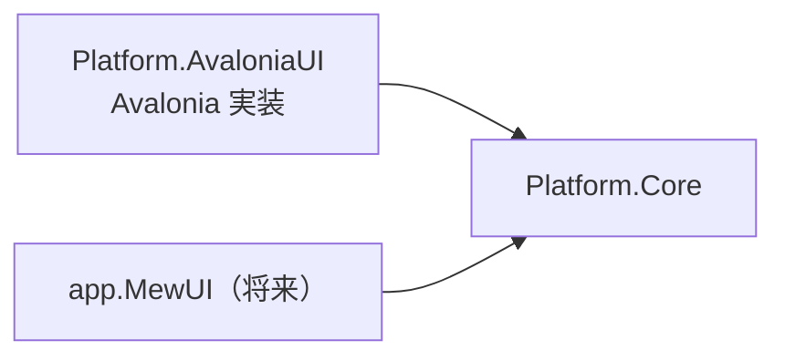

# Platform.Core システム仕様書

## 概要

`Platform.AvaloniaUI`（Avalonia UI 実装）と将来の MewUI 実装が共有する、UI フレームワーク非依存の型を提供するライブラリです。
SaveEvidence のマルチ UI 対応（Avalonia UI / MewUI）における、共有基盤（Core）分割の第一段階として作成されました。

## 技術スタック

- .NET 10 / C# 14
- SkiaSharp（`EsBitmap` のピクセル操作のみ）
- Microsoft.Extensions.Logging.Abstractions（`LoggerFallback` のロガー抽象のみ）
- UI フレームワークは一切参照しない

## アーキテクチャ

- `Platform.Core` は他プロジェクトへ依存しない末端の共有ライブラリです。
- 各 UI 実装は、コア型と自身の型（例: `Avalonia.Input.Key` / `Avalonia.Point` / `IPlatformHandle`）を相互変換する Interop 層を個別に用意します（例: `Platform.AvaloniaUI` プロジェクトの `EsKeyAvaloniaInterop` / `EsGeometryAvaloniaInterop` / `EsPlatformHandleAvaloniaInterop`）。
- サービス抽象（`ICaptureService` 等）の具象実装（Win32 / NoOp）と `PlatformFactory.CreateXxx()` のファクトリは、UI 非依存の `Platform.Native` が提供します。

## コンポーネント構成

| ファイル | 内容 |
| --- | --- |
| `EsKey.cs` | UI フレームワーク非依存のキー識別子（列挙型）。`Avalonia.Input.Key` と同名のメンバーを持つ |
| `EsWindowState.cs` | UI フレームワーク非依存のウィンドウ表示状態（列挙型）。`Avalonia.Controls.WindowState` と同名のメンバーを持つ |
| `HotKeyModifiers.cs` | ホットキー修飾キーのフラグ列挙型 |
| `HotKeySetting.cs` | ホットキー設定の値オブジェクト（record） |
| `ICaptureService.cs` | 画面領域キャプチャの抽象 |
| `ICursorService.cs` | OS カーソル操作の抽象 |
| `IWindowService.cs` | ネイティブウィンドウ操作の抽象 |
| `IElementFinder.cs` | 要素（ウィンドウ・スクリーン）検出の抽象 |
| `ICursorOverrideGuard.cs` | カーソル上書き抑止の抽象 |
| `IGlobalHotKeyService.cs` | グローバルホットキー管理の抽象 |
| `ElementFinderResults.cs` | 要素検出の結果（`readonly record struct`） |
| `LoggerFallback.cs` | ロガーの null を `NullLogger.Instance` へ吸収する共通ヘルパー（拡張メソッド `OrNullLogger`） |
| `Coordinate/ScrollMath.cs` | スクロール範囲・ビューポートサイズの純粋計算 |
| `Coordinate/DpiScaler.cs` | DIP 値を物理ピクセルへ変換する純粋計算 |
| `Coordinate/CoordMath.cs`（internal） | 画像レイアウト計算の一元化。`CoordTransform` から利用する |
| `Coordinate/ICoordTransform.cs` | 座標系間の変換ポート（`Forward` / `Inverse` / `Bounds`） |
| `Coordinate/CoordTransform.cs` | 変換ポートの具象実装（`Func` 委譲・`Identity` / `Compose` / `ScrollOffset` / `Scale` / `DomainScale` / `ImageLayout`） |
| `Geometry/EsPoint.cs` | UI フレームワーク非依存の 2 次元座標（`readonly record struct`） |
| `Geometry/EsSize.cs` | UI フレームワーク非依存の 2 次元サイズ（`readonly record struct`） |
| `Geometry/EsVector.cs` | UI フレームワーク非依存の 2 次元ベクター（`readonly record struct`） |
| `Geometry/EsRect.cs` | UI フレームワーク非依存の矩形（`readonly record struct`） |
| `Geometry/EsPixelPoint.cs` | UI フレームワーク非依存の画面物理座標（整数ピクセル） |
| `Geometry/EsPixelRect.cs` | UI フレームワーク非依存の画面物理矩形（整数ピクセル。`Contains` / `Union` / `Center`） |
| `Geometry/EsPlatformHandle.cs` | UI フレームワーク非依存のネイティブウィンドウ識別子 |
| `Geometry/CoordinateFormatter.cs` | 座標の表示文字列を生成する純粋関数 |
| `Imaging/EsBitmap.cs` | SkiaSharp のみに依存するピクセルコンテナ（BGRA8888・Premul） |

## 例外処理ポリシー

本プロジェクトは値型・列挙型と純粋計算で構成されます。例外は `EsBitmap` の引数検証（`ArgumentOutOfRangeException`）と破棄後アクセス（`ObjectDisposedException`）のみです。

## 移行の経緯

従来 `Platform.AvaloniaUI` プロジェクト内にあった以下の型は、UI フレームワーク（Avalonia）の型を保持していたため、本プロジェクトへ切り出しました。

| 型 | 移行前の依存 |
| --- | --- |
| `HotKeySetting` / `HotKeyModifiers` | `Avalonia.Input.Key` |
| `EsKey` | （新設。`Avalonia.Input.Key` と同名のメンバーを持つ） |
| `ScrollMath` / `DpiScaler` / `CoordMath` | なし（`double` のみ） |
| `CoordinateFormatter` | `Avalonia.Point` → `EsPoint` へ変更 |
| `ICoordTransform` / `CoordTransform` | `Avalonia.Point` / `Size` / `Vector` → `EsPoint` / `EsSize` / `EsVector` へ変更 |
| `EsBitmap` | なし（System.Drawing プリミティブと SkiaSharp のみ。移設当初の名前は `PbBitmap`） |
| `ICaptureService` / `ICursorService` / `IElementFinder` | `Avalonia.PixelRect` / `PixelPoint` → `EsPixelRect` / `EsPixelPoint` へ変更 |
| `IWindowService` / `ElementFinderResults` | `Avalonia.Platform.IPlatformHandle` → `EsPlatformHandle` へ変更 |
| `ICursorOverrideGuard` | `Attach(TopLevel)` → `Attach(EsPlatformHandle)` へ変更（`TopLevel` からの取得は Avalonia 側の拡張メソッド `Attach(this ICursorOverrideGuard, TopLevel)` が担う） |
| `IGlobalHotKeyService<T>` | なし（`IntPtr` と `HotKeySetting` のみ） |

これにより、`app.AvaloniaUI` の設定モデルや各コントロールの純粋ロジック、将来の MewUI 実装からも UI フレームワーク非依存のまま利用できます。
Avalonia 側は相互変換（`EsKeyAvaloniaInterop` / `EsGeometryAvaloniaInterop`）と `EsBitmap` アダプタ（`EsBitmapAvaloniaExtensions` / `EsBitmapAvaloniaImage`）を提供します。

### コア型の命名

コア型には **`Es`（Estable の略）接頭辞**を付けます（`EsKey` / `EsPoint` / `EsSize` / `EsVector` / `EsRect` /
`EsPixelPoint` / `EsPixelRect` / `EsPlatformHandle` / `EsWindowState` / `EsBitmap`）。

画像コンテナは移設当初 `PbBitmap`（Pb = Premultiplied）でしたが、型名がピクセル形式という実装の詳細を表していたため、
他のコア型と揃えて `EsBitmap` へ改名しました（`EsBitmapAvaloniaExtensions` / `EsBitmapAvaloniaImage` /
`EsBitmapDrawingExtensions` も同様）。
