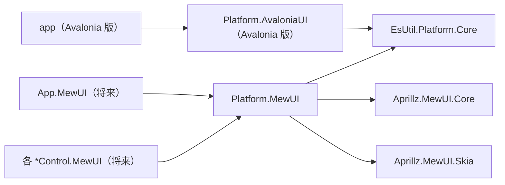

# Platform.MewUI システム仕様書

## 目次 <!-- omit from toc -->

- [1. 概要](#1-概要)
- [2. 技術スタック](#2-技術スタック)
- [3. アーキテクチャ](#3-アーキテクチャ)
- [4. 依存関係](#4-依存関係)
- [5. コンポーネント構成](#5-コンポーネント構成)
- [6. 設計判断](#6-設計判断)
  - [6.1 名前ベースの変換（値ベースではない）](#61-名前ベースの変換値ベースではない)
  - [6.2 未定義値の防御（`EnumCanonical`）](#62-未定義値の防御enumcanonical)
  - [6.3 別名表の対称性](#63-別名表の対称性)
- [7. 例外処理ポリシー](#7-例外処理ポリシー)
- [8. 既知の挙動差（Avalonia との非対称性）](#8-既知の挙動差avalonia-との非対称性)
- [9. テスト](#9-テスト)
- [10. 未実装（今後の判断）](#10-未実装今後の判断)

## 1. 概要

`EsUtil.Platform.Core` のコア型（UI フレームワーク非依存）と **MewUI**（`Aprillz.MewUI`）の型を相互変換する Interop 層です。
SaveEvidence のマルチ UI 対応（Avalonia UI / MewUI）における、MewUI 側の境界変換を担います。

Avalonia 版の `Platform.AvaloniaUI`（`EsUtil.SaveEvidence.Platform.AvaloniaUI`）と対になる位置付けです。

## 2. 技術スタック

- .NET 10 / C# 14
- `Aprillz.MewUI.Core` **0.21.1（バージョン固定）** — MewUI の型のみ（プラットフォームホスト・バックエンドは含まない）
- UI 実装への依存なし（型変換のみのため、ホスト・バックエンドを参照しない）

## 3. アーキテクチャ

- コアロジックは `Es*` 型のみを扱い、UI 境界（各 UI ホスト・コントロール）でのみ本プロジェクトで変換します。
- Avalonia 版と MewUI 版は互いに依存しません（どちらも `EsUtil.Platform.Core` に依存）。

## 4. 依存関係

| 種別 | 依存先 |
| --- | --- |
| プロジェクト | `EsUtil.Platform.Core` / `Platform.Skia` |
| パッケージ | `Aprillz.MewUI.*`（バージョン固定。 型のみでホスト・バックエンドは含まない） |

- **上位（アプリ・Parts・Feature）を参照しません**（プラットフォーム層は最下層に近い）。
- 参照の許可範囲は [依存関係.md](../../../.github/依存関係.md) が所有し、ビルドの `DEP0001`〜`DEP0006` が強制します。

## 5. コンポーネント構成

| ファイル | 内容 |
| --- | --- |
| `EsKeyMewUIInterop.cs` | `EsKey` ⇔ `Aprillz.MewUI.Key`。 別名表（`Back` ⇔ `Backspace`）と未定義値の防御 |
| `EsGeometryMewUIInterop.cs` | `EsPoint` / `EsSize` / `EsVector` / `EsRect` / 色（`System.Drawing.Color` ⇔ `Aprillz.MewUI.Color`） |
| `EsWindowStateMewUIInterop.cs` | `EsWindowState` ⇔ `Aprillz.MewUI.Controls.WindowState` |
| `EsPlatformHandleMewUIInterop.cs` | `Aprillz.MewUI.Window` → `EsPlatformHandle` |
| `src/Platform.MewUI/src/Imaging/SkiaImageView.cs` | `IEsBitmap` を親が割り当てた領域へ描画する表示ビュー（`SkiaCanvasView` 派生） |
| `src/Platform.MewUI/src/Imaging/SkiaImageRenderer.cs`（internal） | `IEsBitmap` を Skia キャンバスへ敷く描画層（画素で検証できる） |
| `src/Platform.MewUI/src/Imaging/ClientPixelScale.cs` | 描画面（物理ピクセル）と表示領域（DIP）の比から描画に使う実効倍率を解決する（DPI の通知が届かないコントロールでも画像と同じ倍率で描く） |
| `src/Platform.MewUI/src/Imaging/MewUITextMeasure.cs` | MewUI のテキスト エンジン（DirectWrite の GDI 互換レイアウト）で文字列の実寸を測る。 描画エンジンを持たない環境では Skia の実測で代用する |
| `src/Platform.MewUI/src/Imaging/ImageDrawMath.cs` | 画像を描画先の領域へ配置する矩形の計算（`EsRect` を返す純粋関数。 **唯一の所有者**） |

## 6. 設計判断

### 6.1 名前ベースの変換（値ベースではない）

`EsKey` は Avalonia / Win32 のキー体系（223 メンバー）に合わせているのに対し、MewUI `Key` は
抽象化された小さな集合（91 メンバー・独自採番）です。 採番体系が異なるため、**値による対応付けはできません**。

### 6.2 未定義値の防御（`EnumCanonical`）

`Enum.TryParse<T>("999", out var r)` は**成功**して `(T)999` を返すため、 名前解決の成否だけでは未定義値を検出できません。
未定義値の検査は `EsUtil.Platform.Core` の `EnumCanonical.TryParse<TSource, TTarget>` が単一所有し、本プロジェクトの Interop は
それを呼び出して既定値（キーは `None`、ウィンドウ状態は `Normal`）へフォールバックします。

### 6.3 別名表の対称性

`EsKey` → MewUI の別名表から逆引き（`ToDictionary`）で MewUI → `EsKey` の表を導出します。
2 つの表を個別に保守すると片方向だけ更新される事故が起きるため、単一の表から導出します。

## 7. 例外処理ポリシー

本プロジェクトは変換のみで構成され、例外を送出しません。
対応先がない値（MewUI が表現できないキー・未定義値）は既定値（`None` / `Normal`）へフォールバックし、
`IsRepresentable` で判定できるようにしています。

## 8. 既知の挙動差（Avalonia との非対称性）

| 項目 | Avalonia | MewUI |
| --- | --- | --- |
| 負のサイズ（`Rect` / `Size`） | そのまま保持する | **0 にクランプ**する（座標 X / Y は保持） |
| キー体系 | `EsKey` と同じ 223 メンバー（Win32 相当） | 抽象化された 91 メンバー（独自採番） |
| 表示境界の画像型 | `IImage`（Avalonia 固有のため、コア型とのアダプタ `EsImageSourceAdapter` が要る） | **`IEsBitmap`（コアの画像の面）**。 アダプタは不要（コアの画像がそのまま `IEsBitmap` を実装している） |
| 表示のコピー | `Bitmap` への変換がピクセルを複製する（実測: 4K で約 6 ms。 初回の 1 回に固定する） | `ToSKBitmap()` が**非所有ビュー**を返すため複製しない（実測: 0.3〜2 µs） |

**画像を扱う設計が非対称な理由**: MewUI の描画は Skia 直結（`SKCanvas`）であり、コアの画像がそのまま描画元になるため、表示境界に UI 固有の画像型を持ち込みません（`ToSKBitmap()` は `SKBitmap.InstallPixels` による非所有ビュー）。 したがって Avalonia 側で必要だった「表示アダプタ」と「変換の 1 回化」は、MewUI では**原理的に不要**です（コアの画像が `IEsBitmap` を実装するため、コアの処理からの取り出しも1 型で済みます）。

ソースコードが UI 非依存のまま両 UI を扱うには、**UI 固有の値を UI 内部に閉じ込め**、境界ではコア型へ変換して渡す設計が必要です。

## 9. テスト

- `src/Platform.MewUI/tests`（`Platform.MewUI.Tests`）が本プロジェクトのテストを持ちます。
- UI 初期化が不要なため、すべて `[Fact]` で並列実行されます。
- 回帰検知のための固定値（MewUI のキー数 91、名前が異なるキーは `Backspace` のみ、負サイズのクランプ）を含みます。
  MewUI をアップグレードした際はこれらのテストで破壊的変更を検出します。
- 画像の描画（`SkiaImageRenderer`）は、コントロールを表示せず `SKBitmap` + `SKCanvas` で画素を直接検証します
  （塗り分け・余白の透明・未設定／破棄済み／描画先が空の場合の非描画・再描画時のクリア）。
- `SkiaImageView` のプロパティは、基底クラスで登録した `MewProperty` を派生クラスのインスタンスでも
  共有できることを含めて検証します。

## 10. 未実装（今後の判断）

Avalonia 版の `Platform.AvaloniaUI` にある以下は、MewUI 側では**未実装**です。

| 項目 | 状況 |
| --- | --- |
| `ScreenConverter`（`TopLevel` / `Visual` 依存の画面座標変換） | MewUI 側の対応型（`Window` の座標・DPI 取得 API）を調査してから実装する |
| `CursorOverrideGuardAttach`（`ICursorOverrideGuard.Attach(TopLevel)` 相当） | MewUI 側のカーソル抑止 API の有無を調査する必要がある |
| 画像アダプタ（`EsBitmapAvaloniaExtensions` / `EsImageSourceAdapter` 相当） | **不要**。 MewUI は `SkiaCanvasView` で `ToSKBitmap()`（非所有ビュー）を直接描画できる（PoC で実証済み） |
