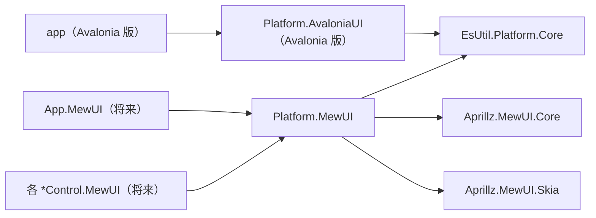

# Platform.MewUI システム仕様書

## 概要

`EsUtil.Platform.Core` のコア型（UI フレームワーク非依存）と **MewUI**（`Aprillz.MewUI`）の型を相互変換する Interop 層です。
SaveEvidence のマルチ UI 対応（Avalonia UI / MewUI）における、MewUI 側の境界変換を担います。

Avalonia 版の `Platform.AvaloniaUI`（`EsUtil.SaveEvidence.Platform.AvaloniaUI`）と対になる位置付けです。

## 技術スタック

- .NET 10 / C# 14
- `Aprillz.MewUI.Core` **0.21.1（バージョン固定）** — MewUI の型のみ（プラットフォームホスト・バックエンドは含まない）
- UI 実装への依存なし（型変換のみのため、ホスト・バックエンドを参照しない）

## アーキテクチャ

- コアロジックは `Es*` 型のみを扱い、UI 境界（各 UI ホスト・コントロール）でのみ本プロジェクトで変換します。
- Avalonia 版と MewUI 版は互いに依存しません（どちらも `EsUtil.Platform.Core` に依存）。

## コンポーネント構成

| ファイル | 内容 |
| --- | --- |
| `EsKeyMewUIInterop.cs` | `EsKey` ⇔ `Aprillz.MewUI.Key`。 別名表（`Back` ⇔ `Backspace`）と未定義値の防御 |
| `EsGeometryMewUIInterop.cs` | `EsPoint` / `EsSize` / `EsVector` / `EsRect` / 色（`System.Drawing.Color` ⇔ `Aprillz.MewUI.Color`） |
| `EsWindowStateMewUIInterop.cs` | `EsWindowState` ⇔ `Aprillz.MewUI.Controls.WindowState` |
| `EsPlatformHandleMewUIInterop.cs` | `Aprillz.MewUI.Window` → `EsPlatformHandle` |
| `src/Platform.MewUI/src/Imaging/SkiaImageView.cs` | `EsBitmap` を親が割り当てた領域へ描画する表示ビュー（`SkiaCanvasView` 派生） |
| `src/Platform.MewUI/src/Imaging/SkiaImageRenderer.cs`（internal） | `EsBitmap` を Skia キャンバスへ敷く描画層（画素で検証できる） |
| `src/Platform.MewUI/src/Imaging/ClientPixelScale.cs` | 描画面（物理ピクセル）と表示領域（DIP）の比から描画に使う実効倍率を解決する（DPI の通知が届かないコントロールでも画像と同じ倍率で描く） |
| `src/Platform.MewUI/src/Imaging/MewUITextMeasure.cs` | MewUI のテキスト エンジン（DirectWrite の GDI 互換レイアウト）で文字列の実寸を測る。 描画エンジンを持たない環境では Skia の実測で代用する |

## 単一所有（Single Source of Truth）

| 内容 | 所有者 |
| --- | --- |
| `EsKey` と MewUI `Key` の別名対応（`Back` ⇔ `Backspace`） | `EsKeyMewUIInterop` の別名表（双方向を 1 つの表から導出し対称性を保つ） |
| 未定義値のフォールバック判定 | 各 Interop（`Enum.IsDefined`） |
| 画像の描画手順（クリア・未設定/破棄済みの判定・配置・描画） | `SkiaImageRenderer`（表示ビューは手順を持たない） |
| 描画に使う実効倍率（描画面と表示領域の比） | `ClientPixelScale`（DPI 通知の有無によらず一致させる） |
| 画像を描画先の領域へ配置する矩形の計算 | 本プロジェクトの `ImageDrawMath`（`EsRect` を返す純粋関数） |

## 設計判断

### 名前ベースの変換（値ベースではない）

`EsKey` は Avalonia / Win32 のキー体系（223 メンバー）に合わせているのに対し、MewUI `Key` は
抽象化された小さな集合（91 メンバー・独自採番）です。 採番体系が異なるため、**値による対応付けはできません**。

### `Enum.IsDefined` による未定義値の防御

`Enum.TryParse<T>("999", out var r)` は**成功**して `(T)999` を返すため、名前解決の成否だけでは未定義値を検出できません。
各 Interop は `Enum.IsDefined` を併用し、未定義値を既定値へフォールバックします。

### 別名表の対称性

`EsKey` → MewUI の別名表から逆引き（`ToDictionary`）で MewUI → `EsKey` の表を導出します。
2 つの表を個別に保守すると片方向だけ更新される事故が起きるため、単一の表から導出します。

## 例外処理ポリシー

本プロジェクトは変換のみで構成され、例外を送出しません。
対応先がない値（MewUI が表現できないキー・未定義値）は既定値（`None` / `Normal`）へフォールバックし、
`IsRepresentable` で判定できるようにしています。

## 既知の挙動差（Avalonia との非対称性）

| 項目 | Avalonia | MewUI |
| --- | --- | --- |
| 負のサイズ（`Rect` / `Size`） | そのまま保持する | **0 にクランプ**する（座標 X / Y は保持） |
| キー体系 | `EsKey` と同じ 223 メンバー（Win32 相当） | 抽象化された 91 メンバー（独自採番） |

ソースコードが UI 非依存のまま両 UI を扱うには、**UI 固有の値を UI 内部に閉じ込め**、境界ではコア型へ変換して渡す設計が必要です。

## テスト

- `src/Platform.MewUI/tests`（`Platform.MewUI.Tests`）が本プロジェクトのテストを持ちます。
- UI 初期化が不要なため、すべて `[Fact]` で並列実行されます。
- 回帰検知のための固定値（MewUI のキー数 91、名前が異なるキーは `Backspace` のみ、負サイズのクランプ）を含みます。
  MewUI をアップグレードした際はこれらのテストで破壊的変更を検出します。
- 画像の描画（`SkiaImageRenderer`）は、コントロールを表示せず `SKBitmap` + `SKCanvas` で画素を直接検証します
  （塗り分け・余白の透明・未設定／破棄済み／描画先が空の場合の非描画・再描画時のクリア。 6 件）。
- `SkiaImageView` のプロパティは、基底クラスで登録した `MewProperty` を派生クラスのインスタンスでも
  共有できることを含めて検証します（4 件）。

## 未実装（今後の判断）

Avalonia 版の `Platform.AvaloniaUI` にある以下は、MewUI 側では**未実装**です。

| 項目 | 状況 |
| --- | --- |
| `ScreenConverter`（`TopLevel` / `Visual` 依存の画面座標変換） | MewUI 側の対応型（`Window` の座標・DPI 取得 API）を調査してから実装する |
| `CursorOverrideGuardAttach`（`ICursorOverrideGuard.Attach(TopLevel)` 相当） | MewUI 側のカーソル抑止 API の有無を調査する必要がある |
| 画像アダプタ（`EsBitmapAvaloniaExtensions` / `EsBitmapAvaloniaImage` 相当） | **不要**。 MewUI は `SkiaCanvasView` で `EsBitmap.ToSKBitmap()` を直接描画できる（PoC で実証済み） |
