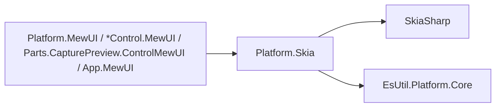
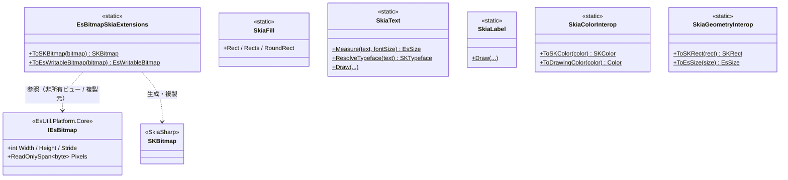
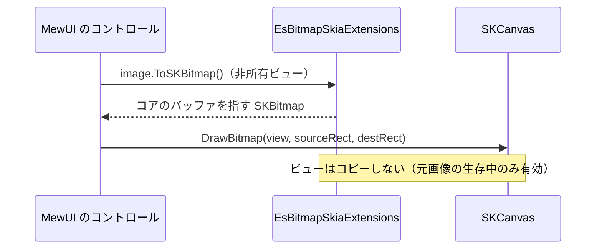
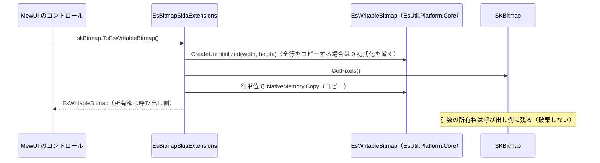

# Platform.Skia システム仕様書

## 目次 <!-- omit from toc -->

- [1. 概要](#1-概要)
- [2. 技術スタック](#2-技術スタック)
- [3. アーキテクチャ](#3-アーキテクチャ)
- [4. 依存関係](#4-依存関係)
- [5. コンポーネント構成](#5-コンポーネント構成)
- [6. クラス図](#6-クラス図)
- [7. データフロー（画像の描画）](#7-データフロー画像の描画)
- [8. データフロー（コアのビットマップ生成）](#8-データフローコアのビットマップ生成)
- [9. 例外処理ポリシー](#9-例外処理ポリシー)
- [10. 可視性ポリシー](#10-可視性ポリシー)
- [11. テスト](#11-テスト)

## 1. 概要

`Platform.Skia` は、**SkiaSharp への依存を 1 箇所へ閉じ込める**プラットフォーム層です。

1. **ビットマップの相互変換**（`EsBitmapSkiaExtensions`）— コアの画像と `SKBitmap` を変換する（非所有ビュー／複製）
2. **描画の部品**（`SkiaFill` / `SkiaLabel` / `SkiaText`）と**変換**（`SkiaColorInterop` / `SkiaGeometryInterop`）

**描画 API の抽象は持ちません**（UI フレームワークごとの描画モデルの差は抽象では吸収しきれないため）。 描画の呼び出し（層の順序）は各 UI が行います。

外部機能と公開 API は [SPEC_API](SPEC_API.md)、利用手順は [README](../README.md) を参照してください。

## 2. 技術スタック

| 項目 | 内容 |
| --- | --- |
| 目的 | `EsUtil.Platform.Core` の判定基準（外部パッケージなし）を守るため、Skia 依存を本層へ隔離する |
| 提供形態 | クラスライブラリ（`EsUtil.SaveEvidence.Platform.Skia.dll`）。 SkiaSharp を参照する唯一のプロジェクト |
| 想定利用者 | `Platform.MewUI`、MewUI 系の各コントロール（Marquee / Loupe / SelectionOverlay / ZoomView）、`App.MewUI`、テスト |
| ターゲット | `net10.0` |
| 言語 | C# 14（`Nullable` 有効・`ImplicitUsings` 有効・`AllowUnsafeBlocks` 有効＝ピクセルポインタのため） |
| ルート名前空間 | `EsUtil.SaveEvidence.Platform.Skia` |
| 汎用性 | UI フレームワーク非依存（SkiaSharp には依存する） |

## 3. アーキテクチャ



- 依存の向きは **MewUI 系 → Platform.Skia →（SkiaSharp / EsUtil.Platform.Core）** です。
- **`EsUtil.Platform.Core` は SkiaSharp を参照しません**（Skia 依存は本層で止まる）。
- `EsBitmapSkiaExtensions` は `EsUtil.Platform.Core` の `IEsBitmap` を拡張します。

## 4. 依存関係

| 種別 | 依存先 |
| --- | --- |
| プロジェクト | `EsUtil.Platform.Core` |
| パッケージ | `SkiaSharp`（**Skia 依存を本層へ閉じ込める唯一のプロジェクト**） |

- `EsUtil.Platform.Core` は SkiaSharp を参照しません（Skia 依存は本層で止まります）。
- 参照の許可範囲は [依存関係.md](../../../.github/依存関係.md) が所有し、ビルドの `DEP0001`〜`DEP0006` が強制します。

## 5. コンポーネント構成

| ファイル | 可視性 | 内容 |
| --- | --- | --- |
| `EsBitmapSkiaExtensions.cs` | `public static class` | `ToSKBitmap`（非所有ビュー。 呼び出し側が破棄する）/ `ToEsWritableBitmap`（複製） |
| `SkiaFill.cs` | `public static class` | 矩形・角丸矩形の塗り |
| `SkiaLabel.cs` | `public static class` | ラベル 1 件（背景 + 文字）の描画順 |
| `SkiaText.cs` | `public static class` | 実寸測定・描画・書体の解決 |
| `SkiaColorInterop.cs` | `public static class` | 色の相互変換 |
| `SkiaGeometryInterop.cs` | `public static class` | 幾何の相互変換 |

## 6. クラス図



## 7. データフロー（画像の描画）



## 8. データフロー（コアのビットマップ生成）



## 9. 例外処理ポリシー

| 状況 | 挙動 |
| --- | --- |
| `ToSKBitmap` の対象が破棄済み | `ObjectDisposedException` |
| `ToSKBitmap` の引数が null | `ArgumentNullException` |
| ビューの作成に失敗（形式・寸法が不正） | `InvalidOperationException`（作成した `SKBitmap` は破棄してから投げる） |
| `ToEsWritableBitmap` の引数が null | `ArgumentNullException` |
| `ToEsWritableBitmap` のピクセルポインタが null | 複製せずに空のビットマップを返す（描画可能な状態を保つ） |

## 10. 可視性ポリシー

- 全型が `public` です。 MewUI 系の複数プロジェクトが同じ変換と描画の部品を使うためです。
- `Platform.Skia.Tests` からのみ `internal` 型へアクセスできます（現在 `internal` 型はありません）。
- **`internal` → `public` の変更は破壊的な設計変更として扱います**。

## 11. テスト

```text
tests/
├── Platform.Skia.Tests.csproj
├── EsBitmapSkiaExtensions.Tests.cs
├── SkiaColorInterop.Tests.cs
├── SkiaFill.Tests.cs
├── SkiaGeometryInterop.Tests.cs
├── SkiaLabel.Tests.cs
└── SkiaText.Tests.cs
```

| 内容 | 件数 |
| --- | --- |
| `EsBitmapSkiaExtensions`（非所有ビュー・ピクセル共有・ビュー破棄後の安全性・破棄済みの例外・複製・アルファ保持・往復） | 8 |
| `SkiaColorInterop`（往復・成分の対応・アルファ） | 8 |
| `SkiaFill`（矩形・複数矩形・角丸） | 9 |
| `SkiaGeometryInterop`（矩形・サイズの変換） | 5 |
| `SkiaLabel`（背景 → 文字の順序） | 5 |
| `SkiaText`（実寸測定・書体の解決・描画） | 10 |

UI 初期化（ウィンドウ）が不要なため、すべて `[Fact]` / `[Theory]` で並列実行されます。

```powershell
dotnet test src/Platform.Skia/tests/Platform.Skia.Tests.csproj
```
