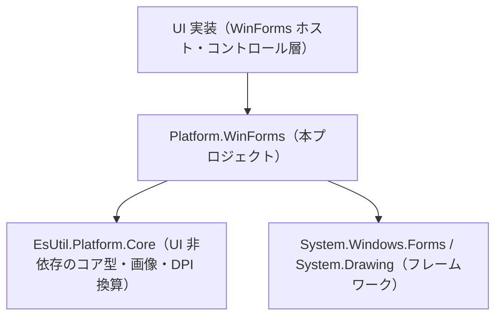
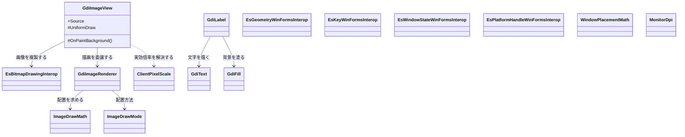
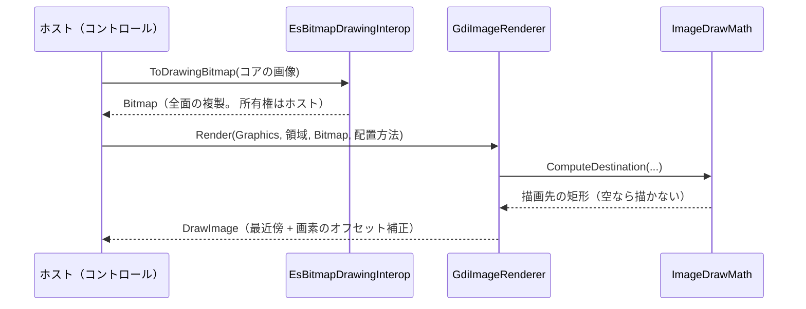

# Platform.WinForms システム仕様書

## 目次 <!-- omit from toc -->

- [1. 概要](#1-概要)
- [2. 技術スタック](#2-技術スタック)
- [3. アーキテクチャ](#3-アーキテクチャ)
- [4. コンポーネント構成](#4-コンポーネント構成)
  - [4.1 層と責務](#41-層と責務)
  - [4.2 クラス図](#42-クラス図)
  - [4.3 描画の流れ](#43-描画の流れ)
  - [4.4 DPI の解決](#44-dpi-の解決)
- [5. 依存関係](#5-依存関係)
- [6. 例外処理ポリシー](#6-例外処理ポリシー)
- [7. ビルドと検証](#7-ビルドと検証)

## 1. 概要

本プロジェクトは、UI フレームワークに依存しない `EsUtil.Platform.Core` のコア型と、WinForms / GDI+（`System.Windows.Forms` / `System.Drawing`）の型の境界変換と、GDI+ で画像・文字・矩形を描くためのプリミティブを提供します。

| 目的 | 内容 |
| --- | --- |
| 型変換の集約 | コア型 ⇔ GDI+ 型の変換（キー・幾何・ウィンドウ状態・ウィンドウ ハンドル・ウィンドウ配置・モニター DPI）を 1 箇所に閉じる |
| 描画の再利用 | 画像の配置計算・画像の描画・テキスト測定・矩形の塗り・ラベルの描画を、UI 実装が毎回書かない形で提供する |
| DIP と物理ピクセルの整合 | WinForms のクライアント座標は物理ピクセルであるため、コアが扱う DIP との換算を 1 箇所に閉じる |

**Skia を使わない理由**: `SkiaSharp.Views.WindowsForms` は .NET Framework 向けの資産しか持たず `net10.0-windows` では解決できません（実測）。 そのため画像の描画は WinForms 自身の描画 API（GDI+）で行い、Skia へ依存する `Platform.Skia` は参照しません（依存関係の許可範囲にも含まれません）。

## 2. 技術スタック

| 項目 | 値 | 理由 |
| --- | --- | --- |
| 対象フレームワーク | `net10.0-windows` | `System.Windows.Forms` と `System.Drawing` を使う層の割り当て（`ビルド設定規約.md` §4） |
| UI フレームワーク | WinForms（`UseWindowsForms`） | 本層が適合させる対象 |
| アンマネージド コード | `AllowUnsafeBlocks` | `LibraryImport` は安全でないコードを要求し、P/Invoke の座標構造体を伴うため（`ビルド設定規約.md` §4） |
| 依存パッケージ | なし | 変換と描画はフレームワークの型だけで完結する |
| 参照するプロジェクト | `EsUtil.Platform.Core` | コア型・画像・DPI 換算の利用 |
| テスト | xUnit v3 | 他プロジェクトと同じ（`テスト規約.md`） |

## 3. アーキテクチャ



依存の向きは `UI 実装 → Platform.WinForms → EsUtil.Platform.Core` の一方向です。 本プロジェクトは上位（アプリ・コントロール層・EsUtil のコントロール）を参照しません（`依存関係.md` §4 の `DEP0006` が機械的に拒否します）。

## 4. コンポーネント構成

### 4.1 層と責務

| 型 | 責務 | 状態を持つか |
| --- | --- | --- |
| `EsKeyWinFormsInterop` | `EsKey` ⇔ `Keys` の名前ベース変換（別名表と未定義値の検出） | 持たない（別名表のみ静的） |
| `EsGeometryWinFormsInterop` | コアの幾何型 ⇔ GDI+ の座標型（丸め規則を単一所有する） | 持たない |
| `EsWindowStateWinFormsInterop` | `EsWindowState` ⇔ `FormWindowState`（表現できない状態の判定を含む） | 持たない |
| `EsPlatformHandleWinFormsInterop` | WinForms のコントロール → ネイティブ ウィンドウ識別子（ハンドルを生成しない） | 持たない |
| `WindowPlacementMath` | DIP ⇔ 画面物理ピクセルの換算と復元可否の判定 | 持たない |
| `MonitorDpi` | 位置からモニターの DPI を照会する（Win32 の `GetDpiForMonitor`） | 持たない |
| `ClientPixelScale` | 描画面と表示領域の比から実効倍率を解決する | 持たない |
| `ImageDrawMath` | 画像を描画先へ配置する矩形の計算 | 持たない |
| `EsBitmapDrawingInterop` | コアの画像 → GDI+ のビットマップの複製 | 持たない（返すビットマップは呼び出し側が所有する） |
| `GdiImageRenderer` | 画像を描画面の矩形へ敷く（拡大・縮小の設定を単一所有する） | 持たない（描画の前後で設定を保存・復帰する） |
| `GdiText` | テキストの実寸測定と描画 | スレッド単位の測定用資源（描画面・フォント・ブラシ）を保持する |
| `GdiFill` | 矩形の塗り（角丸を含む） | スレッド単位のブラシを保持する |
| `GdiLabel` | ラベル 1 件（背景 → 文字）の描画順 | 持たない |
| `GdiImageView` | 割り当てられた領域へ画像を描くコントロール | 表示する画像とその複製を保持する |

### 4.2 クラス図



### 4.3 描画の流れ



**画素の複製を 1 度だけ行う理由**: GDI+ はコアの画素を直接描けません。 複製は全面の画素のコピーであり、描画のたびに行うと描画の費用が複製の費用に支配されます。 そのため複製は「画像が差し替わった時点」に行い、`GdiImageView` が保持します。

**描画面の設定を保存・復帰する理由**: GDI+ の描画面はコントロールの下地と共有されます。 補間・画素のオフセット・スムージングの設定を呼び出し側へ漏らさないよう、描画層が呼び出しの前後で保存・復帰します。

### 4.4 DPI の解決

| 用途 | 解決方法 | 理由 |
| --- | --- | --- |
| 描画の倍率（DIP → 物理ピクセル） | `ClientPixelScale.Resolve(描画面の実サイズ, 表示領域, 保持値)` | DPI の通知はハンドル生成より前に届かず、オフスクリーンの描画面は基準 DPI を報告するため、実測を優先する |
| ウィンドウ配置 | `WindowPlacementMath` + `EsUtil.Platform.Core` の `DpiScaler` | 配置の復元は画面物理ピクセルで保持する（設定の互換性） |
| モニターごとの倍率 | `MonitorDpi.GetScaleForPoint` | WinForms の公開 API にモニター単位の DPI 照会が無い（`Control.DeviceDpi` はコントロールが属する 1 値のみ） |

## 5. 依存関係

| 参照先 | 用途 |
| --- | --- |
| `EsUtil.Platform.Core` | コア型（`EsPoint` / `EsRectInt` / `EsKey` / `EsWindowState` / `EsPlatformHandle`）・画像（`EsReadOnlyBitmap`）・DPI 換算（`DpiScaler`）・列挙の解決（`EnumCanonical`） |

**参照しない**: `App.*` / `Parts.*` / `EsUtil.Feature.*` / `ColorPickerControl.*`（`依存関係.md` §4 の `DEP0006` が拒否します）。 本プロジェクトは最下位に近い層であり、上位の知識を持ちません。

## 6. 例外処理ポリシー

共通方針は [`例外処理規約.md`](../../../.github/例外処理規約.md) §2・§3 に従います。 本プロジェクト固有の事項は次のとおりです。

| 状況 | 扱い | 理由 |
| --- | --- | --- |
| 引数が null | `ArgumentNullException`（`ArgumentNullException.ThrowIfNull`） | 呼び出し側の誤りであり、回復できない |
| 破棄済みの画像 | `ObjectDisposedException`（複製の入口） | 破棄済みの画素は読めない（描画側は `IsDisposed` を見て描かない選択ができる） |
| 照会できないモニター DPI | **0 を返す**（例外にしない） | 代替値（ウィンドウの倍率）で撮影を続行できる |
| 表現できないキー・ウィンドウ状態 | `None` / `Normal` へフォールバックし、`IsRepresentable` で問い合わせられる | 設定ファイルの互換性を保ちながら撮影を続行できる |
| 空の矩形・画像 | 何も描画しない（例外にしない） | 「描くものが無い」だけであり、回復の必要が無い |

**握りつぶしをしない**: 本プロジェクトは描画の境界で例外を記録しません（描画層は呼び出し側へ例外を返し、記録はホストの責務です）。 ログを持たないため、ログの接頭辞も持ちません。

## 7. ビルドと検証

```powershell
dotnet build src/Platform.WinForms/src/Platform.WinForms.csproj
dotnet test src/Platform.WinForms/tests/Platform.WinForms.Tests.csproj
```

合否基準と手順は [`検証手順.md`](../../../.github/検証手順.md) が所有します（ビルドの警告 0・エラー 0、テストの全件合格）。 テストはウィンドウ（ハンドル）を生成せず、オフスクリーンのビットマップ上で画素を実測します。
