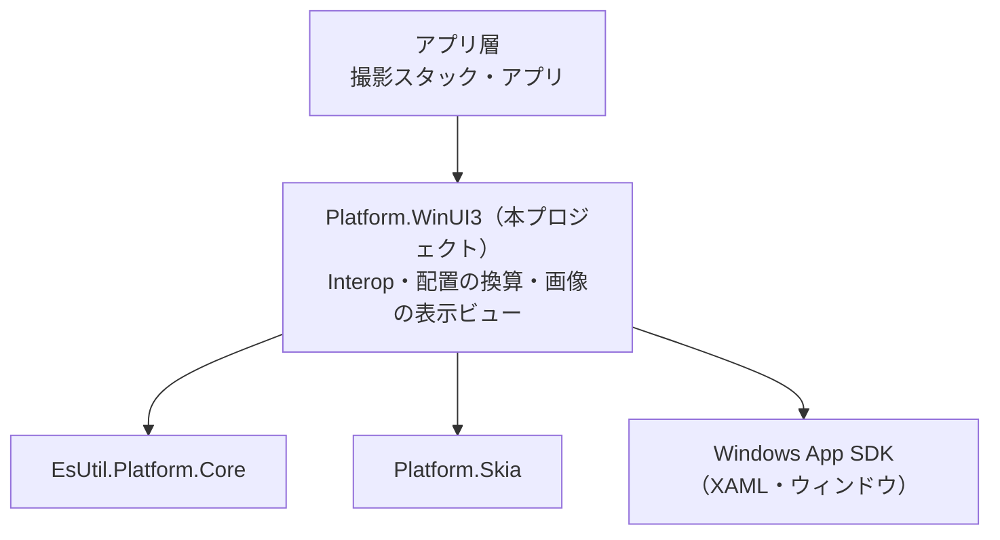
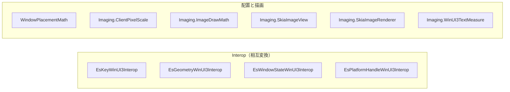
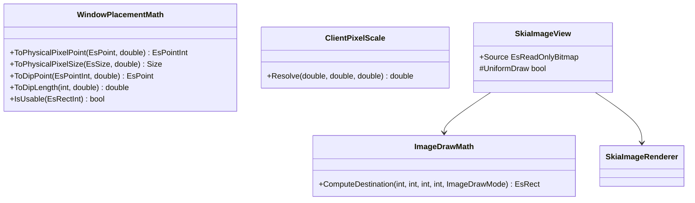
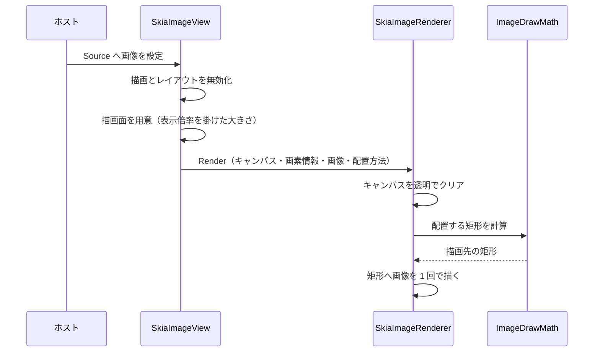
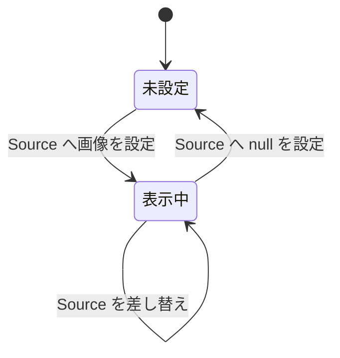
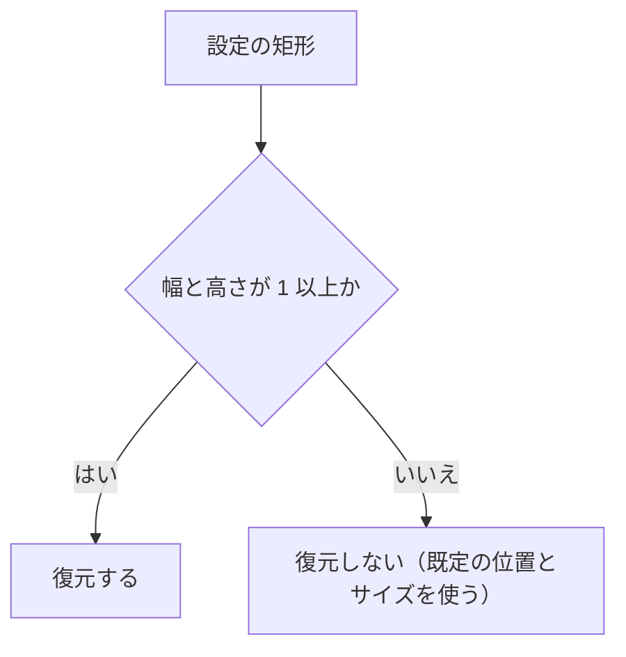

# Platform.WinUI3 システム仕様書

## 目次 <!-- omit from toc -->

- [1. システム概要](#1-システム概要)
- [2. 技術スタック](#2-技術スタック)
- [3. アーキテクチャ](#3-アーキテクチャ)
- [4. コンポーネント構成](#4-コンポーネント構成)
- [5. 依存関係](#5-依存関係)
- [6. 例外処理ポリシー](#6-例外処理ポリシー)
- [7. クラス図](#7-クラス図)
- [8. シーケンス図](#8-シーケンス図)
- [9. 状態遷移図](#9-状態遷移図)
- [10. テスト方針](#10-テスト方針)
- [11. 検証できない範囲](#11-検証できない範囲)
- [12. 制約](#12-制約)

## 1. システム概要

`Platform.WinUI3` は、UI フレームワーク非依存のコア（`EsUtil.Platform.Core`）と WinUI 3（Windows App SDK・`Microsoft.UI.Xaml`）の型の境界を担う層です。
コアの値型・列挙型を WinUI 3 の型へ写す関数と、Skia のキャンバスへ画像を敷く表示ビューだけを提供します。

- **判断・計算を持たない**: 写像の規則と DIP ⇔ 画面物理ピクセルの換算式だけを持ちます。 ウィンドウ状態やキーの意味はコアが所有します。
- **UI ホストを必要としない部分を厚くする**: 値型の変換と純粋計算は XAML の初期化なしで検証できます（ヘッドレスで実行できる範囲を最大化する）。
- **撮影スタックとアプリの唯一の境界**: 上位の層は本プロジェクトを介してコア型と WinUI 3 の型を行き来します。

## 2. 技術スタック

| 項目 | 値 |
| --- | --- |
| 対象フレームワーク | `net10.0-windows10.0.22621.0` |
| UI フレームワーク | WinUI 3（`Microsoft.WindowsAppSDK` 1.x。 `UseWinUI` を有効にする） |
| 最低対応 OS | `10.0.19041.0`（`SupportedOSPlatformVersion`） |
| 描画 | SkiaSharp（`SkiaSharp.Views.WinUI` 3.x の `SKXamlCanvas`） |
| 言語 | C# 14（`Nullable` / `ImplicitUsings` を有効にする） |
| テスト | xUnit v3（`OutputType` は `Exe` を明示する） |

## 3. アーキテクチャ

本プロジェクトは**依存の最下位に近い層**です。 上位（撮影スタック・アプリ）から参照され、本プロジェクトから上位への参照はありません。

設計の原則:

1. **境界の変換は本層が所有する**（上位の層に `float` の丸め・負のサイズのクランプ・名前ベースのキー変換を散らさない）。
2. **換算の基準値はコアが所有する**（DPI スケールの正規化は `DpiScaler`、キーの代表名の解決は `EnumCanonical` へ委譲する）。
3. **描画の入力はコアの画像型**（`EsReadOnlyBitmap`）であり、表示のアダプタを作らない。

## 4. コンポーネント構成

| コンポーネント | 役割 |
| --- | --- |
| `EsKeyWinUI3Interop` | キーの相互変換（名前ベース。 別名表と `EnumCanonical` を使う） |
| `EsGeometryWinUI3Interop` | 座標・サイズ・ベクトル・矩形・色の相互変換 |
| `EsWindowStateWinUI3Interop` | 窓状態の相互変換（提示の種類と重ね表示の状態の 2 系統） |
| `EsPlatformHandleWinUI3Interop` | ウィンドウから Win32 の `HWND` を取り出す |
| `WindowPlacementMath` | DIP ⇔ 画面物理ピクセルの換算と復元可否の判定 |
| `Imaging.ClientPixelScale` | 描画面（物理ピクセル）と割り当て領域（DIP）から実効の表示倍率を解く |
| `Imaging.SkiaImageView` | コアの画像を親の領域へ敷く表示ビュー |
| `Imaging.SkiaImageRenderer` | 画像を Skia のキャンバスへ敷く描画（画素で検証できる） |
| `Imaging.ImageDrawMath` / `Imaging.ImageDrawMode` | 画像の配置矩形の計算と配置方法 |
| `Imaging.WinUI3TextMeasure` | 要素として置くラベルの実寸測定 |

## 5. 依存関係

| 参照先 | 用途 |
| --- | --- |
| `EsUtil.Platform.Core` | コアの値型（座標・矩形・色・キー・窓状態）、`DpiScaler`、`EnumCanonical`、画像型 |
| `Platform.Skia` | `EsReadOnlyBitmap` の Skia 相互変換と Skia の描画プリミティブ |
| `Microsoft.WindowsAppSDK` | XAML の要素とウィンドウ、`Microsoft.UI.Windowing` |
| `SkiaSharp.Views.WinUI` | `SKXamlCanvas`（描画面を持つ要素） |

- **本プロジェクトから上位（アプリ・撮影スタック・コントロール）への参照はない**（`DEP0006` が機械的に拒否する）。
- 名前空間はフォルダに追従します（`IDE0130` がビルドで検査する）。

## 6. 例外処理ポリシー

[`例外処理規約.md`](../../../.github/例外処理規約.md) §2・§3 に従います。 本プロジェクト固有の判断は次のとおりです。

| 状況 | 扱い |
| --- | --- |
| 負の幅・高さ（WinUI 3 が拒否する入力） | **0 へクランプする**（例外にしない。 空の矩形は正常な入力である） |
| 未定義値・対応先がないキー | **`None` を返す**（例外にしない。 `IsRepresentable` で事前に判定できる） |
| DPI スケールが 0 以下・非数 | **基準値へ補正する**（コアの `DpiScaler` が単一の判断元） |
| 画像が未設定・破棄済み・配置が空 | **何も描画しない**（描画の入口が前提条件を判定する） |
| ウィンドウが null | **ハンドル値 0 を返す**（ウィンドウ未生成は正常な状態である） |

## 7. クラス図

## 8. シーケンス図

画像を敷く場合の流れ（`Imaging.SkiaImageView`）:

## 9. 状態遷移図

`Imaging.SkiaImageView` の表示状態（入力は画像の有無だけである）:

`WindowPlacementMath.IsUsable` の判定:

## 10. テスト方針

- **検証はビルドの警告 0 と `dotnet test` の全件合格で判定する**（[`検証手順.md`](../../../.github/検証手順.md)）。
- 対象は値型の相互変換・純粋計算・Skia の描画（画素）であり、いずれも XAML の初期化を必要としない。
- **キーの変換は代表値と未対応値の両方を固定する**（別名表の追加漏れと、対応先がないキーが別のキーへ化けることを検出する）。
- **破棄済みの画像・空の入力・範囲外の倍率**を明示的に検証する（描画しない契約を固定する）。

## 11. 検証できない範囲

| 対象 | 理由 | 確認の方法 |
| --- | --- | --- |
| `Imaging.SkiaImageView` のインスタンス生成 | XAML の型は、XAML のランタイムを初期化していないプロセスで生成できない（実測: `COMException` 0x80040154 `REGDB_E_CLASSNOTREG`） | アプリでの動作確認 |
| `EsPlatformHandleWinUI3Interop` | ウィンドウの生成が必要 | アプリでの動作確認 |
| `Imaging.WinUI3TextMeasure` のテキストエンジン経路 | 要素（`Microsoft.UI.Xaml.Controls.TextBlock`）の生成が必要 | アプリでの動作確認（単体テストは代用の経路を検証する） |

## 12. 制約

- **UI スレッド**: 表示ビューの描画は UI スレッドで行われます。 値型の変換と純粋計算はスレッドに依存しません。
- **幾何型の記憶域**: WinUI 3 の座標型・サイズ型・矩形型の記憶域は `float` のため、`double` の値は往復で丸められます。
- **透明の表現**: WinUI 3 のウィンドウは透明を表現できません（撮影スタックはルート要素の下地色で代用する）。
