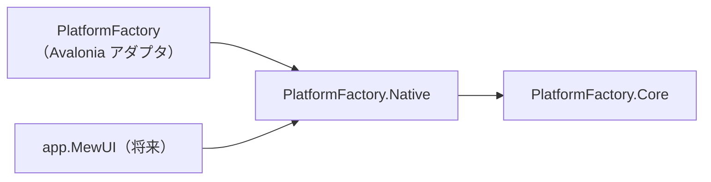

# PlatformFactory.Native システム仕様書

## 概要

`PlatformFactory.Core` の抽象を実装する**ネイティブ（OS）実装**と、実行時プラットフォームに応じた
既定実装を生成するファクトリを提供するライブラリです。

SaveEvidence のマルチ UI 対応（Avalonia UI / MewUI）において、Win32 実装を UI フレームワーク非依存の
アセンブリへ分離するために作成されました。

## 技術スタック

- .NET 10 / C# 14
- System.Drawing.Common（`WinCaptureService` の画面キャプチャ・Windows 専用）
- Microsoft.Extensions.Logging.Abstractions（`ILogger` と LoggerMessage ソース生成）
- UI フレームワークは参照しない

## アーキテクチャ

- 本プロジェクトは UI フレームワークに依存しません（Win32 の P/Invoke とコア型のみ）。
- 実装（Win / NoOp）は本プロジェクトのファクトリが唯一の生成経路となるため internal に隠蔽します（公開 API 最小化）。

## コンポーネント構成

| ファイル | 内容 |
| --- | --- |
| `PlatformFactory.cs` | 公開ファクトリ（Factory Method パターン）。`OperatingSystem.IsWindows()` による分岐を一元化 |
| `PlatformLog.cs` | Win 実装が使用する LoggerMessage 定義（internal） |
| `Win/WinNative.cs` | Win32 API の P/Invoke 宣言・構造体・デリゲート・定数の集約（internal） |
| `Win/WinCursorService.cs` | カーソル位置の取得・移動・表示切替（Win32） |
| `Win/WinElementFinder.cs` | ウィンドウ / スクリーンの検出と一覧取得（Win32） |
| `Win/WinCursorOverrideGuard.cs` | WndProc サブクラス化によるカーソル上書き抑止 |
| `Win/WinCaptureService.cs` | `System.Drawing` + Win32 による画面キャプチャ |
| `Win/WinWindowService.cs` | タスクスイッチャー非表示・キャプチャ除外・位置とサイズの指定・退避 |
| `Win/WinGlobalHotKeyService.cs` | `RegisterHotKey` + WndProc サブクラス化によるグローバルホットキー |
| `NoOp/NoOp*.cs` | 他環境向けの安全なフォールバック（シングルトン） |
| `Imaging/EsBitmapDrawingExtensions.cs` | `System.Drawing.Bitmap` ⇔ `EsBitmap` の変換（Windows 専用） |

## プラットフォーム分岐

| 生成メソッド | Windows | 他環境（Linux / macOS） |
| --- | --- | --- |
| `CreateCursorService` | `WinCursorService` | `NoOpCursorService.Instance` |
| `CreateElementFinder` | `WinElementFinder` | `NoOpElementFinder.Instance` |
| `CreateCursorOverrideGuard` | `WinCursorOverrideGuard` | `NoOpCursorOverrideGuard` |
| `CreateCaptureService` | `WinCaptureService` | `NoOpCaptureService.Instance` |
| `CreateWindowService` | `WinWindowService` | `NoOpWindowService.Instance` |
| `CreateGlobalHotKeyService<T>` | `WinGlobalHotKeyService<T>` | `NoOpGlobalHotKeyService<T>` |

## 例外処理ポリシー

- P/Invoke の失敗は戻り値（`bool` / null）で通知し、例外を送出しません。
- 未対応環境・無効なハンドルは安全に無視するか `false` を返します（NoOp と同じ振る舞い）。

## 移行の経緯

サービス抽象とファクトリは、当初 `PlatformFactory`（Avalonia プロジェクト）に同居していました。
Win32 実装は Avalonia に依存していないため、本プロジェクトへ分離し、MewUI からも再利用できるようにしました。
名前空間も `Estable.AvaloniaUI.*` から `Estable.Platform.*` へ変更しています。
