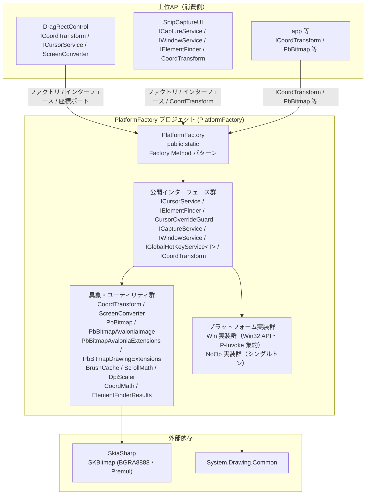
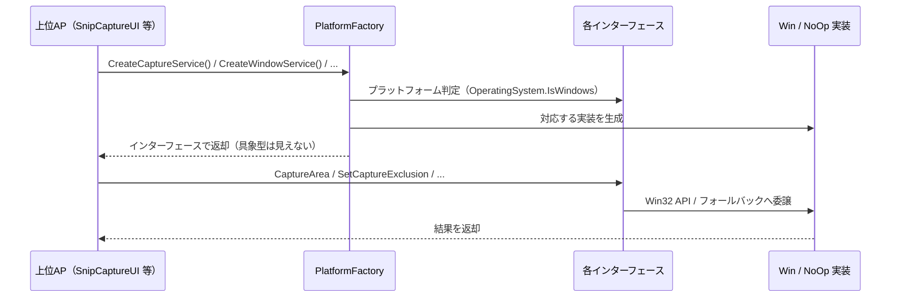

# PlatformFactory システム仕様書（SPEC_System）

## 目次

- [PlatformFactory システム仕様書（SPEC\_System）](#platformfactory-システム仕様書spec_system)
  - [目次](#目次)
  - [1. システム概要](#1-システム概要)
  - [2. 技術スタック](#2-技術スタック)
  - [3. アーキテクチャ](#3-アーキテクチャ)
    - [3.1 レイヤー構造](#31-レイヤー構造)
    - [3.2 依存の方向](#32-依存の方向)
  - [4. 例外処理ポリシー](#4-例外処理ポリシー)
    - [4.1 基本方針](#41-基本方針)
    - [4.2 本プロジェクト固有の例外処理](#42-本プロジェクト固有の例外処理)
  - [5. コンポーネント図](#5-コンポーネント図)
  - [6. コンポーネント一覧](#6-コンポーネント一覧)
    - [6.1 PlatformFactory](#61-platformfactory)
    - [6.2 各インターフェース（抽象）](#62-各インターフェース抽象)
    - [6.3 CoordTransform](#63-coordtransform)
    - [6.4 ScreenConverter](#64-screenconverter)
    - [6.5 その他の公開型](#65-その他の公開型)
    - [6.7 内部実装（Win 系）](#67-内部実装win-系)
    - [6.8 内部実装（NoOp 系）](#68-内部実装noop-系)
    - [6.9 内部ユーティリティ](#69-内部ユーティリティ)
  - [7. 依存ルール](#7-依存ルール)
  - [8. ライフサイクル](#8-ライフサイクル)
  - [9. ログ](#9-ログ)
    - [9.1 LogLevel 設定ポリシー](#91-loglevel-設定ポリシー)
    - [9.2 ログ定義一覧](#92-ログ定義一覧)

---

## 1. システム概要

SaveEvidence は、Windows デスクトップ上の画面をキャプチャし、プレビュー・編集・保存するための Avalonia UI アプリケーションです（.NET 10.0 / C# 14 / MVVM）。

本プロジェクト（PlatformFactory）は、このシステムのうち**プラットフォーム抽象層**を担います。実行時プラットフォーム（Windows / 他環境）に応じた既定実装（カーソル操作・要素検出・キャプチャ・ウィンドウ操作）の生成と、座標変換・画面キャプチャ・要素検出の抽象化 API を提供します。他プロジェクト（DragRectControl / SnipCaptureUI / app）からインターフェース経由で利用されます。

## 2. 技術スタック

| 項目 | 内容 |
| --- | --- |
| **プロジェクト** | `PlatformFactory` |
| **ルート名前空間** | `Estable.AvaloniaUI.Platform` |
| **言語** | C# 14（.NET 10.0） |
| **UI フレームワーク** | Avalonia UI 12.1（Bitmap / PixelPoint / PixelRect / TopLevel 等の標準型） |
| **ターゲットフレームワーク** | net10.0 |
| **ビルドツール** | MSBuild / .NET SDK 10.0 |
| **ログ** | Microsoft.Extensions.Logging.Abstractions（LoggerMessage ソース生成） |
| **画像処理** | System.Drawing.Common（Win キャプチャ実装） |
| **テスト** | xUnit v3 / Avalonia.Headless.XUnit |
| **依存プロジェクト** | なし（他プロジェクトから参照される基盤ライブラリ） |

## 3. アーキテクチャ

### 3.1 レイヤー構造

```text
公開ファクトリ（PlatformFactory）
  → 各インターフェース（抽象: ICursorService / IElementFinder / ICaptureService / IWindowService 等）
    → Win 実装 / NoOp 実装（internal）
```

### 3.2 依存の方向

- 依存は**一方向の階層構造**（公開ファクトリ → インターフェース → Win / NoOp 実装）。
- 上位 AP はインターフェース経由で利用し、具象型（Win / NoOp）に依存しない（DIP）。
- 公開 API はプラットフォーム非依存型のみを使用し、Win32 ハンドル・System.Drawing 型を公開しない（カプセル化）。
- プラットフォーム固有実装は本ファクトリが唯一の生成経路となるため、internal に隠蔽できる（公開 API 最小化）。

## 4. 例外処理ポリシー

### 4.1 基本方針

- ライブラリは例外を原則伝播し、上位 AP（app）で処理する。
- UI レイヤー（app）ではユーザー操作起因の例外を各ハンドラで catch し、UI の応答性を維持する。
- ログは LoggerMessage ソース生成（`PlatformLog.cs` / `WinCaptureServiceLog.cs`）で出力する。高頻度イベントは Debug、障害は Error / Warning で記録する。

### 4.2 本プロジェクト固有の例外処理

- キャプチャはバックグラウンド + タイムアウト（上位 AP が制御）で実行し、UI スレッドをブロックしない。
- 他環境（Linux / macOS）では NoOp 実装（安全なフォールバック）で例外なく動作する（Win32 DLL 依存を回避）。

## 5. コンポーネント図



## 6. コンポーネント一覧

### 6.1 PlatformFactory

- **分類**: 公開静的ファクトリ（`public static class`・Factory Method パターン）
- **責務**:
  - 実行時プラットフォーム（Windows / 他環境）に応じた既定実装の生成
  - `OperatingSystem.IsWindows()` によるプラットフォーム判定の一元化（各プロジェクトの重複分岐を排除・DRY）
  - 生成結果は各インターフェース（抽象）で返し、具象型への依存を排除（DIP）
- **公開メソッド**:
  - `CreateCursorService()` → `ICursorService`（Windows: `WinCursorService` / 他: `NoOpCursorService.Instance`）
  - `CreateElementFinder()` → `IElementFinder`（Windows: `WinElementFinder` / 他: `NoOpElementFinder.Instance`）
  - `CreateCursorOverrideGuard()` → `ICursorOverrideGuard`（Windows: `WinCursorOverrideGuard` / 他: `NoOpCursorOverrideGuard`）
  - `CreateCaptureService(ILogger? logger = null)` → `ICaptureService`（Windows: `WinCaptureService` / 他: `NoOpCaptureService.Instance`）
  - `CreateWindowService()` → `IWindowService`（Windows: `WinWindowService` / 他: `NoOpWindowService.Instance`）
  - `CreateGlobalHotKeyService<T>() where T : notnull` → `IGlobalHotKeyService<T>`（Windows: `WinGlobalHotKeyService<T>` / 他: `NoOpGlobalHotKeyService<T>`）
- **可視性**: public
- **依存**: 各インターフェース / Win 実装 / NoOp 実装

### 6.2 各インターフェース（抽象）

| コンポーネント | メンバー | 説明 |
| --- | --- | --- |
| `ICursorService` | `GetCursorScreenPoint()` / `SetCursorScreenPoint(PixelPoint)` / `ShowCursor(bool)` | カーソル位置の取得・移動・表示切替 |
| `IElementFinder` | `FindWindowUnderCursor(PixelPoint)` / `FindScreenUnderCursor(PixelPoint)` / `ListScreens()` / `ListWindows()` | 指定位置のウィンドウ / スクリーン検出・一覧取得 |
| `ICursorOverrideGuard` | `IsAttached` / `Attach(TopLevel)` | カーソル上書き抑止（WndProc サブクラス化。アタッチ中は常に抑止） |
| `ICaptureService` | `CaptureArea(PixelRect)` / `CaptureVirtualScreen(out PixelPoint)` | 画面領域・仮想スクリーンのキャプチャ |
| `IWindowService` | `HideFromTaskSwitcher(IPlatformHandle)` / `SetCaptureExclusion(IPlatformHandle, bool)` / `EvacuateWindow(IPlatformHandle)` | タスクスイッチャー非表示・キャプチャ除外・退避 |
| `IGlobalHotKeyService<T>` | `Initialize(IntPtr)` / `RegisterAll(...)` / `UnregisterAll()` / `event Action<T>? HotKeyPressed` | グローバルホットキーの登録・WM_HOTKEY 受信・アクション配信 |
| `ICoordTransform` | `Forward(Point)` / `Inverse(Point)` / `Bounds`（`Size?`） | 座標系 A ↔ B の変換ポート |

- **可視性**: public
- **依存**: Avalonia 標準型（`PixelPoint` / `PixelRect` / `TopLevel` / `IPlatformHandle`）

### 6.3 CoordTransform

- **分類**: 公開座標変換ポート（`public sealed class : ICoordTransform`）
- **責務**: `Func` 委譲による座標系 A ↔ B の変換と境界の提供
- **公開メンバー**:
  - `Identity`（静的プロパティ）: 等価変換の既定ポート
  - `Compose(outer, inner)`（静的メソッド）: 2 ポート合成（inner 先行 → outer 後続。Bounds は outer 優先）
  - `ScrollOffset(Func<Vector>)`（静的メソッド）: スクロールオフセット平行移動
  - `Scale(double)`（静的メソッド）: 原点基準の等方スケーリング（factor ≤ 0 は 1.0 扱い・固定値）
  - `DomainScale(Func<double>)`（静的メソッド）: ドメイン = ローカル DIP × 倍率（呼び出し毎評価）
  - `ImageLayout(Func<Size>, Size, Func<bool>?)`（静的メソッド）: 画像レイアウト（レターボックス・スケール）の動的ポート
  - `ImageLayoutScaleX(Func<Size>, Size, Func<bool>?)`（静的メソッド）: 画像レイアウトの X スケール（ズーム率導出用）
  - コンストラクタ: `CoordTransform(Func<Point, Point> forward, Func<Point, Point> inverse, Func<Size?> bounds)`
  - `Forward` / `Inverse` / `Bounds`: `ICoordTransform` の実装
- **可視性**: public
- **依存**: `CoordMath`（internal。画像レイアウト計算の委譲）

### 6.4 ScreenConverter

- **分類**: 公開静的クラス（`public static class`）
- **責務**: コントロールローカル DIP ↔ 画面物理 Pixel の変換と変換ポートの生成
- **公開メソッド**: `LocalDipToScreen(Visual, Point)` / `ScreenToLocalDip(Visual, PixelPoint)` / `CreateVisualDipPort(Visual)`
- **可視性**: public
- **依存**: `ICoordTransform`

### 6.5 その他の公開型

| コンポーネント | 説明 |
| --- | --- |
| `ElementFinderResults` record struct | 検出要素の結果（`Bounds` / `IsDetected` / `Title` / `Handle` / `ClassName`） |
| `HotKeySetting` record | ホットキーの組合せ（`HotKeyModifiers Modifiers` / `Key Key`）。`ToString()` で "Ctrl + Shift + Q" 形式を返す |
| `ColorExtensions.FromAColor` | C# 14 静的拡張メンバー（`extension(Color)`）。基準色（名前付き色等）とアルファ値から色を生成（RGB 直指定の可読性問題を解消） |
| `ScrollMath` | スクロール範囲・ビューポートサイズの純粋計算（`MaxOffset` / `ViewportSize`）。UI フレームワーク非依存 |
| `DpiScaler` | DIP 値をスケーリング係数で物理ピクセルへ変換（`ScaleToPixel`。切り上げ・最低 1） |
| `CoordinateFormatter` | 座標を `(x, y)` 形式に整形（`Format(Point)`。整数に丸め）。座標ラベルの共用 |
| `AvaloniaGeometryAdapters` | コアの `Point` / `Size` / `Vector` / `Rect` ↔ Avalonia 型の相互変換（`ToAvaloniaPoint` 等） |
| `RectDExt` | コアの `Point` / `Size` / `Rect` ↔ System.Drawing 型の相互変換（`ToDrawingPoint` 等） |
| `PbBitmap` | 複数ビットマップ種別を横断する軽量ユニバーサルラッパー（コア）。内部に `SKBitmap`（BGRA8888・Premul）を唯一所有し、`SkiaSharp` のみに依存したピクセル操作と `Create` / `FromSKBitmap` / `ToSKBitmap`（生成・変換）を提供。静的共有状態を持たないため並列・大規模利用に適する |
| `PbBitmapAvaloniaImage` | `PbBitmap` を内包して Avalonia `IImage` として公開するアダプタ。`Draw` は `ISkiaSharpApiLeaseFeature` を取得して `SKCanvas` へ直接描画（`WriteableBitmap` / `Bitmap` を生成しないゼロコピー描画）。破棄は `Dispose` で行い、内包 `PbBitmap` の所有権を保持する |
| `PbBitmapAvaloniaExtensions` | `PbBitmap` の生成・変換拡張（Avalonia）。`ToPbBitmap`（`this Bitmap`）/ `ToAvaloniaWriteableBitmap` / `ToAvaloniaImage` / `CreateAvaloniaWriteableBitmap` / `CreateAvaloniaImage` / `Size` / `Crop(PixelRect)` / `GetPixel` / `SetPixel` / `TrySetPixel` / `Clear(AvaloniaColor)`（`this PbBitmap`）を提供し、Avalonia との変換を閉じる |
| `PbBitmapDrawingExtensions` | `PbBitmap` の生成・変換拡張（System.Drawing・Windows 専用・`[SupportedOSPlatform("windows")]`）。`ToPbBitmap`（`this DrawingBitmap`）/ `ToDrawingBitmap`（`this PbBitmap`）を提供する |
| `BrushCache` | 色に対応するブラシの容量制限付きキャッシュ（`GetOrCreate` / `Count` / `MaxCapacity`。スレッド安全） |

### 6.7 内部実装（Win 系）

| コンポーネント | 説明 |
| --- | --- |
| `Win\WinCaptureService` | CopyFromScreen による画面・仮想スクリーンキャプチャ（System.Drawing 内包） |
| `Win\WinCursorService` | Win32（GetCursorPos / SetCursorPos / ShowCursor）によるカーソル操作 |
| `Win\WinElementFinder` | Win32（EnumWindows / EnumDisplayMonitors）による要素検出（自ウィンドウ除外を自己解決） |
| `Win\WinWindowService` | タスクスイッチャー非表示 / キャプチャ除外 / 退避 |
| `Win\WinCursorOverrideGuard` | WndProc サブクラス化で WM_SETCURSOR 抑止 |
| `Win\WinGlobalHotKeyService<T>` | RegisterHotKey / WndProc サブクラス化で WM_HOTKEY を受信し、アクションを配信 |
| `Win\WinNative` | P/Invoke 集約（struct / delegate / const / Win32 API） |

- **可視性**: すべて internal（本ファクトリが唯一の生成経路）

### 6.8 内部実装（NoOp 系）

| コンポーネント | 説明 |
| --- | --- |
| `NoOp\NoOpCaptureService` | 常に null を返す（`Instance` シングルトン） |
| `NoOp\NoOpCursorOverrideGuard` | 抑止なし（IsAttached = false のまま） |
| `NoOp\NoOpCursorService` | 何もしない（Get = default / Set = 無視） |
| `NoOp\NoOpElementFinder` | 常に未検出（`Instance` シングルトン） |
| `NoOp\NoOpWindowService` | 何もしない（`SetCaptureExclusion` のみ false） |
| `NoOp\NoOpGlobalHotKeyService<T>` | ホットキー機能なし（HotKeyPressed は発生しない） |

- **可視性**: すべて internal（他環境での安全なフォールバック。Win32 DLL 依存を回避）

### 6.9 内部ユーティリティ

| コンポーネント | 説明 |
| --- | --- |
| `CoordMath` | 画像レイアウト計算の一元化（`CalculateUniformLayout` / `ComputeImageRenderInfo`）。`CoordTransform.ImageLayout` から委譲される |
| `PlatformLog` | LoggerMessage ソース生成によるログ定義集約 |
| `WinCaptureServiceLog` | WinCaptureService の LoggerMessage 定義（`LogVirtualScreenBounds` / `LogCaptureSdBitmap` / `LogCaptureSdBitmapDone`） |

- **可視性**: すべて internal

## 7. 依存ルール

- 依存方向は**一方向の階層構造**（公開ファクトリ → インターフェース → Win / NoOp 実装）。
- 上位 AP（DragRectControl / SnipCaptureUI 等）は本ライブラリの**インターフェース経由**で利用し、具象型（Win / NoOp）に依存しない（DIP）。
- 公開 API はプラットフォーム非依存型（`PbBitmap` / `PixelPoint` / `PixelRect` / `IPlatformHandle`）のみを使用し、Win32 ハンドル・System.Drawing 型を公開しない（カプセル化）。
- プラットフォーム固有実装は本ファクトリが唯一の生成経路となるため、internal に隠蔽できる（公開 API 最小化）。

## 8. ライフサイクル



## 9. ログ

ログ定義は `PlatformLog.cs`（internal・LoggerMessage ソース生成）と `WinCaptureServiceLog.cs`（internal）に集約し、`ILogger` の拡張メソッドとして定義する。
各メソッドは `this ILogger` 第一引数で定義し、呼び出し側では logger 引数を省略する（例: `_log.LogCursorVisibilityChanged(show)`）。
各サービスのコンストラクタ / ファクトリメソッド（`PlatformFactory.CreateXxx(ILogger? logger = null)`）でロガーを注入する。null の場合は出力しない。
出力先・レベル制御はホストアプリケーションが所有する（本クラスは定義のみ）。

### 9.1 LogLevel 設定ポリシー

トレースログは LogLevel.Trace に限定せず、「重要度 × 発生頻度」でレベルを使い分ける。

| LogLevel | 対象 | 本番での意図 |
| --- | --- | --- |
| `Error` | 例外・失敗（処理継続不可） | 常時出力し、障害を確実に残す |
| `Warning` | 異常だがフォールバックで継続（ハング退避・キャプチャ失敗等） | 常時出力し、異常発生の痕跡を残す |
| `Information` | 重要な状態遷移（低頻度：カーソル表示切替・ウィンドウ操作） | 常時出力し、操作手順の再現を可能にする |
| `Debug` | 操作イベントの詳細（キャプチャ内部フロー） | 障害時のみ有効化して解析 |
| `Trace` | 高頻度・極詳細 | 特別な性能・座標解析時のみ有効化 |

判断基準:

1. 例外・警告は常時残す（`Error` / `Warning`）
2. 重要な状態遷移（低頻度）は `Information`
3. 操作イベントの詳細（中頻度）は `Debug`
4. 高頻度・極詳細は `Trace`
5. カーソル位置取得（`GetCursorScreenPoint`）等の高頻度呼び出しはログ対象外（ノイズ防止）

### 9.2 ログ定義一覧

| レベル | メソッド | 出力内容 |
| --- | --- | --- |
| `Warning` | `PlatformLog.LogWindowEvacuated` | ウィンドウ退避（最前面解除・非表示・WM_CLOSE） |
| `Information` | `PlatformLog.LogCursorVisibilityChanged` | カーソル表示/非表示の状態変更 |
| `Information` | `PlatformLog.LogWindowHiddenFromTaskSwitcher` | タスクバー / Alt+Tab からの除外 |
| `Information` | `PlatformLog.LogCaptureExclusionChanged` | キャプチャ除外設定の変更（成否込み） |
| `Debug` | `WinCaptureServiceLog.LogVirtualScreenBounds` | 仮想スクリーン全体キャプチャの矩形 |
| `Debug` | `WinCaptureServiceLog.LogCaptureSdBitmap` / `LogCaptureSdBitmapDone` | 仮想スクリーン Bitmap キャプチャの開始 / 完了 |
