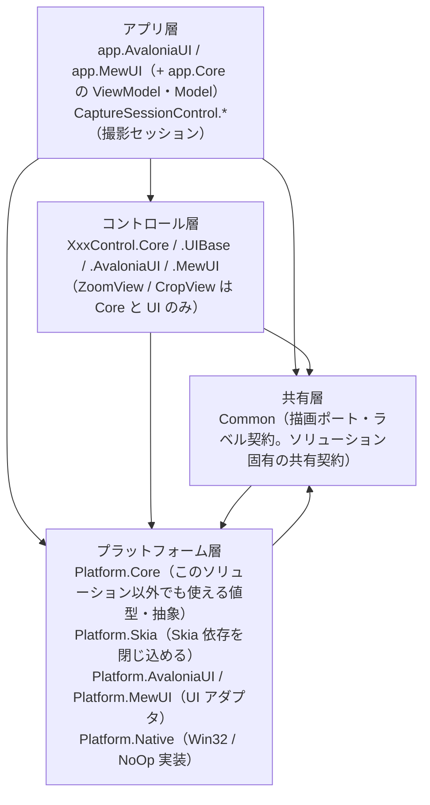
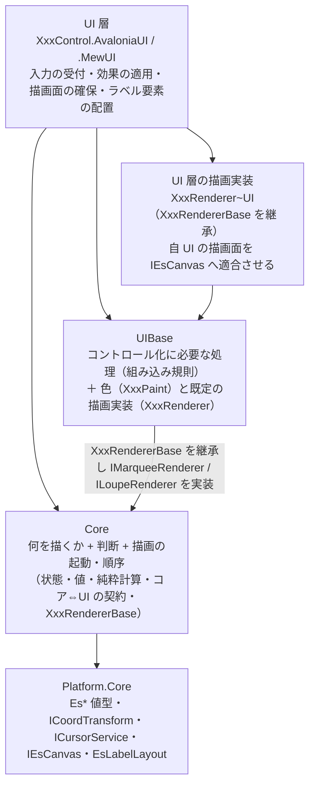

# コントロールの層構成（Core / UIBase / UI）

本リポジトリのコントロールは、**UI 非依存のコアを複数の UI（Avalonia / MewUI）で共有する**ために層を分けています。
本ドキュメントは「層の依存の向き」と「どこに何を置くか」の単一の説明です。各層の中身は各プロジェクトの `README.md` / `SPEC_*.md` を参照してください。

## 1. 全体の階層

依存は常に上から下への一方向です（`Common` と `Platform.*` は相互に参照しません。`Platform.Core` は `Common` を参照しません）。

## 2. コントロール層の 3 層

**Core（何を描くか・判断・描画の起動と順序） / UIBase（コントロール化に必要な処理＋色と既定実装） / UI（フレームワーク固有）** の 3 層です。UI 層が UIBase と Core の両方を参照し、**UIBase はコアの契約を実装する**向きに依存します（コアは UIBase を参照しません）。

UIBase は `Platform.Core` も参照します（描画ポート・実寸測定）。Core は UIBase を参照しません。

| 層 | 置くもの | 置かないもの | 依存先 | Marquee の例 |
| --- | --- | --- | --- | --- |
| **Core** | 「何を描くか」の判断・状態・設定の既定値と補正・純粋計算・コア⇔UI の契約・**描画内容の解決（層の順序・矩形）と描画の起動**・ログ定義 | 色・UI フレームワークの型・組み込み先の概念 | `Platform.Core` | `Marquee`（ファサード + `Marquee.Content.cs` の `ResolveFrame`）/ `MarqueeDrawContent` / `MarqueeOptions` / `IMarqueeRenderer`（契約）/ `MarqueeRendererBase` |
| **UIBase** | コントロール化に必要な処理（組み込み規則）・**色（`MarqueePaint` / `LoupePaint`）と色を持つ既定の描画実装**（層の順序は Core の基底が所有するため順序を判断しない）・層をまたぐ設定の写像（設定 → 子の値、設定 → 色。両 UI で共有する） | コア単体でも成立する判断（選択・表示レイアウト）・UI フレームワークの型 | `Core` / `Platform.Core` | `MarqueeRenderer` / `MarqueePaint` / `MarqueeLabelPlan` / `MarqueeWheelInterpreter` / `CapturePaintMapper` / `FadeMaskHostLabelRenderer` |
| **UI** | 入力イベントの受付とコア型への変換・効果の適用・通知の公開イベントへの転送・**描画面の確保（`XxxRenderer~UI`）**・ラベル要素の配置 | 判断・計算・既定値（コアが単一所有する）・層の順序（コアが単一所有する）・複数 UI で共有できる手順 | `Core` / `UIBase` / `Platform.*` | `MarqueeControl` / `MarqueeRendererAvaloniaUI` / `Effects` |

**UIBase の中の 2 つの関心事**: 実装上は同じアセンブリに置きますが、帰属の基準は別です。

| 関心事 | 内容 | 判定 |
| --- | --- | --- |
| **組み込み規則** | 組み込み先（ビューポート等）がある場合にだけ必要な規則（ホイール解釈・ビューポート変化の再通知・再描画のスケジューリング） | 単体でそのコントロールを使っても存在する概念か |
| **色と既定の描画実装** | 描画にだけ必要な設定（色）の保持と、その色を使う層の描画（層の順序は Core の基底が単一所有する） | 描画にだけ必要か（コアの計算・判断に入るか） |

## 3. どこに置くかを決める 3 つの問い

1. **単体でそのコントロールを使っても存在する概念か** — する なら **Core**。例: 選択の判断・表示レイアウト・**層の順序に従った描画手順（`XxxRendererBase`）**・実寸からラベル要素への写像。
2. **描画 API の呼び出しに色が要るか** — 要る なら **UIBase**（色と、その色を使う既定の描画実装）。
3. **フレームワーク固有の機構か** — そうなら **UI**（入力の受付・描画面の確保・要素の配置・UI 型への写像）。
   例: `DrawingContext` / `SKCanvas` の確保、`Border` + `TextBlock` の配置、カーソル型の写像。

> **「1 が成立するなら 1 が優先」**（Core に置けるものは Core に置く。組み込み規則と色だけが UIBase に残る）。

UI 層に残すのは「フレームワーク固有の型を使うもの」だけです（入力の受付・効果の適用・通知の転送・描画面の確保・要素の配置・境界の 1 行変換）。

UI 層に残すのは「フレームワーク固有の型を使うもの」だけです（入力の受付・効果の適用・通知の転送・描画面の確保・要素の配置・境界の 1 行変換）。

## 4. 「描画の起動と順序は Core・色は UIBase・描画面は ~UI」

もっとも紛らわしい点です。**Core は色を持ちません**（色は UI 非依存の型だが、Core の計算・判断に入らないため）が、**描画手順（層の順序と起動）は Core が持ちます**。この 2 つは「色をレンダラのインスタンス状態にする」ことで両立します。

| 何 | どこ | 理由 |
| --- | --- | --- |
| 描画の契約（`IMarqueeRenderer` / `ILoupeRenderer`） | **Core** | コアが「何を描くか（渡す値）」を決めるため。UI 層が描画を差し替える入口もここにある |
| 描画手順の基底（`MarqueeRendererBase` / `LoupeRendererBase`） | **Core** | 「どの層をどの順に描くか」は**単体のコントロールにも存在する概念**であり UI フレームワーク非依存（描画 API は `IEsCanvas` が抽象化済み）。Core が持つことで**描画の起動と順序が Core の単一所有**になる |
| 描画の起動（`Marquee.Draw` / `Loupe.Draw`） | **Core** | 起動の入口を Core に一本化する（UI が `Renderer.DrawShapes` を直接呼ぶと、実装の差し替えと順序の単一所有が二重経路になる） |
| 描画にだけ必要な色（`MarqueePaint` / `LoupePaint`）と既定実装 | **UIBase** | 色はコアの計算・判断に入らないためコアの型面に現れない（**色を使う層の描画は抽象メソッドとして派生へ委ねる**）。その派生（`MarqueeRenderer` / `LoupeRenderer`）が色をインスタンス状態として保持する |
| 描画面の確保（`DrawingContext` / `SKCanvas` → `IEsCanvas` の適合）と UI 固有の描画 | **~UI** | `IEsCanvas` では吸収できないフレームワーク固有の機構（中間ビットマップ・描画コールバック・要素ベースの描画）を担う。`XxxRenderer~UI` が継承の拡張点になる |
| 注入 | **UI** | `new MarqueeRendererAvaloniaUI(paint)` を 1 回生成して注入し、コントロールの `Paint` プロパティ（`MarqueePaint` / `LoupePaint`）と併せて設定する。差し替える場合は `Renderer` プロパティへ別実装を設定する（その場合はコアの `Draw` 入口を通る） |

**帰属の規則**: **判断・寸法・表示可否・描画の起動と順序は Core、色は UIBase、描画面とフレームワーク固有の描画は ~UI、配線は UI** です。色をコアの設定値へ入れないのは、色が「何を描くか」の判断に使われないためです（描画の可否は色のアルファではなくコアの明示フラグが決めます）。

アセンブリ参照の向きは `UI → UIBase → Core` です（`UIBase` は Core の契約を実装するので Core を参照する）。**逆向きの参照はありません**。

**`~UI` の `XxxRenderer~UI` が担うもの**: 描画手順（層の順序）は Core が単一所有するため、`~UI` の派生は**順序を判断しません**。`~UI` が担うのは「自 UI の描画面を確保して `IEsCanvas` へ適合させる」ことと、`IEsCanvas` では扱えない UI 固有の描画です（要素ベースの描画・自 UI の API を要する処理等）。描画先の差し替え（`IEsCanvas` の実装）と描画実装の差し替え（`Renderer`）は別の機構であり、UI は「自 UI の型なら自前の `Draw`、差し替えられていればコアの `Draw` 入口」の 2 経路で扱います。

## 5. コントロールごとの層

| コントロール | Core | UIBase | UI |
| --- | --- | --- | --- |
| `MarqueeControl` | あり | あり（描画手順 + 組み込み規則） | AvaloniaUI / MewUI |
| `LoupeControl` | あり | あり（描画手順 + 組み込み規則。組み込み規則は AvaloniaUI のみが使う） | AvaloniaUI / MewUI |
| `ZoomViewControl` | あり | なし（UI 層が描く） | AvaloniaUI / MewUI |
| `CropViewControl` | あり | なし | AvaloniaUI / MewUI |
| `CaptureSessionControl` | あり | あり（設定 → 色の写像のみ。描画手順は持たない） | AvaloniaUI / MewUI |
| `FadeMaskDragRectControl` | あり | あり（値の解決 ＋ 付加情報ラベルの描画。内部する Marquee / Loupe の UIBase を再利用する） | AvaloniaUI / MewUI |
| `ColorPickerControl` | なし（UI のみ） | なし | AvaloniaUI |

`LoupeControl` の組み込み規則（`LoupeRenderCoordinator`）を MewUI が使わないのは、**MewUI が中間ビットマップを持たず同期描画するため**です（再描画のスケジューリングが不要）。同じ必要が生じた時点で注入できます。

`CaptureSessionControl.UIBase` は**描画手順を持たない例外的な UIBase** です（設定 → 色の写像だけを持ちます）。写像元がセッションの設定型（`CaptureSettings`）、写像先が描画層の色（`MarqueePaint` / `LoupePaint`）という**2 つの層にまたがる**ため、コアにも（Core → UIBase の逆流になる）再利用ライブラリにも置けません。両 UI のホストが同じ写像を使うことを保証するために本層を置いています（詳細は [`CaptureSessionControl.UIBase`](CaptureSessionControl.UIBase/README.md)）。

`LineDetection` は画像処理ライブラリであり、本 3 層には含めません（`Platform.Core` のみに依存します）。

## 6. 各層のドキュメント

| コントロール | Core | UIBase |
| --- | --- | --- |
| Marquee | [`Feature.MarqueeCore`](Feature.MarqueeCore/README.md) | [`MarqueeControl.UIBase`](MarqueeControl.UIBase/README.md) |
| Loupe | [`Feature.LoupeCore`](Feature.LoupeCore/README.md) | [`LoupeControl.UIBase`](LoupeControl.UIBase/README.md) |
| CaptureSession | [`CaptureSessionControl.Core`](CaptureSessionControl.Core/README.md) | [`CaptureSessionControl.UIBase`](CaptureSessionControl.UIBase/README.md) |
| FadeMaskDragRect | [`FadeMaskDragRectControl.Core`](FadeMaskDragRectControl.Core/README.md) | [`FadeMaskDragRectControl.UIBase`](FadeMaskDragRectControl.UIBase/README.md) |

FadeMaskDragRect は複合コントロールであり、内包する Marquee / Loupe の層も参照します（[`MarqueeControl.UIBase`](MarqueeControl.UIBase/README.md) / [`LoupeControl.UIBase`](LoupeControl.UIBase/README.md)）。

UI 層は [`MarqueeControl.AvaloniaUI`](MarqueeControl.AvaloniaUI/README.md) / [`MarqueeControl.MewUI`](MarqueeControl.MewUI/README.md) / [`LoupeControl.AvaloniaUI`](LoupeControl.AvaloniaUI/README.md) / [`LoupeControl.MewUI`](LoupeControl.MewUI/README.md)、
共有層は [`Common`](Common/README.md)、
プラットフォーム層は [`Platform.Core`](Platform.Core/README.md) / [`Platform.Skia`](Platform.Skia/README.md) / [`Platform.AvaloniaUI`](Platform.AvaloniaUI/README.md) / [`Platform.MewUI`](Platform.MewUI/README.md) / [`Platform.Native`](Platform.Native/README.md) を参照してください。

## 7. 名前空間とフォルダの対応

| 種別 | フォルダ | 名前空間 |
| --- | --- | --- |
| プラットフォーム層 | `Platform.Core` / `.Native` / `.Skia` / `.AvaloniaUI` / `.MewUI` | `EsUtil.Platform.Core` / `.Native` / `.Skia` / `.AvaloniaUI` / `.MewUI` |
| 共有層（ソリューション固有の共有契約） | `Common` | `EsUtil.SaveEvidence.Common`（型は `.Imaging`） |
| 可搬コア（機能単位） | `Feature.MarqueeCore` / `Feature.LoupeCore` | `EsUtil.Feature.MarqueeCore`（幾何 `.Selection` / 装飾 `.Decoration`） / `EsUtil.Feature.LoupeCore`（`.Imaging`） |
| 製品側のコントロール | `MarqueeControl.UIBase` 等 | `EsUtil.SaveEvidence.Marquee.UIBase` 等 |
| アプリ | `app.Core` / `app.AvaloniaUI` / `app.MewUI` | `EsUtil.SaveEvidence`（Core と AvaloniaUI が共有） / `EsUtil.SaveEvidence.MewUI` |

**コントロール系の名前空間は、フォルダ名から `Control` を除いた短縮名を使います**（例: `MarqueeControl.AvaloniaUI` → `EsUtil.SaveEvidence.Marquee.AvaloniaUI`）。これは好みではなく制約です。

- 名前空間のセグメントと型名が一致すると **CS0118**（名前空間を種類として使用）になります。C# の名前解決は「外側の名前空間のメンバー（名前空間を含む）」を、`namespace` 宣言より前に書いた `using` より優先するためです。実測では `MarqueeControl` / `LoupeControl` / `ZoomViewControl` / `CropViewControl` / `ColorPickerControl` / `FadeMaskDragRectControl` / `CaptureSessionControl` の 7 型が該当します（フォルダ名をそのまま使うと、他の名前空間からこれらの型を単純名で参照できません）。
- 短縮名にしても `Marquee` / `Loupe`（コアのファサード型）だけはセグメントと一致するため、UI 側は**別名 `using`**（`using MarqueeFacade = EsUtil.Feature.MarqueeCore.Marquee;` / `LoupeFacade` も同様）で参照します。
- コアの名前空間は可搬性の単位（`EsUtil.Feature.*`）、製品側は `EsUtil.SaveEvidence.*` に置きます。`EsUtil.Platform.*` は外部パッケージに依存しない値型・抽象・描画ポートです。
