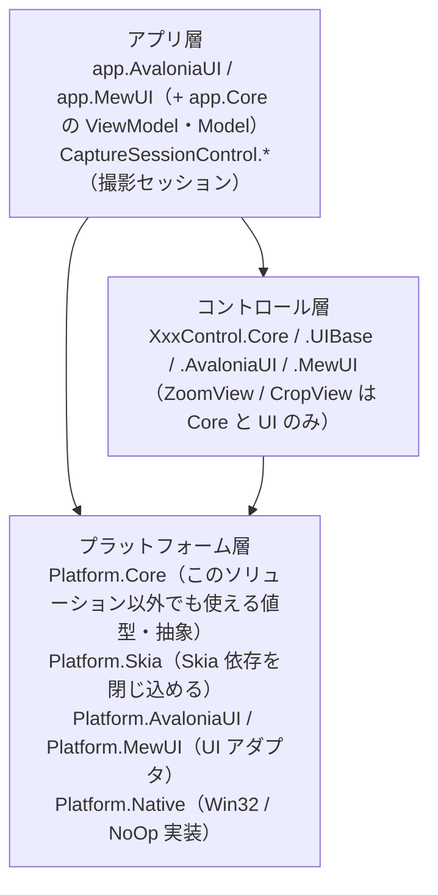
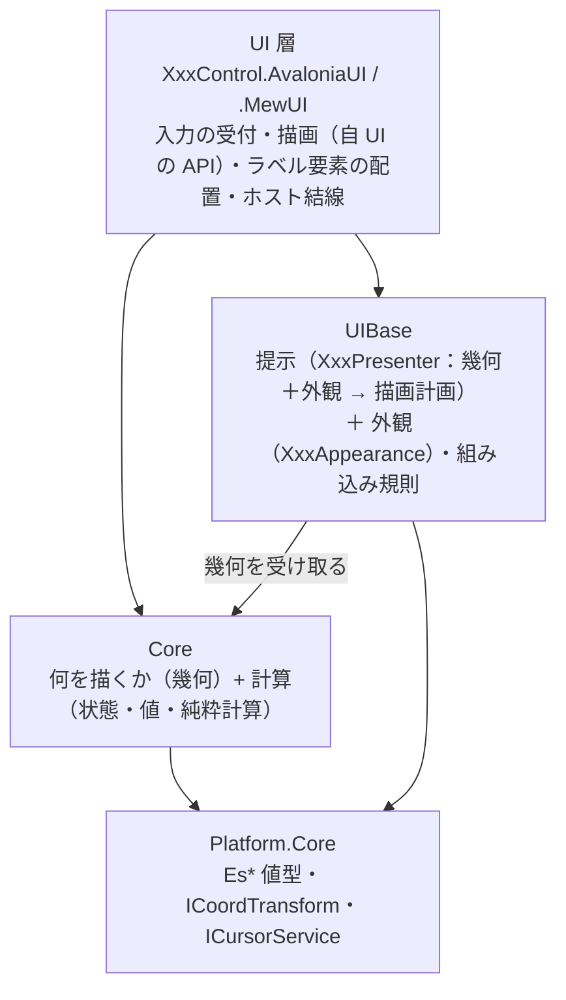

# コントロールの層構成（Core / UIBase / UI）

本リポジトリのコントロールは、**UI 非依存のコアを複数の UI（Avalonia / MewUI）で共有する**ために層を分けています。
本ドキュメントは「層の依存の向き」と「どこに何を置くか」の単一の説明です。各層の中身は各プロジェクトの `README.md` / `SPEC_*.md` を参照してください。

## 1. 全体の階層

依存は常に上から下への一方向です。

> **移行中**: `Common`（描画ポート `IEsCanvas`）は旧構成の名残であり、Marquee 系を新しい構成（下記）へ移す過程で削除します。

## 2. コントロール層の 3 層

**Core（何を描くか・判断・計算） / UIBase（提示＝描画計画と外観＋組み込み規則） / UI（フレームワーク固有の描画と配線）** の 3 層です。UI 層が UIBase と Core の両方を参照し、**UIBase はコアの計算結果を使って描画計画を組み立てる**向きに依存します（コアは UIBase を参照しません）。

**Core は UIBase を参照しません**（描画 API も描画の抽象も知らない）。

| 層 | 置くもの | 置かないもの | 依存先 | Loupe の例 |
| --- | --- | --- | --- | --- |
| **Core** | 「何を描くか」の判断・状態・設定の既定値と補正・純粋計算・**描画の幾何（切り出し領域・描画面）**・**コアが出力するログ定義** | 色・フォントサイズ・表示可否・UI フレームワークの型・組み込み先の概念・**描画 API と描画の抽象**・UI が出力するログ定義 | `Platform.Core` | `Loupe`（`ResolveLayout` / `ResolveGeometry`）/ `LoupeGeometry` / `LoupeOptions` / `LoupeLayout` |
| **UIBase** | **提示（`XxxPresenter`：幾何＋外観 → 描画計画（層の順序・装飾矩形・文言・配置））**・**外観（`XxxAppearance`：色・フォント・角丸・枠線の太さ・表示可否）**・**テキストを要素に写す配置計算（`XxxLabelPlan`）**・組み込み規則（再描画のバッチ化等）・**UI が出力するログ定義とログの値の書式** | コア単体でも成立する計算（選択・表示レイアウト）・UI フレームワークの型・**描画 API の抽象** | `Core` / `Platform.Core` | `LoupePresenter` / `LoupeAppearance` / `LoupeDrawPlan` / `LoupeDrawLayer` / `LoupeDecorationGeometry` / `LoupeMetricsScaler` / `LoupeLabelPlan` |
| **UI** | 入力イベントの受付とコア型への変換・効果の適用・通知の公開イベントへの転送・**描画（自 UI の描画 API で描画計画を描く）**・ラベル要素の配置 | 判断・計算・既定値（コアが単一所有する）・層の順序（UIBase がデータとして単一所有する）・複数 UI で共有できる処理 | `Core` / `UIBase` / `Platform.*` | `LoupeControl` / `LoupeContextPainter` / `LoupeSkiaPainter` |

**UIBase の中の 2 つの関心事**: 実装上は同じアセンブリに置きますが、帰属の基準は別です。

| 関心事 | 内容 | 判定 |
| --- | --- | --- |
| **組み込み規則** | 組み込み先（ビューポート等）がある場合にだけ必要な規則（ホイール解釈・再描画のスケジューリング） | 単体でそのコントロールを使っても存在する概念か |
| **提示と外観** | 幾何（コア）と外観から描画計画を解決する手順と、色・フォント・枠線の太さ・表示可否の保持 | 描画にだけ必要か（コアの計算・判断に入るか） |

## 3. どこに置くかを決める 3 つの問い

1. **単体でそのコントロールを使っても存在する概念か** — する なら **Core**。例: 選択の判断・表示レイアウト・切り出し領域の計算。
2. **描画にだけ必要で、コアの計算・判断に入らないか** — そうなら **UIBase**（色・フォント・枠線の太さ・表示可否と、それを使って描画計画を組み立てる手順）。
3. **フレームワーク固有の機構か** — そうなら **UI**（入力の受付・描画 API の呼び出し・要素の配置・UI 型への写像）。例: `DrawingContext` / `SKCanvas` の確保、`Border` + `TextBlock` の配置、カーソル型の写像。

> **「1 が成立するなら 1 が優先」**（Core に置けるものは Core に置く。組み込み規則と描画の都合だけが UIBase に残る）。

UI 層に残すのは「フレームワーク固有の型を使うもの」だけです（入力の受付・効果の適用・通知の転送・描画・要素の配置・境界の 1 行変換）。

## 4. 「何を描くか（幾何）は Core・どう見せるか（描画計画と外観）は UIBase・どう描くかは UI」

もっとも紛らわしい点です。**Core は色もフォントサイズも描画 API も描画の抽象も持ちません**（描画にだけ必要なものであり、Core の計算・判断に入らないため）。**Core が持つのは描画の幾何**（切り出し領域・描画面）です。**その幾何と外観から描画計画（層の順序・装飾矩形・文言・配置）を組み立てるのが UIBase の `XxxPresenter`** であり、**実際に描くのは各 UI が自 UI の描画 API で行います**（`XxxContextPainter` / `XxxSkiaPainter`）。

**描画 API の抽象（キャンバスの抽象）は持ちません**。UI フレームワークごとの描画モデル（即時描画 / リテインド / 描画プリミティブの違い）は抽象に集約しきれず、対象 UI が増えるたびに抽象が肥大するためです。UIBase は**描画計画というデータ**を返し、UI がそれを自前の API で写します。

**テキスト（ラベル）は UIBase が文言・基準点・配置まで解決し、UI 層が扱いを決めます**。**テキスト要素（`TextBlock` 等）として置くか canvas へ描くかは UI 層の判断**です。UIBase は値（`XxxLabelPlacement`）を渡し、UI は要素として置くか文字として描くかを選びます（要素は親の描画より後に描かれるため常に最上位になります）。

| 何 | どこ | 理由 |
| --- | --- | --- |
| 描画の幾何（切り出し領域・描画面） | **Core** | 単体のルーペでも成立する計算である（描画面のサイズ・切り出し領域は選択に依存しない） |
| 描画計画（層の順序・装飾矩形・文言・配置）と外観（色・フォント・枠線の太さ・表示可否） | **UIBase** | 描画にだけ必要な設定・規則であり、コアの計算・判断に入らない。コアに置くと色・フォントをコアへ持ち込むことになる |
| テキストを要素に写す配置計算（`XxxLabelPlan`） | **UIBase** | 実寸（描画 API 依存）から配置矩形を求める。体裁値（内側余白・フォントサイズ・色・角丸）の所有も UIBase（`XxxAppearance`）である。**UI 層が要素として置くか画像として描くかの選択は各 UI に残る** |
| 実際の描画（描画 API の呼び出し） | **UI** | 描画 API は UI フレームワーク固有であり、抽象で吸収しきれない |
| 描画面の確保（`DrawingContext` / `SKCanvas` / 中間ビットマップ） | **UI** | フレームワーク固有の機構（中間ビットマップの有無・描画コールバック）である |
| 注入・配線 | **UI** | コントロールの公開プロパティ（`Options` / `Appearance`）と入力イベントの配線はフレームワーク固有である |

**帰属の規則**: **計算（幾何・判断・状態）は Core、描画計画と外観（色・フォント・枠線の太さ・表示可否）は UIBase、描画 API の呼び出しと配線は UI** です。色とフォントをコアの設定値へ入れないのは、「何を描くか」の判断に使われないためです（描画の可否は色のアルファではなく外観の明示フラグが決めます）。

**描画計画のまとめ型**: 描画計画（`XxxDrawPlan`）は「フレーム 1 枚分」のまとめ型であり、UIBase から UI へ渡す唯一の描画契約です。項目が複数の値を 1 つの概念としてまとめる場合にだけ専用型を作ります（単一のコレクションで足りる項目に型を作りません）。

アセンブリ参照の向きは `UI → UIBase → Core` です（`UIBase` は Core の幾何（`XxxGeometry`）を使うので Core を参照する）。**逆向きの参照はありません**（Core は UIBase も `Common` も参照しない）。

**コントロールを差し替えるには**: 描画計画の構成を変える場合は `XxxPresenter` を継承して `ResolveDrawPlan` を上書きする（または `XxxPresenterXxx` を作る）。見た目だけを変える場合は外観（`XxxAppearance`）を差し替える。コアの公開 API だけで描画計画を組み立てられるため、`XxxPresenter` を使わない独自実装も可能です。

## 5. コントロールごとの層

| コントロール | Core | UIBase | UI |
| --- | --- | --- | --- |
| `MarqueeControl` | あり | あり（描画手順 + 組み込み規則） | AvaloniaUI / MewUI |
| `LoupeControl` | あり | あり（提示 + 外観。組み込み規則は AvaloniaUI のみが使う） | AvaloniaUI / MewUI |
| `ZoomViewControl` | あり | なし（UI 層が描く） | AvaloniaUI / MewUI |
| `CropViewControl` | あり | なし | AvaloniaUI / MewUI |
| `CaptureSessionControl` | あり | あり（設定 → 色の写像のみ。描画手順は持たない） | AvaloniaUI / MewUI |
| `FadeMaskDragRectControl` | あり | あり（値の解決 ＋ 付加情報ラベルの配置。内包する Marquee / Loupe の UIBase を再利用する） | AvaloniaUI / MewUI |
| `ColorPickerControl` | なし（UI のみ） | なし | AvaloniaUI |

`LoupeControl` の組み込み規則（`LoupeRenderCoordinator`）を MewUI が使わないのは、**MewUI が中間ビットマップを持たず同期描画するため**です（再描画のスケジューリングが不要）。同じ必要が生じた時点で注入できます。

`CaptureSessionControl.UIBase` は**描画手順を持たない例外的な UIBase** です（設定 → 色の写像だけを持ちます）。写像元がセッションの設定型（`CaptureSettings`）、写像先が外観（`MarqueeAppearance` / `LoupeAppearance`）という**2 つの層にまたがる**ため、コアにも（Core → UIBase の逆流になる）再利用ライブラリにも置けません。両 UI のホストが同じ写像を使うことを保証するために本層を置いています（詳細は [`CaptureSessionControl.UIBase`](CaptureSessionControl.UIBase/README.md)）。

`LineDetection` は画像処理ライブラリであり、本 3 層には含めません（`Platform.Core` のみに依存します）。

## 6. 各層のドキュメント

| コントロール | Core | UIBase |
| --- | --- | --- |
| Marquee | [`Feature.Marquee.Core`](Feature.Marquee.Core/README.md) | [`Feature.Marquee.Presenter`](Feature.Marquee.Presenter/README.md) |
| Loupe | [`Feature.Loupe.Core`](Feature.Loupe.Core/README.md) | [`Feature.Loupe.Presenter`](Feature.Loupe.Presenter/README.md) |
| CaptureSession | [`CaptureSessionControl.Core`](CaptureSessionControl.Core/README.md) | [`CaptureSessionControl.UIBase`](CaptureSessionControl.UIBase/README.md) |
| FadeMaskDragRect | [`FadeMaskDragRectControl.Core`](FadeMaskDragRectControl.Core/README.md) | [`FadeMaskDragRectControl.UIBase`](FadeMaskDragRectControl.UIBase/README.md) |

FadeMaskDragRect は複合コントロールであり、内包する Marquee / Loupe の層も参照します（[`Feature.Marquee.Presenter`](Feature.Marquee.Presenter/README.md) / [`Feature.Loupe.Presenter`](Feature.Loupe.Presenter/README.md)）。

UI 層は [`MarqueeControl.AvaloniaUI`](MarqueeControl.AvaloniaUI/README.md) / [`MarqueeControl.MewUI`](MarqueeControl.MewUI/README.md) / [`LoupeControl.AvaloniaUI`](LoupeControl.AvaloniaUI/README.md) / [`LoupeControl.MewUI`](LoupeControl.MewUI/README.md)、
プラットフォーム層は [`Platform.Core`](Platform.Core/README.md) / [`Platform.Skia`](Platform.Skia/README.md) / [`Platform.AvaloniaUI`](Platform.AvaloniaUI/README.md) / [`Platform.MewUI`](Platform.MewUI/README.md) / [`Platform.Native`](Platform.Native/README.md) を参照してください。

## 7. 名前空間とフォルダの対応

| 種別 | フォルダ | 名前空間 |
| --- | --- | --- |
| プラットフォーム層 | `Platform.Core` / `.Native` / `.Skia` / `.AvaloniaUI` / `.MewUI` | `EsUtil.Platform.Core` / `.Native` / `.Skia` / `.AvaloniaUI` / `.MewUI` |
| 可搬コア（機能単位） | `Feature.Marquee.Core` / `Feature.Loupe.Core` | `EsUtil.Feature.Marquee.Core`（`.Contract` / `.Drawing` / `.Interaction` / `.Setting` / `.Logging` / `.Session` / `.Selection` / `.Decoration`） / `EsUtil.Feature.Loupe.Core`（`.Drawing` / `.Setting` / `.Logging` / `.Placement`） |
| 製品側のコントロール | `Feature.Marquee.Presenter` 等 | `EsUtil.Feature.Marquee.Presenter` 等 |
| アプリ | `app.Core` / `app.AvaloniaUI` / `app.MewUI` | `EsUtil.SaveEvidence`（Core と AvaloniaUI が共有） / `EsUtil.SaveEvidence.MewUI` |

**コントロール系の名前空間は、フォルダ名から `Control` を除いた短縮名を使います**（例: `MarqueeControl.AvaloniaUI` → `EsUtil.SaveEvidence.Marquee.AvaloniaUI`）。これは好みではなく制約です。

- 名前空間のセグメントと型名が一致すると **CS0118**（名前空間を種類として使用）になります。C# の名前解決は「外側の名前空間のメンバー（名前空間を含む）」を、`namespace` 宣言より前に書いた `using` より優先するためです。実測では `MarqueeControl` / `LoupeControl` / `ZoomViewControl` / `CropViewControl` / `ColorPickerControl` / `FadeMaskDragRectControl` / `CaptureSessionControl` の 7 型が該当します（フォルダ名をそのまま使うと、他の名前空間からこれらの型を単純名で参照できません）。
- 短縮名にしても `Marquee` / `Loupe`（コアのファサード型）だけはセグメントと一致するため、UI 側は**別名 `using`**（`using MarqueeFacade = EsUtil.Feature.Marquee.Core.Marquee;` / `LoupeFacade` も同様）で参照します。
- コアの名前空間は可搬性の単位（`EsUtil.Feature.*`）、製品側は `EsUtil.SaveEvidence.*` に置きます。`EsUtil.Platform.*` は外部パッケージに依存しない値型・抽象です。
