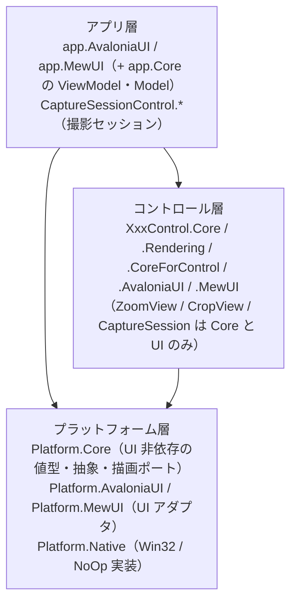
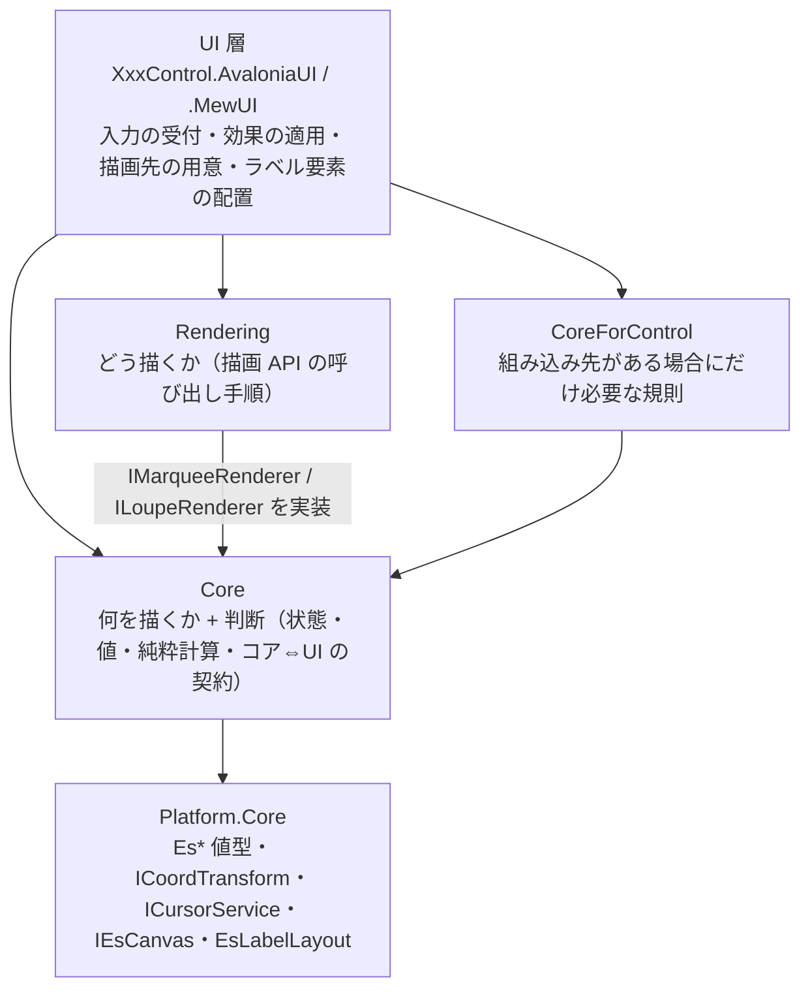

# コントロールの層構成（Core / Rendering / CoreForControl / UI）

本リポジトリのコントロールは、**UI 非依存のコアを複数の UI（Avalonia / MewUI）で共有する**ために層を分けています。
本ドキュメントは「層の依存の向き」と「どこに何を置くか」の単一の説明です。各層の中身は各プロジェクトの `README.md` / `SPEC_*.md` を参照してください。

## 1. 全体の階層

依存は常に上から下への一方向です（逆参照・双方向依存はありません）。

## 2. コントロール層の 4 層

**Rendering と CoreForControl は兄弟です**（互いを参照しません）。どちらも Core にだけ依存し、3 つすべてを参照するのは UI 層です（CoreForControl は必要とする UI だけが参照します。例: `LoupeControl` の MewUI 版は中間ビットマップを持たず同期描画するため参照しません）。

Rendering は `Platform.Core` も参照します（CoreForControl は実装によって参照 0 件。図では省略）。Core は Rendering / CoreForControl を参照しません。

| 層 | 置くもの | 置かないもの | 依存先 | Marquee の例 |
| --- | --- | --- | --- | --- |
| **Core** | 「何を描くか」の判断・状態・設定の既定値と補正・純粋計算・コア⇔UI の契約・ログ定義 | 描画 API の呼び出し・UI フレームワークの型・組み込み先の概念 | `Platform.Core` | `Marquee`（ファサード）/ `MarqueeSession` / `MarqueeFrame` / `MarqueeOptions` / `IMarqueeRenderer`（契約） |
| **Rendering** | 「どう描くか」（層の順序に従った描画 API の呼び出し手順） | 判断・外観値の既定値・組み込み先の概念 | `Core` / `Platform.Core` | `MarqueeRenderer`（`Default`）/ `MarqueeLabelPlan` / `MarqueeOuterRenderer` |
| **CoreForControl** | 組み込み先がある場合にだけ必要な規則（ホイール解釈・ビューポート変化の再通知・再描画のスケジューリング） | 単体でも成立する判断（選択・表示レイアウト）・描画 API の呼び出し | `Core` / `Platform.Core`（`LoupeControl.CoreForControl` はどちらも参照しない） | `MarqueeWheelInterpreter` / `MarqueeViewportNotifier` |
| **UI** | 入力イベントの受付とコア型への変換・効果の適用・通知の公開イベントへの転送・描画先の用意・ラベル要素の配置 | 判断・計算・既定値（コアが単一所有する） | `Core` / `Rendering` / `CoreForControl` / `Platform.*` | `MarqueeControl` / `Effects` / `AvaloniaCanvas` の適合 |

**名前の意味**: `CoreForControl` は「Core（コア）を Control（コントロール）へ組み込むためにだけ必要な層」です。コア単体では存在しない概念（ビューポート・非同期の再描画）を置きます。

## 3. どこに置くかを決める 3 つの問い

1. **単体でそのコントロールを使っても存在する概念か** — しない（組み込み先があって初めて問題になる）なら **CoreForControl**。
   例: 「Ctrl+ホイール = ズーム」「ビューポート変化の再通知」「1 フレーム 1 回への再描画のバッチ化」。
2. **描画 API の呼び出し手順か** — そうなら **Rendering**。
   例: 層の順序に従った描画ポート（`IEsCanvas`）の呼び出し、実寸からラベル要素への写像。
3. **それ以外** — **Core**。判断・状態・設定の既定値と補正・純粋計算・コア⇔UI の契約・ログ定義。

UI 層に残すのは「フレームワーク固有の型を使うもの」だけです（入力の受付・効果の適用・通知の転送・描画先の用意・要素の配置・境界の 1 行変換）。

## 4. 「契約は Core・実装は Rendering・注入は UI」

もっとも紛らわしい点です。**コアは描画層を参照しません**が、描画の**契約**はコアが持ちます。

| 何 | どこ | 理由 |
| --- | --- | --- |
| 描画の契約（`IMarqueeRenderer` / `ILoupeRenderer`） | **Core** | コアが「何を描くか（渡す値）」を決めるため。UI 層が描画を差し替える入口もここにある |
| 既定実装（`MarqueeRenderer.Default` / `LoupeRenderer.Default`） | **Rendering** | 描画 API の手順は UI 非依存だが、コアの一部ではない |
| 注入 | **UI** | `new Marquee(MarqueeRenderer.Default, effects, cursor, options)`。差し替える場合は `Renderer` プロパティへ別実装を設定する |

アセンブリ参照の向きは `UI → Rendering → Core` です（`Rendering` は Core の契約を実装するので Core を参照する）。**逆向きの参照はありません**。

## 5. コントロールごとの層

| コントロール | Core | Rendering | CoreForControl | UI |
| --- | --- | --- | --- | --- |
| `MarqueeControl` | あり | あり | あり（両 UI が使う） | AvaloniaUI / MewUI |
| `LoupeControl` | あり | あり | あり（AvaloniaUI のみが使う） | AvaloniaUI / MewUI |
| `ZoomViewControl` | あり | なし（UI 層が描く） | なし | AvaloniaUI / MewUI |
| `CropViewControl` | あり | なし | なし | AvaloniaUI / MewUI |
| `CaptureSessionControl` | あり | なし | なし | AvaloniaUI / MewUI |
| `FadeMaskDragRectControl` | あり | なし（内包する Marquee / Loupe の Rendering を使う） | なし | AvaloniaUI / MewUI |
| `ColorPickerControl` | なし（UI のみ） | なし | なし | AvaloniaUI |

`LoupeControl` の CoreForControl を MewUI が使わないのは、**MewUI が中間ビットマップを持たず同期描画するため**です（再描画のスケジューリングが不要）。同じ必要が生じた時点で注入できます。

`LineDetection` は画像処理ライブラリであり、本 4 層には含みません（`Platform.Core` のみに依存します）。

## 6. 各層のドキュメント

| コントロール | Core | Rendering | CoreForControl |
| --- | --- | --- | --- |
| Marquee | [`Feature.MarqueeCore`](Feature.MarqueeCore/README.md) | [`MarqueeControl.Rendering`](MarqueeControl.Rendering/README.md) | [`MarqueeControl.CoreForControl`](MarqueeControl.CoreForControl/README.md) |
| Loupe | [`Feature.LoupeCore`](Feature.LoupeCore/README.md) | [`LoupeControl.Rendering`](LoupeControl.Rendering/README.md) | [`LoupeControl.CoreForControl`](LoupeControl.CoreForControl/README.md) |

UI 層は [`MarqueeControl.AvaloniaUI`](MarqueeControl.AvaloniaUI/README.md) / [`MarqueeControl.MewUI`](MarqueeControl.MewUI/README.md) / [`LoupeControl.AvaloniaUI`](LoupeControl.AvaloniaUI/README.md) / [`LoupeControl.MewUI`](LoupeControl.MewUI/README.md)、
プラットフォーム層は [`Platform.Core`](Platform.Core/README.md) / [`Platform.AvaloniaUI`](Platform.AvaloniaUI/README.md) / [`Platform.MewUI`](Platform.MewUI/README.md) / [`Platform.Native`](Platform.Native/README.md) を参照してください。

## 7. 名前空間とフォルダの対応

| 種別 | フォルダ | 名前空間 |
| --- | --- | --- |
| プラットフォーム層 | `Platform.Core` / `.Native` / `.AvaloniaUI` / `.MewUI` | `EsUtil.Platform.Core` / `.Native` / `.AvaloniaUI` / `.MewUI` |
| 可搬コア（機能単位） | `Feature.MarqueeCore` / `Feature.LoupeCore` | `EsUtil.Feature.MarqueeCore`（幾何 `.Selection` / 装飾 `.Decoration`） / `EsUtil.Feature.LoupeCore`（`.Imaging`） |
| 製品側のコントロール | `MarqueeControl.Rendering` 等 | `EsUtil.SaveEvidence.Marquee.Rendering` 等 |
| アプリ | `app.Core` / `app.AvaloniaUI` / `app.MewUI` | `EsUtil.SaveEvidence`（Core と AvaloniaUI が共有） / `EsUtil.SaveEvidence.MewUI` |

**コントロール系の名前空間は、フォルダ名から `Control` を除いた短縮名を使います**（例: `MarqueeControl.AvaloniaUI` → `EsUtil.SaveEvidence.Marquee.AvaloniaUI`）。これは好みではなく制約です。

- 名前空間のセグメントと型名が一致すると **CS0118**（名前空間を種類として使用）になります。C# の名前解決は「外側の名前空間のメンバー（名前空間を含む）」を、`namespace` 宣言より前に書いた `using` より優先するためです。実測では `MarqueeControl` / `LoupeControl` / `ZoomViewControl` / `CropViewControl` / `ColorPickerControl` / `FadeMaskDragRectControl` / `CaptureSessionControl` の 7 型が該当します（フォルダ名をそのまま使うと、他の名前空間からこれらの型を単純名で参照できません）。
- 短縮名にしても `Marquee` / `Loupe`（コアのファサード型）だけはセグメントと一致するため、UI 側は**別名 `using`**（`using MarqueeFacade = EsUtil.Feature.MarqueeCore.Marquee;` / `LoupeFacade` も同様）で参照します。
- コアの名前空間は可搬性の単位（`EsUtil.Feature.*`）、製品側は `EsUtil.SaveEvidence.*` に置きます。`EsUtil.Platform.*` は外部パッケージに依存しない値型・抽象・描画ポートです。
