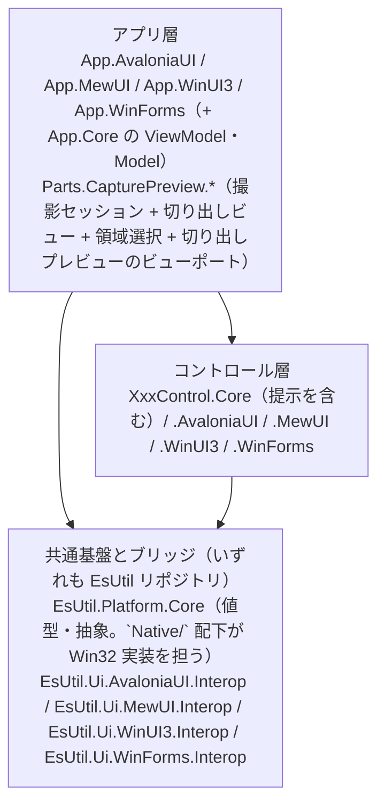
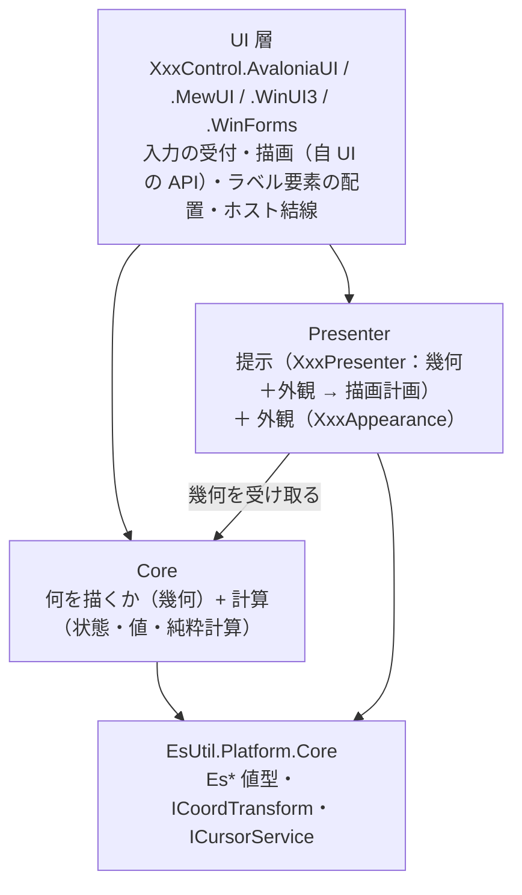

# コントロールの層構成（Core / Presenter / UI）

本リポジトリのコントロールは、**UI 非依存のコアを複数の UI（Avalonia / MewUI / WinUI 3 / WinForms）で共有する**ために層を分けています。
本ドキュメントは「層の依存の向き」と「どこに何を置くか」の単一の説明です。 各層の中身は各プロジェクトの `README.md` / `SPEC_*.md` を参照してください。

## 1. 全体の階層

依存は常に上から下への一方向です。

## 2. コントロール層の 3 層

**Core（何を描くか・判断・計算） / Presenter（提示＝描画計画と外観） / UI（フレームワーク固有の描画と配線）** の 3 層です。 UI 層が Presenter と Core の両方を参照し、**Presenter はコアの計算結果を使って描画計画を組み立てる**向きに依存します（コアは Presenter を参照しません）。

**Core は Presenter を参照しません**（描画 API も描画の抽象も知りません）。
**Presenter はコントロール化を前提としません**（ホイール操作・ビューポート連携・再描画のスケジューリングなど、組み込み先があるときにだけ必要な規則を持ちません）。

| 層 | 置くもの | 置かないもの | 依存先 | Loupe の例 |
| --- | --- | --- | --- | --- |
| **Core** | 「何を描くか」の判断・状態・設定の既定値と補正・純粋計算・**描画の幾何（切り出し領域・描画面）**・**コアが出力するログ定義** | 色・フォントサイズ・表示可否・UI フレームワークの型・**描画 API と描画の抽象**・コントロール化を前提とした処理（組み込み先の概念） | `EsUtil.Platform.Core` | `LoupeCore`（`ResolveLayout` / `ResolveGeometry`）/ `LoupeGeometry` / `LoupeOptions` / `LoupeLayout` |
| **Presenter** | **提示（`XxxPresenter`：幾何＋外観 → 描画計画（層の順序・装飾矩形・文言・配置））**・**外観（`XxxAppearance`：色・フォント・角丸・枠線の太さ・表示可否）**・**テキストを要素に写す配置計算（`XxxLabelPlan`）**・**本層が所有する設定の変更ログ** | コア単体でも成立する計算（選択・表示レイアウト）・UI フレームワークの型・**描画 API の抽象**・**コントロール化を前提とした処理**（入力の解釈・ビューポート連携・組み込み先の概念） | `Core` / `EsUtil.Platform.Core` | `LoupePresenter` / `LoupeAppearance` / `LoupeDrawPlan` / `LoupeDrawLayer` / `LoupePresenter`（`DrawPlan` partial） / `LoupePresenter`（`LabelPlan` partial） |
| **UI** | 入力イベントの受付とコア型への変換・効果の適用・通知の公開イベントへの転送・**描画（自 UI の描画 API で描画計画を描く）**・ラベル要素の配置・**コントロール化を前提とした処理（ホイール操作・ビューポート連携）**・**本 UI が出力するログ定義** | 判断・計算・既定値（コアが単一所有する）・層の順序（Presenter がデータとして単一所有する） | `Core` / `Presenter` / `Platform.*`（単独配布する `EsUtil.Feature.*.Control*` は `Platform.*` を参照せず、使う変換・描画ヘルパーを `Internal/` へ複製する。 [`../.github/依存関係.md`](../.github/依存関係.md) §4.1） | `LoupeControl` / `LoupeContextPainter` / `LoupeSkiaPainter` |

## 3. どこに置くかを決める 3 つの問い

1. **単体でそのコントロールを使っても存在する概念か** — する なら **Core**。 例: 選択の判断・表示レイアウト・切り出し領域の計算。
2. **描画にだけ必要で、コアの計算・判断に入らないか** — そうなら **Presenter**（色・フォント・枠線の太さ・表示可否と、それを使って描画計画を組み立てる手順）。
3. **フレームワーク固有の機構か** — そうなら **UI**（入力の受付・描画 API の呼び出し・要素の配置・UI 型への写像）。 例: `DrawingContext` / `SKCanvas` の確保、`Border` + `TextBlock` の配置、カーソル型の写像。

> **「1 が成立するなら 1 が優先」**（Core に置けるものは Core に置く。 描画にだけ必要な設定と描画計画の解決だけが Presenter に残る）。
> **コントロール化を前提とした処理は UI へ置く**（ホイール操作・ビューポートの変化の追従・入力の解釈は、コントロールを何かへ組み込んで初めて必要になる）。

UI 層に残すのは「フレームワーク固有の型を使うもの」と「コントロール化を前提とした処理」です（入力の受付・効果の適用・通知の転送・描画・要素の配置・境界の 1 行変換・ホイール操作）。

## 4. 「何を描くか（幾何）は Core・どう見せるか（描画計画と外観）は Presenter・どう描くかは UI」

もっとも紛らわしい点です。 **Core は色もフォントサイズも描画 API も描画の抽象も持ちません**（描画にだけ必要なものであり、Core の計算・判断に入らないため）。 **Core が持つのは描画の幾何**（切り出し領域・描画面）です。 **その幾何と外観から描画計画（層の順序・装飾矩形・文言・配置）を組み立てるのが Presenter の `XxxPresenter`** であり、**実際に描くのは各 UI が自 UI の描画 API で行います**（`XxxContextPainter` / `XxxSkiaPainter`）。

**描画 API の抽象（キャンバスの抽象）は持ちません**。 UI フレームワークごとの描画モデル（即時描画 / リテインド / 描画プリミティブの違い）は抽象に集約しきれず、対象 UI が増えるたびに抽象が肥大するためです。 Presenter は**描画計画というデータ**を返し、UI がそれを自前の API で写します。

**テキスト（ラベル）は Presenter が文言・基準点・配置まで解決し、UI 層が扱いを決めます**。 **テキスト要素（`TextBlock` 等）として置くか canvas へ描くかは UI 層の判断**です。 Presenter は値（`XxxLabelPlacement`）を渡し、UI は要素として置くか文字として描くかを選びます（要素は親の描画より後に描かれるため常に最上位になります）。

| 何 | どこ | 理由 |
| --- | --- | --- |
| 描画の幾何（切り出し領域・描画面） | **Core** | 単体のルーペでも成立する計算である（描画面のサイズ・切り出し領域は選択に依存しない） |
| 描画計画（層の順序・装飾矩形・文言・配置）と外観（色・フォント・枠線の太さ・表示可否） | **Presenter** | 描画にだけ必要な設定・規則であり、コアの計算・判断に入らない。 コアに置くと色・フォントをコアへ持ち込むことになる |
| テキストを要素に写す配置計算（`XxxLabelPlan`） | **Presenter** | 実寸（描画 API 依存）から配置矩形を求める。 体裁値（内側余白・フォントサイズ・色・角丸）の所有も Presenter（`XxxAppearance`）である。 **UI 層が要素として置くか画像として描くかの選択は各 UI に残る** |
| 実際の描画（描画 API の呼び出し） | **UI** | 描画 API は UI フレームワーク固有であり、抽象で吸収しきれない |
| 描画面の確保（`DrawingContext` / `SKCanvas` / 中間ビットマップ） | **UI** | フレームワーク固有の機構（中間ビットマップの有無・描画コールバック）である |
| 注入・配線 | **UI** | コントロールの公開プロパティ（`Options` / `Appearance`）と入力イベントの配線はフレームワーク固有である |

**帰属の規則**: **計算（幾何・判断・状態）は Core、描画計画と外観（色・フォント・枠線の太さ・表示可否）は Presenter、描画 API の呼び出しと配線（コントロール化を前提とした処理を含む）は UI** です。 色とフォントをコアの設定値へ入れないのは、「何を描くか」の判断に使われないためです（描画の可否は色のアルファではなく外観の明示フラグが決めます）。

**描画計画のまとめ型**: 描画計画（`XxxDrawPlan`）は「フレーム 1 枚分」のまとめ型であり、Presenter から UI へ渡す唯一の描画契約です。 項目が複数の値を 1 つの概念としてまとめる場合にだけ専用型を作ります（単一のコレクションで足りる項目に型を作りません）。

アセンブリ参照の向きは `UI → 提示層（Presenter）→ Core` です（提示層は Core の幾何（`XxxGeometry`）を使う）。 **逆向きの参照はありません**（Core は提示層もブリッジ（`EsUtil.Ui.*.Interop`）も参照しない）。 `EsUtil` 側では提示層がコアと同じアセンブリ（`EsUtil.Feature.<機能>.Core`）に入っており、層の分離は**フォルダと名前空間**（`src/Core/` / `src/Presenter/`）だけが担います（コアから提示層への参照は禁止のままです）。

**コントロールを差し替えるには**: 描画計画の構成を変える場合は `XxxPresenter` を継承して `ResolveDrawPlan` を上書きする（または `XxxPresenterXxx` を作る）。 見た目だけを変える場合は外観（`XxxAppearance`）を差し替える。 コアの公開 API だけで描画計画を組み立てられるため、`XxxPresenter` を使わない独自実装も可能です。

## 5. コントロールごとの層

| コントロール | Core | Presenter（提示。 Core と同一アセンブリ） | UI |
| --- | --- | --- | --- |
| `MarqueeControl` | あり | あり（提示 + 外観。 `EsUtil.Feature.Marquee.Core` に同梱） | AvaloniaUI / MewUI / WinUI3 / WinForms |
| `LoupeControl` | あり | あり（提示 + 外観。 `EsUtil.Feature.Loupe.Core` に同梱） | AvaloniaUI / MewUI / WinUI3 / WinForms |
| `ZoomViewControl` | あり（`Parts.CapturePreview.Core`） | なし（UI 層が描く） | `CapturePreview.*` に収録 |
| `CropViewControl` | あり（`Parts.CapturePreview.Core`） | なし | AvaloniaUI / MewUI / WinUI3 / WinForms |
| `CaptureSessionControl` | あり | あり（設定 → 色の写像のみ。 描画手順は持たない） | AvaloniaUI / MewUI / WinUI3 / WinForms |
| `SelectionOverlayControl` | あり | あり（値の解決 ＋ 付加情報ラベルの体裁。 内包する Marquee / Loupe の Presenter を再利用する） | AvaloniaUI / MewUI / WinUI3 / WinForms |
| `ThumbnailControl` | あり（`EsUtil.Feature.Thumbnail.Core`） | あり（`EsUtil.Feature.Thumbnail.Core` に同梱。 提示 + 外観 + 影） | AvaloniaUI / WinForms（EsUtil のコントロール） |
| `AnnotationLayerControl` | あり（`Feature.Annotation.Core` の `Core/`） | あり（同じアセンブリの `Presenter/`。 描画計画・外観・書式バーの寸法・代表色・選択の解決） | AvaloniaUI / MewUI / WinUI3 / WinForms |

**プレビューへ重ねる注釈レイヤーは、プレビュー領域の入力を単一所有します**: 注釈の無い場所の操作（パン・ズーム・ホバー・ダブルクリック・右クリック）は注釈レイヤーが受け取り、`PreviewGestureRequested` / `AddMenuRequested` でホストへ渡します（ホストがプレビューへ転送する）。 **入力を「注釈の上か」で要素ごとに切り替えてはいけません**（切り替えた側が次の押下を受け取れず、選択の解除・再選択・移動ができなくなります。 実測 2026-11-20）。 座標変換は `PreviewImageRect`（プレビュー内の画像の表示矩形）だけを使い、自前で Fit を計算しません（ズーム・パンで注釈がずれます）。

**折り返すツール バーの幅は、余白を二重に引かず、レイアウトの後に決めます**: ファイル名テンプレートのような「中身に合わせて幅が変わる」項目を持つ `WrapPanel` は、次の 3 点を守らないと初期表示で 2 段になります（実測 2026-11-22: MewUI 版）。 ①ツール バーの右余白がシステム ボタンの領域を確保しているため、**さらに安全余白を引かない**（引くと最小幅でも収まらず必ず折り返す）。 ②余地が最小幅より狭いときは**最小幅を諦める**（最小幅を守ると合計が余地を超える）。 ③`SizeChanged` の中で幅を変えると**無効化が捨てられる**ため、幅の決定はレイアウトの後（ディスパッチャ）へ回す。 併せて **`MinWidth` を計算値より優先させない**（`MinWidth` が計算を上書きし、縮められなくなります）。

**注釈の座標は画像の外へ出しません（Core が強制します）**: 矩形としっぽの先端は `AnnotationGeometry`（`ClampRect` / `ClampTailTip`）が画像の内側へ収め、**変更の入口は `AnnotationDocument.SetBounds` / `SetTailTip` / `SetTail` と生成メソッド（`CreateFrame` / `CreateBubble`）だけ**です（`AnnotationItem.Bounds` / `BubbleAnnotation.Tail` の設定子は Core の内部に閉じてあるため、UI からは書き換えられません＝コンパイルで強制されます）。 画像の外へ出た注釈は表示されず掴めない（移動できない・しっぽを掴めない）ため、追加・移動・サイズ変更・しっぽの移動のすべてがこの規則を通ります。 しっぽの先端は画像の端から 10 px 内側へ収めます（ハンドルが切られて掴めなくなるため）。 描画の入口（`AnnotationPresenter`）でも同じ規則を適用するため、読み込んだファイルの値が外に出ていても画像の外には描かれません。 **画像の外の右クリックは追加メニューを出しません**（`AnnotationGeometry.Contains`。判定を UI ごとに書くと座標系を取り違えて「メニューが出ない」不具合になります）。

**ポインタは隠しません（Core が強制します）**: nudge（カーソル キーによる移動）でポインタを隠すと、入力位置を見失い、ウィンドウを切り替えるまで戻らないことがあります（Win32 の `ShowCursor` はカウンタ式で、対応が崩れると復元できない）。 `Parts.CapturePreview.Core` の `NeverHideCursorService`（位置の取得・移動は委任し、**表示の切替だけ行わない**）を 4 つの UI 版のマーキーへ注入します。 **UI やコントロール側で `ShowCursor(false)` 相当を呼んではいけません**。

**画像の表示倍率と位置はコアが解決します**: ホストは「プレビュー内の画像の表示矩形」を渡すだけで、検証と倍率・位置の計算は `AnnotationImageLayout` が単一所有します。 **画像が見切れる（左上が負になる）表示矩形は正しい値です**（ズーム 100% で画像がプレビューより大きい場合）。 検証は「有限・正の大きさ・縦横比が画像と一致」だけを行い、はみ出しを理由に捨ててはいけません（捨てると実際の画像と注釈で別の倍率を使い、右上へずれます。 実測 2026-11-21）。 **押下中は座標変換を固定します**: ドラッグ中に表示矩形が更新されると倍率が変わり、注釈がカーソルからずれるためです。

**画像の表示倍率と位置はコアが解決します（続き・パネルの高さ）**: 書式バーの高さは `AnnotationPanelAppearance.FixedContentHeight`（34 DIP）で固定し、**置く位置の計算にも同じ値**を使います（`ResolvePanelHeight`）。 UI ごとに中身の希望寸法が実際の描画サイズとずれるため、実寸で位置を決めると書式バーが注釈に重なります（実測 2026-11-21）。 **書式バーの項目の並びと高さもコアが単一所有します**（`AnnotationFormatBarLayout.Order` / `AnnotationFormatBarLayout.ItemHeight`）。 UI はその順に要素を置き、同じ高さを与えて縦方向の中央へ寄せるだけにします（UI ごとに順や高さが違うと、版ごとに押す位置が変わります。 実測 2026-11-21: WinForms 版だけ並びが違い、MewUI 版と WinUI 3 版は項目の高さが揃っていませんでした）。 **高さは 32 DIP を下回らせません**: AvaloniaUI の `ComboBox` と WinUI 3 の `ToggleButton` の最小の高さが 32 DIP で、それより低いと内側の枠が切れます。 **パネルの高さも同じ値から決めます**（`AnnotationPanelAppearance.FormatBar` の `FixedContentHeight`）。。 **描画の座標系は UI ごとに確かめます**: 描画コンテキストの原点が要素の左上でない UI（MewUI は**ウィンドウの左上**）では、自分の左上（`Bounds`）を足さないと、図形とハンドルが揃ったまま画像・ヒット判定・パネルから `Bounds` だけずれます（実測 2026-11-21: 注釈が 40, 42.4 DIP 左上へ描かれ、掴めない・書式バーが被る、として現れました）。

**本文の文字位置（キャレット・選択範囲・当たり判定）はコアが単一所有します**: 行の中の文字位置と座標の対応は `AnnotationTextLineLayout`（`ResolveX` / `ResolveOffset` / `ResolveBaseline`）が決め、`AnnotationTextLineIndex` もこれを使います。 **基準は「描画に使う区間（`AnnotationTextSegmentPlan`）の原点」** です。 行頭から区間の幅を積み上げると、区間の境界・末尾の空白・丸めの分だけ描画とずれ、文字とキャレットが一致しません（実測 2026-11-21: MewUI 版と WinUI 3 版で一致しませんでした）。 文字の実寸だけを UI が測り（`MeasurePrefix`）、位置の決め方は UI が書きません。 **同じフレームでは同じレイアウト実体を使います**（作り直すと丸め・キャッシュの差で描いた文字とキャレットが食い違うため。 実測 2026-11-22）。 **文字のレイアウトは画面の DPI で測ります**: 測定を 96 DPI に固定すると、描画（画面の DPI）と 1 文字あたり約 6.7% 送りが食い違い、長い文字列ほどキャレットが文字からずれます（実測 2026-11-22: 10 文字で 7 px）。 UI は描画の直前に画面の倍率を渡します（MewUI の `AnnotationTextMetrics.DpiScale`）。 **入力範囲（枠線の太さ・角丸・本文の余白・しっぽの幅・文字の大きさ）は `AnnotationLimits` の安全域から取ります**（UI 側に範囲を書くと、入力できた値がコアで黙って補正され、画面と結果が食い違います。 実測 2026-11-22: WinUI 3 版と WinForms 版が 0.5〜64 / 0〜4096 を持っていました）。 ベースラインも同じ規則で決めます（キャレットと選択範囲が行の文字と同じベースラインに載ります）。

**注釈の Core と Presenter はフォルダと名前空間で分けます（EsUtil へ移す前提の構成）**: `Feature.Annotation.Core` アセンブリの中を `src/Core/`（名前空間 `EsUtil.Feature.Annotation.Core`）と `src/Presenter/`（`EsUtil.Feature.Annotation.Presenter`）に分けます。 **Core** は文書・注釈・書式・幾何・履歴・当たり判定・画像の倍率（何を描くかと判断）、**Presenter** は描画計画（`AnnotationPresenter` / `AnnotationShapePlan` / `AnnotationTextLinePlan`）・外観（`AnnotationAppearance` / `AnnotationPanelAppearance`）・パネルの配置と操作（`AnnotationPanelController` / `AnnotationPanelPlacement`）・書式バーの並びと寸法（`AnnotationFormatBarLayout`）・代表色の定義（`AnnotationPaletteCatalog`）・フォントの並べ方（`AnnotationFontCatalog`）・選択の解決と適用（`AnnotationSelectionPresenter`）を持ちます。 **色・フォント・寸法・文面は UI に書きません**（UI は自分の描画 API への写像と、フレームワーク固有の列挙だけを行います）。 以前は代表色 40 色・フォントの並べ方・書式バーの幅が 4 つの UI 版に重複しており、版ごとに値が変わる危険がありました（実測 2026-11-22）。

**注釈の編集 UI の寸法と「フライアウトが扱う値」もコアが単一所有します**: 項目名の幅・色の入力の幅・装飾ボタンの幅・行の間隔・文字サイズは `AnnotationEditorLayout`（Presenter）が持ち、UI は自分の単位へ写すだけにします。 右クリックのフライアウトが扱う値（外観・本文の余白・しっぽの幅・しっぽの辺）は**コントロールのプロパティとして取得・設定でき**（`SelectedAppearance` / `SelectedBodyPadding` / `SelectedTailWidth` / `SelectedTailBaseEdge`）、値の解決は `AnnotationSelectionPresenter` が行います。 重なり順は値ではなく操作のため、`MoveSelectedToFront` / `MoveSelectedToBack` として 4 つの UI 版が同じ名前で公開します。 **押下の有無の判定（ドラッグの継続）も 4 つの UI 版で同じ規則**にします（押していない移動では動かさない。 取りこぼしで「押していないのにドラッグ中」が残ると、ホバーだけで枠線や注釈が動きます。 実測 2026-11-22）。

**本文を選んでいないときの書式変更は「以降の入力」へ回します（コアが単一所有します）**: 書式バーは**文字を選んでいなくても操作でき**、選んだ書式は**既存の文字を変えず**、次に入力する文字へだけ適用します（規則は Core の `AnnotationTextStyleEdit.ResolveRange` / `Insert`、保留の保持は Presenter の `AnnotationTypingStyle`。 `Ctrl+B` などの切り替えも同じ経路を通します）。 **UI 側で「選択が無ければ何もしない」と書いてはいけません**: 以前は各 UI 版が書式バーの項目を無効にしており、書式を変えられないうえ、`Ctrl+B` は本文全体へ適用されていました（実測 2026-11-22）。 表示（書式バーの値と押下状態）も**保留した書式**で行います（本文が変わらないため、そのままキャレットの書式を出すと操作が効いていないように見えます）。

**入力欄の下地は「有効時の入力欄の色」で塗ります**: MewUI の `ComboBox` は既定の下地が灰色（実測 2026-11-22: `#E8E8E8`）で、白い数値の入力と並ぶと**無効に見えます**。 注釈の編集 UI は `ComboBox` を有効時の入力欄の色（`Palette.ControlBackground`）で塗り、数値の入力と同じ見た目に揃えます（色の選択は内部の `ComboBox` を公開していないため、含まれる `ComboBox` をまとめて塗ります）。

**注釈のフローティング パネル（書式バー・右クリックの外観フライアウト）の規則はコアが単一所有します**: 出す位置・置ける領域への収め方・ドラッグでの移動・外側のクリックで閉じる規則・見た目（枠・余白・幅・下地）は `AnnotationPanelController` / `AnnotationPanelPlacement` / `AnnotationPanelAppearance` が持ちます。 **UI 層は `IAnnotationPanelHost`（アプリの画面への追加・移動・破棄と、置ける領域・パネルの実寸の報告）だけを実装します**。 UI ごとに「アプリの内側へ収める」「ポインタが外れたら閉じる」「独自の枠や余白を足す」と書くと、版ごとに見た目と動作が食い違います（実測 2026-11-20: 4 つの UI 版で枠が二重になったり、書式バーの幅が足りなくなったりした）。 **パネルは独立したウィンドウにせず、アプリの画面の最上位へ重ねます**（ウィンドウはタスク バーへ出る・アプリの後ろへ回る・フォーカスを奪うため）。 **全面を覆う `Canvas` を挟んではいけません**（パネルの外側の押下を吸ってしまい、注釈も書式バーも操作できなくなります。 実測 2026-11-21）。 位置は重ねた先の左上を原点とする余白（`Margin`）か `Canvas.SetLeft` で与えます。 **位置は「注釈の矩形」を基準に決め、レイアウト後の実寸で置き直します**（本文の矩形を基準にすると枠線の上へ数ピクセル重なり、レイアウト前の測定は高さを正しく返さないことがあります。 実測 2026-11-22）。 **書式バーと注釈の間の余白はコア（`AnnotationPanelMetrics.FormatBarGap`）が単一所有します**: UI ごとに実寸と描画サイズがずれるため、UI 側で余白を決めると重なります。
`CropViewControl` と `SelectionOverlayControl` は `Parts.CapturePreview.ControlAvaloniaUI` / `Parts.CapturePreview.ControlMewUI` / `Parts.CapturePreview.ControlWinUI3` / `Parts.CapturePreview.ControlWinForms` が公開する複合コントロールです（独立したプロジェクトではありません。 撮影セッションの Facade と同じアセンブリに収録されます）。 `ZoomViewControl` も同じアセンブリに収録され、`CropViewControl` が内包する画像ビューポートです（ZoomView の UI 層も独立したプロジェクトではありません。 ズーム・パンの状態と判断は UI 非依存コアの `Parts.CapturePreview.Core` が単一所有します）。

**コントロール化を前提とした処理は UI が持ちます**: ホイール操作（どの入力がズーム・パンかを決める）・ビューポートの変化の追従・組み込み先の概念は、コントロールを何かへ組み込んで初めて必要になるためです。
`LoupeControl` の中間ビットマップの再描画スケジューリング（`LoupeRenderCoordinator`。 Avalonia 版が所有する）を MewUI が使わないのは、**MewUI が中間ビットマップを持たず同期描画するため**です（再描画のスケジューリングが不要）。 同じ必要が生じた時点で実装できます。

`Parts.CapturePreview.Core` は**撮影スタックの UI 非依存層**です。 撮影・切り出し・画像ビューポート・領域選択の規則に加え、製品の設定型（`CaptureSettings`）と提示層の外観（`MarqueeAppearance` / `LoupeAppearance`）を橋渡しする写像（`Presentation/`。 `CapturePaintMapper` / `SelectionOverlayChildValues` / 付加情報ラベルの配置指示）を持ちます。 写像は**製品の設定型と提示層の外観型の両方を参照できる唯一の層**（両 UI から参照できる UI 非依存層）に置くことで、UI ごとに写像が分かれて**片方だけ漏れる事態**を防ぎます（詳細は [`Parts.CapturePreview.Core`](Parts.CapturePreview.Core/README.md)）。

`LineDetection` は画像処理ライブラリであり、本 3 層には含めません（`EsUtil.Platform.Core` のみに依存します）。

## 6. 各層のドキュメント

| コントロール | Core（提示を含む） |
| --- | --- |
| Marquee | [`EsUtil.Feature.Marquee.Core`](../../EsUtil/EsUtil/Feature.Marquee.Core/README.md) |
| Loupe | [`EsUtil.Feature.Loupe.Core`](../../EsUtil/EsUtil/Feature.Loupe.Core/README.md) |
| CaptureOverlaySession | [`Parts.CapturePreview.Core`](Parts.CapturePreview.Core/README.md)（`Presentation/`） |
| CropView | [`Parts.CapturePreview.Core`](Parts.CapturePreview.Core/README.md) |
| ZoomView | [`Parts.CapturePreview.Core`](Parts.CapturePreview.Core/README.md)（UI 層が描く。 `CropViewControl` が内包） |
| SelectionOverlay | [`Parts.CapturePreview.Core`](Parts.CapturePreview.Core/README.md)（`Presentation/`） |

SelectionOverlay は複合コントロールであり、内包する Marquee / Loupe の層も参照します（[`EsUtil.Feature.Marquee.Core`](../../EsUtil/EsUtil/Feature.Marquee.Core/README.md) / [`EsUtil.Feature.Loupe.Core`](../../EsUtil/EsUtil/Feature.Loupe.Core/README.md)）。

UI 層は [`EsUtil.Ui.AvaloniaUI.Marquee`](../../EsUtil/EsUtil.Ui.AvaloniaUI/Marquee/README.md) / [`EsUtil.Ui.MewUI.Marquee`](../../EsUtil/EsUtil.Ui.MewUI/Marquee/README.md) / [`EsUtil.Ui.WinUI3.Marquee`](../../EsUtil/EsUtil.Ui.WinUI3/Marquee/README.md) / [`EsUtil.Ui.WinForms.Marquee`](../../EsUtil/EsUtil.Ui.WinForms/Marquee/README.md) /
[`EsUtil.Ui.AvaloniaUI.Loupe`](../../EsUtil/EsUtil.Ui.AvaloniaUI/Loupe/README.md) / [`EsUtil.Ui.MewUI.Loupe`](../../EsUtil/EsUtil.Ui.MewUI/Loupe/README.md) / [`EsUtil.Ui.WinUI3.Loupe`](../../EsUtil/EsUtil.Ui.WinUI3/Loupe/README.md) / [`EsUtil.Ui.WinForms.Loupe`](../../EsUtil/EsUtil.Ui.WinForms/Loupe/README.md)、
共通基盤とブリッジは [`EsUtil.Platform.Core`](../../EsUtil/EsUtil/Platform.Core/README.md) / [`EsUtil.Ui.AvaloniaUI.Interop`](../../EsUtil/EsUtil.Ui.AvaloniaUI/Interop/README.md) / [`EsUtil.Ui.MewUI.Interop`](../../EsUtil/EsUtil.Ui.MewUI/Interop/README.md) / [`EsUtil.Ui.WinUI3.Interop`](../../EsUtil/EsUtil.Ui.WinUI3/Interop/README.md) / [`EsUtil.Ui.WinForms.Interop`](../../EsUtil/EsUtil.Ui.WinForms/Interop/README.md) を参照してください。

## 7. 名前空間とフォルダ

名前空間とフォルダの対応表・`Control` を除く短縮名の制約（CS0118）・アセンブリ名の規則は [`.github/命名規約.md`](../.github/命名規約.md) が単一所有します。 本ドキュメントは層の帰属（Core / Presenter / UI のどれに置くか）だけを扱います。
