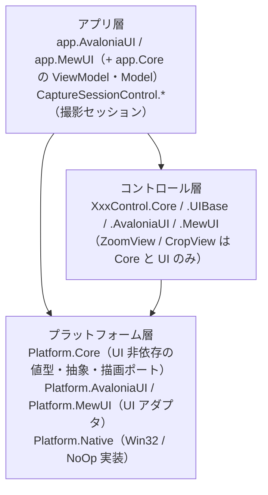
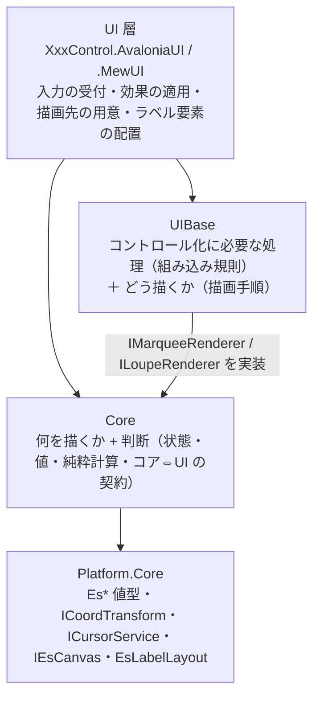

# コントロールの層構成（Core / UIBase / UI）

本リポジトリのコントロールは、**UI 非依存のコアを複数の UI（Avalonia / MewUI）で共有する**ために層を分けています。
本ドキュメントは「層の依存の向き」と「どこに何を置くか」の単一の説明です。各層の中身は各プロジェクトの `README.md` / `SPEC_*.md` を参照してください。

## 1. 全体の階層

依存は常に上から下への一方向です（逆参照・双方向依存はありません）。

## 2. コントロール層の 3 層

**Core（何を描くか・判断） / UIBase（コントロール化に必要な処理＋どう描くか） / UI（フレームワーク固有）** の 3 層です。UI 層が UIBase と Core の両方を参照し、**UIBase はコアの契約を実装する**向きに依存します（コアは UIBase を参照しません）。

UIBase は `Platform.Core` も参照します（描画ポート・実寸測定）。Core は UIBase を参照しません。

| 層 | 置くもの | 置かないもの | 依存先 | Marquee の例 |
| --- | --- | --- | --- | --- |
| **Core** | 「何を描くか」の判断・状態・設定の既定値と補正・純粋計算・コア⇔UI の契約・ログ定義 | 描画 API の呼び出し・UI フレームワークの型・組み込み先の概念 | `Platform.Core` | `Marquee`（ファサード）/ `MarqueeSession` / `MarqueeFrame` / `MarqueeOptions` / `IMarqueeRenderer`（契約） |
| **UIBase** | コントロール化に必要な処理（組み込み規則）と描画手順（層の順序に従った描画 API の呼び出し）・描画にだけ必要な色（`MarqueePaint` / `LoupePaint`）・層をまたぐ設定の写像（設定 → 子の値、設定 → 色。両 UI で共有する） | コア単体でも成立する判断（選択・表示レイアウト）・UI フレームワークの型 | `Core` / `Platform.Core` | `MarqueeRenderer` / `MarqueePaint` / `MarqueeLabelPlan` / `MarqueeWheelInterpreter` / `CapturePaintMapper` / `FadeMaskHostLabelRenderer` |
| **UI** | 入力イベントの受付とコア型への変換・効果の適用・通知の公開イベントへの転送・描画先の用意・ラベル要素の配置 | 判断・計算・既定値（コアが単一所有する）・複数 UI で共有できる手順 | `Core` / `UIBase` / `Platform.*` | `MarqueeControl` / `Effects` / `AvaloniaCanvas` の適合 |

**UIBase の中の 2 つの関心事**: 実装上は同じアセンブリに置きますが、帰属の基準は別です。

| 関心事 | 内容 | 判定 |
| --- | --- | --- |
| **組み込み規則** | 組み込み先（ビューポート等）がある場合にだけ必要な規則（ホイール解釈・ビューポート変化の再通知・再描画のスケジューリング） | 単体でそのコントロールを使っても存在する概念か |
| **描画手順** | 「どう描くか」（層の順序に従った描画ポートの呼び出しと、実寸 → 要素の写像） | 描画 API の呼び出し手順か |

## 3. どこに置くかを決める 3 つの問い

1. **単体でそのコントロールを使っても存在する概念か** — しない（組み込み先があって初めて問題になる）なら **UIBase（組み込み規則）**。
   例: 「Ctrl+ホイール = ズーム」「ビューポート変化の再通知」「1 フレーム 1 回への再描画のバッチ化」。
2. **描画 API の呼び出し手順か** — そうなら **UIBase（描画手順）**。
   例: 層の順序に従った描画ポート（`IEsCanvas`）の呼び出し、実寸からラベル要素への写像。
3. **それ以外** — **Core**。判断・状態・設定の既定値と補正・純粋計算・コア⇔UI の契約・ログ定義。

> **1 が成立するなら 1 が優先**（組み込み規則は単体のコントロールには存在しない概念であり、コアから分離しておくとコアをそのまま独立できる）。

UI 層に残すのは「フレームワーク固有の型を使うもの」だけです（入力の受付・効果の適用・通知の転送・描画先の用意・要素の配置・境界の 1 行変換）。

## 4. 「契約は Core・既定実装は UIBase・注入は UI」

もっとも紛らわしい点です。**コアは描画手順を参照しません**（コアは UIBase を参照できない）が、描画の**契約**はコアが持ちます。

| 何 | どこ | 理由 |
| --- | --- | --- |
| 描画の契約（`IMarqueeRenderer` / `ILoupeRenderer`） | **Core** | コアが「何を描くか（渡す値）」を決めるため。UI 層が描画を差し替える入口もここにある |
| 描画にだけ必要な色（`MarqueePaint` / `LoupePaint`） | **UIBase** | 色はコアの計算・判断に入らない（描画の可否は寸法・表示可否としてコアの明示フラグが持つ）ため、描画手順と同じ層が単一所有する |
| 既定実装（`MarqueeRenderer` / `LoupeRenderer`） | **UIBase** | 描画 API の呼び出し手順は UI 非依存だが、コアの一部ではない（コアは UIBase を参照できない）。色はインスタンスの状態として受け取る |
| 注入 | **UI** | `new MarqueeRenderer(paint)` を 1 回生成して注入し、コントロールの `Paint` プロパティ（`MarqueePaint` / `LoupePaint`）と併せて設定する。差し替える場合は `Renderer` プロパティへ別実装を設定する |

**帰属の規則**: **寸法・表示可否・判断は Core、色と描画手順は UIBase、配線は UI** です。色をコアの設定値へ入れないのは、色が「何を描くか」の判断に使われないためです（描画の可否は色のアルファではなくコアの明示フラグが決めます）。

アセンブリ参照の向きは `UI → UIBase → Core` です（`UIBase` は Core の契約を実装するので Core を参照する）。**逆向きの参照はありません**。

**UI 層に `XxxRenderer` の派生を作らない理由**: フレームワーク差は既に描画ポート（`IEsCanvas`）が 1 回だけ抽象化しています（描画手順は `IEsCanvas` を呼ぶだけで UI 非依存）。さらに `~UI` で描画手順を継承実装すると**同じ可変性を 2 つの機構で扱う**ことになり、UI 初期化なしの画素検証（`SkiaEsCanvas`）も二重化します。`~UI` が担うフレームワーク固有の描画は `AvaloniaCanvas` / `SkiaEsCanvas` のアダプタだけです。

## 5. コントロールごとの層

| コントロール | Core | UIBase | UI |
| --- | --- | --- | --- |
| `MarqueeControl` | あり | あり（描画手順 + 組み込み規則） | AvaloniaUI / MewUI |
| `LoupeControl` | あり | あり（描画手順 + 組み込み規則。組み込み規則は AvaloniaUI のみが使う） | AvaloniaUI / MewUI |
| `ZoomViewControl` | あり | なし（UI 層が描く） | AvaloniaUI / MewUI |
| `CropViewControl` | あり | なし | AvaloniaUI / MewUI |
| `CaptureSessionControl` | あり | あり（設定 → 色の写像のみ。描画手順は持たない） | AvaloniaUI / MewUI |
| `FadeMaskDragRectControl` | あり | あり（値の解決 ＋ 付加情報ラベルの描画。内部する Marquee / Loupe の UIBase を再利用する） | AvaloniaUI / MewUI |
| `ColorPickerControl` | なし（UI のみ） | なし | AvaloniaUI |

`LoupeControl` の組み込み規則（`LoupeRenderCoordinator`）を MewUI が使わないのは、**MewUI が中間ビットマップを持たず同期描画するため**です（再描画のスケジューリングが不要）。同じ必要が生じた時点で注入できます。

`CaptureSessionControl.UIBase` は**描画手順を持たない例外的な UIBase** です（設定 → 色の写像だけを持ちます）。写像元がセッションの設定型（`CaptureSettings`）、写像先が描画層の色（`MarqueePaint` / `LoupePaint`）という**2 つの層にまたがる**ため、コアにも（Core → UIBase の逆流になる）再利用ライブラリにも置けません。両 UI のホストが同じ写像を使うことを保証するために本層を置いています（詳細は [`CaptureSessionControl.UIBase`](CaptureSessionControl.UIBase/README.md)）。

`LineDetection` は画像処理ライブラリであり、本 3 層には含めません（`Platform.Core` のみに依存します）。

## 6. 各層のドキュメント

| コントロール | Core | UIBase |
| --- | --- | --- |
| Marquee | [`Feature.MarqueeCore`](Feature.MarqueeCore/README.md) | [`MarqueeControl.UIBase`](MarqueeControl.UIBase/README.md) |
| Loupe | [`Feature.LoupeCore`](Feature.LoupeCore/README.md) | [`LoupeControl.UIBase`](LoupeControl.UIBase/README.md) |
| CaptureSession | [`CaptureSessionControl.Core`](CaptureSessionControl.Core/README.md) | [`CaptureSessionControl.UIBase`](CaptureSessionControl.UIBase/README.md) |
| FadeMaskDragRect | [`FadeMaskDragRectControl.Core`](FadeMaskDragRectControl.Core/README.md) | [`FadeMaskDragRectControl.UIBase`](FadeMaskDragRectControl.UIBase/README.md) |

FadeMaskDragRect は複合コントロールであり、内包する Marquee / Loupe の層も参照します（[`MarqueeControl.UIBase`](MarqueeControl.UIBase/README.md) / [`LoupeControl.UIBase`](LoupeControl.UIBase/README.md)）。

UI 層は [`MarqueeControl.AvaloniaUI`](MarqueeControl.AvaloniaUI/README.md) / [`MarqueeControl.MewUI`](MarqueeControl.MewUI/README.md) / [`LoupeControl.AvaloniaUI`](LoupeControl.AvaloniaUI/README.md) / [`LoupeControl.MewUI`](LoupeControl.MewUI/README.md)、
プラットフォーム層は [`Platform.Core`](Platform.Core/README.md) / [`Platform.AvaloniaUI`](Platform.AvaloniaUI/README.md) / [`Platform.MewUI`](Platform.MewUI/README.md) / [`Platform.Native`](Platform.Native/README.md) を参照してください。

## 7. 名前空間とフォルダの対応

| 種別 | フォルダ | 名前空間 |
| --- | --- | --- |
| プラットフォーム層 | `Platform.Core` / `.Native` / `.AvaloniaUI` / `.MewUI` | `EsUtil.Platform.Core` / `.Native` / `.AvaloniaUI` / `.MewUI` |
| 可搬コア（機能単位） | `Feature.MarqueeCore` / `Feature.LoupeCore` | `EsUtil.Feature.MarqueeCore`（幾何 `.Selection` / 装飾 `.Decoration`） / `EsUtil.Feature.LoupeCore`（`.Imaging`） |
| 製品側のコントロール | `MarqueeControl.UIBase` 等 | `EsUtil.SaveEvidence.Marquee.UIBase` 等 |
| アプリ | `app.Core` / `app.AvaloniaUI` / `app.MewUI` | `EsUtil.SaveEvidence`（Core と AvaloniaUI が共有） / `EsUtil.SaveEvidence.MewUI` |

**コントロール系の名前空間は、フォルダ名から `Control` を除いた短縮名を使います**（例: `MarqueeControl.AvaloniaUI` → `EsUtil.SaveEvidence.Marquee.AvaloniaUI`）。これは好みではなく制約です。

- 名前空間のセグメントと型名が一致すると **CS0118**（名前空間を種類として使用）になります。C# の名前解決は「外側の名前空間のメンバー（名前空間を含む）」を、`namespace` 宣言より前に書いた `using` より優先するためです。実測では `MarqueeControl` / `LoupeControl` / `ZoomViewControl` / `CropViewControl` / `ColorPickerControl` / `FadeMaskDragRectControl` / `CaptureSessionControl` の 7 型が該当します（フォルダ名をそのまま使うと、他の名前空間からこれらの型を単純名で参照できません）。
- 短縮名にしても `Marquee` / `Loupe`（コアのファサード型）だけはセグメントと一致するため、UI 側は**別名 `using`**（`using MarqueeFacade = EsUtil.Feature.MarqueeCore.Marquee;` / `LoupeFacade` も同様）で参照します。
- コアの名前空間は可搬性の単位（`EsUtil.Feature.*`）、製品側は `EsUtil.SaveEvidence.*` に置きます。`EsUtil.Platform.*` は外部パッケージに依存しない値型・抽象・描画ポートです。
