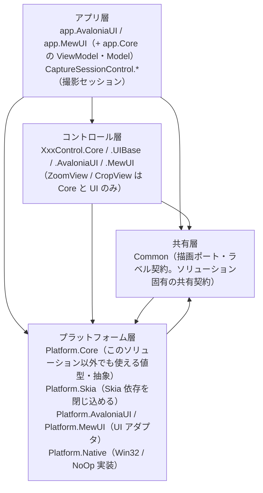
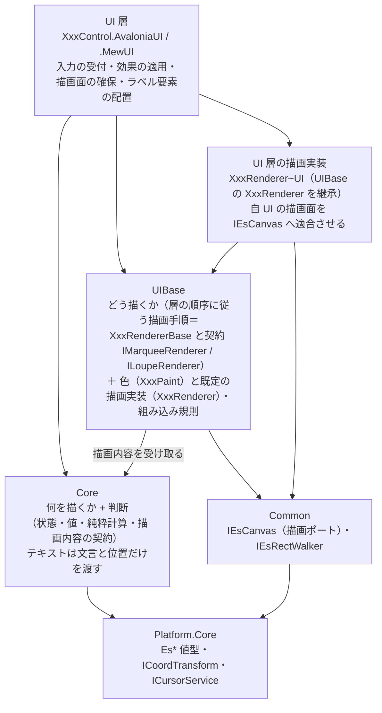

# コントロールの層構成（Core / UIBase / UI）

本リポジトリのコントロールは、**UI 非依存のコアを複数の UI（Avalonia / MewUI）で共有する**ために層を分けています。
本ドキュメントは「層の依存の向き」と「どこに何を置くか」の単一の説明です。各層の中身は各プロジェクトの `README.md` / `SPEC_*.md` を参照してください。

## 1. 全体の階層

依存は常に上から下への一方向です（`Common` と `Platform.*` は相互に参照しません。`Platform.Core` は `Common` を参照しません）。

## 2. コントロール層の 3 層

**Core（何を描くか・判断・描画の起動と順序） / UIBase（コントロール化に必要な処理＋色と既定実装） / UI（フレームワーク固有）** の 3 層です。UI 層が UIBase と Core の両方を参照し、**UIBase はコアの契約を実装する**向きに依存します（コアは UIBase を参照しません）。

UIBase は `Platform.Core` も参照します（描画ポートの適合と実寸測定）。**Core は `Common` も UIBase も参照しません**（描画 API も描画ポートも知らない）。

| 層 | 置くもの | 置かないもの | 依存先 | Marquee の例 |
| --- | --- | --- | --- | --- |
| **Core** | 「何を描くか」の判断・状態・設定の既定値と補正・純粋計算・コア⇔UI の契約・**描画内容の解決（層の順序・矩形）**・**テキストの文言と位置（Text と基準点）**・**コアが出力するログ定義** | 色・フォントサイズ・UI フレームワークの型・組み込み先の概念・**描画 API と描画ポート**・UI が出力するログ定義 | `Platform.Core` | `Marquee`（ファサード + `Marquee.DrawContent.cs` の `CreateRequest` / `ResolveContent`）/ `MarqueeDrawContent` / `MarqueeDrawLayer` / `MarqueeTextPlacement` / `MarqueeOptions` |
| **UIBase** | コントロール化に必要な処理（組み込み規則）・**描画手順（層の順序に従う写し方＝`XxxRendererBase` とその契約）**・**色（`MarqueePaint` / `LoupePaint`）と既定の描画実装**・**テキストを要素に写す配置計算（`MarqueeLabelPlan` / `LoupeLabelPlan`）**・層をまたぐ設定の写像（設定 → 子の値、設定 → 色。両 UI で共有する）・**UI が出力するログ定義とログの値の書式** | コア単体でも成立する判断（選択・表示レイアウト）・UI フレームワークの型 | `Core` / `Common` / `Platform.Core` | `MarqueeRendererBase` / `IMarqueeRenderer` / `MarqueeRenderer` / `MarqueePaint` / `MarqueeLabelPlan` / `MarqueeWheelInterpreter` / `FadeMaskHostLabelRenderer` |
| **UI** | 入力イベントの受付とコア型への変換・効果の適用・通知の公開イベントへの転送・**描画面の確保（`XxxRenderer~UI`）**・ラベル要素の配置 | 判断・計算・既定値（コアが単一所有する）・層の順序（コアがデータとして単一所有する）・複数 UI で共有できる手順 | `Core` / `UIBase` / `Platform.*` | `MarqueeControl` / `MarqueeRendererAvaloniaUI` / `Effects` |

**UIBase の中の 2 つの関心事**: 実装上は同じアセンブリに置きますが、帰属の基準は別です。

| 関心事 | 内容 | 判定 |
| --- | --- | --- |
| **組み込み規則** | 組み込み先（ビューポート等）がある場合にだけ必要な規則（ホイール解釈・ビューポート変化の再通知・再描画のスケジューリング） | 単体でそのコントロールを使っても存在する概念か |
| **描画手順** | 層の順序に従って描画ポート（`IEsCanvas`）を呼ぶ手順（`XxxRendererBase` と契約。層の順序は Core がデータとして単一所有する） | 描画にだけ必要か（コアの計算・判断に入るか） |
| **色と既定の描画実装** | 描画にだけ必要な設定（色）の保持と、その色を使う層の描画（`XxxRenderer`） | 描画にだけ必要か（コアの計算・判断に入るか） |

## 3. どこに置くかを決める 3 つの問い

1. **単体でそのコントロールを使っても存在する概念か** — する なら **Core**。例: 選択の判断・表示レイアウト・**テキストの文言と位置**・**描画内容（どの層をどの順に描くか）の解決**。
2. **描画 API の呼び出しに色やテキストの体裁（フォントサイズ）が要るか** — 要る なら **UIBase**（色・フォントサイズと、層の順序に従う描画手順・配置計算）。
3. **フレームワーク固有の機構か** — そうなら **UI**（入力の受付・描画面の確保・要素の配置・UI 型への写像）。
   例: `DrawingContext` / `SKCanvas` の確保、`Border` + `TextBlock` の配置、カーソル型の写像。

> **「1 が成立するなら 1 が優先」**（Core に置けるものは Core に置く。組み込み規則と色だけが UIBase に残る）。

UI 層に残すのは「フレームワーク固有の型を使うもの」だけです（入力の受付・効果の適用・通知の転送・描画面の確保・要素の配置・境界の 1 行変換）。

UI 層に残すのは「フレームワーク固有の型を使うもの」だけです（入力の受付・効果の適用・通知の転送・描画面の確保・要素の配置・境界の 1 行変換）。

## 4. 「何を描くか（層の順序）は Core・描画手順と色は UIBase・描画面は ~UI」

もっとも紛らわしい点です。**Core は色もフォントサイズも描画 API も持ちません**（描画にだけ必要なものであり、Core の計算・判断に入らないため）。**Core が持つのは「何を描くか」と「どの層をどの順に描くか」のデータ**（`MarqueeDrawContent.Layers` / `LoupeDrawContent.Layers`）であり、**そのデータをたどって描画 API を呼ぶ手順は UIBase が単一所有します**（UI 側の共有層なので UI フレームワークに依存しない）。

**テキスト（ラベル）は Core が値を渡し、UI 層が扱いを決めます**。Core が決めるのは「文言・基準点・アライン・領域」までであり、**テキスト要素（`TextBlock` 等）として置くか canvas へ描くかは UI 層の判断**です。  
Core は値（`MarqueeTextPlacement` / `LoupeTextPlacement`）と層（`MarqueeDrawLayer.Label` / `LoupeDrawLayer.Label`）の両方を渡します。層は canvas へ描く実装のためのものであり、**要素として置く UI は無視してよい**（要素は親の描画より後に描かれるため常に最上位になる）。そのためのフック（`XxxRendererBase.DrawLabel`）の**既定は何もしない**ため、要素で描く UI はコードを書かなくて済みます。

| 何 | どこ | 理由 |
| --- | --- | --- |
| 描画の契約（`IMarqueeRenderer` / `ILoupeRenderer`） | **UIBase** | 描画は UI の関心事であるため（Core は描画 API も描画ポートも知らない）。層の順序は Core がデータとして単一所有し、本契約を通して UI 層へ渡す（色とフォントサイズは描画にだけ必要な設定であり、契約には含めない） |
| 描画手順の基底（`MarqueeRendererBase` / `LoupeRendererBase`） | **UIBase** | 「どの層をどの順に描くか」の**順序は Core のデータ**（`Layers`）が単一所有し、それに従って描画ポートを呼ぶ手順は UI フレームワーク非依存（描画 API は `IEsCanvas` が抽象化済み）。各 UI へ複製せず本層が単一所有する |
| 描画にだけ必要な色（`MarqueePaint` / `LoupePaint`）と、テキストの体裁（フォントサイズ・角丸・内側余白）と既定実装 | **UIBase** | これらはコアの計算・判断に入らないため、コアの型面にも**描画の契約にも現れない**（**体裁を使う層の描画は派生へ委ねる**）。その派生（`MarqueeRenderer` / `LoupeRenderer`）が描画の設定をインスタンス状態として保持し、自クラスの公開プロパティとして提供する（テキストを canvas へ描く派生が参照する） |
| テキストを要素に写す配置計算（`MarqueeLabelPlan` / `LoupeLabelPlan`） | **UIBase** | 実寸（描画 API 依存）から配置矩形を求め、要素の配置指示（`MarqueeLabelPlacement` / `LoupeLabelPlacement`）へ写す。**体裁値（内側余白・フォントサイズ・色・角丸）の所有も UIBase（`MarqueePaint` / `LoupePaint`）**である。**UI 層が要素として置くか画像として描くかの選択は各 UI に残る** |
| 描画面の確保（`DrawingContext` / `SKCanvas` → `IEsCanvas` の適合）と UI 固有の描画 | **~UI** | `IEsCanvas` では吸収できないフレームワーク固有の機構（中間ビットマップ・描画コールバック・要素ベースの描画）を担う。`XxxRenderer~UI` が継承の拡張点になる |
| 注入 | **UI** | `new MarqueeRendererAvaloniaUI(paint)` を生成して自コントロールの `Renderer` プロパティへ保持し、`Paint` プロパティ（`MarqueePaint` / `LoupePaint`）の変更時に新しい色で差し替える。差し替えた実装は描画ポート経由で描く |

**帰属の規則**: **判断・寸法・表示可否・描画内容（層の順序と矩形）・テキストの文言と位置は Core、描画手順と色とテキストの体裁は UIBase、描画面とフレームワーク固有の描画（要素として置くか画像として描くかの選択）は ~UI、配線は UI** です。色とフォントサイズをコアの設定値へ入れないのは、「何を描くか」の判断に使われないためです（描画の可否は色のアルファではなくコアの明示フラグが決めます）。

**描画内容のまとめ型を作る条件**: 描画内容の項目は、**複数の値を 1 つの概念としてまとめて渡す場合にだけ型を作ります**（`MarqueeOuterDecoFrame`（暗転領域 + 枠線）/ `MarqueeInnerDecoFrame`（塗り + 枠線））。単一のコレクションで足りる項目に型を作りません（`LoupeDrawContent` の十字線と外枠は矩形の一覧のまま渡す）。`MarqueeDrawContent` / `LoupeDrawContent` は層の順序を添えた「フレーム 1 枚分」のまとめ型であり、描画層へ渡す唯一の契約です。

**描画面の矩形の持ち手**: 描画面の全体を使う側（ルーペの下地・市松模様）は `LoupeDrawContent.SurfaceBounds` を持ちます。マーキーは暗転領域（クライアント矩形から穴を除いた帯）を装飾の解決が済ませており、描画層は暗転領域だけを描くため同値の矩形を持ちません（描画入力の `ClientSize` は装飾の解決が使います）。

アセンブリ参照の向きは `UI → UIBase → Core` です（`UIBase` は Core の描画内容（`XxxDrawContent` / `XxxDrawLayer`）を使うので Core を参照する）。**逆向きの参照はありません**（Core は UIBase も `Common` も参照しない）。

**`~UI` の `XxxRenderer~UI` が担うもの**: 層の順序は Core がデータとして単一所有するため、`~UI` の派生は**順序を判断しません**。`~UI` が担うのは「自 UI の描画面を確保して `IEsCanvas` へ適合させる」ことと、`IEsCanvas` では扱えない UI 固有の描画です（要素ベースの描画・自 UI の API を要する処理等）。描画先の差し替え（`IEsCanvas` の実装）と描画実装の差し替え（コントロールの `Renderer`）は別の機構であり、UI は「自 UI の描画実装なら自前の `Draw`、差し替えられていれば描画ポート経由の `DrawShapes`」の 2 経路で扱います。

## 5. コントロールごとの層

| コントロール | Core | UIBase | UI |
| --- | --- | --- | --- |
| `MarqueeControl` | あり | あり（描画手順 + 組み込み規則） | AvaloniaUI / MewUI |
| `LoupeControl` | あり | あり（描画手順 + 組み込み規則。組み込み規則は AvaloniaUI のみが使う） | AvaloniaUI / MewUI |
| `ZoomViewControl` | あり | なし（UI 層が描く） | AvaloniaUI / MewUI |
| `CropViewControl` | あり | なし | AvaloniaUI / MewUI |
| `CaptureSessionControl` | あり | あり（設定 → 色の写像のみ。描画手順は持たない） | AvaloniaUI / MewUI |
| `FadeMaskDragRectControl` | あり | あり（値の解決 ＋ 付加情報ラベルの描画。内部する Marquee / Loupe の UIBase を再利用する） | AvaloniaUI / MewUI |
| `ColorPickerControl` | なし（UI のみ） | なし | AvaloniaUI |

`LoupeControl` の組み込み規則（`LoupeRenderCoordinator`）を MewUI が使わないのは、**MewUI が中間ビットマップを持たず同期描画するため**です（再描画のスケジューリングが不要）。同じ必要が生じた時点で注入できます。

`CaptureSessionControl.UIBase` は**描画手順を持たない例外的な UIBase** です（設定 → 色の写像だけを持ちます）。写像元がセッションの設定型（`CaptureSettings`）、写像先が描画層の色（`MarqueePaint` / `LoupePaint`）という**2 つの層にまたがる**ため、コアにも（Core → UIBase の逆流になる）再利用ライブラリにも置けません。両 UI のホストが同じ写像を使うことを保証するために本層を置いています（詳細は [`CaptureSessionControl.UIBase`](CaptureSessionControl.UIBase/README.md)）。

`LineDetection` は画像処理ライブラリであり、本 3 層には含めません（`Platform.Core` のみに依存します）。

## 6. 各層のドキュメント

| コントロール | Core | UIBase |
| --- | --- | --- |
| Marquee | [`Feature.MarqueeCore`](Feature.MarqueeCore/README.md) | [`MarqueeControl.UIBase`](MarqueeControl.UIBase/README.md) |
| Loupe | [`Feature.LoupeCore`](Feature.LoupeCore/README.md) | [`LoupeControl.UIBase`](LoupeControl.UIBase/README.md) |
| CaptureSession | [`CaptureSessionControl.Core`](CaptureSessionControl.Core/README.md) | [`CaptureSessionControl.UIBase`](CaptureSessionControl.UIBase/README.md) |
| FadeMaskDragRect | [`FadeMaskDragRectControl.Core`](FadeMaskDragRectControl.Core/README.md) | [`FadeMaskDragRectControl.UIBase`](FadeMaskDragRectControl.UIBase/README.md) |

FadeMaskDragRect は複合コントロールであり、内包する Marquee / Loupe の層も参照します（[`MarqueeControl.UIBase`](MarqueeControl.UIBase/README.md) / [`LoupeControl.UIBase`](LoupeControl.UIBase/README.md)）。

UI 層は [`MarqueeControl.AvaloniaUI`](MarqueeControl.AvaloniaUI/README.md) / [`MarqueeControl.MewUI`](MarqueeControl.MewUI/README.md) / [`LoupeControl.AvaloniaUI`](LoupeControl.AvaloniaUI/README.md) / [`LoupeControl.MewUI`](LoupeControl.MewUI/README.md)、
共有層は [`Common`](Common/README.md)、
プラットフォーム層は [`Platform.Core`](Platform.Core/README.md) / [`Platform.Skia`](Platform.Skia/README.md) / [`Platform.AvaloniaUI`](Platform.AvaloniaUI/README.md) / [`Platform.MewUI`](Platform.MewUI/README.md) / [`Platform.Native`](Platform.Native/README.md) を参照してください。

## 7. 名前空間とフォルダの対応

| 種別 | フォルダ | 名前空間 |
| --- | --- | --- |
| プラットフォーム層 | `Platform.Core` / `.Native` / `.Skia` / `.AvaloniaUI` / `.MewUI` | `EsUtil.Platform.Core` / `.Native` / `.Skia` / `.AvaloniaUI` / `.MewUI` |
| 共有層（ソリューション固有の共有契約） | `Common` | `EsUtil.SaveEvidence.Common`（型は `.Imaging`） |
| 可搬コア（機能単位） | `Feature.MarqueeCore` / `Feature.LoupeCore` | `EsUtil.Feature.MarqueeCore`（`.Contract` / `.Drawing` / `.Interaction` / `.Setting` / `.Logging` / `.Content` / `.Session` / `.Selection` / `.Decoration`） / `EsUtil.Feature.LoupeCore`（`.Contract` / `.Drawing` / `.Setting` / `.Logging` / `.Checkerboard` / `.Decoration` / `.Imaging`） |
| 製品側のコントロール | `MarqueeControl.UIBase` 等 | `EsUtil.SaveEvidence.Marquee.UIBase` 等 |
| アプリ | `app.Core` / `app.AvaloniaUI` / `app.MewUI` | `EsUtil.SaveEvidence`（Core と AvaloniaUI が共有） / `EsUtil.SaveEvidence.MewUI` |

**コントロール系の名前空間は、フォルダ名から `Control` を除いた短縮名を使います**（例: `MarqueeControl.AvaloniaUI` → `EsUtil.SaveEvidence.Marquee.AvaloniaUI`）。これは好みではなく制約です。

- 名前空間のセグメントと型名が一致すると **CS0118**（名前空間を種類として使用）になります。C# の名前解決は「外側の名前空間のメンバー（名前空間を含む）」を、`namespace` 宣言より前に書いた `using` より優先するためです。実測では `MarqueeControl` / `LoupeControl` / `ZoomViewControl` / `CropViewControl` / `ColorPickerControl` / `FadeMaskDragRectControl` / `CaptureSessionControl` の 7 型が該当します（フォルダ名をそのまま使うと、他の名前空間からこれらの型を単純名で参照できません）。
- 短縮名にしても `Marquee` / `Loupe`（コアのファサード型）だけはセグメントと一致するため、UI 側は**別名 `using`**（`using MarqueeFacade = EsUtil.Feature.MarqueeCore.Marquee;` / `LoupeFacade` も同様）で参照します。
- コアの名前空間は可搬性の単位（`EsUtil.Feature.*`）、製品側は `EsUtil.SaveEvidence.*` に置きます。`EsUtil.Platform.*` は外部パッケージに依存しない値型・抽象・描画ポートです。
