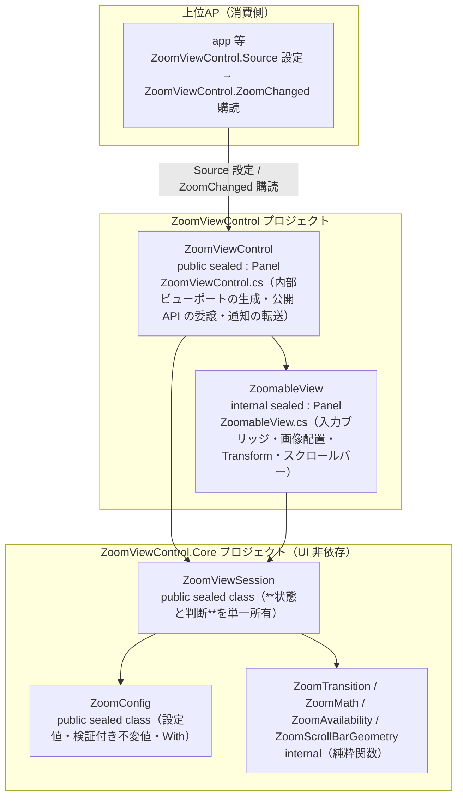

# ZoomViewControl システム仕様書（SPEC_System）

## 目次

- [ZoomViewControl システム仕様書（SPEC\_System）](#zoomviewcontrol-システム仕様書spec_system)
  - [目次](#目次)
  - [1. システム概要](#1-システム概要)
  - [2. 技術スタック](#2-技術スタック)
  - [3. アーキテクチャ](#3-アーキテクチャ)
    - [3.1 レイヤー構造](#31-レイヤー構造)
    - [3.2 依存の方向](#32-依存の方向)
  - [4. 例外処理ポリシー](#4-例外処理ポリシー)
    - [4.1 基本方針](#41-基本方針)
    - [4.2 本プロジェクト固有の例外処理](#42-本プロジェクト固有の例外処理)
  - [5. コンポーネント図](#5-コンポーネント図)
  - [6. コンポーネント一覧](#6-コンポーネント一覧)
    - [6.1 ZoomViewControl](#61-zoomviewcontrol)
    - [6.2 ZoomableView](#62-zoomableview)
    - [6.3 ZoomViewControl.Core の型（UI 非依存）](#63-zoomviewcontrolcore-の型ui-非依存)
  - [7. 依存ルール](#7-依存ルール)
  - [8. ログ](#8-ログ)
    - [8.1 ログ定義一覧](#81-ログ定義一覧)

---

## 1. システム概要

画像プレビューのズーム・パン・Fit 表示を提供する独立ライブラリです。ScrollViewer を使用しない自己完結型ビューポート（`ZoomableView`）を内包する複合コントロール（`ZoomViewControl`）、ズーム遷移の設定（`ZoomConfig`）、**状態と判断を単一所有する状態管理クラス（`ZoomViewSession`）**で構成されます。設定値（`ZoomConfig`）は公開値オブジェクト（`public`）、計算（`ZoomMath` / `ZoomTransition` / `ScrollMath` / `ZoomScrollBarGeometry`）はコア内部の実装（`internal`）で、設定値（`ZoomConfig`）を引数で受け取ります。

**UI 層は入力ブリッジ・効果の適用・描画・UI 固有のホスト結線のみ**を担い、判断を持ちません。`ZoomPercent`（実効ズーム率）の導出・可否・遷移の適用・パン・スクロールバー・Fit 復帰はすべてコアのセッションが確定します。

上位 AP（app 等）は `ZoomViewControl` の `Source` を設定し、`ZoomChanged` を購読するだけで、ズーム計算・表示・遷移の詳細は本ライブラリが担います。

## 2. 技術スタック

| 項目 | 内容 |
| --- | --- |
| **.NET** | .NET 10.0 |
| **言語** | C# 14 |
| **UI** | Avalonia 12.1（`Avalonia`） |
| **ログ** | Microsoft.Extensions.Logging.Abstractions（LoggerMessage ソース生成） |
| **テスト** | xUnit v3 / Avalonia.Headless |
| **依存プロジェクト** | `ZoomViewControl.Core`（UI 非依存の状態・判断・計算・設定値）/ `Platform.AvaloniaUI`（コア型の相互変換・共通計算） |

## 3. アーキテクチャ

### 3.1 レイヤー構造

```text
上位 AP（app 等）: ZoomViewControl.Source 設定 → ZoomViewControl.ZoomChanged 購読
  ↓
ZoomViewControl（本ライブラリ）
  ├── ZoomViewControl（複合コントロール: 内部ビューポートの生成・公開 API の委譲・通知の転送）
  └── ZoomableView（内部ビューポート: 入力ブリッジ・画像配置/RenderTransform/スクロールバーの適用）
  ↓
ZoomViewControl.Core（UI 非依存）
  ├── ZoomViewSession（**状態と判断**を単一所有。Fit の表現・実効ズーム率・可否・キャッシュ・遷移適用・パン・スクロールバー）
  ├── ZoomConfig（設定値: ズーム遷移のパラメータ。公開値オブジェクト・検証付き不変値）
  └── ZoomTransition / ZoomMath / ZoomAvailability / ZoomScrollBarGeometry（純粋関数。internal）
```

### 3.2 依存の方向

- **上位 AP → ZoomViewControl → ZoomViewControl.Core → Platform.Core の一方向**。逆方向の依存はない。
- `ZoomViewControl` が `ZoomableView` を内包し、内部ビューポートのセッションを公開 API の実体として使う（判断はコアが単一所有する）。
- `ZoomableView` が入力（ポインター・ホイール）をコア型へ変換してセッションへ渡し、返された効果を適用する。**ズーム遷移もセッションが行うため、要求イベントによる親への往復は不要**（旧 `ZoomRequested` は削除した）。
- `ZoomViewControl` / `ZoomableView` は、Core 呼び出しの境界で 1 行の相互変換（`.ToEsSize()` / `.ToEsVector()` / `.ToAvaloniaPoint()` 等）を行う。UI 内部の状態（`RenderTransform`）とイベント引数は Avalonia 型のまま維持する。

## 4. 例外処理ポリシー

### 4.1 基本方針

- ライブラリは例外を原則伝播し、上位 AP（app 等）で処理する。
- ログは LoggerMessage ソース生成で出力する。**定義はコア（`EsUtil.SaveEvidence.ZoomView` の `ZoomLogMessage`）が単一所有**し、ズーム操作の前後 % を Information で記録する（書式は両 UI で同一）。
- `ZoomViewControl.Log` へ注入されたロガーへ出力する（未設定時は `NullLogger` で無出力）。

### 4.2 本プロジェクト固有の例外処理

- コントロール（`ZoomableView`）のイベントハンドラ内の例外は握りつぶさず、上位 AP へ伝播する（コントロールの内部状態を不正にしない）。
- ズーム率（10〜500%）・オフセット（スクロール範囲）はクランプにより不正な値を防止する。`Source` に null を設定した場合も表示状態（スクロールバー非表示・再描画・通知）を一貫して更新する。
- `ZoomViewControl.Core` の内部型（`ZoomMath` / `ZoomTransition` / `ZoomAvailability`）は入力の範囲チェック・クランプを内部で行い、例外を発生させない。例外を送出するのは設定値（`ZoomConfig`）の不変条件検証のみ。

## 5. コンポーネント図



## 6. コンポーネント一覧

### 6.1 ZoomViewControl

- **分類**: 公開コントロール（`public sealed class : Panel`。自己完結型複合コントロール）
- **責務**: 内部ビューポート（`ZoomableView`）を生成し、公開 API をセッション（`ZoomViewSession`）へ委譲する。セッションの通知（`ZoomChanged` / `ViewportChanged`）を自 UI の公開イベントへ転送し、ホストが内部ビューポートへ到達する必要をなくす
- **非公開メンバー**: `Session`（内部ビューポートが所有するセッションへの参照。公開 API の実体） / `ZoomableView`（内包するビューポート） / `OnSessionNotified`（通知の転送）
- **公開 API の詳細**: `SPEC_ExtFunc.md` の 8.1 を参照
- **依存**: `EsUtil.SaveEvidence.ZoomView`（`ZoomViewSession` / `ZoomConfig` / `ZoomNotice` / `ZoomState`） / Platform.Core（`EsVector` / `EsPoint`）と Platform.AvaloniaUI（相互変換）
- **状態と判断の所有者**: `ZoomViewSession`（コア）。本コントロールは値の委譲と通知の転送のみを行う

### 6.2 ZoomableView

- **分類**: 内部コントロール（`internal sealed class : Panel`。`ZoomViewControl` の内部実装）
- **責務**: ScrollViewer 不使用のパン・ズームビューポート。入力（ポインター・ホイール）をコア型へ変換してセッションへ渡し、返された効果（再描画・ポインタキャプチャ）を適用する。セッションの値（表示サイズ・原点・オフセット・スクロール可否）を `Image` のレイアウト・`RenderTransform`・標準 `ScrollBar` へ写す。ビューポートのサイズ（`Bounds`）の所有者であり、変更時にセッションへ通知する
- **内部実装の詳細**:
  - ScrollViewer を使用しない（RenderTransform ベース）。ScrollViewer のレイアウト処理によるオフセット上書きが原理的に発生しない
  - 描画位置 = 実効スケール × (コンテンツ座標 − オフセット)。値（スケール・オフセット・中央寄せ補正）はコアが確定する
  - 見た目（スクロールバーの太さ 10 DIP）は標準 `ScrollBar` 固有であり、コアの外観（`ZoomViewAppearance`）は参照しない
- **依存**: `EsUtil.SaveEvidence.ZoomView`（`ZoomViewSession` / `ZoomFeedback` / `ZoomNotice`） / Platform.AvaloniaUI（相互変換）

### 6.3 ZoomViewControl.Core の型（UI 非依存）

すべて UI 非依存プロジェクト（名前空間 `EsUtil.SaveEvidence.ZoomView`）が提供する。

| コンポーネント | 分類 | 責務 |
| --- | --- | --- |
| `ZoomViewSession` | 公開 sealed class | **状態と判断を単一所有**する状態管理クラス（内部ズーム率・オフセット・設定・表示条件の保持、実効ズーム率の導出、可否、Fit 実効倍率のキャッシュと無効化、遷移の適用、パン、スクロールバーのドラッグ） |
| `ZoomConfig` | 公開 sealed class | ズーム遷移の設定（`MinZoom` / `MaxZoom` / `WheelFactor` / `ButtonZoomLevels`。検証付き不変値・`With` で部分更新）。外部拡張点 |
| `ZoomState` | 公開 readonly record struct | 通知する 4 値（実効ズーム率・Fit 状態・可否） |
| `ZoomFeedback` | 公開 readonly record struct | UI が適用する効果（再描画・ポインタキャプチャ）。適用順を単一所有する |
| `ZoomNotice` / `ZoomNoticeKind` | 公開 enum / sealed record | セッションから UI への通知（種別と通知時点の値） |
| `ZoomViewAppearance` | 公開 sealed record | 外観（下地・市松模様・スクロールバー）の単一値。描画可否と市松のタイル矩形も持つ |
| `ZoomScrollBar` / `ZoomScrollBarMetrics` | 公開 record struct | スクロールバーの矩形、および標準スクロールバー部品へ写す同期値 |
| `ZoomLogMessage` / `ZoomLogFormat` | 公開静的クラス | ログ定義（両 UI 共通の書式）と値の文字列化・丸め |
| `ZoomMath` | 内部静的クラス | ズーム中心維持・Fit 実効倍率・座標変換（オフセット基準 / 画像表示矩形原点基準）・オフセットクランプ・% ↔ 倍率の換算（座標は `EsPoint` / `EsVector` / `EsSize`） |
| `ZoomTransition` | 内部静的クラス | ⊖⊕ 段階遷移・Ctrl+ホイール ×1.1 遷移・可否判定。`ZoomConfig` を引数で受け取る |
| `ZoomAvailability` | 内部 record struct | ズーム可否（ズームイン・ズームアウト）を単一に保持する値オブジェクト |
| `ZoomScrollBarGeometry` | 内部静的クラス | スクロールバーのトラック・サムの矩形・可動範囲・サム位置からのオフセット逆算 |
| `ScrollMath` | 公開静的クラス（`Platform.Core`） | スクロールバーの範囲・ビューポートサイズの計算。共通基盤に分離 |

- 計算（`ZoomMath` / `ZoomTransition` / `ZoomAvailability` / `ZoomScrollBarGeometry`）は `InternalsVisibleTo`（`ZoomViewControl.AvaloniaUI` / `ZoomViewControl.MewUI` / 各テスト）で公開する。UI 層はセッション経由で間接利用する。
- UI 非依存のため、ヘッドレス不要の `[Fact]` で並列テスト可能（`ZoomViewControl.Core.Tests` が検証）。

## 7. 依存ルール

- 依存は**一方向**（上位 AP → ZoomViewControl → ZoomViewControl.Core → Platform.Core）。本ライブラリは上位 AP の型（ViewModel 等）に依存しない。
- `ZoomViewControl` が `ZoomableView` を内包し、内部ビューポートが入力の配線を自己完結する。**ズーム遷移もコアのセッションが行うため、要求イベントによる親への往復は不要**（旧 `ZoomRequested` は削除した）。
- UI 非依存の状態・判断・計算・設定値は `ZoomViewControl.Core` が単一所有し、UI 側は境界でコア型へ 1 行変換して委譲する。
- 純粋関数は UI コントロールから分離され、テスト容易性を確保する。

## 8. ログ

- ログ定義は **コア（`EsUtil.SaveEvidence.ZoomView` の `ZoomLogMessage`）が単一所有**する（書式を両 UI で揃えるため。本プロジェクトに `Logging/` は持たない）。
- `ZoomViewControl.Log` プロパティへ注入されたロガーへ出力する。未設定（null）の場合は `NullLogger` で無出力（null の吸収はコアが単一所有する）。
- 出力先・ログレベルはホスト側（上位 AP）のロギング基盤（Serilog 等）が決定する（本ライブラリはログ定義のみ）。

### 8.1 ログ定義一覧

| レベル | メソッド | 出力内容 |
| --- | --- | --- |
| `Information` | `ZoomLogMessage.LogZoomIn` | ズームイン（⊖⊕ボタン）の変更前後 % |
| `Information` | `ZoomLogMessage.LogZoomOut` | ズームアウト（⊖⊕ボタン）の変更前後 % |
| `Information` | `ZoomLogMessage.LogZoomInWheel` | Ctrl+ホイールズームインの変更前後 % |
| `Information` | `ZoomLogMessage.LogZoomOutWheel` | Ctrl+ホイールズームアウトの変更前後 % |

変更前の値は**実効ズーム率**（Fit 中は実効倍率）を記録し、丸めはコアの `ZoomLogFormat.Percent` が単一所有する。
