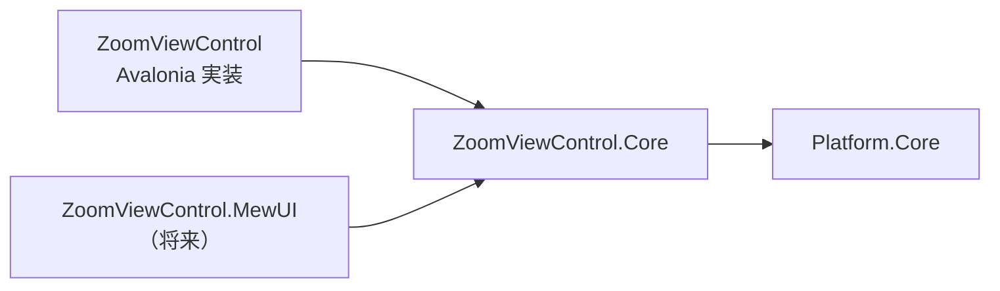
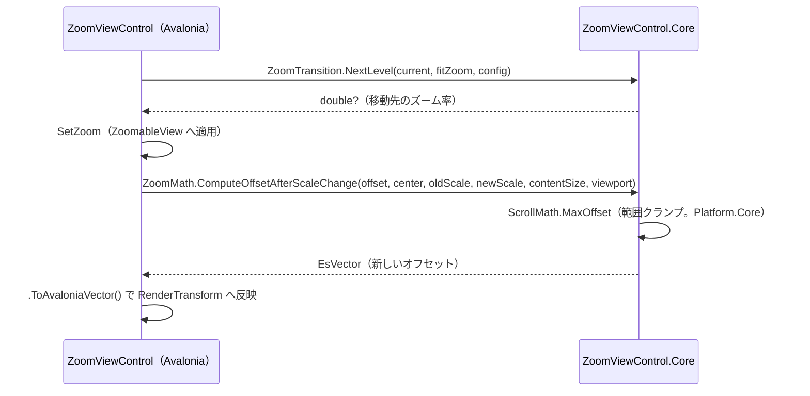

# ZoomViewControl.Core システム仕様書

## 概要

`ZoomViewControl.AvaloniaUI`（Avalonia UI 実装）と将来の MewUI 実装が共有する、UI フレームワーク非依存のズーム・パンロジックを提供するライブラリです。SaveEvidence のマルチ UI 対応における「コントロールの Core / UI 分割」の 2 例目（ティア E）です。

## 技術スタック

- .NET 10 / C# 14
- UI フレームワークは一切参照しない
- 外部パッケージへの直接依存なし（依存は `Platform.Core` のみ）

## アーキテクチャ

- `ZoomViewControl.Core` は UI フレームワークへ依存しません。
- UI 実装は、コア型と自身の型（`Avalonia.Point` / `Vector` / `Size`）を境界で相互変換します。変換は 1 行に限定し、UI 側の状態（`RenderTransform` 等）とイベント引数は UI の型のまま維持します。
- 公開型は `ZoomConfig` のみです。ほかの型は `internal` とし、`InternalsVisibleTo`（`ZoomViewControl` / `ZoomViewControl.AvaloniaUI.Tests` / `ZoomViewControl.Core.Tests`）で UI 実装とテストへ公開します。

## コンポーネント構成

| ファイル | 可視性 | 内容 |
| --- | --- | --- |
| `ZoomConfig.cs` | `public sealed class` | ズーム遷移の設定（検証付き不変値）。不変条件の検証と `With` による部分更新 |
| `ZoomTransition.cs` | `internal static class` | ⊖⊕ 段階遷移・Ctrl+ホイール ×1.1 遷移・ズーム可否判定（純粋関数） |
| `ZoomMath.cs` | `internal static class` | Fit 実効倍率・ズーム中心維持・スクロール範囲クランプ・座標変換（純粋関数） |
| `ZoomAvailability.cs` | `internal readonly record struct` | ズーム可否を単一に保持する値オブジェクト |
| `ZoomScrollBarGeometry.cs` | `internal static class` | スクロールバーのトラック・サムの矩形と、サム位置からのオフセット逆算（純粋関数）。`ZoomScrollBar` も本ファイルが定義する |

## データフロー

## 単一所有（Single Source of Truth）

| 計算 | 所有者 |
| --- | --- |
| ズーム遷移の段階（23 段階）とホイール倍率 | `ZoomTransition`（既定値は `ZoomConfig.Default` が保持） |
| ズーム範囲・倍率・レベル集合の不変条件 | `ZoomConfig.Validate` |
| Uniform（Fit）スケール | `ZoomMath.FitScale` |
| スクロールバーのトラック・サムの矩形 | `ZoomScrollBarGeometry.Compute` |
| スクロール範囲の最大オフセット / ビューポートサイズ | `Platform.Core` の `ScrollMath` |

`ZoomMath.FitZoomPercent` / `ComputeEffectiveScale` / `ZoomTransition.CanZoomIn` / `CanZoomOut` などは上記へ委譲し、同じ計算を二重に所有しません。

## 例外処理ポリシー

例外を送出するのは `ZoomConfig` の不変条件検証のみです（`ArgumentNullException` / `ArgumentException` / `ArgumentOutOfRangeException`）。

`ZoomMath` / `ZoomTransition` は入力の範囲チェック・クランプを内部で行い、例外を発生させません（スケールが 0 以下の場合は 1 として扱う）。

## 可視性ポリシー

- `ZoomConfig` のみ `public`（UI 実装と MewUI 実装が共有する公開契約）。
- 他の型・メンバーは `internal`。`internal` → `public` の変更は破壊的な設計変更として扱います。

## テスト

- `src/ZoomViewControl.Core/tests`（`ZoomViewControl.Core.Tests`）が本プロジェクトのテストを持ちます。
- UI 初期化が不要なため、すべて `[Fact]`（`AvaloniaFact` ではない）で並列実行されます。
- UI 依存の検証（コントロール生成・描画・入力・イベント発火）は `ZoomViewControl.AvaloniaUI.Tests`（Avalonia ヘッドレス・直列）が担います。

## 移行の経緯

従来 `ZoomViewControl`（Avalonia）プロジェクト内にあった以下の型を本プロジェクトへ切り出しました。

| 型 | 移行内容 |
| --- | --- |
| `ZoomConfig` | そのまま移設（UI 型を使用していない） |
| `ZoomTransition` | そのまま移設（`ZoomViewControl` への `<see cref>` を一般表現へ変更） |
| `ZoomAvailability` | そのまま移設（`ZoomViewControl` のメンバーへの `<see cref>` を一般表現へ変更） |
| `ZoomMath` | `Avalonia.Point` / `Vector` / `Size` → `EsPoint` / `EsVector` / `EsSize` へ変更 |

UI 側に残した型（イベント引数）:

- `ZoomChangedEventArgs`（`public`）: public 型の名前空間変更は利用側の破壊的変更になり、`CropViewControl` の公開 API にも波及するため UI 側に残した。
- `ZoomRequestedEventArgs`（`internal`）: ポインタ位置（`Avalonia.Point`）を保持する UI 内部のイベント引数のため UI 側に残した。
