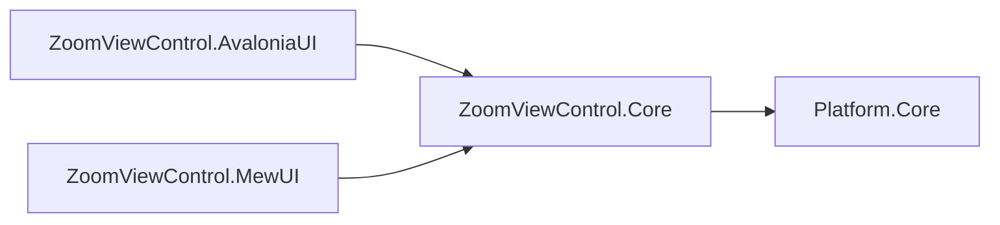
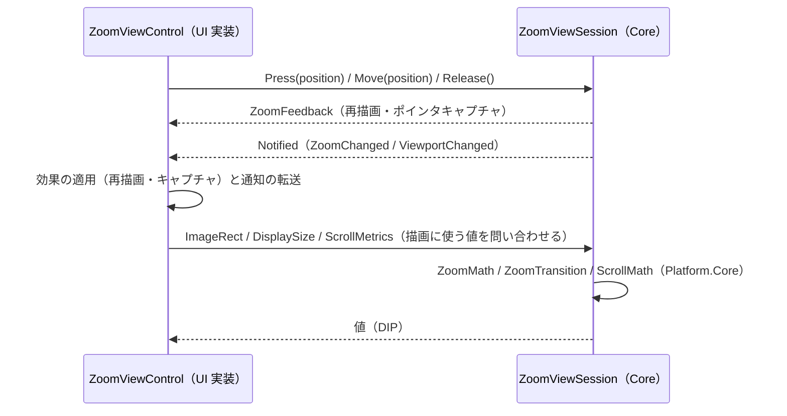

# ZoomViewControl.Core システム仕様書

## 概要

`ZoomViewControl.AvaloniaUI`（Avalonia UI 実装）と `ZoomViewControl.MewUI`（MewUI 実装）が共有する、UI フレームワーク非依存のズーム・パンロジックを提供するライブラリです。SaveEvidence のマルチ UI 対応における「コントロールの Core / UI 分割」の 2 例目（ティア E）です。

## 技術スタック

- .NET 10 / C# 14
- UI フレームワークは一切参照しない
- 外部パッケージへの直接依存なし（依存は `Platform.Core` のみ）

## アーキテクチャ

- `ZoomViewControl.Core` は UI フレームワークへ依存しません。
- UI 実装は、コア型と自身の型（`Avalonia.Point` / `Vector` / `Size`）を境界で相互変換します。変換は 1 行に限定し、UI 側の状態（`RenderTransform` 等）とイベント引数は UI の型のまま維持します。
- 状態と判断（Fit の表現・実効ズーム率の導出・可否・キャッシュの無効化・遷移の適用・パン・スクロールバー）は `ZoomViewSession` が単一所有します。
- `ZoomViewSession` / `ZoomConfig` / 契約型（`ZoomState` / `ZoomFeedback` / `ZoomNotice`）/ 外観（`ZoomViewAppearance`）/ ログは `public` です。
- 計算（`ZoomTransition` / `ZoomMath` / `ZoomAvailability` / `ZoomScrollBarGeometry`）は `internal` とし、`InternalsVisibleTo`（`ZoomViewControl.AvaloniaUI` / `ZoomViewControl.MewUI` / `ZoomViewControl.AvaloniaUI.Tests` / `ZoomViewControl.MewUI.Tests` / `ZoomViewControl.Core.Tests`）で UI 実装とテストへ公開します。

## コンポーネント構成

| ファイル | 可視性 | 内容 |
| --- | --- | --- |
| `ZoomConfig.cs` | `public sealed class` | ズーム遷移の設定（検証付き不変値）。不変条件の検証と `With` による部分更新 |
| `ZoomViewSession.cs` | `public sealed class` | 状態（ズーム率・オフセット・設定・表示条件）の保持と、入力の解釈・判断（実効ズーム率・可否・遷移適用・パン・スクロールバー）。契約（`ZoomFeedback` / `ZoomNotice`）を返す |
| `ZoomState.cs` | `public readonly record struct` | 通知する 4 値（実効ズーム率・Fit 状態・可否） |
| `ZoomFeedback.cs` | `public readonly record struct` | UI が適用する効果（再描画・ポインタキャプチャ）。適用順を単一所有する |
| `ZoomNotice.cs` | `public enum` / `public sealed record` | 通知の種別と通知時点の値 |
| `ZoomViewAppearance.cs` | `public sealed record` | 下地・市松模様・スクロールバーの外観。描画可否と市松模様を描く範囲（画像の表示矩形の内側）・タイル矩形を単一所有する |
| `ZoomScrollBarMetrics.cs` | `public readonly record struct` | 標準スクロールバー部品へ写す同期値（最大オフセット・表示範囲・可否） |
| `ZoomLogMessage.cs` / `ZoomLogFormat.cs` | `public static partial class` / `public static class` | ログ定義（両 UI 共通の書式）と値の文字列化・丸め |
| `ZoomTransition.cs` | `internal static class` | ⊖⊕ 段階遷移・Ctrl+ホイール ×1.1 遷移・ズーム可否判定（純粋関数） |
| `ZoomMath.cs` | `internal static class` | Fit 実効倍率・ズーム中心維持・スクロール範囲クランプ・座標変換・% ↔ 倍率の換算（純粋関数） |
| `ZoomAvailability.cs` | `internal readonly record struct` | ズーム可否を単一に保持する値オブジェクト |
| `ZoomScrollBarGeometry.cs` | `internal static class` | スクロールバーのトラック・サムの矩形と可動範囲、サム位置からのオフセット逆算（純粋関数）。`ZoomScrollBar` も本ファイルが定義する |

## データフロー

## 単一所有（Single Source of Truth）

| 計算・判断 | 所有者 |
| --- | --- |
| 状態（内部ズーム率・オフセット・設定・表示条件）と入力の解釈 | `ZoomViewSession` |
| ズーム遷移の段階（23 段階）とホイール倍率 | `ZoomTransition`（既定値は `ZoomConfig.Default` が保持） |
| ズーム範囲・倍率・レベル集合の不変条件 | `ZoomConfig.Validate` |
| Uniform（Fit）スケール・Fit 実効倍率のキャッシュと無効化 | `ZoomViewSession`（`ZoomMath.FitScale` へ委譲） |
| 実効ズーム率の導出（Fit 中はクランプした実効倍率） | `ZoomViewSession` |
| ズーム可否と通知値 | `ZoomViewSession`（`ZoomTransition.BuildAvailability` へ委譲） |
| スクロールバーのトラック・サムの矩形と可動範囲 | `ZoomScrollBarGeometry` |
| スクロール範囲の最大オフセット / ビューポートサイズ | `Platform.Core` の `ScrollMath`（`ZoomViewSession.ScrollMetrics` が入口） |
| 外観（下地・市松・スクロールバー）と描画可否 | `ZoomViewAppearance` |
| ログの書式・レベル・丸め | `ZoomLogMessage` / `ZoomLogFormat` |

`ZoomMath` / `ZoomTransition` / `ZoomScrollBarGeometry` は純粋関数として計算を所有し、`ZoomViewSession` がそれらを組み合わせて判断を確定します（同じ計算を二重に所有しません）。

## 例外処理ポリシー

例外を送出するのは `ZoomConfig` の不変条件検証のみです（`ArgumentNullException` / `ArgumentException` / `ArgumentOutOfRangeException`）。

`ZoomMath` / `ZoomTransition` は入力の範囲チェック・クランプを内部で行い、例外を発生させません（スケールが 0 以下の場合は 1 として扱う）。

## 可視性ポリシー

- `ZoomViewSession` / `ZoomConfig` / 契約型 / 外観 / ログは `public`（UI 実装とホストが共有する公開契約）。
- 計算（`ZoomTransition` / `ZoomMath` / `ZoomAvailability` / `ZoomScrollBarGeometry`）は `internal`。`internal` → `public` の変更は破壊的な設計変更として扱います。

## テスト

- `src/ZoomViewControl.Core/tests`（`ZoomViewControl.Core.Tests`）が本プロジェクトのテストを持ちます。
- UI 初期化が不要なため、すべて `[Fact]`（`AvaloniaFact` ではない）で並列実行されます。
- **状態と判断はすべて本プロジェクトのテストが網羅します**（`ZoomViewSession.Tests.cs`）。UI 側のテストは入力の反映・通知の転送・描画（UI 固有のホスト結線）のみを検証します。

## 層の責務の境界

| 層 | 責務 |
| --- | --- |
| Core（本プロジェクト） | 状態の保持、入力の解釈、両 UI 共通の値と計算、コア↔UI の契約、外観の既定値、ログ定義 |
| UI 層（`ZoomViewControl.*`） | 入力イベントの受付とコア型への変換、効果の適用、通知の転送、描画先への描画、UI 固有のホスト結線 |

UI 層に残る分岐（コアへ移せない例外）は次の 4 種のみです。

1. 描画先の構築と描画（Avalonia = 子 `Image` + `RenderTransform` + 標準 `ScrollBar` / MewUI = `SKCanvas`）
2. DPI の取得と `DipToDeviceScaling`、ポインタキャプチャ API の呼び出し
3. レイアウト（`Bounds` の確定とビューポートのセッションへの通知）
4. 見た目の差（スクロールバーの太さ・余白。Avalonia は標準部品を使うためコアの値を参照しない）

## 移行の経緯

従来 `ZoomViewControl`（Avalonia）プロジェクト内にあった以下の型を本プロジェクトへ切り出しました。

| 型 | 移行内容 |
| --- | --- |
| `ZoomConfig` | そのまま移設（UI 型を使用していない） |
| `ZoomTransition` | そのまま移設（`ZoomViewControl` への `<see cref>` を一般表現へ変更） |
| `ZoomAvailability` | そのまま移設（`ZoomViewControl` のメンバーへの `<see cref>` を一般表現へ変更） |
| `ZoomMath` | `Avalonia.Point` / `Vector` / `Size` → `EsPoint` / `EsVector` / `EsSize` へ変更 |

UI 側に残した型（イベント引数）:

- `ZoomChangedEventArgs`（`public`）: public 型の名前空間変更は利用側の破壊的変更になり、`CropViewControl` の公開 API にも波及するため UI 側に残した（通知値はコアの `ZoomState` を保持する薄い型とする）。
- `ZoomRequestedEventArgs`（`internal`）: ポインタ位置（`Avalonia.Point`）を保持する UI 内部のイベント引数だったが、**ズーム遷移がコアのセッションへ移ったため削除した**（内部ビューポートがセッションを直接呼ぶ）。
