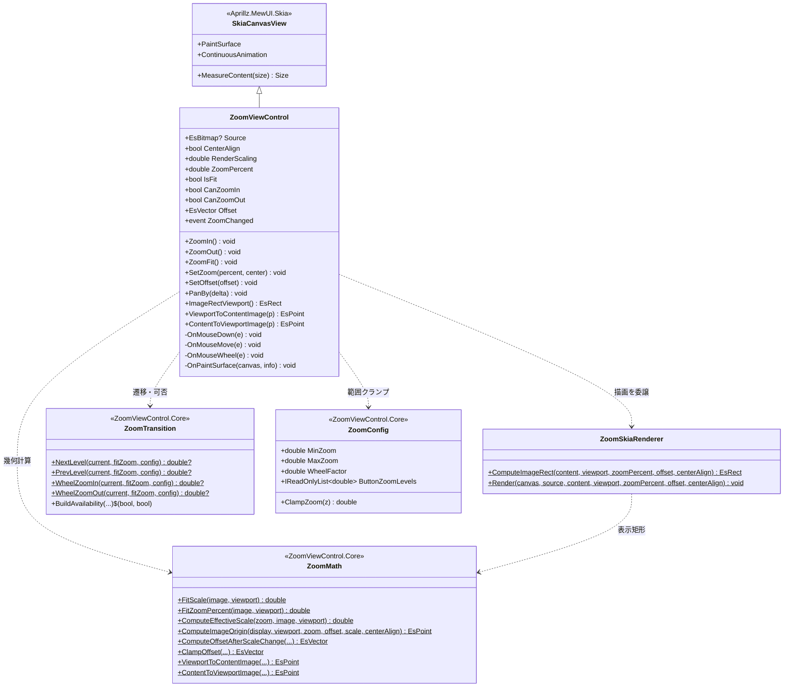
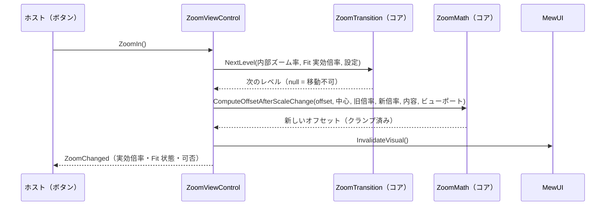
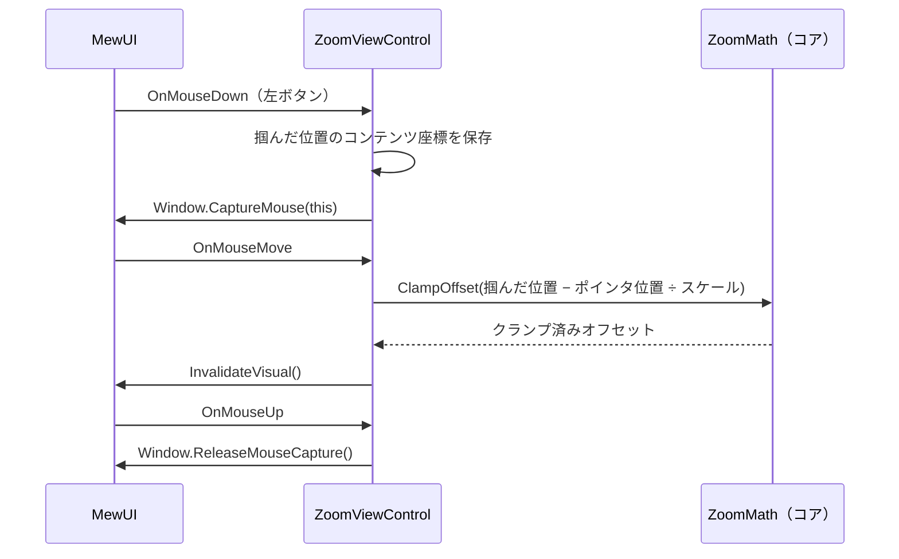
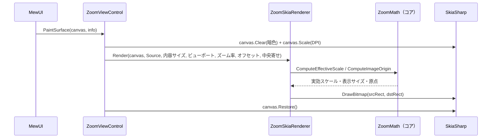

# ZoomViewControl.MewUI システム仕様書

`ZoomViewControl`（MewUI 版ズームビュー）のシステム概要・アーキテクチャ・依存関係・設計判断を記載します。

## システム概要

`ZoomViewControl.MewUI` は、Avalonia 版 `ZoomViewControl`（+ 内部 `ZoomableView`）と**同一の UI 非依存コア（`ZoomViewControl.Core`）**を使い、
描画層と入力処理のみを MewUI（SkiaSharp）で実装したズーム・パン可能な画像表示コントロールです。

コアが担う範囲（Fit 実効倍率・ズーム中心維持・スクロール範囲クランプ・座標変換・段階遷移・可否判定）は両 UI で完全に共通であり、
本プロジェクトはその計算結果を使って画像を描画し、入力を状態へ反映するだけです。

## 技術スタック

| 区分 | 採用技術 |
| --- | --- |
| 対象フレームワーク | .NET 10（`net10.0`） |
| 言語 | C# 14 |
| UI フレームワーク | MewUI（`Aprillz.MewUI.Skia` **0.21.1 固定**） |
| 描画 | SkiaSharp（`SKCanvas.DrawBitmap` で 1 回描画する） |
| 基底コントロール | `Aprillz.MewUI.Skia.Controls.SkiaCanvasView` |
| プロパティシステム | `MewProperty<T>`（`MewPropertyOptions.AffectsRender`） |
| 入力 | `OnMouseDown` / `OnMouseMove` / `OnMouseUp` / `OnMouseWheel` + `Window.CaptureMouse` |

## アーキテクチャ

### 依存方向（一方向を厳守）

```text
┌────────────────────────┐        ┌────────────────────────┐
│ ZoomViewControl.MewUI  │        │    ZoomViewControl     │
│ （MewUI の描画・入力） │        │ （Avalonia の描画・入力）│
└───────────┬────────────┘        └───────────┬────────────┘
            │                                 │
            └────────────┬────────────────────┘
                         ▼
              ┌──────────────────────┐
              │ ZoomViewControl.Core │  コアロジック（単一所有）
              └──────────┬───────────┘
                         ▼
              ┌──────────────────────┐
              │  Platform.Core │  コア幾何型・スクロール計算
              └──────────────────────┘
```

Avalonia 版と MewUI 版の間に依存はありません。共通する計算は必ず `ZoomViewControl.Core` を経由します。

### 責務の分担

| 層 | 責務 |
| --- | --- |
| `ZoomViewControl.Core` | Fit 実効倍率・実効スケール・画像原点・表示サイズの計算、ズーム中心維持、オフセットのクランプ、座標変換、段階遷移、可否判定 |
| `ZoomViewControl.MewUI` | 画像の描画、パン・ズーム入力の処理、ズーム率とオフセットの保持、イベント通知、DPI 追従 |
| ホスト（`app.MewUI` 等） | `Source` の供給、`ZoomIn` / `ZoomOut` / `ZoomFit` の呼び出し、`ZoomChanged` の購読 |

## コンポーネント構成

```text
src/ZoomViewControl.MewUI/
├── src/
│   ├── ZoomViewControl.cs        コントロール本体（状態・入力・描画の起点・公開 API）
│   ├── ZoomSkiaRenderer.cs       表示矩形の計算と SKCanvas への描画
│   └── ZoomChangedEventArgs.cs   ズーム率変更イベントの引数
└── tests/
    ├── TestHelper.cs                 テスト用の描画先（SKBitmap + SKCanvas）と画像生成
    ├── ZoomSkiaRenderer.Tests.cs     表示矩形の計算と描画結果の画素検証（10 件）
    └── ZoomViewControl.Tests.cs      ズーム・パン・座標変換（19 件）
```

| コンポーネント | 責務 |
| --- | --- |
| `ZoomViewControl` | `MewProperty`（`Source` / `CenterAlign` / `RenderScaling`）の定義、ズーム率とオフセットの保持、入力処理、イベント通知、DPI 追従 |
| `ZoomSkiaRenderer` | 表示矩形の計算（コアへの委譲）と `DrawBitmap` による描画。コントロールとテストが共用する |
| `RenderTarget`（テスト） | ウィンドウ不要の描画先。`SKBitmap` と `SKCanvas` を保持し、画素を読み取る |

## クラス図



## シーケンス図（ズーム）



## シーケンス図（パン）



## シーケンス図（描画）



## 設計判断

1. **Avalonia 版の 2 クラス構成を 1 クラスに統合した**。Avalonia 版は `Image` + `RenderTransform` + `ScrollBar` を扱うために内部ビューポート（`ZoomableView`）を分けているが、
   MewUI 版は Skia へ直接描画するため分離する理由がない（YAGNI）。
2. **画像を 1 回の `DrawBitmap` で描画する**。Avalonia 版の Transform 合成に相当する処理はコアの `ComputeImageOrigin` が計算済みであり、
   Skia 側は表示矩形へ描くだけでよい（中間バッファも Transform も不要）。
3. **表示矩形の計算と描画を `ZoomSkiaRenderer` に分離した**。コントロールを表示せずに画素を検証できるようにするため
   （ルーペと同じ方式。テスト容易性を優先）。
4. **`ZoomPercent` を `MewProperty` にしなかった**。Avalonia 版と同じく「0 以下は無視」「Fit は `ZoomFit` のみ」という
   半ば手続き的な意味を持つプロパティであり、宣言的バインディングに馴染まない（変更は `ZoomChanged` で通知する）。
5. **キャンバスを DPI スケーリングしてから DIP 座標で描画する**。コアの計算はすべて DIP のため、
   物理ピクセルへ変換するのは描画の境界 1 箇所に閉じる。
6. **スクロールバーはオーバーレイで自前描画する**。Avalonia 版は標準の `ScrollBar` を同期表示するが、<br/>
   MewUI 版はトラックとサムの矩形をコア（`ZoomScrollBarGeometry`）で計算し、`SKCanvas` へ直接描画する<br/>
   （描画と入力が同じ配置計算を共有する）。画像がビューポートに収まる軸には生成しない。
7. **マウスキャプチャを使う**。ドラッグ中にポインタがコントロール外へ出てもパンが継続するようにするため。

## テスト方針

| 対象 | 方針 |
| --- | --- |
| `ZoomSkiaRenderer` | 表示矩形の計算を値で検証し、`SKBitmap` + `SKCanvas` へ実際に描画して**画素を実測**する（ウィンドウ不要で並列実行できる） |
| `ZoomViewControl` | `Measure` / `Arrange` でビューポートを確定させ、ズーム遷移・可否・クランプ・座標変換・イベントを検証する |
| コアロジック | `ZoomViewControl.Core.Tests` が担保する（本プロジェクトでは再検証しない） |
| アプリ組み込み | `app.MewUI/verify-ui.ps1` が実機の画素を実測して検証する |

## 未実装・今後の対応

| 項目 | 内容 |
| --- | --- |
| ズーム率の双方向バインド | `ZoomPercent` を `MewProperty` にするかは、ホストの要求が出た段階で判断する |
| スクロールバーのキーボード操作 | サムの矢印キー移動・PageUp/PageDown は未対応（必要になった段階で追加する） |

## ログ

ズーム操作の前後のズーム率（%）を Information で記録します（Avalonia 版と同一の書式・レベル）。

| 出力元 | ログ |
| --- | --- |
| `ZoomIn` / `ZoomOut` | `LogZoomIn` / `LogZoomOut` |
| Ctrl+ホイール | `LogZoomInWheel` / `LogZoomOutWheel` |

`ApplyZoomStep` が遷移とログを共通処理として担い、各操作は記録するログだけを選びます（遷移しない場合はログも出しません）。<br/>
出力先は `Log` プロパティへ注入します（既定は `NullLogger`。`CropViewControl.MewUI` 経由でホストが設定する）。
