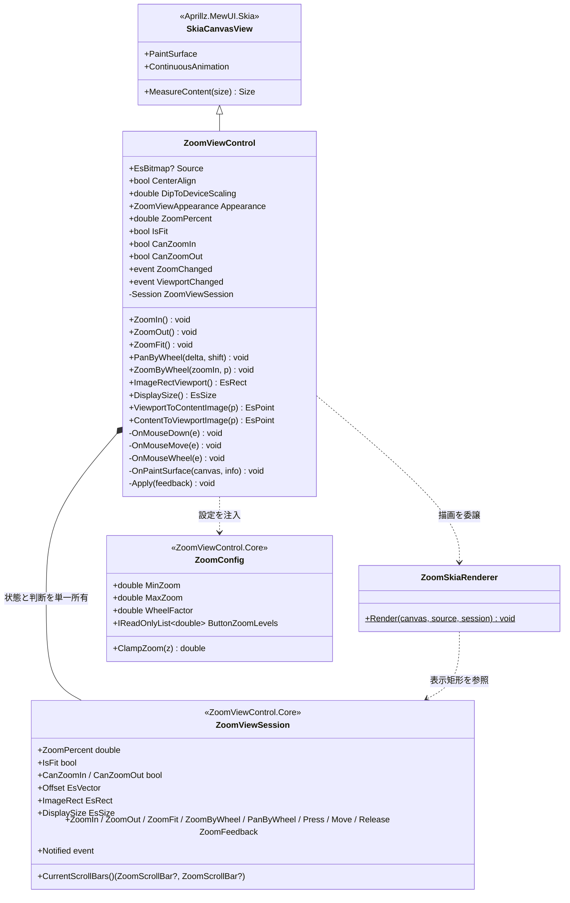
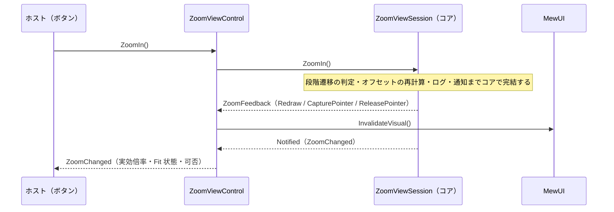
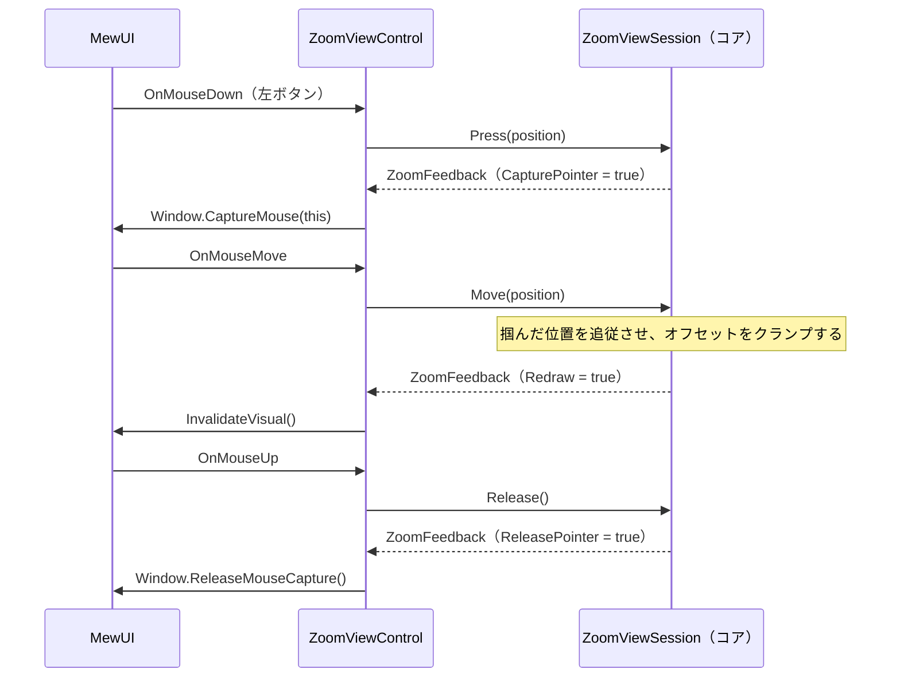
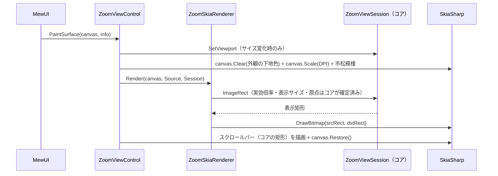

# ZoomViewControl.MewUI システム仕様書

`ZoomViewControl`（MewUI 版ズームビュー）のシステム概要・アーキテクチャ・依存関係・設計判断を記載します。

## システム概要

`ZoomViewControl.MewUI` は、Avalonia 版 `ZoomViewControl`（+ 内部 `ZoomableView`）と**同一の UI 非依存コア（`ZoomViewControl.Core`）**を使い、
描画層と入力処理のみを MewUI（SkiaSharp）で実装したズーム・パン可能な画像表示コントロールです。

コアが担う範囲（**状態と判断**・Fit 実効倍率・ズーム中心維持・スクロール範囲クランプ・座標変換・段階遷移・可否判定）は両 UI で完全に共通であり、
本プロジェクトは**入力の変換・効果の適用・描画・UI 固有のホスト結線**のみを担います。

## 技術スタック

| 区分 | 採用技術 |
| --- | --- |
| 対象フレームワーク | .NET 10（`net10.0`） |
| 言語 | C# 14 |
| UI フレームワーク | MewUI（`Aprillz.MewUI.Skia` **0.21.1 固定**） |
| 描画 | SkiaSharp（`SKCanvas.DrawBitmap` で 1 回描画する） |
| 基底コントロール | `Aprillz.MewUI.Skia.Controls.SkiaCanvasView` |
| プロパティシステム | `MewProperty<T>`（`MewPropertyOptions.AffectsRender`） |
| 入力 | `OnMouseDown` / `OnMouseMove` / `OnMouseUp` / `OnMouseWheel` + `Window.CaptureMouse` |

## アーキテクチャ

### 依存方向（一方向を厳守）

```text
┌────────────────────────┐        ┌────────────────────────┐
│ ZoomViewControl.MewUI  │        │    ZoomViewControl     │
│ （MewUI の描画・入力） │        │ （Avalonia の描画・入力）│
└───────────┬────────────┘        └───────────┬────────────┘
            │                                 │
            └────────────┬────────────────────┘
                         ▼
              ┌──────────────────────┐
              │ ZoomViewControl.Core │  コアロジック（単一所有）
              └──────────┬───────────┘
                         ▼
              ┌──────────────────────┐
              │  Platform.Core │  コア幾何型・スクロール計算
              └──────────────────────┘
```

Avalonia 版と MewUI 版の間に依存はありません。共通する計算は必ず `ZoomViewControl.Core` を経由します。

### 責務の分担

| 層 | 責務 |
| --- | --- |
| `ZoomViewControl.Core`（`ZoomViewSession`） | 状態（ズーム率・オフセット・設定・表示条件）の保持、入力の解釈（判断）、実効ズーム率・実効スケール・画像原点・表示サイズの計算、ズーム中心維持、オフセットのクランプ、座標変換、段階遷移、可否判定、スクロールバーの矩形 |
| `ZoomViewControl.MewUI` | **入力ブリッジ**（マウス・ホイール→コア型→セッション→効果の適用）、**描画**（セッションの値を Skia へ写す）、**ホスト結線**（`MewProperty`・DPI 追従・ポインタキャプチャ・レイアウト）、通知の転送 |
| ホスト（`app.MewUI` 等） | `Source` の供給、`Appearance` の設定、`ZoomIn` / `ZoomOut` / `ZoomFit` の呼び出し、`ZoomChanged` の購読 |

**判断・値・計算は UI 層に持ちません**（`ZoomPercent` の 0 以下の拒否・クランプ、Fit の表現、キャッシュの無効化もコアが単一所有します）。

## コンポーネント構成

```text
src/ZoomViewControl.MewUI/
├── src/
│   ├── ZoomViewControl.cs        コントロール本体（入力ブリッジ・描画・ホスト結線）
│   ├── ZoomSkiaRenderer.cs       表示矩形（コアが確定済み）へ SKCanvas で描画するだけの層
│   └── ZoomChangedEventArgs.cs   ズーム変更イベントの引数（コアの ZoomState を保持する薄い型）
└── tests/
    ├── TestHelper.cs                 テスト用の描画先（SKBitmap + SKCanvas）と画像生成
    ├── RecordingLogger.cs            ログ収集用の ILogger
    ├── ZoomSkiaRenderer.Tests.cs     描画結果の画素検証（4 件）
    └── ZoomViewControl.Tests.cs      入力の反映・通知の転送・外観・スクロールバー（17 件）
```

| コンポーネント | 責務 |
| --- | --- |
| `ZoomViewControl` | `MewProperty`（`Source` / `CenterAlign` / `DipToDeviceScaling`）の定義、`Appearance` の窓口、入力の変換と効果の適用、通知の転送、描画順の所有、DPI 追従 |
| `ZoomSkiaRenderer` | コアが確定した表示矩形へ `DrawBitmap` で描画するだけ（判断・計算を持たない） |
| `RenderTarget`（テスト） | ウィンドウ不要の描画先。`SKBitmap` と `SKCanvas` を保持し、画素を読み取る |

## クラス図



## シーケンス図（ズーム）



## シーケンス図（パン）



## シーケンス図（描画）



## 設計判断

1. **Avalonia 版の 2 クラス構成を 1 クラスに統合した**。Avalonia 版は `Image` + `RenderTransform` + `ScrollBar` を扱うために内部ビューポート（`ZoomableView`）を分けているが、
   MewUI 版は Skia へ直接描画するため分離する理由がない（YAGNI）。
2. **画像を 1 回の `DrawBitmap` で描画する**。Avalonia 版の Transform 合成に相当する処理はコアが確定済みであり、
   Skia 側は表示矩形へ描くだけでよい（中間バッファも Transform も不要）。
3. **`ZoomSkiaRenderer` は判断を持たない描画層に絞った**。コアの `ZoomViewSession.ImageRect` を読んで描くだけにし、
   コントロールを表示せずに画素を検証できるようにするため（ルーペと同じ方式。テスト容易性を優先）。
4. **`ZoomPercent` を `MewProperty` にしなかった**。Avalonia 版と同じく「0 以下は無視」「Fit は `ZoomFit` のみ」という
   半ば手続き的な意味を持つプロパティであり、宣言的バインディングに馴染まない（変更は `ZoomChanged` で通知する）。
5. **キャンバスを DPI スケーリングしてから DIP 座標で描画する**。コアの計算はすべて DIP のため、
   物理ピクセルへ変換するのは描画の境界 1 箇所に閉じる。
6. **スクロールバーはオーバーレイで自前描画する**。Avalonia 版は標準の `ScrollBar` を同期表示するが、
   MewUI 版はトラックとサムの矩形をコア（`ZoomScrollBarGeometry`）で計算し、`SKCanvas` へ直接描画する
   （描画と入力が同じ配置計算を共有する）。画像がビューポートに収まる軸には生成しない。
7. **マウスキャプチャを使う**。ドラッグ中にポインタがコントロール外へ出てもパンが継続するようにするため。

## テスト方針

| 対象 | 方針 |
| --- | --- |
| `ZoomSkiaRenderer` | コアが確定した表示矩形への描画結果を `SKBitmap` + `SKCanvas` へ実際に描画して**画素を実測**する（ウィンドウ不要で並列実行できる） |
| `ZoomViewControl` | `Measure` / `Arrange` でビューポートを確定させ、入力の反映・通知の転送・外観・スクロールバーを検証する |
| コアロジック | `ZoomViewControl.Core.Tests` が担保する（本プロジェクトでは再検証しない） |
| アプリ組み込み | `app.MewUI/verify-ui.ps1` が実機の画素を実測して検証する |

## 未実装・今後の対応

| 項目 | 内容 |
| --- | --- |
| ズーム率の双方向バインド | `ZoomPercent` を `MewProperty` にするかは、ホストの要求が出た段階で判断する |
| スクロールバーのキーボード操作 | サムの矢印キー移動・PageUp/PageDown は未対応（必要になった段階で追加する） |

## ログ

ズーム操作の前後のズーム率（%）を Information で記録します（Avalonia 版と同一の書式・レベル）。
**ログ定義はコア（`EsUtil.SaveEvidence.ZoomView` の `ZoomLogMessage`）が単一所有**し、変更前の値は実効ズーム率（Fit 中は実効倍率）を記録します（丸めは `ZoomLogFormat.Percent`）。

| 出力元 | ログ |
| --- | --- |
| `ZoomIn` / `ZoomOut` | `LogZoomIn` / `LogZoomOut` |
| Ctrl+ホイール | `LogZoomInWheel` / `LogZoomOutWheel` |

コアの `ZoomViewSession.ApplyZoomStep` が遷移とログを共通処理として担い、各操作は記録するログだけを選びます（遷移しない場合はログも出しません）。  
出力先は `Log` プロパティへ注入します（既定は `NullLogger`。`CropViewControl.MewUI` 経由でホストが設定する）。
