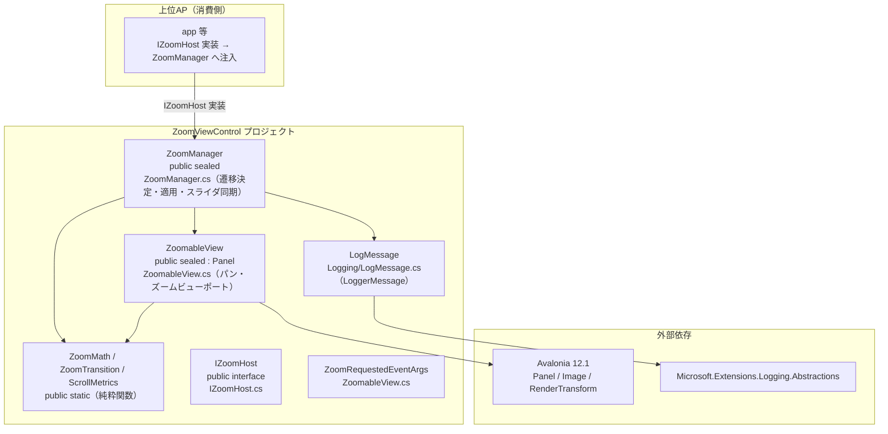

# ZoomViewControl システム仕様書（SPEC_System）

## 目次

- [ZoomViewControl システム仕様書（SPEC\_System）](#zoomviewcontrol-システム仕様書spec_system)
  - [目次](#目次)
  - [1. システム概要](#1-システム概要)
  - [2. 技術スタック](#2-技術スタック)
  - [3. アーキテクチャ](#3-アーキテクチャ)
    - [3.1 レイヤー構造](#31-レイヤー構造)
    - [3.2 依存の方向](#32-依存の方向)
  - [4. 例外処理ポリシー](#4-例外処理ポリシー)
    - [4.1 基本方針](#41-基本方針)
    - [4.2 本プロジェクト固有の例外処理](#42-本プロジェクト固有の例外処理)
  - [5. コンポーネント図](#5-コンポーネント図)
  - [6. コンポーネント一覧](#6-コンポーネント一覧)
    - [6.1 ZoomManager](#61-zoommanager)
    - [6.2 ZoomableView](#62-zoomableview)
    - [6.3 ZoomMath / ZoomTransition / ScrollMetrics（純粋関数）](#63-zoommath--zoomtransition--scrollmetrics純粋関数)
    - [6.4 IZoomHost](#64-izoomhost)
  - [7. 依存ルール](#7-依存ルール)
  - [8. ログ](#8-ログ)

---

## 1. システム概要

画像プレビューのズーム・パン・Fit 表示を提供する独立ライブラリです。ScrollViewer を使用しない自己完結型ビューポート（`ZoomableView`）と、ズーム率の遷移・適用を統括するマネージャー（`ZoomManager`）、UI 非依存の純粋関数（`ZoomMath` / `ZoomTransition` / `ScrollMetrics`）で構成されます。

上位 AP（app 等）は `IZoomHost` を実装して `ZoomManager` に注入し、ズーム操作を指示するだけで、ズーム計算・表示の詳細は本ライブラリが担います。

## 2. 技術スタック

| 項目 | 内容 |
| --- | --- |
| **.NET** | .NET 10.0 |
| **言語** | C# 14 |
| **UI** | Avalonia 12.1（`Avalonia`） |
| **ログ** | Microsoft.Extensions.Logging.Abstractions（LoggerMessage ソース生成） |
| **テスト** | xUnit v3 / Avalonia.Headless |

## 3. アーキテクチャ

### 3.1 レイヤー構造

```text
上位 AP（app 等）: IZoomHost 実装 → ZoomManager へ注入
  ↓
ZoomViewControl（本ライブラリ）
  ├── ZoomManager（マネージャー: 遷移決定・適用・スライダ同期）
  ├── ZoomableView（コントロール: パン・ズーム表示）
  ├── ZoomMath / ZoomTransition / ScrollMetrics（純粋関数: 計算）
  └── Logging/LogMessage（LoggerMessage 定義）
```

### 3.2 依存の方向

- **上位 AP → ZoomViewControl の一方向**（app は本ライブラリへ参照）。本ライブラリは上位 AP に依存しない。
- `ZoomManager` → `IZoomHost`（インターフェース）: ホストの具象型に依存せず、抽象経由でズーム状態を読み書きする（DIP）。
- 純粋関数（`ZoomMath` / `ZoomTransition` / `ScrollMetrics`）は UI 非依存（Avalonia.Media / Avalonia 基本型のみ）。

## 4. 例外処理ポリシー

### 4.1 基本方針

- ライブラリは例外を原則伝播し、上位 AP（app 等）で処理する。
- ログは LoggerMessage ソース生成（`Logging/LogMessage.cs`）で出力する。ズーム操作の前後 % を Information で記録する。
- `ZoomManager.Log` へ注入されたロガーへ出力する（未設定時は `NullLogger` で無出力）。

### 4.2 本プロジェクト固有の例外処理

- コントロール（`ZoomableView`）のイベントハンドラ内の例外は握りつぶさず、上位 AP へ伝播する（コントロールの内部状態を不正にしない）。
- ズーム率（10〜500%）・オフセット（スクロール範囲）はクランプにより不正な値を防止する。`SetSource(null)` 等のリセット系 API は画像なし時も表示状態（スクロールバー非表示・再描画・通知）を一貫して更新する。
- 純粋関数（`ZoomMath` / `ZoomTransition` / `ScrollMetrics`）は入力の範囲チェック・クランプを内部で行い、例外を発生させない。

## 5. コンポーネント図



## 6. コンポーネント一覧

### 6.1 ZoomManager

- **分類**: 公開クラス（`public sealed class`）
- **責務**: ズーム率の遷移（⊖⊕ 23 段階 / Ctrl+ホイール ×1.1）・スライダ同期・ZoomableView への適用を統括
- **公開メンバー**: `ZoomIn` / `ZoomOut` / `ZoomInByWheel` / `ZoomOutByWheel` / `ApplyZoomFromSlider` / `ApplyZoomFromText` / `ApplyZoom` / `SyncZoomSlider` / `UpdateImageAlignment` / `OnZoomableViewSizeChanged` / `Log`
- **注入プロパティ**: `ViewModel`（IZoomHost）/ `ZoomableView` / `ZoomSlider` / `PointerPosition` / `Log`
- **依存**: IZoomHost / ZoomableView / ZoomMath / ZoomTransition / LogMessage

### 6.2 ZoomableView

- **分類**: 公開コントロール（`public sealed class : Panel`）
- **責務**: ScrollViewer 不使用のパン・ズームビューポート。RenderTransform（ScaleTransform + TranslateTransform）で表示。マウスドラッグパンは grab 方式（掴んだ位置がポインタに追従）
- **公開メンバー**: `SetSource` / `SetZoom` / `SetOffset` / `PanBy` / `ViewportToContent` / `ContentToViewport` / `DisplaySize` / `ImageRectViewport` / `ImageControl` / `ZoomPercent` / `Offset` / `Scale` / `EffectiveScale` / `CenterAlign` / `ZoomRequested` / `ViewportChanged`
- **依存**: ZoomMath / ScrollMetrics / ZoomRequestedEventArgs

### 6.3 ZoomMath / ZoomTransition / ScrollMetrics（純粋関数）

| コンポーネント | 分類 | 責務 |
| --- | --- | --- |
| `ZoomMath` | 公開静的クラス | ズーム中心維持・Fit 実効倍率・座標変換・オフセットクランプの計算 |
| `ZoomTransition` | 公開静的クラス | ⊖⊕ 23 段階遷移・Ctrl+ホイール ×1.1 遷移・可否判定 |
| `ScrollMetrics` | 公開静的クラス | スクロールバーの範囲・ビューポートサイズの計算 |

- UI 非依存のため、ヘッドレス不要の `[Fact]` で並列テスト可能（単体テストで仕様を検証）。

### 6.4 IZoomHost

- **分類**: 公開インターフェース
- **責務**: ズーム操作の対象（ホスト）の抽象。ZoomManager がズーム率・画像・表示状態を読み書きするための最小メンバー
- **メンバー**: `ZoomPercent` / `PreviewImage` / `CanZoomIn` / `CanZoomOut` / `ZoomDisplayText` / `CenterAlign`

## 7. 依存ルール

- 依存は**一方向**（上位 AP → 本ライブラリ）。本ライブラリは上位 AP の型（ViewModel 等）に依存しない。
- `ZoomManager` は具象ホストではなく `IZoomHost` に依存する（DIP）。
- 純粋関数は UI コントロールから分離され、テスト容易性を確保する。

## 8. ログ

- ログ定義は `Logging/LogMessage.cs`（LoggerMessage ソース生成・`this ILogger` 拡張メソッド）に集約。
- `ZoomManager.Log` プロパティへ注入されたロガーへ出力する。未設定（null）の場合は `NullLogger` で無出力。
- 出力先・ログレベルはホスト側（上位 AP）のロギング基盤（NLog 等）が決定する（本ライブラリはログ転送のみ）。
