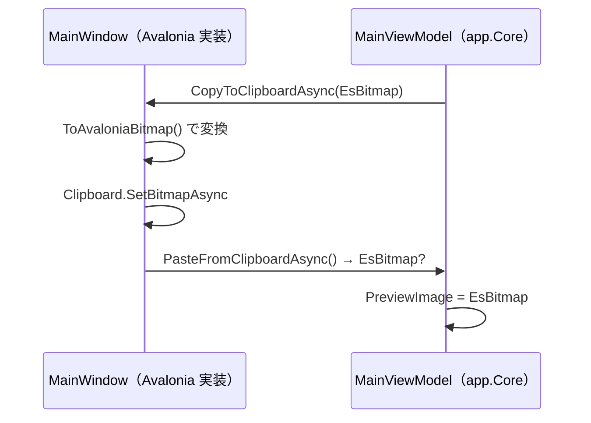

# app.Core システム仕様書

## 概要

SaveEvidence 本体（Avalonia UI 実装 `app.AvaloniaUI`）と将来の MewUI ホストが共有する、UI フレームワーク非依存のモデル・ユーティリティ・ViewModel を提供するライブラリです。SaveEvidence のマルチ UI 対応における「app の Core / UI 分割」（ティア F）です。

## 技術スタック

- .NET 10 / C# 14
- UI フレームワークは一切参照しない
- 外部依存は `CommunityToolkit.Mvvm`（UI フレームワーク非依存の MVVM ツールキット）のみ

## アーキテクチャ

```mermaid
  A[app<br/>Avalonia 実装] --> B[app.Core]
  C["app.MewUI（将来）"] --> B
  B --> D[Platform.Core]
  B --> F[LineDetection]
  A --> E[CaptureSessionControl.AvaloniaUI / ColorPickerControl / Platform.AvaloniaUI]
  A -->|コールバック注入（クリップボード / 上書き確認）| B
```

- `app.Core` は UI フレームワークへ依存しません。
- `app.Core` の名前空間は `app.AvaloniaUI` と同一（`Estable.SaveEvidence.*`）です。アセンブリのみが異なるため、`app.AvaloniaUI` 側の `using` を変更せずに移設できます。
- `internal` 型（`CapacityLimitedCache` / `ImageFileExtensions` / `ViewModeDisplay`）は `InternalsVisibleTo`（`SaveEvidence` / `SaveEvidence.MewUI` / `app.AvaloniaUI.Tests` / `app.Core.Tests` / `app.MewUI.Tests`）で UI 実装とテストへ公開します。

## コンポーネント構成

| ファイル | 可視性 | 内容 |
| --- | --- | --- |
| `Enum/AppPage.cs` | `public enum` | ナビゲーションページの識別子 |
| `Enum/ThemeMode.cs` | `public enum` | テーマモード（`Description` 属性で表示名を保持） |
| `Models/Settings.cs` | `public sealed partial class` | アプリケーション設定（変更通知付き） |
| `Models/FileNameTemplate.cs` | `public static partial class` | ファイル名テンプレートの解析・生成・検証 |
| `Models/UndoStack.cs` | `public sealed class` | 画像の Undo / Redo スタック |
| `Models/HotKeyParser.cs` | `public static class` | ホットキー文字列の解析 |
| `Models/CapacityLimitedCache.cs` | `internal static class` | 容量制限付きの静的キャッシュ操作 |
| `Models/ImageFileExtensions.cs` | `internal static class` | 画像ファイルの拡張子判定（フォルダビューの一覧抽出） |
| `Layout/BottomAlignWrapLayout.cs` | `internal static class` | 折り返しパネルの行高さ・下端揃えの配置計算（Avalonia / MewUI 両版のパネルが委譲する単一所有） |
| `Services/ISettingsService.cs` | `public interface` | 設定管理サービスの抽象 |
| `Services/IImageWriter.cs` | `public interface` | 画像（`EsBitmap`）のファイル書き込みの抽象 |
| `Services/SettingsService.cs` | `public sealed class` | JSON ファイルによる設定管理（反射 / ソース生成の両対応） |
| `Services/EsPixelRectJsonConverter.cs` | `internal sealed class` | `EsPixelRect` の JSON コンバーター |
| `ViewModels/ViewModeDisplay.cs` | `internal static class` | 表示モードの表示文字列変換 |
| `ViewModels/FolderViewViewModel.cs` | `public sealed partial class` | フォルダビューの表示モード・ソート状態 |
| `ViewModels/UndoViewModel.cs` | `public sealed partial class` | Undo 一覧の表示モード状態 |
| `ViewModels/MainViewModel.cs` | `public sealed partial class` | メイン画面の状態（プレビュー画像・保存・自動切り出し・ズーム表示） |

## 単一所有（Single Source of Truth）

| 内容 | 所有者 |
| --- | --- |
| 表示モード（特大 / 大 / 中）の名称・件数表示 | `ViewModeDisplay`（`FolderViewViewModel` / `UndoViewModel` が委譲） |
| ファイル名テンプレートの書式と使用不可文字の検証 | `FileNameTemplate` |
| キャッシュの容量管理（上限超過時の全クリアと `IDisposable` の破棄） | `CapacityLimitedCache` |
| フォルダビューの一覧に含める画像の拡張子 | `ImageFileExtensions`（両 UI のフォルダビューが委譲） |
| 設定の永続化形式（JSON の構造・enum の文字列表現） | `SettingsService`（`EsPixelRectJsonConverter` + enum のジェネリック変換器） |
| プレビュー画像の所有権とライフサイクル（差し替え時の破棄順序） | `MainViewModel`（`OnPreviewImageChanging` / `OnPreviewImageChanged`） |

## UI 依存の注入（依存性逆転）

`MainViewModel` は UI 操作が必要な箇所をコールバック / インターフェースとして受け取り、UI 型を直接持たないようにします。



| 注入点 | 種類 | 内容 |
| --- | --- | --- |
| `IImageWriter` | コンストラクター引数 | 画像のエンコード・保存（Avalonia 版は `AvaloniaImageWriter`。`Program.cs` で DI 登録） |
| `CopyToClipboardAsync` | コールバック | `EsBitmap` を受け取り、UI 型へ変換してクリップボードへ書く |
| `PasteFromClipboardAsync` | コールバック | クリップボードから読み、UI 型から `EsBitmap` へ変換して返す |
| `ConfirmOverwriteAsync` | コールバック | 上書き確認ダイアログ |
| `BeforeEditAction` | コールバック | 画像編集前の Undo プッシュ |
| `StartSelectionMode` | コールバック | キャプチャの開始（`CaptureType`） |

## 例外処理ポリシー

例外を送出しません。入力の不正（解釈できないホットキー文字列・無効なテンプレート）は `bool` の戻り値（`TryParse` / `IsValidTemplate`）またはクランプ（`ClampIndex`）で表現します。

`UndoStack` が保持する `EsBitmap` の破棄は所有者（`UndoStack`）が行います。`Undo` / `Redo` の戻り値の所有権は呼び出し側へ移ります。

## 可視性ポリシー

- `AppPage` / `ThemeMode` / `Settings` / `FileNameTemplate` / `UndoStack` / `HotKeyParser` / `ISettingsService` / `SettingsService` / `FolderViewViewModel` / `UndoViewModel` は `public`（`app.AvaloniaUI` と MewUI ホストが共有する契約）。
- `CapacityLimitedCache` / `ImageFileExtensions` / `ViewModeDisplay` / `EsPixelRectJsonConverter` は `internal`。`internal` → `public` の変更は破壊的な設計変更として扱います。

## 設定ファイルの互換性

| 項目 | 移設前 | 移設後 | JSON 表現 |
| --- | --- | --- | --- |
| ウィンドウ位置・サイズ | `Avalonia.PixelRect?` | `EsPixelRect?` | `{"X":..,"Y":..,"Width":..,"Height":..}`（変更なし） |
| ウィンドウ状態 | `Avalonia.Controls.WindowState` | `EsWindowState` | `"Normal"` 等の名前（変更なし） |

`EsPixelRect` は専用コンバーター、`EsWindowState` は `JsonStringEnumConverter` により、移設前と同一の JSON 形式で読み書きされるため、**既存の `settings.json` はそのまま読み込める**。

## テスト

- `src/app.Core/tests`（`app.Core.Tests`）が本プロジェクトのテストを持ちます。
- UI 初期化が不要なため、すべて `[Fact]`（`AvaloniaFact` ではない）で並列実行されます。
- UI 依存の検証（ページの描画・入力・画像の表示変換）は `app.AvaloniaUI.Tests`（Avalonia ヘッドレス・直列）が担います。

## 移行の経緯

### 第一段階（UI 型を持たないファイル）

従来 `app.AvaloniaUI`（Avalonia）プロジェクト内にあった以下のファイルを本プロジェクトへ切り出しました。いずれも UI フレームワークの型をシグネチャに持たないため、名前空間を変えずに移設できました。

| ファイル | 移行内容 |
| --- | --- |
| `Enum/AppPage.cs` / `Enum/ThemeMode.cs` | そのまま移設 |
| `Models/CapacityLimitedCache.cs` | そのまま移設 |
| `Models/ImageFileExtensions.cs` | 新設（両 UI のフォルダビューで重複していた拡張子一覧を統合） |
| `Models/FileNameTemplate.cs` | そのまま移設 |
| `Models/UndoStack.cs` | そのまま移設（`EsBitmap` は `Platform.Core` 提供） |
| `Models/HotKeyParser.cs` | そのまま移設（不要な `using EsUtil.Platform.AvaloniaUI;` を削除） |
| `ViewModels/ViewModeDisplay.cs` | そのまま移設 |
| `ViewModels/FolderViewViewModel.cs` / `ViewModels/UndoViewModel.cs` | そのまま移設（`CommunityToolkit.Mvvm` へ依存） |

### 第二段階（設定モデルと設定サービスの UI 非依存化）

| ファイル | 移行内容 |
| --- | --- |
| `Models/Settings.cs` | `Avalonia.PixelRect?` → `EsPixelRect?`（`MainWindowBounds`）、`Avalonia.Controls.WindowState` → `EsWindowState`（`MainWindowState`） |
| `Services/ISettingsService.cs` | そのまま移設（`Settings` に依存するため第二段階で実施） |
| `Services/SettingsService.cs` | そのまま移設（使用するコンバーターを `EsPixelRectJsonConverter` へ変更） |
| `Services/PixelRectConverter.cs` | `EsPixelRectJsonConverter` へ改名し、`EsPixelRect` 用へ変更（JSON 形式は同一） |

併せて `Platform.Core` に `EsWindowState`、`Platform.AvaloniaUI` に `EsWindowStateAvaloniaInterop` を追加しました。

### 第三段階（`MainViewModel` の UI 非依存化に必要な型）

| ファイル | 移行内容 |
| --- | --- |
| `Services/IImageWriter.cs` | 移設（`EsBitmap` のみ依存のためそのまま）。具象実装 `AvaloniaImageWriter` は `app.AvaloniaUI` 側に残す |

併せて以下を実施しました。

- `CaptureType`（キャプチャ種別）を `CaptureSessionControl.AvaloniaUI` から `Platform.Core`（`EsUtil.Platform.Core`）へ移設
- `LineDetection` の `LineDetectionResult` / `LineRectangleReconstructor` を `EsPoint` / `EsPixelRect` 化（`LineDetection` が UI 非依存に）
- `MainViewModel` の画像座標の矩形を `Avalonia.PixelRect` → `EsPixelRect` へ変更（本体の移設は次段階）

### 第四段階（`MainViewModel` の移設）

| ファイル | 移行内容 |
| --- | --- |
| `ViewModels/MainViewModel.cs` | 移設 + UI 型の除去。クリップボードのコールバックを `Bitmap?` → `EsBitmap` へ変更、`IImageWriter` を必須引数化（既定実装 `AvaloniaImageWriter` の生成を削除）、`ZoomViewControl` への `<see cref>` を一般表現へ |

併せて以下を実施しました。

- `LineDetection` の名前空間を `Estable.AvaloniaUI.LineDetection` → `Estable.LineDetection` へ変更（UI 非依存のため）
- `app.AvaloniaUI` の `MainWindow`（View）が `EsBitmap` ⇔ `Avalonia.Bitmap` の境界変換を担当
- `app.AvaloniaUI` の `Program.cs` で `IImageWriter`（`AvaloniaImageWriter`）を DI 登録
- `app.AvaloniaUI` の `LineDetection` 直接参照を削除（`app.Core` 経由の推移的参照へ）
- XAML（`MainWindow.axaml` / `CapturePage.axaml` / `SettingsPage.axaml`）の `vm` 名前空間に `;assembly=app.Core` を付与

### 未移設（今後の判断）

以下は UI フレームワークの型をシグネチャに持つため、`app.AvaloniaUI` 側に残しています。

| ファイル | 依存する UI 型 |
| --- | --- |
| `Services/AvaloniaImageWriter.cs` | Avalonia Skia（`WriteableBitmap`）。`IImageWriter` の Avalonia 実装 |
| `Services/CaptureSettingsMapper.cs` | `Avalonia.Media`（色）・`CaptureSessionControl.AvaloniaUI` |
| `Views/**` / `Controls/**` / `Converters/**` / `Icons/**` / `Logging/AppLog.cs` | Avalonia の UI 型 |
