# app.MewUI システム仕様書

`app.MewUI`（MewUI 版アプリ本体）のシステム概要・アーキテクチャ・依存関係・設計判断を記載します。

## システム概要

`app.MewUI` は、SaveEvidence の UI 層のみを **MewUI**（`Aprillz.MewUI`）で実装したホストアプリです。
業務ロジック・状態・設定・画像コンテナは UI 非依存のコア（`app.Core` / `Platform.Core` /
`Platform.Native` / `LineDetection`）が所有し、`app.MewUI` はそれらを組み立てて表示するだけです。

Avalonia 版 `app.AvaloniaUI` と**同じコア**を使うため、設定ファイル・挙動・公開 API は UI 間で共通です。

## 技術スタック

| 区分 | 採用技術 |
| --- | --- |
| 対象フレームワーク | .NET 10（`net10.0-windows`） |
| 言語 | C# 14 |
| UI フレームワーク | MewUI（`Aprillz.MewUI` 0.21.1 固定） |
| グラフィックス | SkiaSharp（`SkiaCanvasView` で `EsBitmap` を直接描画） |
| 描画バックエンド | Direct2D + Win32 プラットフォームホスト + `Aprillz.MewUI.Skia.Interop.Direct2D`（GPU ブリッジ） |
| MVVM | `CommunityToolkit.Mvvm`（コアの `MainViewModel` をそのまま使用） |
| ログ | Serilog 4.x（`Serilog.Sinks.File` + `Serilog.Extensions.Logging`。Avalonia 版と同じファイルへ出力） |

## アーキテクチャ

### 依存方向（一方向を厳守）

```text
┌────────────────┐
│   app.MewUI    │  UI 層（MewUI・コードファースト）
└───────┬────────┘
        │
        ├──────────────────────────────┐
        │                              │
        ▼                              ▼
┌────────────────┐            ┌──────────────────────┐
│   app.Core     │            │ Platform.MewUI      │  コア型 ⇔ MewUI 型
│ (VM / 設定)    │            └──────────┬───────────┘
└───────┬────────┘                       │
        │                                │
        ├───────────────┬────────────────┘
        ▼               ▼
┌────────────────┐ ┌─────────────────────┐
│  Platform.Core │ │   Platform.Native   │
│ (抽象・画像・  │ │ (Win32 / NoOp 実装) │
│  幾何・座標)   │ └─────────────────────┘
└───────┬────────┘
        │
        ▼
┌────────────────┐
│  LineDetection │  線検出（UI 非依存）
└────────────────┘

（別系統）
┌──────────────────────┐
│  LoupeControl.MewUI  │  MewUI 版ルーペ（描画層）
└──────────┬───────────┘
           ▼
┌──────────────────────┐
│   Feature.LoupeCore  │  UI 非依存のルーペロジック
└──────────────────────┘
```

### UI 非依存の担保

`app.MewUI` は `Avalonia*` を参照しません。Avalonia への依存は `Platform.AvaloniaUI`（アダプタ専用）と
`app.AvaloniaUI`（Avalonia UI）のみに閉じています。コアが UI 型を漏らしていないことは、
`app.Core` / `Platform.Core` の依存先が SkiaSharp・OpenCvSharp・`System.Drawing.Color` 等に
限られることで担保しています。

### 境界の変換

コアの型（`EsBitmap` / `EsKey` / `EsRect` 等）と MewUI の型は、境界で **1 行の変換**を行います。

```text
コア型 ──[Platform.MewUI の Interop]──> MewUI 型
```

- 画像は変換不要（`EsBitmap.ToSKBitmap()` をそのまま描画）。
- キー・ウィンドウ状態・幾何・プラットフォームハンドルは `Es*MewUIInterop` を介して変換します。

## コンポーネント構成

```text
src/app.MewUI/src/
├── Program.cs                        起動（バックエンド登録 → コアの組み立て → ホットキー登録 → ウィンドウ表示）
├── AppServices.cs                    共有するコアオブジェクトの束
├── Services/
│   ├── MewUIImageWriter.cs           IImageWriter の実装（SkiaSharp でエンコード）
│   ├── ImageThumbnailLoader.cs       画像ファイルの縮小デコードとキャッシュ
│   ├── SettingsColorMath.cs          設定の色文字列 ⇔ 色の変換
│   ├── SettingsJsonContext.cs        設定の JSON ソース生成（Native AOT 対応）
│   ├── CaptureFlow.cs                キャプチャの開始と結果の反映
│   ├── EditHistory.cs                編集履歴（戻す / やり直し）の実行
│   └── MainViewModelCaptureTarget.cs 切り出しの適用先（ICaptureTarget の実装）
├── Logging/
│   └── AppLog.cs                     ログ定義（LoggerMessage）と Serilog のファクトリ
└── Views/
    ├── MainWindow.cs                 NavigationView の組み立てとページ切り替え
    ├── PageContent.cs                ページの内容と「表示のたびに実行する処理」
    ├── CapturePage.cs                キャプチャページのレイアウト
    ├── ConfirmDialog.cs              簡易確認ダイアログ（はい / いいえ。保存の上書き確認）
    ├── ClickableToolTip.cs          ツールヒント付きボタンのクリック登録（MewUI の不具合回避）
    ├── AppStyles.cs                 共通スタイル（ナビ・ツールバー・ウィンドウ操作・サムネイル枠・面のテーマ追従）
    ├── BottomAlignWrapPanel.cs      折り返し + 行内下端揃えのパネル（コアの計算へ委譲）
    ├── FolderViewPage.cs             フォルダビューページ（サムネイル一覧・表示モード・ソート）
    ├── ThumbnailItem.cs              一覧アイテム（枠 + 影 + ラベル。ホバーの枠色と影を担う）
    ├── UndoPage.cs                   Undo 一覧ページ（サムネイル一覧・表示モード・外部表示）
    ├── SettingsPage.cs               設定ページ（テーマ / 保存 / 画像 / キャプチャ / 選択制限 / ホットキー / 外観）
    ├── ThumbnailView.cs              画像を正方形へ収めるサムネイル表示ビュー
    └── OverlayHost.cs                子を親領域の任意位置へ重ねる領域（ルーペの配置）

tests/
├── app.MewUI.Tests.csproj      xUnit v3（net10.0-windows）
├── TestHelper.cs               テスト共通ユーティリティ
├── MewUIImageWriter.Tests.cs   保存形式・画素数・引数検証（13 件）
├── ImageThumbnailLoader.Tests.cs 縮小デコード・キャッシュ・失敗時の扱い（13 件）
├── SettingsColorMath.Tests.cs  色文字列の解析と整形（22 件）
├── AppLog.Tests.cs             ログ定義の書式と IsEnabled 分岐（3 件）
```

| コンポーネント | 責務 |
| --- | --- |
| `Program` | バックエンド / プラットフォームホストの登録、コアの組み立て、ホットキーの登録、`Application.Run`（起動時コールバックで配置を復元） |
| `AppServices` | 共有するコアオブジェクトの束（DI コンテナを持たないため起動時に生成して渡す） |
| `MainWindow` | ナビパネル（自前の合成。アイコン + ページ名・選択背景）とページ内容の切り替え、タイトルバー（拡張クライアント領域 + ウィンドウボタン）、配置の復元と保存、自動切り出し中の Escape（キャンセル）の処理 |
| `PageContent` | ページの要素と、表示のたびに実行する処理（設定の再読込・一覧の再構築）の組 |
| `CapturePage` | ツールバー・クロップビュー・ルーペ・切り出しオーバーレイ・ステータスの配置とコマンド接続。自動切り出しの検出矩形（水色の実線・ホバーで「赤枠 + 半透明の赤塗り」）を `CropViewControl.Rects` と装飾専用の `MarqueeControl`（内側の装飾 = `InnerDeco`）で表示し、矩形内のダブルクリックで確定、矩形外のダブルクリックでキャンセルする（Escape は `MainWindow` が処理する） |
| `CaptureSessionControl`（`CaptureSessionControl.MewUI`） | 撮影と切り出しの Facade。排他（同時に 1 つだけ）とセッションの寿命を単一所有する。撮影はオーナーのキャプチャ除外 + 退避 → キャプチャ → 選択オーバーレイ → 切り出し、切り出しはプレビュー上の領域選択 → `ICaptureTarget` への適用を行う |
| `ConfirmDialog` | 簡易確認ダイアログ（はい / いいえ）を表示して選択を返す。`MainWindow` が `MainViewModel.ConfirmOverwriteAsync` へ配線する |
| `ClickableToolTip` | クリックできるボタンへツールチップとクリック処理をまとめて登録する。MewUI の不具合でツールチップ表示中の押下が取り消されるため、`Click` が発生しなかった押下を `MouseUp` で補完する |
| `AppStyles` | ナビ・ツールバー・ウィンドウ操作ボタン・サムネイル枠・面（ナビパネル / ステータスバー / プルダウン / 設定カード）の共通スタイル（`StyleName` で適用する `StyleSheet`）とレイアウト値（Avalonia 版と同一）を単一所有する。状態で変化するプロパティとテーマに追従する面の色はローカル値で設定せず本スタイルで与える。テーマの適用（`ApplyTheme`）と、スタイルで表せない値の更新通知（`ThemeChanged`）も本クラスが担う |
| `BottomAlignWrapPanel` | 横方向に折り返し、各行内で子要素を下端揃えするパネル。行高さと配置の計算はコアの `BottomAlignWrapLayout` が所有し、本クラスは寸法の変換と委譲のみを担う（Avalonia 版の同名パネルと計算を共有する） |
| `ThumbnailItem` | 一覧アイテム 1 件（枠 + 影 + ラベル）を組み立てる。影（`ShadowDecorator`）の配下では `StateTrigger`（ホバー）が効かないため、ホバー時の枠色と影の有無を `MouseEnter` / `MouseLeave` で直接切り替える（現在表示中の枠は影なし） |
| `FolderViewPage` | フォルダ一覧のツールバー・サムネイル一覧・ステータスバー（保存先フォルダを右端へ寄せる） |
| `UndoPage` | Undo / Redo 履歴のサムネイル一覧、表示モードの保存・復元、ダブルクリックでの外部表示（現在の画像は青の太枠 + 影なし） |
| `SettingsPage` | 全設定の編集 UI（Avalonia 版と同じ 7 セクション + 外観設定の 8 カテゴリ）。変更の即時保存・テーマの即時適用・ホットキー入力を担う |
| `ThumbnailView` | 画像を縦横比を保って収める表示ビュー（描画は `Platform.MewUI` の `SkiaImageView` が単一所有し、計測と Uniform 指定だけを与える） |
| `OverlayHost` | 子を親領域の任意位置へ重ねる Panel（位置は配置フェーズで関数から評価する） |
| `MewUIImageWriter` | `IImageWriter` の実装。拡張子から保存形式を決めて SkiaSharp でエンコードする |
| `ImageThumbnailLoader` | 画像ファイルの一覧抽出・縮小デコード・容量制限付きキャッシュ |
| `ImageDrawMath`（`Platform.Core`） | 画像の描画先矩形（Uniform / Fill）の計算（純粋関数。両 UI で共用） |
| `SettingsColorMath` | 設定の色文字列（`#AARRGGBB`）⇔ MewUI / System.Drawing の色（純粋関数） |
| `SettingsJsonContext` | 設定の JSON ソース生成コンテキスト（Native AOT 用。`Settings` を参照する側に置く） |
| `LoupeMetrics` | 設定のルーペ項目をルーペコントロールへ反映（プレビュー / 撮影 / 切り出しで共用） |
| `CropBoundsMath`（`CaptureSessionControl.Core`） | 切り出し矩形の計算（画像内へのクランプ・端数の丸め・閉区間化・最小サイズ判定）を単一所有する純粋関数。Avalonia 版と共用する（`CropSession` が使用） |
| `CaptureFlow` | キャプチャの開始（ホットキーの連打の防止）と結果の反映（Undo 退避 → プレビュー設定）。排他は Facade（`CaptureSessionControl`）が担う |
| `EditHistory` | 編集履歴の移動（履歴からの画像の取り出しとプレビューへの差し替え） |
| `WindowPlacementMath`（`Platform.MewUI`） | 物理px ⇔ DIP の変換、スケールの正規化、画面外判定（純粋関数） |
| `AppLog` | ログ定義と Serilog のファクトリ（Avalonia 版と同一のファイル・書式。`Logging/AppLog.cs`） |
| `IconLoader` | Avalonia 版と共有する SVG アイコンを Skia でラスタライズし、画像・ウィンドウアイコン（ICO）を生成する（`Icons/IconLoader.cs`） |

## クラス図

```mermaid
classDiagram
    class Program {
        +Main()$ void
    }
    class MainWindow {
        +Create(services)$ Window
        +RestorePlacement(window, settings)$ void
    }
    class AppServices {
        +MainViewModel Main
        +ISettingsService Settings
        +UndoStack UndoStack
        +FolderViewViewModel FolderView
    }
    class PageContent {
        +FrameworkElement Content
        +Action? OnActivated
    }
    class CapturePage {
        +Build(vm)$ PageContent
    }
    class FolderViewPage {
        +Build(services)$ PageContent
    }
    class UndoPage {
        +Build(vm, settings, undoStack)$ PageContent
    }
    class ImageThumbnailLoader {
        +Load(filePath, maxSize)$ EsBitmap?
    }
    class OverlayHost {
        <<Panel>>
        +Place(childSize, position) void
    }
    class EditHistory {
        +Undo(services)$ void
        +Redo(services)$ void
    }
    class LoupeMetrics {
        +Apply(loupe, settings)$ void
    }
    class SettingsJsonContext {
        <<JsonSerializerContext>>
        +Default$ SettingsJsonContext
    }
    class ThumbnailView {
        <<SkiaCanvasView>>
        +EsBitmap? Source
        +int RequestedSize
    }
    class FolderViewViewModel {
        <<app.Core>>
        +int ItemCount
        +int SelectedViewModeIndex
        +bool IsSortAscending
        +string FolderPathText
    }
    class UndoStack {
        <<app.Core>>
        +Push(image) void
        +GetUndoHistory() IReadOnlyList~EsBitmap~
        +GetRedoHistory() IReadOnlyList~EsBitmap~
    }
    class WindowPlacementMath {
        +ToPhysicalPixelPoint(EsPoint, scale)$ EsPointInt
        +ToPhysicalPixelSize(EsSize, scale)$ Size
        +ToDipPoint(EsPointInt, scale)$ EsPoint
        +ToDipLength(int, scale)$ double
        +IsUsable(EsRectInt?)$ bool
        +NormalizeScale(double)$ double
    }
    class LoupeControl {
        <<LoupeControl.MewUI>>
        +EsBitmap? Source
        +EsPoint? CenterPoint
        +int RequestedSize
        +int ZoomLevel
    }
    class ZoomViewControl {
        <<ZoomViewControl.MewUI>>
        +EsBitmap? Source
        +double ZoomPercent
        +ZoomIn() void
        +ZoomOut() void
        +ZoomFit() void
        +event ZoomChanged
    }
    class CropViewControl {
        <<CropViewControl.MewUI>>
        +EsBitmap? Source
        +ZoomViewAppearance Appearance
        +IReadOnlyList~OverlayRect~ Rects
        +bool CenterAlign
        +ZoomIn() void
        +ZoomOut() void
        +ZoomFit() void
    }
    class MewUIImageWriter {
        +Save(image, filePath) void
    }
    class MainViewModel {
        +EsBitmap PreviewImage
        +string ImageSizeDisplayText
        +string SaveStatusText
        +SaveImageAsync() Task
        +CopyToClipboard() Task
        +PasteFromClipboard() Task
    }
    class IImageWriter {
        <<interface>>
        +Save(EsBitmap, string) void
    }

    Program ..> MainWindow : 生成・配置復元
    Program ..> AppServices : 組み立て
    Program ..> MainViewModel : 生成
    Program ..> MewUIImageWriter : 注入
    Program ..> UndoStack : 生成・BeforeEditAction で共有
    Program ..> FolderViewViewModel : 生成
    MainWindow ..> AppServices : ページの生成
    MainWindow ..> WindowPlacementMath : 座標変換
    MainWindow ..> ISettingsService : 配置の読み書き
    MainWindow ..> PageContent : 表示時の最新化
    MainWindow ..> CapturePage : 内容
    MainWindow ..> FolderViewPage : 内容
    MainWindow ..> UndoPage : 内容
    MainWindow ..> SettingsPage : 内容
    MainWindow ..> MainViewModel : 束縛
    MainWindow ..> ConfirmDialog : 上書き確認の配線
    CapturePage ..> CropViewControl : 配置
    CapturePage ..> CaptureSessionControl : 撮影と切り出し（CaptureSessionControl.MewUI）
    CapturePage ..> CaptureFlow : 撮影の開始
    CapturePage ..> EditHistory : 履歴の移動
    CapturePage ..> OverlayHost : ルーペの絶対配置
    OverlayHost ..> LoupeControl : 配置
    CaptureSessionControl ..> CropSession : 切り出しセッション
    CaptureSessionControl ..> CaptureOverlay : 撮影セッション
    CaptureSessionControl ..> CaptureSessionSlot : 排他の受付
    CropSession ..> FadeMaskDragRectControl : 配置（Crop）
    CropSession ..> ICaptureTarget : 切り出しの適用
    MainViewModelCaptureTarget ..> MainViewModel : CropPreviewCommand
    MainViewModelCaptureTarget ..> ICaptureTarget : 実装
    CropSession ..> FadeMaskDragRectControl : 設定の変換（コアの FadeMaskDragRectOptionsMapper）
    CapturePage ..> LoupeMetrics : ルーペの外観（プレビューの常時表示）
    Program ..> SettingsJsonContext : 設定のソース生成
    SettingsService ..> SettingsJsonContext : 型情報の取得
    CaptureFlow ..> CaptureSessionControl : 撮影の実行
    CaptureOverlay ..> SkiaImageView : 下敷きの画像
    CaptureOverlay ..> FadeMaskDragRectControl : 配置（Area / Screen / Window）
    CaptureOverlay ..> IElementFinder : 要素の検出
    CaptureOverlay ..> ICaptureService : 画面の取得
    SettingsPage ..> SettingsColorMath : 色の変換
    SettingsPage ..> ISettingsService : 設定の読み書き
    FolderViewPage ..> ThumbnailView : 配置
    FolderViewPage ..> ImageThumbnailLoader : サムネイルの読み込み
    FolderViewPage ..> FolderViewViewModel : 束縛
    FolderViewPage ..> ISettingsService : 表示モード・ソート順
    UndoPage ..> ThumbnailView : 配置
    UndoPage ..> UndoStack : 履歴の参照
    UndoPage ..> ISettingsService : 表示モードの読み書き
    UndoPage ..> MainViewModel : 現在の画像を参照
    ImageThumbnailLoader ..> EsBitmap : 縮小デコードの結果
    ThumbnailView --|> SkiaImageView : 計測と Uniform 指定を与える
    SkiaImageView ..> ImageDrawMath : 配置計算
    CropViewControl ..> MainViewModel : 参照（Source / DetectedRects）
    LoupeControl ..> MainViewModel : 参照（Source / CenterPoint）
    MewUIImageWriter ..|> IImageWriter
```

## シーケンス図（起動）

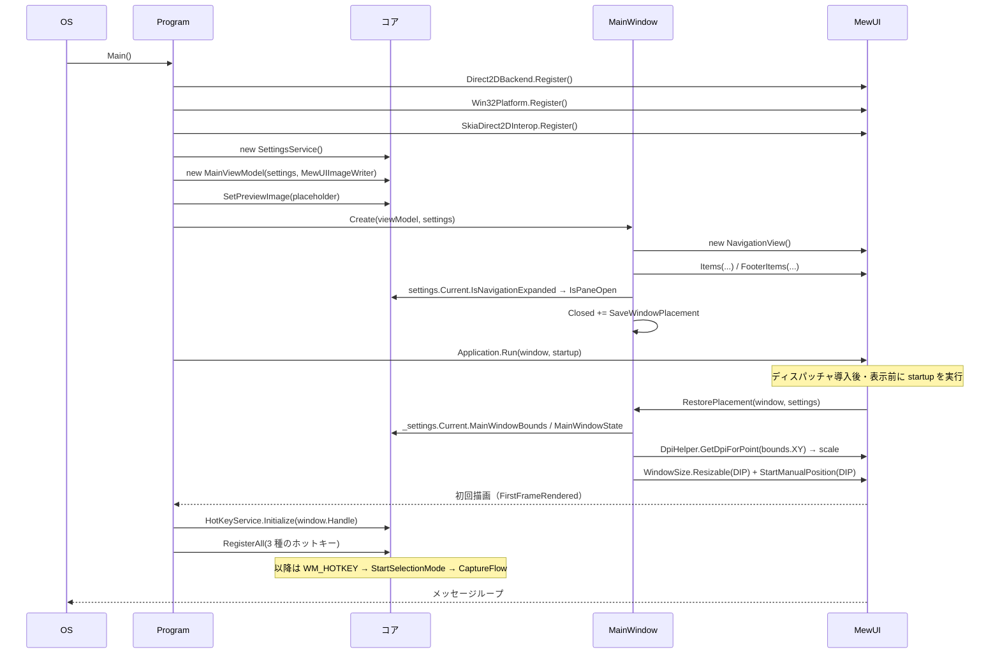

## シーケンス図（キャプチャ）

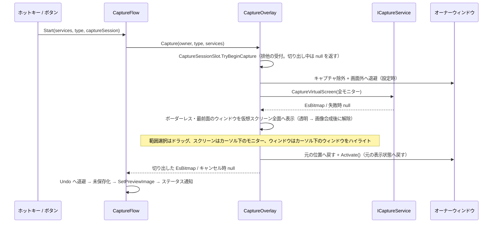

## シーケンス図（プレビューの切り出し）

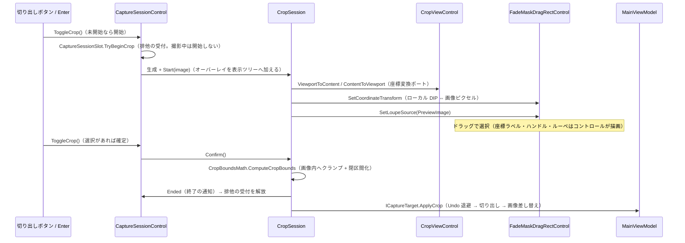

## シーケンス図（フォルダビューページ）

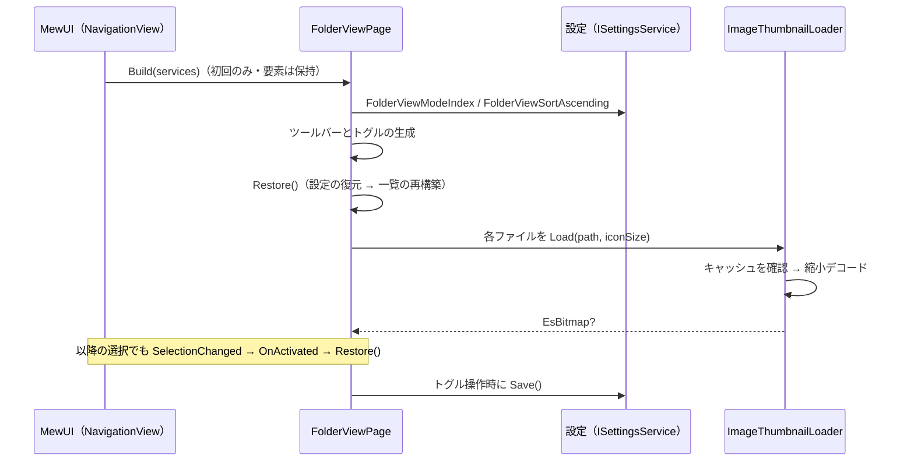

## シーケンス図（サムネイルの縮小デコード）

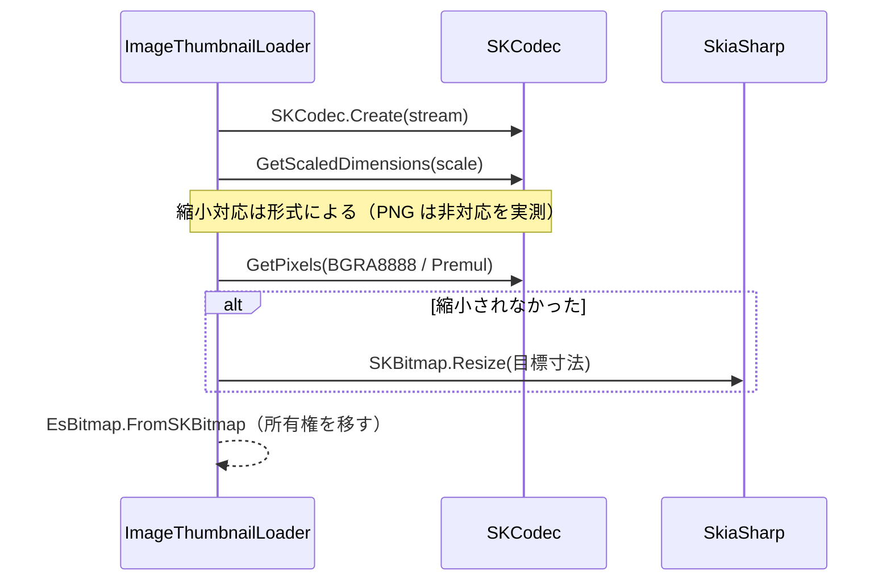

## シーケンス図（編集履歴の移動）

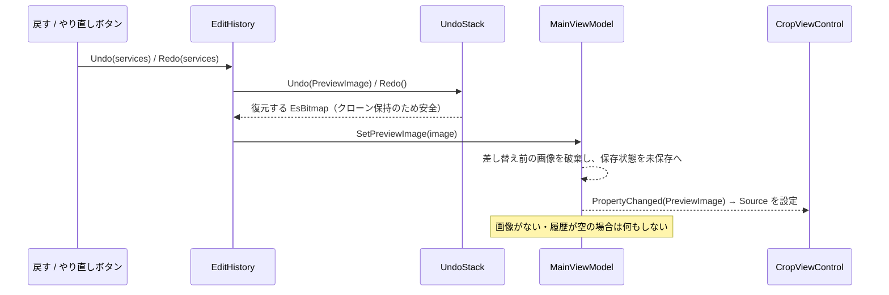

## シーケンス図（ルーペのカーソル追従）

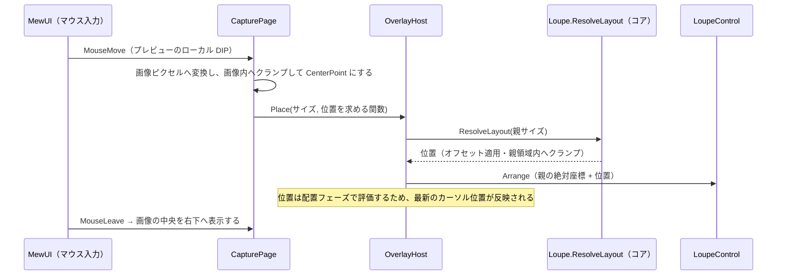

## シーケンス図（Undo 一覧ページ）

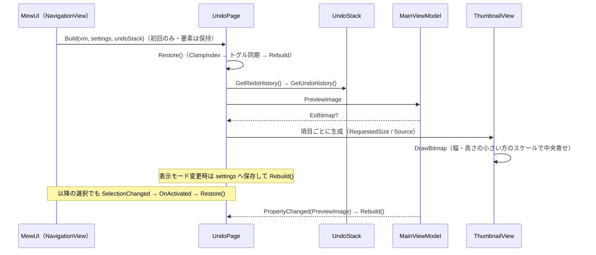

## シーケンス図（ウィンドウ配置の保存）

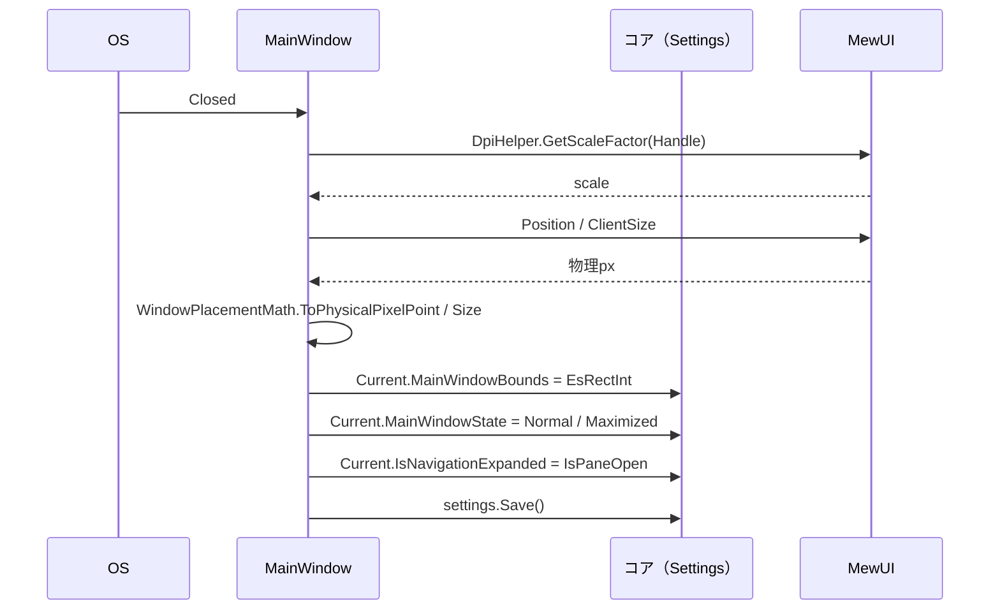

## シーケンス図（プレビュー描画）

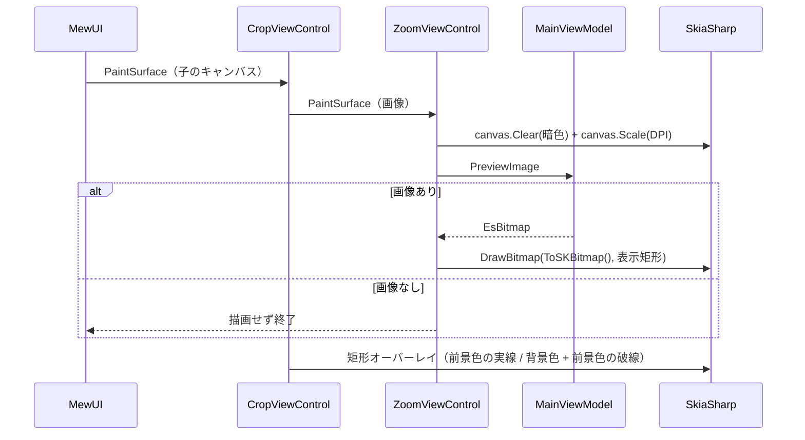

## シーケンス図（画像差し替え）

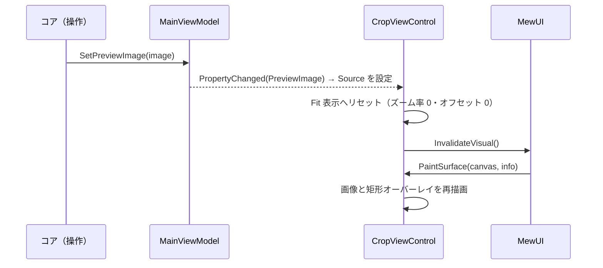

## 例外処理ポリシー

| 状況 | 方針 |
| --- | --- |
| バックエンド / プラットフォームホスト未登録 | `Program` で必ず登録し、発生させない |
| プレビュー画像が未設定 | 例外にせず何も描画しない |
| 設定ファイルの不整合 | コア（`SettingsService`）のフォールバックに委ねる |
| 保存済みのウィンドウ位置が画面外 | 復元を中止して既定位置で起動する（`WindowPlacementMath.IsUsable`） |
| モニターの DPI が取得できない | `NormalizeScale` が 1.0 へ丸める（ゼロ除算・NaN を伝播させない） |
| 保存先フォルダが存在しない | 一覧を空にし、ステータスのアイテム数を 0 にする |
| 保存先フォルダの列挙に失敗（アクセス拒否等） | 一覧を空にする（ページごと落とさない） |
| 画像のデコードに失敗（破損・非画像） | その項目のサムネイルを描画しない（項目自体は残す） |
| 破棄済みの画像を描画しようとした | `ThumbnailView` / `SkiaImageView` が描画を省略する（キャッシュの容量超過で破棄された場合） |
| 対象モニターを検出できない | キャプチャを開始しない（画像の取得に失敗した場合） |
| 画面の取得に失敗 | キャプチャを開始しない（オーナーの表示状態を戻す） |
| 選択が退化している（1px 未満） | キャンセルと同じ扱いにする（0 サイズの画像を作らない） |
| ホットキーの登録に失敗 | そのホットキーのみ無効（他のホットキーと操作は影響を受けない） |
| 保存先フォルダの参照ダイアログが使えない | 設定を変更しない（手入力での編集は可能） |
| 設定の色文字列が不正 | 既定色へフォールバックする（描画を落とさない） |
| キャプチャの多重起動 | `CaptureFlow.IsCapturing` で無視する（ホットキーの連打で重ならない）。切り出し中の撮影は Facade（`CaptureSessionControl`）がコアの `CaptureSessionSlot` で受付を拒否する |
| オーバーレイの非アクティブ化 | キャンセルとして扱う（最前面のオーバーレイが残り続けるのを防ぐ） |
| 要素を検出できない位置のクリック | 確定しない（誤クリックで撮影を取りこぼさない。キャンセルは Esc） |
| 未処理の例外（アプリ全体 / UI スレッド / 未観測タスク） | Critical で記録する。UI スレッドの例外は記録後に処理済みとし、ウィンドウの表示を維持する（`Program.RegisterExceptionLogging`） |
| アプリ終了中（オーナーがクローズ済み）にホットキーが届いた | オーナーの再表示を試みず、キャプチャを中止する（終了処理を妨げない） |

## 設計判断

1. **UI 層のみを実装する**。状態・設定・画像コンテナはコアが単一所有し、`app.MewUI` は保持しない。
2. **ViewModel をラップしない**。`app.Core` の `MainViewModel`（`INotifyPropertyChanged`）を
   `Bind` へ直接渡す。UI ごとの ViewModel を増やすと二重管理になるため。
3. **画像アダプタを作らない**。MewUI は SkiaSharp を直接扱えるため、`EsBitmap` を変換せず描画できる。
4. **パッケージバージョンを固定する**。MewUI は 0.x で API が安定化中であり、
   破壊的変更を検知できるよう `MewUIVersion` をプロパティで単一管理する。
5. **プレビューは Star 行に置く**。`SkiaCanvasView` の `MeasureContent` は `Size.Empty` を返し、
   親が割り当てた領域全体を描画に使うため、3 行の Grid（Auto / Star / Auto）で残余を占めさせる。
6. **静止画では連続再描画を無効化する**。`ContinuousAnimation` を `false` にし、
   画像の差し替え時のみ `InvalidateVisual()` を呼ぶ。
7. **ウィンドウ配置の復元は `Application.Run` の起動時コールバックで行う**。
   DIP はモニターの DPI に依存するため、DPI が確定する表示前の時点でしか正しい値を計算できない。
   加えて MewUI の `window.Position` セッターは表示前・表示後のいずれも効かないため、
   `StartManualPosition`（DIP）を使う。詳細は後述の実測知見を参照。
8. **配置の座標変換を純粋関数へ分離する**。`WindowPlacementMath` は MewUI に依存しないため、
   ヘッドレスで境界値（スケールのゼロ・NaN、画面外判定、端数の丸め）まで検証できる。
9. **ページ要素は 1 度だけ生成して保持する**。MewUI の `NavigationView` は選択のたびに内容を渡し直す想定だが、
   状態と変更購読を保つため要素を再生成しない。「表示のたびに最新化する処理」は `PageContent.OnActivated` として
   渡し、`SelectionChanged` から呼ぶ（Avalonia 版の `IsVisible` 変更に相当）。
10. **共有するコアオブジェクトを `AppServices` で束ねる**。DI コンテナを持たないため起動時に生成して渡すが、
   各ページは必要なメンバーだけを受け取る（束をそのまま引き回さない）。
11. **サムネイルの読み込みを専用クラスへ分離する**。縮小デコードと容量制限付きキャッシュは
   `ImageThumbnailLoader` が単一所有し、ページは `Load` を呼ぶだけにする（UI なしで検証できる）。
12. **キャプチャの開始経路を 1 つにする**。ツールバーのボタンとグローバルホットキーは
   `MainViewModel.StartSelectionMode` → `CaptureFlow.Start` → Facade（`CaptureSessionControl`）へ集約する（開始処理を二重所有しない）。
13. **ホットキーは初回描画後に登録する**。ウィンドウハンドルとウィンドウプロシージャは表示時に確定し、
   起動時コールバックではサブクラス化が MewUI 側の設定で上書きされて `WM_HOTKEY` を受け取れない（実測）。
14. **撮影の対象は全モニター（仮想スクリーン）**。1 モニターに限定するとカーソルのある
    モニターでしか選択できないため、仮想スクリーンを 1 枚の画像とし、オーバーレイで全面を覆う
    （フレームワークの論理座標による配置は OS に補正されるため、物理ピクセルで置き直す）。
15. **表示状態と画像の配置を別のビューへ分ける**。撮影のオーバーレイ（`CaptureSessionControl.MewUI`）と
    サムネイル（`ThumbnailView`）は大きさの要求が異なるが、描画は `Platform.MewUI` の `SkiaImageView` が、
    配置の計算は `ImageDrawMath`（`Platform.Core`）が単一所有する（サムネイルは計測と Uniform 指定だけを加える）。
16. **色の変換を専用クラスへ分離する**。設定は色を文字列で保持するため、境界の変換は
   `SettingsColorMath` が単一所有し、不正な値は既定色へフォールバックする。
17. **絶対配置が必要な子は自前の Panel で配置する**。MewUI の `Grid` は整列で位置を決め、`Margin` と
   `Canvas` の絶対配置は反映されない（実測）。また `ActualWidth` / `ActualHeight` は測定結果（残余を埋める
   要素では 0）であり実サイズは配置引数からしか得られないため、位置の決定は配置フェーズで行う（`OverlayHost`）。
18. **ルーペの外観の反映を 1 箇所に集約する**。ルーペはプレビュー・撮影・切り出しの 3 箇所に登場し、
   同じ設定を同じ対応で反映する必要がある（`LoupeMetrics`）。
19. **履歴の移動を専用クラスへ分離する**。`EditHistory` が「履歴から取り出してプレビューへ差し替える」
   操作を単一所有し、ツールバーのボタンはこれを呼ぶだけにする。
20. **設定の変更は Facade へ集約する**。設定（切り出しの外観・最小サイズ等）は `CaptureSessionControl.AppearanceSettings`
   へ渡し、部分更新・検証・同値スキップ・適用ログはコアが単一所有する。撮影と切り出しが同じ設定を使い、
   実行中の切り出しセッションへは即時反映される（ページは 1 度だけ生成されるため、購読しないと設定画面での
   変更が届かない。Avalonia 版の `MainWindow` と同じ配線）。
21. **設定の JSON はソース生成コンテキストを注入する**。Native AOT / トリミングでは反射ベースの
   シリアル化が成立せず設定が空（`{}`）になる（実測）。コンテキストは `Settings` を参照する側の
   アセンブリに置く必要がある（同一コンパイル内では MVVM のソース生成結果を JSON のソース生成が見られないため）。
   書式はソース生成の有無にかかわらず共通とし、設定ファイルの互換性を保つ（実測でバイト単位の一致を確認）。

## 未実装・今後の対応

| 項目 | 内容 |
| --- | --- |
| 全モニターの同時キャプチャ | 対象は全モニター（仮想スクリーン）。1 モニターに限定するとカーソルのあるモニターでしか選択できないため |
| 切り出し中のスクロールバー | オーバーレイがビューポートを覆うためスクロールバーは掴めない。ホイール（通常 / Shift+ホイール）でパンする |
| 最大化の復元 | `WindowState` は起動時コールバックで適用するが、最大化前の通常配置は設定へ保存しない |
| ルーペの追従の実機検証 | `verify-ui.ps1` が枠色（設定由来）の画素数で存在を判定する（カーソル追従のため位置に依存しない走査にした） |
| 設定変更のログ | 設定ページの変更はログ出力しない（Avalonia 版と同じく操作と起動・終了のみを記録する） |

## テスト方針

| 対象 | 方針 |
| --- | --- |
| `MewUIImageWriter` | 実ファイルへ書き出し、`SKCodec` で保存形式を判定して検証する（13 件） |
| `WindowPlacementMath` | 純粋関数のためヘッドレスで検証する。スケール 0・負値・NaN、画面外判定、四捨五入の境界を含む（19 件） |
| `ImageDrawMath` | 純粋関数のためヘッドレスで検証する。Uniform / Fill・余白の中央寄せ・空の入力（`Platform.Core.Tests` が担う） |
| `SettingsColorMath` | 純粋関数のためヘッドレスで検証する。6 / 8 桁・大文字小文字・不正入力・往復変換（22 件） |
| `SettingsService` | ソース生成と反射の書式の一致（既存の設定ファイルとの互換性）を `app.Core.Tests` で検証する（4 件） |
| `ImageThumbnailLoader` | 実ファイルへ書き出した画像を読み込み、寸法（長辺の上限）・アルファ・キャッシュの同一性・失敗時の null を検証する（13 件） |
| `AppLog` | LoggerMessage の生成コードを `RecordingLogger` と `NullLogger` の両方で実行し、書式と IsEnabled 分岐を検証する（3 件） |
| ビュー（`MainWindow` / `CapturePage` / `FolderViewPage` / `UndoPage` / `SettingsPage`） | MewUI はホスト初期化を要するため自動テストの対象外とし、実機検証（`verify-ui.ps1` と撮影）で確認する |
| 組み込み先のコントロール | `LoupeControl.MewUI.Tests` / `ZoomViewControl.MewUI.Tests` が描画と状態を検証する |
| コアロジック | `app.Core` / `Platform.*` / `*Control.Core` のテストで担保する（UI 層にロジックを持たない） |

### 実機検証（`verify-ui.ps1`）

起動 → `PrintWindow`（`PW_RENDERFULLCONTENT`）で撮影 → 画素実測 → リサイズ後の再撮影 → 設定の復元、を自動で行う。

判定は次の 3 点です。

1. **ステータスバーが表示されている**。下端の帯で最頻色が占める画素数で判定する
   （背景色はテーマのページ背景色に従うため、色を決め打ちするとテーマ変更で誤判定する）。
2. **ルーペが表示されていない**。カーソルをウィンドウ外へ退避した状態で、設定の枠色の画素が現れないことを確認する
   （通常画面 `CapturePage` はルーペを使わない。ルーペは切り出しと領域選択のオーバーレイが使う）。
3. **`-VerifyLoupe` 指定時**: `Ctrl+R` で切り出しを開始し、カーソルをプレビュー上へ移動してルーペを表示させ、
   枠色の画素数（存在）とルーペ上端中央帯の文字色・暗色背景の画素数（中心座標ラベル）を判定する。

### 端に接する UI の当たり判定（`WM_NCHITTEST` の実測）

MewUI のウィンドウは**端から 6 DIP をサイズ変更の判定領域**にします（`Win32WindowBackend` が `WM_NCHITTEST` へ
`HTRIGHT` / `HTBOTTOM` 等を返す）。そのため、ビューポート端へ密着するオーバーレイ（ズームビューのスクロールバー等）は
余白を与えないと掴めません（ポインタがウィンドウサイズ変更になり、クリックがコントロールへ届かない）。

当たり判定の境界は、起動中のウィンドウへ `SendMessage(hwnd, WM_NCHITTEST /* 0x0084 */, 0, MAKELPARAM(screenX, screenY))`
を送って戻り値を実測すると確定できます（125% DPI で端から 1〜7 px が `HTRIGHT` = 11、8 px 以降が `HTCLIENT` = 1）。

**計測側のプロセスを Per-Monitor V2（`SetProcessDpiAwarenessContext(-4)`）にすること**。
未対応だと座標と撮影が `96/dpi` に仮想化され、ウィンドウの下端・右端が切れた画像になり、
レイアウトの誤判定（実際に発生）を招く。

### 実測知見（MewUI 0.21.1）

ウィンドウ配置の復元を実装する過程で実測した API の挙動。同じ症状に再遭遇したときの判断材料とする。

| 実測した挙動 | 対処 |
| --- | --- |
| `Application.Run` より前は `DpiHelper.GetSystemDpi()` / `GetDpiForPoint()` が **96** を返す（`Application.IsRunning` が false） | DPI 依存の計算を起動前に確定させない |
| `window.Position` のセッターが無効（表示前・表示後とも位置が変わらない） | `StartManualPosition(xDip, yDip)` を使う |
| `window.Loaded` での `MoveTo()` は効かない（表示後に上書きされる） | 表示前の `Application.Run(window, startup)` で設定する |
| `WindowSize.Resizable(w, h)` の DIP は**そのウィンドウのモニターの DPI** を基準に解釈される | `DpiHelper.GetDpiForPoint(位置) / 96.0` でスケールを求めて DIP へ変換する |
| `GetWindowRect` は枠を含む矩形、`window.ClientSize` はクライアント領域 | 保存・復元は `ClientSize` を軸に統一する（枠の太さは DPI で変わる） |
| `DpiHelper.EnablePerMonitorDpiAwareness()` を呼ばないと `GetDpiForMonitor` が仮想化される | `Main` の先頭で必ず呼ぶ（本アプリの 125% 環境では raw DPI が 111 だった） |
| **ツールチップが表示されているボタンを押すと `Click` が発生しない**（`MouseDown` / `MouseUp` は届くが `IsPressed` / `IsMouseCaptured` が入らない）。ツールチップを閉じる際のポップアップウィンドウ破棄がスレッド全体のマウスキャプチャを解放し、押下で取得したキャプチャを奪うため（aprillz/MewUI#253） | クリックできるボタンは `ClickableToolTip.WithToolTip` で登録し、`Click` が発生しなかった押下を `MouseUp` で補完する |
| **ウィンドウの端から 6 DIP はサイズ変更の判定領域**（`Win32WindowBackend` の `WM_NCHITTEST` が `HTRIGHT` / `HTBOTTOM` 等を返す）。端へ密着して描くオーバーレイはポインタがリサイズになる | 端に接するオーバーレイ（ズームビューのスクロールバー）は余白を空けて描く（`ScrollBarMargin` の既定 8 DIP。6 DIP より外へ出す） |
| `PopupManager.PreferNativePopups` を `false` にするとポップアップを別 HWND ではなくウィンドウ内に描画できるが、`internal` のためアプリからは変更できない（Native AOT のため反射も不可） | 上記の補完で対処する（修正版のリリース後に削除する） |
| **`Window.WindowSize`（DIP）→ 物理ピクセルの換算はプライマリモニターのスケール固定**。倍率の違うモニターでは物理サイズがモニターと一致せず（100% のモニターで 1.25 倍になる）、余白が太い枠として見える。描画側はウィンドウの DPI を使うため両者は一致しない | 撮影オーバーレイは表示後に `WindowState = Maximized` を設定して **OS にモニター全面を決めさせる**。座標変換の倍率は `DpiHelper.GetDpiForWindow` から得る |
| **マウス移動はヒットテスト対象の要素にしか届かない**（親の `Grid` へ購読しても子がヒットすると届かない）。また領域全体を占める重ね要素はヒットテストを奪う | 移動の購読は最も下の要素（`ZoomViewControl` 等）へ行い、表示専用の重ね要素（`OverlayHost`）は `IsHitTestVisible = false` にする |
| **ローカル値が設定されたプロパティには `StateTrigger`（ホバー・押下）が効かない**（ローカル値が優先される） | ホバーで変わるプロパティはローカル値で設定せず、`StyleName` のスタイル（`AppStyles`）で与える |
| **テーマは `Application.Run` の後でしか変更できない**（それより前は `Application.Current` が未初期化で例外。`Application not initialized`） | 保存済みのテーマは起動時コールバックで適用する（`AppStyles.ApplyTheme`）。生成時に色を決めるコードはテーマ切替に追従しない点に注意する |
| **`Button` は内容を左上へ置く**（`Width` や `MinWidth` で広げるとアイコンが左寄りになり、文字はフォントの代替字形のメタデータで上下にも寄る） | アイコンは MewUI のベクターグリフ（`GlyphElement` の `Hamburger` / `WindowMinimize` / `WindowMaximize` / `WindowRestore` / `Cross`）へ寄せ、内容は `Center()` で中央へ置く |
| **`Button` の既定スタイルは `MinHeight` を 32 DIP にする**（ステータスバーのような小さい寸法を指定しても最小寸法に負ける） | ステータスバーのボタンのスタイルで `MinHeight` / `MinWidth` を 0 に上書きする |
| **`ShadowDecorator` は影の描画場所をレイアウトで確保する**（`ShadowPadding` は読み取り専用で、ぼかしとオフセットの分だけ子の周囲に場所を取る） | 影は一覧アイテムの見た目に必要なため残し、子とラベルの間隔から下側の確保分を差し引いて（負の `Spacing`）Avalonia 版と同じ間隔にする |
| **`ShadowDecorator` の配下では `StateTrigger`（ホバー）が効かない**（影の装飾要素が状態を子へ伝えない） | ホバーで変わる枠色と影の有無は `MouseEnter` / `MouseLeave` で直接切り替える（`ThumbnailItem`） |
| **`StateTrigger` の Hot は「その要素自身がヒットテストされたか」で決まる**（子孫がヒットしている間は祖先は Hot にならない）。一方 `MouseEnter` / `MouseLeave` は祖先にも伝わる | 配下のホバーで見た目を変える場合は `StateTrigger` ではなく `MouseEnter` / `MouseLeave` を使う |
| **`ShadowDecorator` は自身のレイアウト境界の内側にだけ影を描く**（`ShadowPadding` が描画可能域になる） | 影の余白を負のマージンで相殺すると影が切れる（枠の外へはみ出せない）。余白は残し、隣接要素との間隔だけを負の `Spacing` で詰める |
| **`Panel`（`StackPanel` / `Grid`）は `Background` を持たない** | 背景（ホバー帯等）が必要な場合は `Border` で包んで `Background` を設定する |
| **色の引数順が型で異なる**（`SKColor` は R/G/B/A・`MewUIColor` の 4 引数コンストラクタは A/R/G/B） | 取り違えると「不透明の暗色」のつもりが「半透明の赤（あずき色）」になる。`MewUIColor.FromArgb` と `new SKColor(r, g, b, a)` を明示して使う |
| **ステータスバーの行高はスライダが決める**（Avalonia 版は `Height=24` のスライダが最大要素） | スライダの高さを Avalonia 版と同じ 24 DIP にし、行の高さを固定せず内容依存にする（両 UI とも 25.6 DIP になる） |
| **`MewUIColor` の 4 引数コンストラクタは A / R / G / B 順**（`(255, 32, 32, 32)` は暗色ではなく「アルファ 32 の赤」になる）。不透明度のつもりで渡すと透ける | 色は `MewUIColor.FromArgb(a, r, g, b)` で組み立てる（`SKColor` は `r, g, b, a` 順のため混同しない） |
| **Skia キャンバスへ市松模様だけを描くと下地が透明になる**（市松色は既定 30% の半透明のため、後ろの要素が透けて見える） | 市松模様の下地へテーマの背景色を塗る（プレビューは `CheckerBackground`、ルーペは `BackgroundColor`） |
| **ステータスバーへ独自の背景色を与えると、同じホバー色でも他と違って見える**（背景との明度差でホバーのコントラストが変わる） | ステータスバーの背景はページ背景（`Theme.Palette.ControlBackground`）に統一する |
| **ウィンドウの非表示（`Hide` = `ShowWindow(SW_HIDE)`）は DWM のコンポジションへ即時反映されない**。直後に `CopyFromScreen` すると、自ウィンドウが**半透明の状態で写り込む**（実測: 写り込み率 65%・待機 50 ms でも再現） | 撮影の前にウィンドウを**画面外へ退避**（`MoveTo`）する。併せて `IWindowService.SetCaptureExclusion` も設定し、撮影後に解除する |
| **`Hide` と `Show` の往復はウィンドウを再作成させる**（復帰時に一瞬表示 → 非表示 → 再表示のちらつきが出る） | 退避は `Hide` ではなく位置の変更（画面外配置）にし、復帰は位置を戻すだけにする（Avalonia 版と同じ方式） |
| **ウィンドウは表示時に背景色で塗られる**（`EffectiveOpaqueBackground`）。そのため撮影用オーバーレイをそのまま表示すると、撮影画像を描くまでの数十 ms（実測 65 ms）が背景色の面として見える | オーバーレイを `Opacity = 0` で表示し、`FrameRendered` を数えて画像が合成されたフレームで透明を解除する。背景色は撮影画像の平均色に合わせて差を目立たなくする。（実測: 65 ms → 1 フレーム・色差 111 → 23） |
| **全モニターを跨ぐウィンドウは、論理座標（DIP）による配置が OS により補正される**（実測: 仮想スクリーン原点の `y=-1200` を指定すると `y=0` に移動される）。また **`WindowState.Maximized` は 1 モニターへ寄せる**（全モニターを覆えない） | 配置は `IWindowService.SetBounds`（`SetWindowPos`）で**物理ピクセル**指定にし、起動時の配置より後（透明な 1 フレーム目）に適用する |

**実測値**: `150, 180 / 900 × 600`（クライアント）を保存 → 復元後の `GetWindowRect` は
`X=150 Y=180 W=918 H=647`（枠 18 × 47 を加えた値）。クライアント領域は指定どおり `900 × 600` に一致する。

> **検証時の注意**: ウィンドウを動かすと終了時に `settings.json` が上書きされる。
> 実測の前後で `%LOCALAPPDATA%\SaveEvidence\settings.json` を退避・復元すること。
