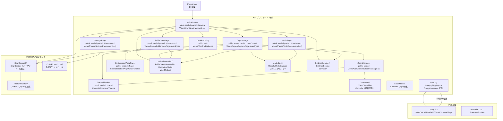
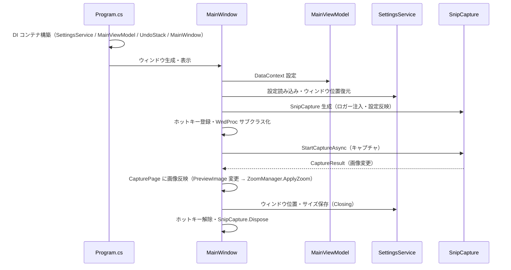

# app システム仕様書（SPEC_System）

## 目次

- [app システム仕様書（SPEC\_System）](#app-システム仕様書spec_system)
  - [目次](#目次)
  - [1. システム概要](#1-システム概要)
  - [2. 技術スタック](#2-技術スタック)
  - [3. アーキテクチャ](#3-アーキテクチャ)
    - [3.1 レイヤー構造](#31-レイヤー構造)
    - [3.2 依存の方向](#32-依存の方向)
  - [4. 例外処理ポリシー](#4-例外処理ポリシー)
    - [4.1 基本方針](#41-基本方針)
    - [4.2 本プロジェクト固有の例外処理](#42-本プロジェクト固有の例外処理)
  - [5. コンポーネント図](#5-コンポーネント図)
  - [6. コンポーネント一覧](#6-コンポーネント一覧)
    - [6.1 MainWindow](#61-mainwindow)
    - [6.2 CapturePage](#62-capturepage)
    - [6.3 FolderViewPage](#63-folderviewpage)
    - [6.4 UndoPage](#64-undopage)
    - [6.5 SettingsPage](#65-settingspage)
    - [6.6 ZoomManager / ZoomableView](#66-zoommanager--zoomableview)
    - [6.7 ViewModel 群](#67-viewmodel-群)
    - [6.8 SettingsService](#68-settingsservice)
    - [6.9 その他のコントロール](#69-その他のコントロール)
    - [6.10 App（テーマ適用）](#610-appテーマ適用)
  - [7. 依存ルール](#7-依存ルール)
  - [8. ログ](#8-ログ)
  - [9. ライフサイクル](#9-ライフサイクル)

---

## 1. システム概要

SaveEvidence は、Windows デスクトップ上の画面をキャプチャし、プレビュー・編集・保存するための Avalonia UI アプリケーションです（.NET 10.0 / C# 14 / MVVM）。

本プロジェクト（app）は、このシステムの**実行可能アプリケーション本体**です。UI（ウィンドウ・ページ・コントロール）・ViewModel・設定サービスを統括し、キャプチャ・切出し・保存・ズーム・フォルダビュー・設定画面をユーザーに提供します。キャプチャ・切出しのセッションは SnipCaptureUI、色選択は ColorPickerControl、プラットフォーム抽象は PlatformFactory を利用します。

## 2. 技術スタック

| 項目 | 内容 |
| --- | --- |
| **プロジェクト** | `app` |
| **ルート名前空間** | `app` |
| **言語** | C# 14（.NET 10.0） |
| **UI フレームワーク** | Avalonia UI 12.1（Avalonia.Desktop / Avalonia.Themes.Fluent / FluentAvaloniaUI） |
| **MVVM フレームワーク** | CommunityToolkit.Mvvm 8.x（ソースジェネレーター） |
| **ターゲットフレームワーク** | net10.0-windows10.0.17763.0 |
| **ビルドツール** | MSBuild / .NET SDK 10.0 |
| **DI** | Microsoft.Extensions.DependencyInjection |
| **ログ** | NLog 6.x（ファイル出力 `%LOCALAPPDATA%\SaveEvidence\logs\SaveEvidence.log`）+ Microsoft.Extensions.Logging（LoggerMessage ソース生成） |
| **シリアル化** | System.Text.Json（設定ファイル） |
| **テスト** | xUnit v3 / Avalonia.Headless.XUnit |
| **依存プロジェクト** | SnipCaptureUI / ColorPickerControl / PlatformFactory |

## 3. アーキテクチャ

### 3.1 レイヤー構造

```text
View Layer（MainWindow / CapturePage / FolderViewPage / UndoPage / SettingsPage）
  → ViewModel Layer（MainViewModel / FolderViewViewModel / UndoViewModel）
    → Model / Service Layer（UndoStack / SettingsService / ZoomManager 等）
      → 外部ライブラリ（SnipCaptureUI / ColorPickerControl / PlatformFactory）
```

### 3.2 依存の方向

- 依存は**一方向の階層構造**（View → ViewModel → Service / Model → 外部ライブラリ）。
- ViewModel は View の詳細（コントロール型）に依存せず、公開プロパティ・コールバックで連携する。
- サービスはインターフェース（`ISettingsService`）を介して注入される（DIP）。
- ズーム計算（`ZoomMath` / `ZoomTransition` / `ScrollMetrics`）は UI 非依存の純粋関数に分離され、単体テストで検証できる。

## 4. 例外処理ポリシー

### 4.1 基本方針

- ユーザー操作起因の例外は各イベントハンドラ内で catch し、UI の応答性を維持する。
- ファイル保存・画像処理の例外は catch し、`false` または空値を返す。
- 設定ファイル読み書きの例外は catch し、デフォルト値で続行する。
- グローバル例外は Avalonia の標準例外処理に委ねる（デバッグビルドでは Avalonia.Diagnostics が未処理例外を表示）。
- ログは LoggerMessage ソース生成（`Logging/AppLog.cs`）で出力する。操作イベントは Information、障害は Error / Warning で記録する。

### 4.2 本プロジェクト固有の例外処理

- キャプチャセッションの例外は SnipCaptureUI がオーバーレイを閉じて通常状態に復帰する（app は結果を Task で受ける）。
- クリップボードからの画像取得に失敗した場合は無視し、既存のプレビューを維持する。
- サムネイル読み込み（FolderViewPage）の失敗は null を返し、アイテム一覧に影響させない。

## 5. コンポーネント図



## 6. コンポーネント一覧

### 6.1 MainWindow

- **分類**: 公開ウィンドウ（`public sealed partial class : Window`）
- **責務**:
  - ナビゲーション（キャプチャ / フォルダビュー / Undo 一覧 / 設定）の統括
  - キャプチャ（ScreenSelect / WindowSelect / AreaSelect）の開始と結果の反映
  - グローバルホットキーの登録・WM_HOTKEY 受信（WndProc サブクラス化）
  - 設定変更の SnipCapture への即時反映（`ApplySnipCaptureSettings`）
  - ウィンドウ位置・サイズの復元 / 保存
- **公開メンバー**: `StartSelectionMode(CaptureType)` / `ApplySnipCaptureSettings()` / `NavigateToCapturePage()` 等
- **依存**: CapturePage / FolderViewPage / UndoPage / SettingsPage / MainViewModel / SettingsService / SnipCapture / IGlobalHotKeyService / INativeWindowInterceptor / ConfirmDialog

### 6.2 CapturePage

- **分類**: 公開ページ（`public sealed partial class : UserControl`）
- **責務**:
  - 画像プレビュー（ZoomableView + ZoomManager）の統括
  - 切出し（Crop）セッションの開始・確定・キャンセル
  - キャプチャメニュー（全画面 / ウィンドウ / 範囲選択）の受付
  - ステータスバーへのポインタ座標・画像サイズ表示
  - Ctrl ショートカット（保存 / コピー / 貼り付け / Undo / Redo / 切り出し / ズーム）の一括処理（`OnGlobalKeyDown`）
- **公開メンバー**: `Initialize(...)` / `ExitCropMode()` / `CleanupCaptureResources()` 等
- **依存**: MainViewModel / ZoomManager / ZoomableView / SnipCapture / UndoStack / AppLog

### 6.3 FolderViewPage

- **分類**: 公開ページ（`public sealed partial class : UserControl`）
- **責務**:
  - 保存先フォルダの画像一覧表示（サムネイル + ファイル名）
  - 表示モード（特大 / 大 / 中）・ソート（昇順 / 降順）の切替
  - 表示モード・ソート順の設定保存（`Settings.FolderViewModeIndex` / `Settings.FolderViewSortAscending`）と起動時復元
  - ダブルクリックで既定アプリによりファイルを開く
- **特徴**: 一覧の ItemsPanel は `BottomAlignWrapPanel`（行内下端揃え）。行の高さは各行の最大アイテム高さに応じ、ファイル名 1 文字目の高さ位置が行内で揃う
- **テーマ対応**: リスト背景・ファイル名ラベル・サムネイル枠線/影はテーマ（ライト/ダーク）に応じて切り替わる。背景・枠線・文字色は Fluent テーマの標準リソース（`DynamicResource`）を参照し、影のみ App リソース（`ThumbnailShadow`）で定義する
- **復元タイミング**: コンストラクタ / `Loaded` / `IsVisible` 変更時（ナビゲーション再表示）に復元し、ToggleButton の選択状態へ同期する
- **依存**: FolderViewViewModel / MainViewModel / SettingsService

### 6.4 UndoPage

- **分類**: 公開ページ（`public sealed partial class : UserControl`）
- **責務**:
  - Undo / Redo スタックと現在のプレビュー画像を時系列順（新しい → 古い）にサムネイル一覧表示
  - 現在のキャプチャページに表示中の画像を青枠（`BorderBrush #0078D4`・`BorderThickness 3`）で強調
  - 表示モード（特大 / 大 / 中）の切替と設定保存（`Settings.UndoViewModeIndex`）・起動時復元
  - サムネイルのダブルクリックで一時ファイル（PNG）に保存し、OS の既定アプリ（外部ツール）で開く
- **表示順**: Redo（新しい）→ 現在 → Undo（古い）の固定（時系列順で新しい → 古い）
- **更新タイミング**: `IsVisible` 変更時（ナビゲーション再表示）に自身で最新の履歴を読み込む（`Refresh()`・FolderViewPage と同じパターン）
- **依存**: UndoViewModel / MainViewModel（PreviewImage・DI シングルトン）/ UndoStack（DI シングルトン・CapturePage と共有）

### 6.5 SettingsPage

- **分類**: 公開ページ（`public sealed partial class : UserControl`）
- **責務**: アプリケーション設定（外観・キャプチャ・ルーペ・保存・表示・ラベル・ホットキー）の編集 UI
- **外観設定**: テーマ（`ThemeMode`: Light / Dark / System）を ComboBox で選択。System は OS の設定に追従。右下の「デフォルト値に戻す」ボタンで外観設定（選択枠・暗転・ハンドル・マーカー・ルーペ・市松模様・ラベル）を `Settings.ResetAppearanceToDefaults()` により一括復元（外観設定以外は変更されない）
- **ラベル設定**: キャプチャ選択画面の左上ラベル（1 行目 = サイズ / 2 行目 = 操作 / 3 行目 = 情報）を行ごとに設定。各行で表示・文字色・背景色・フォントサイズを個別に設定可能（背景色は不透明度を統合した `#AARRGGBB` 形式。カラーピッカーでアルファも設定できる）
- **設定項目の対応先**: 全設定項目と反映先コントロールの対応は `SPEC_SettingTargetTable.md` を参照
- **依存**: SettingsService / ColorPickerControl（色選択）

### 6.6 ZoomManager / ZoomableView

| コンポーネント | 分類 | 責務 |
| --- | --- | --- |
| `ZoomManager` | 公開クラス（`public sealed class`） | ズーム率の遷移・スライダ同期・ZoomableView への適用を統括。計算は ZoomMath / ZoomTransition に委譲 |
| `ZoomableView` | 公開コントロール（`public sealed class : Panel`） | ScrollViewer 不使用のパン・ズームビューポート。RenderTransform（ScaleTransform + TranslateTransform）で表示。マウスドラッグパンは grab 方式（掴んだ位置がポインタに追従） |

### 6.7 ViewModel 群

| コンポーネント | 分類 | 責務 |
| --- | --- | --- |
| `MainViewModel` | `ObservableObject` | メイン画面の状態（PreviewImage / ZoomPercent / ZoomDisplayText / PointerDisplayText / 保存・コピーコマンド等）。テーマ選択肢 `ThemeModes` を提供 |
| `FolderViewViewModel` | `ObservableObject` | フォルダビューの状態（ItemCount / SelectedViewModeIndex / IsSortAscending / FolderPathText） |
| `UndoViewModel` | `ObservableObject` | Undo 一覧の状態（ItemCount / SelectedViewModeIndex） |

### 6.8 SettingsService

- **分類**: 公開サービス（`public sealed class : ISettingsService`）
- **責務**: 設定（`Settings`）の JSON 永続化（`%LOCALAPPDATA%\SaveEvidence\settings.json`）。Lock によるスレッドセーフな読み書き
- **特徴**: enum（`ThemeMode` 等）は数値ではなく文字列で保存（`JsonStringEnumConverter`）。設定ファイルの可読性向上
- **依存**: System.Text.Json / Settings

### 6.9 その他のコントロール

| コンポーネント | 分類 | 責務 |
| --- | --- | --- |
| `BottomAlignWrapPanel` | 公開パネル（`public sealed class : Panel`） | 横方向折り返し + 行内下端揃え。各行の高さは最大アイテム高さで決定（FolderViewPage の一覧用） |
| `ZoomRequestedEventArgs` | 公開 record | Ctrl+ホイールのズーム要求（ZoomIn / PointerPosition） |
| `FileNameTemplate` | 公開ユーティリティ（`public sealed partial class`） | ファイル名テンプレートの解析・生成・検証。日時プレースホルダ（`{date}` / `{time}` 等）とエスケープ（`{{` / `}}`）の解決、右端数値のオートインクリメント。外部仕様は SPEC_ExtFunc.md（13. ファイル名テンプレート）を参照 |

### 6.10 App（テーマ適用）

- **分類**: アプリケーションエントリポイント（`public sealed partial class : Application`）
- **責務**: DI コンテナ初期化（Program.cs）・MainWindow 表示・テーマ（`ThemeMode`）の `RequestedThemeVariant` への反映
- **テーマ反映**: 起動時に `Settings.ThemeMode` を反映し、変更時は `PropertyChanged` 購読で即時反映する。`Light` → `ThemeVariant.Light` / `Dark` → `ThemeVariant.Dark` / `System` → `ThemeVariant.Default`（OS 追従）
- **特徴**: FluentTheme の DynamicResource により、テーマ切替で全コントロールの色が自動的に切り替わる。フォルダビュー等は標準リソース（`SystemControlBackgroundAltHighBrush` 等）を参照し、サムネイル影のみ App リソース（`ThumbnailShadow`）で定義する

## 7. 依存ルール

- 依存方向は**一方向の階層構造**（View → ViewModel → Service / Model → 外部ライブラリ）。
- View は ViewModel に依存する（DataBindings とイベントハンドラ経由）。ViewModel は View の詳細（コントロール型）に依存しない。
- サービスはインターフェース（`ISettingsService`）を介して注入される（DIP）。
- ズーム計算は純粋関数（ZoomMath / ZoomTransition / ScrollMetrics）に分離し、UI から独立してテスト可能にする。
- キャプチャ・切出しの詳細は SnipCaptureUI に委譲し、app は公開 Facade（SnipCapture）のみに依存する。

## 8. ログ

ログ定義は `Logging/AppLog.cs`（LoggerMessage ソース生成）に集約し、NLog 経由で `%LOCALAPPDATA%\SaveEvidence\logs\SaveEvidence.log`（7日で自動アーカイブ・削除）へ出力する。

| LogLevel | 対象 | 例 |
| --- | --- | --- |
| `Information` | ユーザー操作の主要イベント（低頻度） | ズーム変更 % / キャプチャメニュークリック / ホットキー発火 / キャプチャ開始・戻り値 |
| `Error` | 例外・失敗 | 設定変更の SnipCapture 反映で例外 |

詳細は `SPEC_ExtFunc.md` の「9. ログ」を参照。

## 9. ライフサイクル


